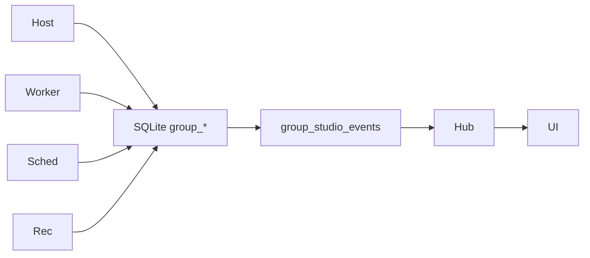
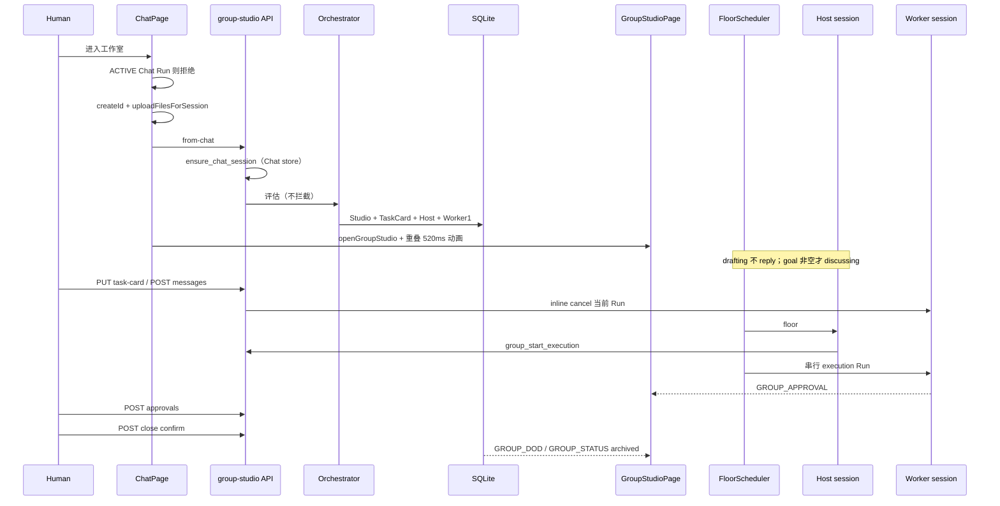

# Agent 群聊工作室（Group Chat Studio）设计实现方案

| 字段 | 值 |
| --- | --- |
| 状态 | P0 已落地。当前架构事实以 `AGENTS.md` / `docs/architecture-overview.md` 为准 |
| 作者 | 引力 YINLI |
| 日期 | 2026-08-26 |
| 修订 | R3（权限策略、restatement 守卫、热键挂 ChatPage、一轮结束协议、完整路由表、pause 收口） |
| 产品名 | 工作室 / Group Studio |
| 范围 | 全新独立功能；不替换、不增强当前 Chat Team Runtime |
| 实现前必须先冻结 | `docs/group-studio-event-contract.md`（本设计含契约草案，落地 PR 之前拆出） |

> 本文是实现方案。已拍板的隔离墙、入口、调度规则不得重新打开。P0 已上线；P1 只进 `docs/project-todo.md`。

---

## Overview

引力 YINLI 需要一间面向复杂任务的**虚拟专家工作室**：把不可控的多 Agent 自由聊天，收成围绕一张任务卡运转、可打断、可验收、有预算熔断的分布式协作。当前 Chat 的一次性 `TeamRun` 解决的是“本轮 Leader 动态拉人、Mailbox 协作、综合一个答案”，生命周期跟着一次 `POST /api/chat/send`，展示走 `RUNTIME_EVENT` + DisplaySnapshot V4 Team Blocks。工作室要解决的是跨多轮、可干预、有黑板和验收清单的项目空间，二者产品语义不同。

本方案把 Group Chat Studio 做成与 Dynamic Workflow 同级的**独立运行时容器**：共用 Workspace / Project、Agent、Skill、MCP、HTTP Tool、权限、沙箱、记忆注入、模型设置和 `src/notifications/`；不共用 `POST /api/chat/send`、Chat SSE、`TeamRun` / Mailbox / Team Block、`chat_messages`，也不把群事件写入 `run_events`。入口只从 Chat 顶栏按钮或快捷键发出，经过 520ms 三段过渡进入独立三栏界面；返回 Chat 不销毁工作室。

---

## Background & Motivation

Chat 已有两条协作路径，都不覆盖“专家工作室”：

1. **单 Agent ReAct**（`mode=agent`）：AskUser、Plan Mode middleware、`DelegateTask` Subagent。
2. **一次性 Team Runtime**（`mode=team`）：见 `docs/team-runtime-redesign.md`。不变量第 1 条：**同一 Chat session 也不得复用上轮成员或 Mailbox**。

Dynamic Workflow 证明了可复用的**隔离模式**（独立路由 + SQLite 事实源 + 独立 SSE + 独立 pane）。工作室借鉴隔离方式，不做成 Workflow 脚本编排。现网 Workflow SSE 是 `replay=true` 全量重放、**没有** `afterSeq`；工作室 replay 学 Chat stream 的 `afterSeq` + `GET` 快照，不学 Workflow。

### 必须遵守的产品约束（写入本文，外链只作背景）

- 人类最高干预；Orchestrator 是后台服务，不在群里说话。
- 群围着一张任务卡（Goal / 约束 / DoD）转；不做无目标闲聊。
- 预算与熔断；Agent 不能自主跨群串联。
- 主持人控场、显式发言权；讨论期串行。
- 黑板优先于长历史；未决问题不得被摘要抹掉。
- P0 不做人数字典式自动建群、抢单、红蓝对抗、独立 QA、协同 PR、快照回滚。

---

## Goals & Non-Goals

### Goals（P0）

- 独立工作室页面，Chat → 工作室 / 回程过渡动画。
- Chat 顶栏按钮 + 快捷键 `⌘⇧G` / `Ctrl+Shift+G`；组词期间不触发。
- 一 Chat 会话最多一间**未归档**工作室；按钮是切换不是新建。
- 任务卡：Goal / 约束 / DoD；一群一卡。
- 系统级 Orchestrator（规则 + 可选轻量模型），不进群。
- Host 控场 + 显式发言权；**P0 讨论期与执行期都串行**（同时最多 1 个发言/干活者）。
- 结构化黑板；未决问题禁止被摘要抹掉。
- 静音切断上下文；人数硬顶 6（含 Host）。
- 预算按 turn / 无进展熔断；达阈值暂停并走通知通道。
- 人类输入框发言即中止当前生成；Goal/约束变更强制 Host 复述。
- Worker 高风险工具走独立 `GROUP_APPROVAL`，禁止写入 Chat `PENDING_INTERACTIONS`。
- 结项时若已设 DoD 必须勾齐；未设验收清单视为已完成，可直接归档。规则能勾的自动勾。
- 群共享文件库（基本版本）。
- 独立 SSE；前端只依赖该契约。

### Non-Goals

- 不演进 `TeamRun` / Mailbox / Team Console / `kind=team` Block。
- 不向 `POST /api/chat/send` 加 group 字段；不改 `docs/chat-sse-event-contract.md`。
- 不把按钮放进 `ChatComposer`「单 Agent / Team」分段。
- 不把入口做成 TitleBar 第三个 `WorkspaceMode`。
- 不恢复 `teams` / `team_members`；模块名不得叫 Team。
- 不回归 `runtime.kind=plan` / 旧 `runtime.kind=subagent`；不新增 `memory` runtime.kind。
- P0 不写 `run_events`，不发明 `run_events.source`。
- P0 不做推翻重来 / 快照回滚 / 执行期并行 / USD 计价熔断 / 群列表主入口。
- P1：独立 QA、红蓝对抗、快照回滚、自动建群、抢单、协同 PR、群列表次要入口、执行并行、成本熔断。

---

## Key Decisions

1. **新功能，独立运行时容器。** 不演进 `TeamRun`，不向 Chat 请求加 group 字段，不写 Chat SSE。
2. **独立界面。** 不复用 `ChatPage` 气泡、`ChatComposer`、DisplaySnapshot V4 Team Blocks。
3. **入口只从 Chat 发出。** 顶栏按钮或快捷键；`TitleBar.MODE_OPTIONS` 保持 `workstation | workflow`。
4. **共用能力底座，不共用运行时容器。** 共用 Project binding、`get_or_create_agent()`、Skill/MCP/HTTP Tool、权限、沙箱、`build_memory_injection_text()`、模型设置、`dispatch_notification()`。不共用 chat handlers、Chat projection、TeamStore、`PENDING_INTERACTIONS`、`run_events`。
5. **SQLite 是领域事实源。** 对标 Workflow 存储方式，不对标 TeamRun file-first。产出物文件在 `{project_root}/.agent-workstation/group-studios/{group_id}/`。
6. **Orchestrator 与黑板记录员是系统服务。** P0 群内人格只有 Host + Worker。
7. **调度硬规则 + P0 全串行。** 人类插话 > Host 控场 > @。`maxParallelWorkers=1`；并行是 P1。没有 floor 的 session 不得 `reply()`。
8. **一群一卡。** 结束归档。返回 Chat 只收起 surface。P0 只允许改 Goal + restatement，不做 supersede。
9. **切换是升级，不搬气泡。** 带走 Workspace/Project、目标初稿、已上传附件、选中 Agent。不带走 DOM / TeamRun / Plan / AskUser / 图片。
10. **Chat 活动 Run 禁止升级。** 后端按 `ACTIVE_RUN_STATUSES` 返回 `409 chat_run_active`（含 waiting_*），不只看前端 `isStreaming`。
11. **通知走 `src/notifications/`。** 点击 `group_studio_*` 必须 `openGroupStudio`，禁止进 `NotificationResultModal`。
12. **Host 哨兵 `agent_id="group-studio-host"`。** 选中 Chat Agent = 第一 Worker。Host 不进 Agents 页，不参与 MemoryAdmissionGate，`require_agent` 跳过该 id 与 `"default"`。
13. **路由前缀 `/api/group-studio`。** 包名 `group_studio`。
14. **工具装配对齐 Team allowlist，并补 `include_default_tools`。** Host：`include_default_tools=False` + 控场工具 allowlist。Worker：显式 allowlist（普通工具 + 群工具），**denylist `AskUser` / `FinalAnswerStart`**。禁止 Host/Worker 默认吃到 Chat HITL 工具。
15. **群聊内工具权限全部放开，且策略由工作室自有、不抄 Chat Agent profile。** Host 固定 `PermissionMode.BYPASS`。Worker 同样固定 `human_approval=False` + `trusted_tools` → `PermissionMode.BYPASS`，Bash/Write/网络工具直接执行，不再弹出 `GROUP_APPROVAL`。Chat 里该 Agent 的审批配置保持不变。`group_approvals` 仍保留，仅当运行时仍打出 `REQUIRE_USER_CONFIRM` 时使用。不得写入 Chat `PENDING_INTERACTIONS`。
16. **P0 只熔断 turn 与无进展。** `max_cost_usd` 为 P1 字段，API 可返回但不生效。
17. **Feature flag 默认 `enabled=false`。** 开 flag 是最后一个实现 PR。关 flag 拒绝新 from-chat，已有 Run 继续到 pause/archive。
18. **三个 ID 不得互冒。** `chat_session_id` → `RuntimeContext.session_id`；`group_id` → 工作室身份与文件根；`membership_id` → Agent cache key。
19. **Host/Worker 工具上下文按群复用。** `get_or_create_agent()` 缓存命中时 extra_tools 不会换成新对象；`HostToolContext` / `WorkerToolContext` 必须按 `group_id`（工人再加 `member_id`）单例，每轮只改 `run_id` 并清空指派/正文。`group_assign_floor` 同时把 `pending_speaker_member_id` 写入 `group_studios`；Host 结束后调度读 ctx 或该列，空闲时未消费指派优先拉工人。人类新指令清空该列。
20. **进入执行必须调工具。** `group_start_execution` 可带 `memberId` 在同一轮指定谁写交付。口头宣布「进入执行」无效：Host 运行时会 nudge 一次要求调工具；若只切了阶段没指派，调度再给 Host 一轮去 `group_assign_floor`。
21. **每轮注入最近 8 条可见消息。** Host/Worker 的本轮 user 消息必须带 `lastSpokeAt` 与最近 8 条 `visibleInTimeline` 消息；可见发言回写 `lastSpokeAt`。执行/验收期工人交稿后系统把「已交稿」摘要写入黑板，并登记 `workspace/` `outputs/` 新文件。主持人不得只因黑板 artifacts 为空就判未响应。

---

## 产品对象模型

### 对象一览

| 对象 | 标识 | 职责 |
| --- | --- | --- |
| `GroupStudio` | `gstu_` | 一间工作室。身份 = 当前任务卡。绑定唯一未归档 `chat_session_id`。 |
| `TaskCard` | `gtask_` | Goal / 背景 / 约束 / **DoD 真源**。`group_studios.current_task_card_id` 指向它。 |
| `Membership` | `gmbr_` | Host 或 Worker 席位。Host 行 `agent_id` 恒为 `group-studio-host`。 |
| `Blackboard` | 1:1 `group_id` | 共识面。不含 DoD 副本，只投影 `taskCardId`。 |
| `GroupMessage` | `gmsg_` | 结构化消息。 |
| `GroupRun` | `grun_` | **一次**串行生成（讨论或执行）。P0 无 child batch。 |
| `GroupApproval` | `gapv_` | Worker 工具权限待批。独立于 Chat HITL。 |
| `GroupArtifact` | `gart_` | 共享文件库。 |
| `GroupRestoreSnapshot` | `gsnap_` | **P1 时间旅行对象**。不要和 SSE `GROUP_STUDIO_STATE` 同名。 |

### Overlay 优先级（工作室级，互斥展示）

同一时刻工作室 `status` 只能是一个值。覆盖层优先级：

```text
paused > circuit_broken > awaiting_human > (drafting|discussing|executing|reviewing|closing)
```

`GroupRun.status=waiting_permission` **不改变**工作室 status。`GroupApprovalBar` 仅在 studio 处于 `discussing|executing|reviewing` **且** 当前 Run 为 `waiting_permission` 时展示。`paused` / `circuit_broken` / `awaiting_human` 期间 **隐藏** ApprovalBar（pause 会把 pending approval 标 `cancelled`）。

`awaiting_restatement` 是 `awaiting_human` 的子原因（布尔字段），不是第三套 overlay。

### GroupStudio 合法转移表

`from × event × guard → to`。未列出的转移一律 409 `illegal_transition`。

| from | event | guard | to |
| --- | --- | --- | --- |
| — | `from-chat` 且 `goal` 空 | 无 active studio | `drafting` |
| — | `from-chat` 且 `goal` 非空 | 无 active studio | `discussing` |
| `drafting` | `PUT task-card` 且 `goal.strip()` 非空 | 无论旧 Goal 是否为空；**不走 restatement** | `discussing`（卡 `active`） |
| `discussing` | Host 工具 `group_start_execution` **或** 人类 `POST /start-execution` | 当前卡 `status=active` 且 goal 非空 | `executing` |
| `executing` | Host `group_start_review` **或** 人类 `POST /start-review` | — | `reviewing` |
| `reviewing` | `POST /close` | — | `closing` |
| `closing` | `POST /close` confirm | 当前卡全部 DoD `checked=true` | `archived` |
| `discussing`/`executing`/`reviewing` | Goal/约束变更 | **仅当** `old_goal.strip()` 或旧 `constraints` 非空 | `awaiting_human`（`awaitingRestatement=true`，`phaseBeforePause`=原阶段） |
| `awaiting_human` | `POST /confirm-restatement` | Host 已发出 `intent=restatement` | `phaseBeforePause`（不得回到非法空 Goal 的 discussing） |
| 非终态（除 `paused`） | `POST /pause` | 同时 cancel 当前 Run 与 pending approval（同 reconcile） | `paused`（写入 `phaseBeforePause`） |
| `paused` | `POST /resume` | — | **只回** `phaseBeforePause`；若空或非法则 `discussing` |
| 计费阶段 Run 结束 | 熔断条件 | 见熔断节 | `circuit_broken`（写入 `phaseBeforePause`） |
| `circuit_broken` | 人类可先调高 `maxTurns`，再 `POST /resume` | — | **只回** `phaseBeforePause`；若空或非法则 `discussing` |
| 非终态 | Project 归档 / Host 连续崩溃超限 | — | `failed` |
| 任意非终态 | 删除绑定 Chat session | cancel 当前 Run | `archived` |

不变量：

- 同一 `chat_session_id` 最多 1 条 `status NOT IN ('archived','failed')`。
- `archived` 后再按按钮是**新建**。
- `drafting` 时 FloorScheduler **禁止** Host/Worker `reply()`。人类只能改任务卡。
- **首次**从空 Goal 写成非空只走 `drafting → discussing`，不进入 restatement（没有旧 Goal 可复述）。
- 返回 Chat 只把 `studioSurface='none'`，不改 SQLite。
- `POST /pause` 与启动 reconcile 相同：cancel 当前 Run、pending approval → `cancelled`、SSE `GROUP_INTERRUPT` `source=pause`。paused 期间 `POST /messages` **只入列**（200），resume 后再按调度规则 1 给 Host。paused 不展示 ApprovalBar，不派 floor。

### TaskCard

```text
draft ──► active ──► frozen_for_close ──► archived
```

- `drafting` 工作室对应卡 `draft`；进入 `discussing` 时卡变 `active`。
- 进入 `closing` 时卡 `frozen_for_close`（DoD 可勾，Goal/约束只读）。
- **P0 没有 `superseded`。** 改 Goal 只升 `revision` 并 restatement。
- 同一群 `UNIQUE(group_id) WHERE status IN ('draft','active','frozen_for_close')`。
- `group_studios.current_task_card_id` NOT NULL。

DoD **只存在 TaskCard**。黑板不存 checklist 副本，只读 `taskCardId`。结项、自动勾、人类勾都写 TaskCard，SSE 用 `GROUP_DOD`（payload 带完整 `dodChecklist`）。

### Membership

生命周期 `status` 与活动/静音正交：

| 列 | 取值 | 含义 |
| --- | --- | --- |
| `status` | `active` / `crashed` / `removed` | 席位生死。P0 拉人直接 `active`，无 `invited`。 |
| `muted` | bool | 切断输入。Host 不可 `muted=true`（409 `host_required`）。 |
| 活动 | 不存列 | 由 `current_run_id` + `group_runs.speaker_member_id` 派生：该成员在 running/waiting_permission 的讨论 Run 上 = 发言中；执行 Run 上 = 干活中。发言/干活结束回到 `active`。 |

静音：不可 assign、不响应 @、不注入新消息。唤醒上下文 = 黑板 + 当前任务卡 + 最近 8 条 `visibleInTimeline` 消息。

### GroupRun（P0 串行）

```text
queued ──► running ──► waiting_permission ──► running
               │                │
               └──► completed / cancelled / failed
waiting_permission ──► cancelled（人类插话或 pause）
```

- `kind`: `discussion` | `execution`（P0 都是单 speaker，无 batch/child）。
- `current_run_id`：当前这一条 Run，不是批次 id。JSON 为 `string | null`。
- 执行期工具过程走 `GROUP_ACTIVITY_*`（默认折叠），完成后系统写一条 **主时间线** `GroupMessage`（`intent=report_progress`，`visibleInTimeline=true`）。不存在 `GROUP_BATCH_SUMMARY` 事件。
- `waiting_permission` 期间进程内 **必须持有** 该 Worker 的 AgentScope 实例（registry key = `group_id:membership_id:run_id`），直到 approved / denied / cancelled。丢掉实例则无法构造 `UserConfirmResultEvent`，该 Run 只能 `cancelled` 并 `GROUP_ERROR` `worker_session_lost`。
- P1 并行再加 `parent_run_id` / child rows；P0 表不预留并行语义以免误用。

---

## 与 Chat session 的绑定

```text
ChatSession (kind=chat)  1 ── 0..1  未归档 GroupStudio
```

- 不改 `chat_sessions.kind`。
- 不写 `chat_messages`。
- `POST /api/chat/send` body 不加 group 字段。
- catalog 附加可选 DTO，见 API。

### 空会话不由 group_studio SQL 建 Chat 行

现网空会话是前端 `createId()`，真正 INSERT 发生在 `POST /api/chat/send` → Chat store。from-chat **禁止** `INSERT INTO chat_sessions`。

协议：

1. 前端若无 `activeSessionId`，先 `createId()` 写入本地（与 `handleSend` 相同），再升级。
2. `routes/group_studio/handlers.py` 调用从 Chat store **抽出**的 `ensure_chat_session(...)`（send 与 from-chat 共用）。该函数住在 `backend/src/server/routes/chat/store.py`（或并列的 `chat_session_ensure.py`），**不是** `group_studio_records.py`。
3. `group_studio_records` 只写 `group_*` 表。
4. `routes/chat/handlers/sessions.py` 的 catalog 只能 `import` `group_studio_records.lookup_active_by_chat_session_ids`，禁止 import orchestrator/runtime。

无 `sessionId` 时 `GET /by-chat/{sessionId}` 不调用；按钮视为无工作室。

### 升级现场

分界只看 `message_count === 0` vs `>= 1`，没有“几乎无对话”。

| 现场 | 带走 | 不带走 | 任务卡 |
| --- | --- | --- | --- |
| `message_count=0` 且草稿空 | Workspace/Project、选中 Agent | 无 | Goal 空 → `drafting` |
| `message_count=0` 且草稿非空 | 草稿、**已上传**附件、Agent、Project | 图片、气泡 | Goal = trim 草稿 → `discussing` |
| `message_count>=1` | 最近一条用户消息、**已上传**的本轮附件、Agent、Project | 气泡 DOM、TeamRun、Plan、AskUser、图片 | Goal = 最近用户消息，`seedFromChat=true` |

**附件时序：** Chat 草稿里的 `fileAttachments` 是本地 `File`，path 在 `uploadFilesForSession`（`POST /api/projects/{projectId}/files?sessionId=`）之后才有。from-chat **之前**前端必须先上传；请求只带上传返回的 `filePaths`。未上传则不带附件，不 500。

**P0 不带走图片**（`imageAttachments` 仍是 base64，工作室不接）。UI 可提示「图片不会带入工作室」。

已有未归档工作室：200 返回已有，不新建。

Chat 存在 `ACTIVE_RUN_STATUSES`（`running` / `cancelling` / `waiting_user` / `waiting_permission` / `waiting_external` / 兼容 `waiting`）→ `409 chat_run_active`。前端 streaming **与** AskUser/Plan 等待都 disable 入口。

删除 Chat session：无论 flag，先 cancel 群 Run 再 `archived`，避免孤儿。

---

## 前端信息架构

三栏 + StudioTopbar，无第四主面板。左栏 P0 只放本群成员。预算/暂停/结束在顶栏。

### 过渡动画（520ms）与 CSS 重叠

现网 `.app-workspace-pane` 非 active 直接 `opacity:0; pointer-events:none`（260ms）。若 `data-mode` 一切到 `group-studio`，Chat DOM 立刻不可见，三段动画无法发生在 Chat 上。

**transition owner：**

- `studioTransition !== 'idle'` 时 **两个 pane 同时可见**（覆盖 260ms 规则）。
- `data-studio-transition` 驱动相位 class；**动画结束**才把 `data-mode` 写成目标值，并给非目标 pane `aria-hidden`。
- `prefers-reduced-motion: reduce`：跳过相位，直接切 mode。
- 进行中禁止二次 toggle。

去程：0–180ms Chat 私有结构收起 → 180–400ms 工作室骨架展开 → 400–520ms 控件就位。回程对称。ChatPage 保持 keep-alive，不卸载。

`appStore` **不持久化**。刷新掉回 Chat。若该 session 有未归档工作室，按钮为「回到工作室」，不要假装 `studioSurface` 能活过 reload。

### Electron 拖拽与红绿灯

`data-chat-workbench=true` 时 TitleBar `display:none`，Chat 靠 `ChatHistoryPanel` 的 `chat-workbench-electron-spacer`（约 56px）+ `-webkit-app-region: drag`。工作室左栏不是历史栏，**StudioTopbar 必须复制 spacer 与 drag region**；按钮、输入、暂停 `no-drag`。否则 macOS 窗口无法拖、红绿灯压住「返回 Chat」。

### 入口按钮与快捷键

按钮在 `ChatPage` 顶栏、`NotificationBell` 左侧。禁止进 `ChatComposer` 分段。

文案（已冻结）：无工作室「进入工作室」；已有「回到工作室」；已在工作室「返回 Chat」。tooltip 附 `⌘⇧G` / `Ctrl+Shift+G`。

热键**只挂 `ChatPage`**（`useGroupStudioHotkey`）。Chat keep-alive 下 `currentView` 仍是 `chat`，切到工作室 **不卸载** ChatPage，同一监听覆盖去程和回程，不会双触发。**不要**在 `App.tsx` 或 `GroupStudioPage` 再注册——`isComposingRef` 与 `useEventStream` 的 streaming / waiting 只活在 ChatPage。

hook 内判断（全部在 ChatPage 侧）：

- flag 关闭、`workspaceMode !== 'workstation'`、`repeat`、`isComposing` / `isComposingRef` → no-op。
- Chat 处于 `ACTIVE_RUN_STATUSES`（含 `waiting_*`，以后端 `/api/chat/runs` 或 `useEventStream` 的 run status 为准，不只 `isStreaming`）→ toast「请先停止或完成当前回复」。
- Electron 与 Vite Web 都 `preventDefault()`（浏览器 `⌘⇧G` 是 Find Previous）。

### Chat 轻量状态

顶栏圆点来自 `GET /by-chat/{sessionId}`，不订群 SSE。历史行 Tag 等 catalog 字段落地（PR 9）再加，入口 PR 不加徽章。

---

## `workspaceMode` / App 壳扩展

`WorkspaceMode` 不变。新增：

```ts
export type StudioSurface = 'none' | 'group-studio';
export type StudioTransition =
  | 'idle'
  | 'enter-collapse' | 'enter-expand' | 'enter-settle'
  | 'leave-collapse' | 'leave-expand' | 'leave-settle';
```

`openGroupStudio(groupId)` 不改 `workspaceMode`/`currentView`（保持 `chat`）。通知跳转若在 workflow：先 `setWorkspaceMode('workstation')` + `setView('chat')`。

`App.tsx` 第三 pane：`app-workspace-pane--group-studio`。`AppLayout.tsx` / `TitleBar.tsx` 不加第三 mode。`data-chat-workbench` 在 studio 打开时仍为 true。

---

## 后端模块边界

```text
backend/src/group_studio/          # 领域，禁止被 chat handlers import
backend/src/server/routes/group_studio/
backend/src/storage/group_studio_records.py
backend/src/tools/group_studio/    # Host/Worker 工具，不进 Chat 默认 toolkit
```

`main.py`：`prefix="/api/group-studio"`。路由在 flag 关闭时除 Settings 读取外对写/建返回 404 `group_studio_disabled`。

### 墙

```text
chat handlers / dispatcher / team_runtime / projection  ✗ 调用 group runtime
group_studio                                            ✗ 写 chat_messages / RUNTIME_EVENT / PENDING_INTERACTIONS / run_events
group_studio_records                                    ✗ INSERT chat_sessions
routes/chat/handlers/sessions.py                        ✓ lookup_active_by_chat_session_ids 查询
routes/group_studio/handlers.py                         ✓ ensure_chat_session（Chat store 抽出）
group_studio                                            ✓ get_or_create_agent / resolve_runtime_context(chat_session_id) / memory injection / dispatch_notification
```

### 临时 import 白名单（P0）

`create_main_agent_from_spec` / `build_main_agent_runtime_spec` 今日住在 `routes/chat/runtime_builder.py`，领域包依赖路由层，方向反了。P0：

- 给 `MainAgentRuntimeSpec` **增加** `include_default_tools: bool = True`（向后兼容 Chat）。
- `group_studio/host_runtime.py` 与 `worker_runtime.py` 允许临时 import 上述两函数。
- pytest：禁止 `routes.chat.handlers` / `team_runtime` import `group_studio`；禁止 `group_studio` import `leader_stream` / `hitl` / `PENDING_INTERACTIONS`。
- P1 把 spec/cache key 下沉到 `backend/src/agents/` 或 `runtime/`，Chat 与 group_studio 平级调用。

### 三个 ID

| ID | 用途 |
| --- | --- |
| `chat_session_id` | `resolve_runtime_context(session_id=...)`，跨 Project 拒绝 |
| `group_id` | 工作室主键、文件根、SSE 路径 |
| `membership_id` | `build_runtime_agent_cache_key` 的 `session_id` 参数用 `f"{group_id}:{membership_id}"`，`runtime_features_cache_key="group-studio"` |

禁止 `session_id=gstu_...` 传入 `resolve_runtime_context`。

---

## 工具装配合同（对齐 Team allowlist）

现网 `create_main_agent_from_spec()` **没有** `include_default_tools`；`_create_default_toolkit(include_default_tools=True)` 会注入 `AskUser`、`FinalAnswerStart`、记忆工具，非只读再加 Write/Edit。Team 用 `tool_name_allowlist` 锁死（`member_runtime._create_team_agent`）。工作室必须同样锁。

**工作室自有权限策略（不抄 Chat Agent 的 `tool_permission_profile`）**

现网默认 Agent 多为 `confirm_destructive` → `PermissionMode.ACCEPT_EDITS`；`TRUSTED_TOOLS`/`READ_ONLY` → `BYPASS`。只有 `human_approval=True` 或 `ASK_EVERY_TIME` 才映射 `PermissionMode.DEFAULT` 并稳定打出 `REQUIRE_USER_CONFIRM`（`permissions.py` `to_agentscope_permission_mode`）。若从持久 Agent 复制 guardrails，多数 Worker **永远不会出现** `GROUP_APPROVAL`，Bash/Write 会 BYPASS 直跑。

| 角色 | `human_approval` | `tool_policy` | AgentScope mode |
| --- | --- | --- | --- |
| Host | `False` | `trusted_tools` | `PermissionMode.BYPASS` |
| Worker | `False` | `trusted_tools` | `PermissionMode.BYPASS` |

Worker 仍复制该 Agent 的 filesystem_scope / docker / Skill / MCP 白名单，**覆盖审批为 BYPASS，并打开网络**。覆盖必须进 `guardrail_cache_key`，避免和 Chat 实例撞 cache。

**Host**

- `include_default_tools=False`
- `tool_name_allowlist` = Host 控场工具名集合
- `tool_name_denylist` = `{AskUser, FinalAnswerStart}`（双保险）
- `runtime_tool_scope` = 全 false（对标 `DISABLED_TOOL_SCOPE`）
- `mcp_servers=[]` `knowledge_tools=[]` `skill_paths=[]`
- `parent_agent_id="group-studio-host"`，**不得**等于第一 Worker
- `agent_id`（factory cache 外层）含 `group-studio-host` 与 `group_id`
- `max_react_iters=16`
- 无 Bash / Write / Edit

Host 工具：`group_assign_floor`、`group_invite_member`、`group_mute_member`、`group_remove_member`、`group_start_execution`、`group_start_review`、`group_propose_close`、`group_read_blackboard`、`group_read_task_card`。黑板写入工具只在黑板 PR 后注入（见 PR Plan），SSE+Host PR 不得先给 `group_patch_blackboard`。

**Worker**

- `include_default_tools=True`，但 **必须** 配 allowlist，避免未来默认工具漏进。
- allowlist：`Read, Write, Edit, Grep, Glob, Bash, HttpRequest, WebFetch, memory_node_tree, memory_node_query` + 该 Agent 白名单内 knowledge/MCP 工具名 + 群工具（`group_read_blackboard`, `group_post_message`, `group_request_help`, `group_propose_decision`）。
- denylist：`{AskUser, FinalAnswerStart}`。
- Skill/MCP/HTTP：从该 Worker `agent_id` 的持久配置复制，再经 `ProjectResourceAccess` 过滤。**不要**用 `has_team=True` 偷开工具，也不要共用 `ChatRunContext` 对象；只复用 factory 输入字段。
- cwd / `write_scope_dir` = 群 `workspace/`。
- `max_react_iters=40`（可被预算更小值截断，不得大于 40）。

**一轮如何结束（P0 冻结）**

denylist `FinalAnswerStart` 之后必须有等价结束协议，否则模型空转到 `max_react_iters` 再被算无进展。

| 结束方式 | 条件 | 运行时动作 |
| --- | --- | --- |
| 自然结束 | 模型本步 **没有** tool call（纯文本） | 文本写入 `GROUP_MESSAGE_CLOSE` `outcome=completed`，Run `completed` |
| Host 强制结束 | 本步调用了 `group_assign_floor` / `group_start_execution` / `group_start_review` / `group_propose_close` | `stop_after_tool_name` 对齐 Team Leader 的 `team_finish_coordination`：该工具成功后立刻停 `reply_stream` |
| Worker 强制结束 | 本步调用了 `group_post_message` | 同样 `stop_after_tool_name`。执行期允许先跑写/Bash 等工具，**最后**必须 `group_post_message` 才算本轮交付 |
| 触顶 | 达到 `max_react_iters` 仍未自然/强制结束 | Run `failed` 或 `cancelled`，**计一次 `no_progress`**，floor 回 Host |
| 权限暂停 | `REQUIRE_USER_CONFIRM` | 见下；**不算**一轮结束 |

Host 只读工具（`group_read_*`）不触发强制结束。Worker 若在执行期只写文件从不 `group_post_message`，触顶后按无进展处理，不把磁盘变更当成已交付。

**`REQUIRE_USER_CONFIRM` 合同**

1. 暂停该 `GroupRun` → `waiting_permission`。**不释放** Worker Agent 实例。
2. INSERT **一行** `group_approvals`：`reply_id`（AgentScope 恢复必需）+ `tool_calls_json`（完整 tool_call 块数组，不只 preview）。一次 pause 含 N 个 tool_call 也只一行；人类一次 `approve|deny` 作用于全部 call，才能 resume。禁止拆成互不相关的多行分批 resume。
3. SSE `GROUP_APPROVAL`（payload 含 `approvalId`、`replyId`、`toolCalls` 摘要列表）。
4. **禁止**写入 `PENDING_INTERACTIONS` / Chat HITL。
5. `POST /approvals`：用 `UserConfirmResultEvent(reply_id=..., confirm_results=...)` 送回 **同一** Worker session（代码在 `group_studio/approvals.py`，可抄 `hitl.build_automatic_confirm_resume` 的事件形状，不 import Chat pending 全局字典）。approve 后 Run 回到 `running` 继续；deny 后工具结果为拒绝文本，Worker 可再说话或 `group_post_message`。
6. 插话 / pause / 进程丢失：approval `cancelled`，实例丢弃，Run `cancelled`。

Host 无高风险工具，不应出现 approval。若出现，记 `GROUP_ERROR` 并 `awaiting_human`。

---

## 发言权调度器

硬规则（Python，prompt 不可覆盖）：

1. 人类消息队列非空 **且 studio 非 paused** → cancel 当前 Run（含 `waiting_permission`），Host 下一轮必须先响应。paused 时消息只入列，resume 后本条再生效。
2. Host `group_assign_floor(memberId)`。
3. 最近一条消息 `mentions[]`（仍串行）。
4. P1 抢单。
5. 否则：仅当 status ∈ `{discussing, executing, reviewing}` 且 goal 非空，Host 获得 floor。`drafting` / `paused` / `circuit_broken` / `awaiting_human` **不**自动给 Host 说话。

P0：`speakingOrWorkingCount <= 1`。静音成员跳过。

---

## API / Interface Changes

前缀 `/api/group-studio`。对外 camelCase。写操作带 `projectId`。JSON 空值一律 `null`，SQLite `''` / `0` 在 records 层转换。

### 错误码（HTTP 409/422/403/404，`detail` 为稳定 code）

| code | 何时 |
| --- | --- |
| `group_studio_disabled` | flag 关闭（404） |
| `chat_run_active` | Chat `ACTIVE_RUN_STATUSES`（409） |
| `studio_exists` | 不用于成功返回；已有 studio 走 200 |
| `member_cap` | 第 7 人（409） |
| `agent_not_bound` | Project 白名单（403） |
| `job_agent_forbidden` | `role=job`（403） |
| `host_required` | mute/remove Host（409） |
| `studio_paused` | 除 `resume` / `messages`（只入列）/ `pause` 外的推进（409）。含 `approvals`、`start-execution`、`close` |
| `studio_circuit_broken` | 未 resume 的推进（409） |
| `not_awaiting_restatement` | confirm 时标志为 false（409） |
| `restatement_missing` | Host 尚未复述（409） |
| `dod_incomplete` | close confirm 未勾齐（409） |
| `illegal_transition` | 转移表外（409） |
| `drafting_no_floor` | drafting 启动 Run（409） |
| `approval_not_pending` | 重复批/已取消（409） |
| `goal_required` | 空 Goal 进入 discussing/executing（422） |
| `cross_project_session` | session 归属冲突（422） |
| `worker_session_lost` | `waiting_permission` 但进程内 Worker 实例已丢（409，Run 只能 cancel） |
| `approval_batch_incomplete` | 同 `reply_id` 未一次决策完（409） |

### 路由表（P0）

`projectId` 一律 query（GET）或 body（POST/PUT）。`{id}` = `groupId`。

| 方法 | 路径 | Body | 成功 | 主要错误 |
| --- | --- | --- | --- | --- |
| POST | `/from-chat` | `GroupStudioFromChatRequest` | 200 `GroupStudio`（含 `messages`，新建可空） | 404 disabled；409 `chat_run_active`；422 `cross_project_session` |
| GET | `/{id}` | — | 200 `GroupStudio` **含最近 100 条 `messages`**（与 `GROUP_STUDIO_STATE` 对齐） | 404 |
| GET | `/{id}/messages?before=&limit=` | — | 200 `{ messages }` 更早页，默认 limit 100 | 404 |
| GET | `/{id}/events?afterSeq=` | — | SSE | 404 |
| GET | `/by-chat/{sessionId}` | — | 200 `GroupStudio \| null` | 404 disabled |
| POST | `/{id}/pause` | `GroupPauseRequest` | 200 studio `paused`；副作用：cancel Run + approval | 409 `illegal_transition` |
| POST | `/{id}/resume` | `GroupResumeRequest` | 200 回到 `phaseBeforePause`（非法则 `discussing`） | 409 非 paused/circuit_broken |
| POST | `/{id}/messages` | `GroupMessageCreateRequest` | 200 消息；running 则 inline interrupt；**paused 则只入列不派 floor** | 422 空 body |
| POST | `/{id}/interrupt` | `GroupInterruptRequest` | 200 只停不说话 | 409 无活动 Run（可当 no-op 200） |
| PUT | `/{id}/task-card` | `GroupTaskCardUpdateRequest` | 200 `TaskCard` | 见 restatement 守卫；422 `goal_required` |
| POST | `/{id}/members` | `GroupMemberCreateRequest` | 200 `Membership` | 403 `agent_not_bound` / `job_agent_forbidden`；409 `member_cap` |
| POST | `/{id}/members/{memberId}/mute` | `GroupMemberMuteRequest` | 200 `Membership` | 409 `host_required` |
| POST | `/{id}/members/{memberId}/remove` | `{ projectId }` | 200 `Membership.status=removed` | 409 `host_required` |
| POST | `/{id}/close` | `GroupCloseRequest` | 200；`confirm=false` → `closing`；`true` → `archived` | 409 `dod_incomplete` / `illegal_transition` |
| POST | `/{id}/confirm-restatement` | `GroupConfirmRestatementRequest` | 200 | 409 `not_awaiting_restatement` / `restatement_missing` |
| POST | `/{id}/approvals` | `GroupApprovalDecisionRequest` | 200 `GroupApproval`；Run 回 `running` 或带拒绝结果继续 | 409 `approval_not_pending` / `studio_paused` / `worker_session_lost` |
| POST | `/{id}/start-execution` | `GroupStartPhaseRequest` | 200 | 409 `illegal_transition` / `studio_paused`；422 `goal_required` |
| POST | `/{id}/start-review` | `GroupStartPhaseRequest` | 200 | 409 `illegal_transition` |
| POST | `/{id}/files` | `multipart/form-data` 字段 `file`（与 Chat `POST /api/projects/{projectId}/files` 同类，写入群 `inputs/` 或 `workspace/`） | 200 `GroupArtifact` | 422 超 50MB / 路径非法 |
| GET | `/{id}/files` | — | 200 `{ files: GroupArtifact[] }` | 404 |

`GET /{id}` 的 `GroupStudio` JSON **必须**带 `messages`（最近 100 条，按 `sortOrder` 升序），刷新不连 SSE 也能画出时间线。更早历史用 `GET /{id}/messages`。

### 请求体

```python
class GroupStudioFromChatRequest(BaseModel):
    model_config = {"populate_by_name": True}
    project_id: str = Field(alias="projectId")
    chat_session_id: str = Field(alias="chatSessionId", min_length=1)
    agent_id: str = Field(default="default", alias="agentId")
    draft_text: str = Field(default="", alias="draftText", max_length=8000)
    file_paths: list[str] = Field(default_factory=list, alias="filePaths")
    title: str | None = None

class GroupPauseRequest(BaseModel):
    project_id: str = Field(alias="projectId")

class GroupResumeRequest(BaseModel):
    project_id: str = Field(alias="projectId")
    max_turns: int | None = Field(default=None, alias="maxTurns")  # 熔断后可上调

class GroupMessageCreateRequest(BaseModel):
    """人类输入框唯一写入口。"""
    project_id: str = Field(alias="projectId")
    body: str = Field(min_length=1, max_length=20_000)
    mentions: list[str] = Field(default_factory=list)

class GroupInterruptRequest(BaseModel):
    """只停不说话（顶栏停止）。"""
    project_id: str = Field(alias="projectId")

class GroupTaskCardUpdateRequest(BaseModel):
    project_id: str = Field(alias="projectId")
    goal: str | None = None
    background: str | None = None
    constraints: list[str] | None = None
    dod_checklist: list[DodItem] | None = Field(default=None, alias="dodChecklist")

class GroupMemberCreateRequest(BaseModel):
    project_id: str = Field(alias="projectId")
    agent_id: str = Field(alias="agentId")

class GroupMemberMuteRequest(BaseModel):
    project_id: str = Field(alias="projectId")
    muted: bool

class GroupCloseRequest(BaseModel):
    project_id: str = Field(alias="projectId")
    confirm: bool = False  # false=进入 closing；true=归档

class GroupConfirmRestatementRequest(BaseModel):
    project_id: str = Field(alias="projectId")

class GroupApprovalDecisionRequest(BaseModel):
    project_id: str = Field(alias="projectId")
    approval_id: str = Field(alias="approvalId")
    decision: Literal["approve", "deny"]

class GroupStartPhaseRequest(BaseModel):
    project_id: str = Field(alias="projectId")

class GroupMemberRemoveRequest(BaseModel):
    project_id: str = Field(alias="projectId")
```

人类输入框 **只打** `POST /{groupId}/messages`。

- 当前 Run ∈ `{queued,running,waiting_permission}` **且 studio 非 paused**：inline interrupt（cancel task、approval=`cancelled`、丢弃或结束该 Worker 实例、`GROUP_INTERRUPT` `source=human_message`），再落人类消息，floor 给 Host。
- studio **已是 `paused`**：只 INSERT 人类消息（入列），**不**派 floor、不改 approval（pause 时已 cancelled）。resume 后调度规则 1 看到队列再给 Host。
- `POST /interrupt` 仅停止按钮（无正文）；paused 时视为 no-op。

`PUT /task-card`：

- studio=`drafting` 且 `goal.strip()` 变为非空 → **只**转入 `discussing`，**不** restatement。
- 其它阶段：仅当变更前 `old_goal.strip()` 或旧 `constraints` 非空，且 goal/constraints 相对当前 revision 有变 → 升 revision、黑板同步投影、`awaiting_human` + `awaitingRestatement=true`，并 interrupt 当前 Run。
- 仅改 background / DoD 勾选：不 restatement、不升「目标」语义；DoD 勾选可升 task card revision 但不进 awaiting_human。

`POST /start-execution`、`POST /start-review` 给人类按钮；Host 工具走同一转移。

### 关键类型

```python
GROUP_STUDIO_HOST_AGENT_ID = "group-studio-host"

GroupStudioStatus = Literal[
    "drafting", "discussing", "executing", "reviewing",
    "awaiting_human", "paused", "circuit_broken", "closing",
    "archived", "failed",
]
MemberStatus = Literal["active", "crashed", "removed"]
GroupRunStatus = Literal[
    "queued", "running", "waiting_permission", "completed", "cancelled", "failed",
]
MessageIntent = Literal[
    "discuss", "propose_decision", "ask_question", "report_progress",
    "request_help", "restatement", "human_directive", "system_notice",
    "host_assign",
]

class DodItem(BaseModel):
    id: str
    text: str
    checked: bool = False
    auto_checked: bool = Field(default=False, alias="autoChecked")
    evidence_artifact_id: str | None = Field(default=None, alias="evidenceArtifactId")

class TaskCard(BaseModel):
    id: str
    group_id: str = Field(alias="groupId")
    revision: int
    status: Literal["draft", "active", "frozen_for_close", "archived"]
    goal: str
    background: str = ""
    constraints: list[str] = Field(default_factory=list)
    dod_checklist: list[DodItem] = Field(alias="dodChecklist")
    seed_from_chat: bool = Field(default=False, alias="seedFromChat")
    updated_at: str = Field(alias="updatedAt")

class BlackboardDecision(BaseModel):
    id: str
    text: str
    source_message_id: str | None = Field(default=None, alias="sourceMessageId")
    source_run_id: str | None = Field(default=None, alias="sourceRunId")
    created_at: str = Field(alias="createdAt")

class OpenQuestion(BaseModel):
    id: str
    text: str
    asked_by: str = Field(alias="askedBy")
    resolved: bool = False
    resolution: str = ""

class Blackboard(BaseModel):
    group_id: str = Field(alias="groupId")
    revision: int
    task_card_id: str = Field(alias="taskCardId")
    goal: str
    constraints: list[str]
    decisions: list[BlackboardDecision]
    open_questions: list[OpenQuestion] = Field(alias="openQuestions")
    artifacts: list[str]
    updated_at: str = Field(alias="updatedAt")

class Membership(BaseModel):
    id: str
    group_id: str = Field(alias="groupId")
    role: Literal["host", "worker"]
    agent_id: str = Field(alias="agentId")  # host 行恒为 group-studio-host
    display_name: str = Field(alias="displayName")
    status: MemberStatus
    muted: bool = False
    last_spoke_at: str | None = Field(default=None, alias="lastSpokeAt")
    crash_count: int = Field(default=0, alias="crashCount")

class GroupMessage(BaseModel):
    id: str
    group_id: str = Field(alias="groupId")
    run_id: str | None = Field(default=None, alias="runId")
    speaker_id: str = Field(alias="speakerId")
    role: Literal["human", "host", "worker", "system"]
    intent: MessageIntent
    body: str
    mentions: list[str] = Field(default_factory=list)
    attachments: list[str] = Field(default_factory=list)
    visible_in_timeline: bool = Field(default=True, alias="visibleInTimeline")
    created_at: str = Field(alias="createdAt")

class GroupBudget(BaseModel):
    max_turns: int = Field(default=40, alias="maxTurns")
    max_no_progress_turns: int = Field(default=3, alias="maxNoProgressTurns")
    used_turns: int = Field(default=0, alias="usedTurns")
    no_progress_turns: int = Field(default=0, alias="noProgressTurns")
    # P1：maxCostUsd / usedCostUsd 不在 P0 熔断路径

class GroupApproval(BaseModel):
    id: str
    group_id: str = Field(alias="groupId")
    run_id: str = Field(alias="runId")
    member_id: str = Field(alias="memberId")
    reply_id: str = Field(alias="replyId")
    tool_calls: list[dict] = Field(alias="toolCalls")  # 完整块，恢复 UserConfirmResultEvent 用
    tool_names: list[str] = Field(alias="toolNames")  # 展示
    arguments_preview: str = Field(alias="argumentsPreview")
    status: Literal["pending", "approved", "denied", "cancelled"]
    created_at: str = Field(alias="createdAt")

class GroupStudio(BaseModel):
    id: str
    project_id: str = Field(alias="projectId")
    workspace_id: str = Field(alias="workspaceId")
    chat_session_id: str = Field(alias="chatSessionId")
    title: str
    status: GroupStudioStatus
    phase_before_pause: str | None = Field(default=None, alias="phaseBeforePause")
    current_task_card_id: str = Field(alias="currentTaskCardId")
    task_card: TaskCard = Field(alias="taskCard")
    blackboard: Blackboard
    members: list[Membership]
    budget: GroupBudget
    current_run_id: str | None = Field(default=None, alias="currentRunId")
    current_approval: GroupApproval | None = Field(default=None, alias="currentApproval")  # paused 时恒为 null
    messages: list[GroupMessage] = Field(default_factory=list)  # GET /{id} 最近 100 条
    awaiting_restatement: bool = Field(alias="awaitingRestatement")
    created_at: str = Field(alias="createdAt")
    updated_at: str = Field(alias="updatedAt")

class ChatSessionGroupStudioHint(BaseModel):
    """catalog 可选字段，不进 send body。"""
    id: str
    status: GroupStudioStatus
    title: str
```

`GET /api/chat/sessions/catalog` 响应在现有 `ChatSession` 上增加可选 `groupStudio: ChatSessionGroupStudioHint | null`。前端 `features/chat/types.ts` 同步。缺省 `null`。

---

## 事件流

隔离：SQLite SoT + 独立 SSE。前端只认下表。禁止 Chat `RUNTIME_EVENT`，禁止注册 Chat projector。

- Endpoint：`GET /api/group-studio/{groupId}/events?afterSeq=`
- Heartbeat：`: heartbeat`（Chat/Workflow 风格，**不是**通知的 `: ping`），不进 seq。
- 连接后若 `afterSeq` 缺省或空洞：先发一条 `GROUP_STUDIO_STATE`（payload = `GET /{id}` 的完整 `GroupStudio`，已含最近 100 条 `messages`），再从持久 seq 续推。
- **DELTA 不落 SQLite。** 持久化 OPEN/CLOSE/状态类。运行中 `group_messages.body` 每 256 字符或 200ms upsert 一次，刷新不靠 DELTA replay。
- `GROUP_RUN_ENDED`：当前 GroupRun 结束，**SSE 连接保持**。归档不靠断连。

| type | 持久? | payload 必填 |
| --- | --- | --- |
| `GROUP_STUDIO_STATE` | 否（连接首包，可按 GET 重建） | 完整 `GroupStudio`（含 `messages`） |
| `GROUP_STATUS` | 是 | `from`, `to`, `reason` |
| `GROUP_TASK_CARD` | 是 | 完整 `TaskCard` |
| `GROUP_BLACKBOARD` | 是 | 完整 `Blackboard`（必须含全部 `openQuestions`，含已 resolved） |
| `GROUP_MEMBER` | 是 | 完整 `Membership` + `change`: `joined\|muted\|unmuted\|removed\|crashed` |
| `GROUP_FLOOR` | 是 | `memberId`, `runId`, `reason`: `host_assign\|mention\|human_return\|host_default` |
| `GROUP_MESSAGE_OPEN` | 是 | `messageId`, `speakerId`, `role`, `intent`, `visibleInTimeline` |
| `GROUP_MESSAGE_DELTA` | **否** | `messageId`, `text` |
| `GROUP_MESSAGE_CLOSE` | 是 | `messageId`, `body`（全文）, `outcome`: `completed\|cancelled\|failed` |
| `GROUP_ACTIVITY_OPEN/DELTA/CLOSE` | OPEN/CLOSE 是，DELTA 否 | `runId`, `memberId`, `toolName?` |
| `GROUP_BUDGET` | 是 | 完整 `GroupBudget` |
| `GROUP_CIRCUIT` | 是 | `reason`: `max_turns\|no_progress\|deadlock`, `usedTurns`, `noProgressTurns` |
| `GROUP_INTERRUPT` | 是 | `runId`, `source`: `human_message\|stop_button\|task_card\|pause` |
| `GROUP_APPROVAL` | 是 | 完整 `GroupApproval`（含 `replyId`、`toolCalls`） |
| `GROUP_FILE` | 是 | 完整 artifact |
| `GROUP_DOD` | 是 | `taskCardId`, `dodChecklist` |
| `GROUP_ERROR` | 是 | `code`, `message`。缺 API Key 时为 `model_not_configured`，不创建 Run、不打模型 |
| `GROUP_RUN_ENDED` | 是 | `runId`, `status` |

公共信封：

```json
{
  "seq": 12,
  "groupId": "gstu_...",
  "runId": "grun_...",
  "type": "GROUP_FLOOR",
  "status": "discussing",
  "payload": { "memberId": "gmbr_...", "runId": "grun_...", "reason": "host_assign" },
  "createdAt": "2026-08-26T10:00:00+00:00"
}
```

`seq` = `group_studio_events.sort_order`。DELTA 使用 `seq=null` 或复用当前 OPEN 的 seq 不占用新持久号。



不经过 `leader_stream.py`。工作室内 Trace 抽屉读 `group_studio_events` + 该 Run 的 activity，**P0 不写 `run_events`**。P1 若要进全局 Trace：给 `run_events` `_ensure_column(source)` 默认 `chat`，且 `session_id` 必须是真实 `chat_sessions.id`。

---

## Data Model Changes

`BASE_SCHEMA_SQL` + `_ensure_column`。禁止 `CREATE TABLE teams`。

```sql
CREATE TABLE IF NOT EXISTS group_studios (
    id TEXT PRIMARY KEY,
    workspace_id TEXT NOT NULL,
    project_id TEXT NOT NULL,
    chat_session_id TEXT NOT NULL,
    title TEXT NOT NULL,
    status TEXT NOT NULL,
    phase_before_pause TEXT,
    current_task_card_id TEXT NOT NULL,
    awaiting_restatement INTEGER NOT NULL DEFAULT 0,
    orchestrator_meta TEXT NOT NULL DEFAULT '{}',
    budget_json TEXT NOT NULL,
    current_run_id TEXT NOT NULL DEFAULT '',
    created_at TEXT NOT NULL,
    updated_at TEXT NOT NULL,
    archived_at TEXT,
    FOREIGN KEY(project_id) REFERENCES projects(id)
);
CREATE UNIQUE INDEX IF NOT EXISTS idx_group_studios_active_chat
    ON group_studios(chat_session_id)
    WHERE status NOT IN ('archived', 'failed');

CREATE TABLE IF NOT EXISTS group_task_cards (
    id TEXT PRIMARY KEY,
    group_id TEXT NOT NULL,
    revision INTEGER NOT NULL,
    status TEXT NOT NULL,
    goal TEXT NOT NULL,
    background TEXT NOT NULL DEFAULT '',
    constraints_json TEXT NOT NULL DEFAULT '[]',
    dod_json TEXT NOT NULL DEFAULT '[]',
    seed_from_chat INTEGER NOT NULL DEFAULT 0,
    created_at TEXT NOT NULL,
    updated_at TEXT NOT NULL,
    FOREIGN KEY(group_id) REFERENCES group_studios(id) ON DELETE CASCADE
);
CREATE UNIQUE INDEX IF NOT EXISTS idx_group_task_cards_one_current
    ON group_task_cards(group_id)
    WHERE status IN ('draft', 'active', 'frozen_for_close');

CREATE TABLE IF NOT EXISTS group_memberships (
    id TEXT PRIMARY KEY,
    group_id TEXT NOT NULL,
    role TEXT NOT NULL,
    agent_id TEXT NOT NULL,
    display_name TEXT NOT NULL,
    status TEXT NOT NULL,
    muted INTEGER NOT NULL DEFAULT 0,
    last_spoke_at TEXT,
    crash_count INTEGER NOT NULL DEFAULT 0,
    created_at TEXT NOT NULL,
    updated_at TEXT NOT NULL,
    FOREIGN KEY(group_id) REFERENCES group_studios(id) ON DELETE CASCADE
);

CREATE TABLE IF NOT EXISTS group_blackboards (
    group_id TEXT PRIMARY KEY,
    revision INTEGER NOT NULL,
    payload_json TEXT NOT NULL,
    updated_at TEXT NOT NULL,
    FOREIGN KEY(group_id) REFERENCES group_studios(id) ON DELETE CASCADE
);

CREATE TABLE IF NOT EXISTS group_messages (
    id TEXT PRIMARY KEY,
    group_id TEXT NOT NULL,
    run_id TEXT NOT NULL DEFAULT '',
    speaker_id TEXT NOT NULL,
    role TEXT NOT NULL,
    intent TEXT NOT NULL,
    body TEXT NOT NULL,
    mentions_json TEXT NOT NULL DEFAULT '[]',
    attachments_json TEXT NOT NULL DEFAULT '[]',
    visible_in_timeline INTEGER NOT NULL DEFAULT 1,
    created_at TEXT NOT NULL,
    sort_order INTEGER NOT NULL,
    FOREIGN KEY(group_id) REFERENCES group_studios(id) ON DELETE CASCADE
);

CREATE TABLE IF NOT EXISTS group_runs (
    id TEXT PRIMARY KEY,
    group_id TEXT NOT NULL,
    kind TEXT NOT NULL,
    status TEXT NOT NULL,
    speaker_member_id TEXT NOT NULL DEFAULT '',
    error TEXT NOT NULL DEFAULT '',
    token_input INTEGER NOT NULL DEFAULT 0,
    token_output INTEGER NOT NULL DEFAULT 0,
    created_at TEXT NOT NULL,
    completed_at TEXT,
    updated_at TEXT NOT NULL,
    FOREIGN KEY(group_id) REFERENCES group_studios(id) ON DELETE CASCADE
);

CREATE TABLE IF NOT EXISTS group_approvals (
    id TEXT PRIMARY KEY,
    group_id TEXT NOT NULL,
    run_id TEXT NOT NULL,
    member_id TEXT NOT NULL,
    reply_id TEXT NOT NULL,
    tool_calls_json TEXT NOT NULL,
    arguments_preview TEXT NOT NULL DEFAULT '',
    status TEXT NOT NULL,
    created_at TEXT NOT NULL,
    resolved_at TEXT,
    FOREIGN KEY(group_id) REFERENCES group_studios(id) ON DELETE CASCADE
);
CREATE INDEX IF NOT EXISTS idx_group_approvals_run
    ON group_approvals(run_id, status);

CREATE TABLE IF NOT EXISTS group_artifacts (
    id TEXT PRIMARY KEY,
    group_id TEXT NOT NULL,
    title TEXT NOT NULL,
    path TEXT NOT NULL,
    media_type TEXT NOT NULL DEFAULT '',
    byte_size INTEGER NOT NULL DEFAULT 0,
    created_by TEXT NOT NULL DEFAULT '',
    created_at TEXT NOT NULL,
    FOREIGN KEY(group_id) REFERENCES group_studios(id) ON DELETE CASCADE
);

CREATE TABLE IF NOT EXISTS group_studio_events (
    id TEXT PRIMARY KEY,
    group_id TEXT NOT NULL,
    run_id TEXT NOT NULL DEFAULT '',
    event_type TEXT NOT NULL,
    status TEXT NOT NULL DEFAULT '',
    payload TEXT NOT NULL DEFAULT '{}',
    created_at TEXT NOT NULL,
    sort_order INTEGER NOT NULL,
    FOREIGN KEY(group_id) REFERENCES group_studios(id) ON DELETE CASCADE
);
```

records 层：`current_run_id=''` → JSON `null`；`run_id=''` → `null`；`phase_before_pause` 空 → `null`。

文件根：`{project_root}/.agent-workstation/group-studios/{group_id}/{inputs,workspace,outputs}/`。

启动 reconcile **与** `POST /pause` 相同收口：`current_run_id` 非空 → cancel asyncio task（若还在）、Run `cancelled`、pending approval `cancelled`、丢弃 Worker 实例、studio `paused`（reconcile 时若原状态不是 paused 则写入 `phaseBeforePause`）、SSE `GROUP_INTERRUPT` `source=pause`。reconcile 另发通知「工作室已暂停」。

P1 再加 `group_restore_snapshots`，不要叫 `group_snapshots` 以免和 STATE 事件口语撞车。

---

## 人类插话

`cancel` 当前 GroupRun 的 asyncio.Task（形状学 `cancel_chat_background_run`，**不调用它**），并 `cancelled` pending approval、释放 Worker 实例。非 paused 时先 cancel 再落人类消息。

`awaiting_human` 时 Host 必须发 `intent=restatement`；人类 `confirm-restatement` 后才可 `assign_floor` 给 Worker。drafting 首次填 Goal 不走本路径。

---

## 熔断、通知、后台继续

P0 每次 **计费 Run** 结束检查（`drafting` 不计数；`discussing`/`executing`/`reviewing` 的 completed 计 `used_turns`；`cancelled` 因人类插话 / pause 不计 no_progress；因超时、触顶 `max_react_iters`、失败计 no_progress）：

- `used_turns >= max_turns` → `max_turns`
- 完成且黑板 revision / artifact / DoD 勾选 / 任务卡 revision **均未变** → `no_progress_turns += 1`；达标 → `no_progress`

Host 纯控场（assign_floor 且无 blackboard patch）算无进展。这是故意的，避免空转。

`max_cost_usd` P1。P0 仍可把 token_input/output 记在 `group_runs` 供日后计价，不熔断。

### 通知点击（必须改路由器）

kind：`group_studio_circuit` / `group_studio_awaiting_human` / `group_studio_completed` / `group_studio_failed`。

`payload={"groupStudioId","chatSessionId"}`。inbox 表不改。

**点击路径：** `NotificationBell` / `NotificationToastHost` / Electron `onNotificationClicked` 若 `kind.startsWith('group_studio_')` → `openGroupStudio(payload.groupStudioId)`，**不**调用 `openNotification` / `NotificationResultModal`。

`notificationViewUtils` 补图标与中文文案。

`DesktopNotificationPayload`（`electron/preload.ts` / `main.ts`）今日只有 `jobId`/`firingId`。增加 `groupStudioId: string`（可空）。解析时缺省 `''`。实现写进 `docs/notifications.md`。

flag 关闭：入口隐藏；已有 Run 不杀，直到 pause/archive；新 from-chat 404。

---

## 权限、沙箱、记忆

Host 创建：

1. `resolve_runtime_context(project_id, session_id=chat_session_id, run_id=group_run_id, agent_id="group-studio-host")`
2. `require_agent` **跳过** `default` 与 `group-studio-host`
3. 不注入 Worker 的 agent markdown；Host **不**调用 `build_memory_injection_text` 的 agent 段（可注入 user/global 摘要）
4. 工具合同见上文
5. archived 时 AdmissionGate **只**用最终 Goal + 黑板决策 + 人类可见结论，`agent_id` 用第一 Worker 或 `default`，**禁止**用 `group-studio-host` 写 `agents/group-studio-host/agent_memory.md`

Worker 创建：持久配置复制 skills/mcp/knowledge → Project 过滤 → 记忆注入用 **该 Worker agent_id** → allowlist toolkit → 群 workspace。

人数硬顶 6（1 Host + ≤5 Worker）。

---

## 失败 / 死锁 / 成员崩溃

| 场景 | 行为 |
| --- | --- |
| Worker 一次异常 | Run `failed`，`crash_count++`，floor 回 Host |
| 连续 2 次 | `muted=true`，通知 |
| Host 崩溃 | `awaiting_human`，人类「重试主持人」 |
| 全 mute 且 Host 挂 | `circuit_broken` `deadlock` |
| 超时 | Run cancel，计 no_progress |
| 进程重启 running | `paused` + 通知 |
| 未决 approval 时插话 | approval `cancelled`，Run `cancelled` |

---

## Proposed Design（端到端）



---

## Alternatives Considered

A. Chat `mode=group` — 否决（第三 mode + SSE 污染）。  
B. TeamRun 持久化 — 否决（破坏一次性不变量）。  
C. TitleBar 第三世界 — 否决主入口。  
D. 挂进 Workflow 节点 — 未采用（脚本编排 vs 会议室）。  
E. Host = 选中 Agent — **否决**（已冻结哨兵 `group-studio-host`）。

---

## Security & Privacy

本地 `LocalAccessMiddleware`。Project 白名单。路径限制在群目录。静音切断上下文。Host 记忆隔离。interrupt 先 cancel。不因群聊放宽 Bash 黑名单。Approval 不进 Chat pending 全局表。

---

## Observability

只写 `group_studio_events`。日志 `[GroupStudio] group= run= member=`。P0 Trace 页不展示群事件；工作室内抽屉读本表。不把 usage 打进 Chat projection。

---

## Rollout Plan

```json
{ "enabled": true, "maxMembers": 6, "maxParallelWorkers": 1, "maxTurns": 40 }
```

`json_store` `system_settings/group_studio`。Settings 卡片可关。默认 true。回滚：关 flag，不删表。删除 Chat session 的归档逻辑 **无论 flag** 都要在。

---

## 测试策略

pytest：binding unique、archived 后再开、`chat_run_active`（含 waiting）、`ensure_chat_session` 不被 records 直接 SQL、未绑定 403、`host_required`、open_questions 丢弃必红、drafting 不 reply、**drafting 首次填 Goal 不进 restatement**、串行第二 Run 409、inline interrupt 取消 approval、pause 取消 Run+approval 且消息只入列、DoD 未齐不能 archived、DELTA 不出现在 `group_studio_events`、Worker 权限 mode 为 `DEFAULT`、approval 缺 `reply_id` 不能 resume、触顶计 no_progress、isolation grep、无 `teams` 表、`require_agent` 跳过 `group-studio-host`。

前端：三种升级、上传先于 from-chat、图片不带走、组词热键、重叠动画、reload 回 Chat、通知不进 ResultModal、mode 分段/TitleBar 不变、Electron spacer。

---

## 文档更新清单

| 文档 | 何时 |
| --- | --- |
| `docs/README.md` | 已加草案索引 |
| `docs/group-studio-event-contract.md` | 第一个实现 PR 之前 |
| `docs/notifications.md` | 通知点击 PR |
| `AGENTS.md` / `architecture-overview.md` | **仅开 flag 的最后 PR** |
| Chat SSE / Team 文档 | 不改 |

---

## Open Questions

已冻结并从本节移除：Host 角色、执行并行、Host 是否能 Bash、P0 群列表、快捷键、人数硬顶。审核若要改这些等于改 Key Decisions。

仅剩文案微调（不改交互）：无。产品名对外「工作室」。若审核要改按钮四字，替换字符串即可。

---

## Risks

| 风险 | 严重度 | 缓解 |
| --- | --- | --- |
| 默认 toolkit 带入 AskUser | 高 | allowlist + denylist + `include_default_tools=False`（Host）+ 测试 |
| 阶段机空转 | 高 | drafting 禁 reply；转移表 |
| HITL 卡死 | 高 | 工作室自有 `DEFAULT` 权限 + 持久化 `reply_id`/`tool_calls` + 持有实例 |
| 抄 Chat profile 导致误审批 | 中 | Worker 强制覆盖为 BYPASS，Chat 配置不变 |
| 首次填 Goal 误进 restatement | 中 | drafting 行与 restatement 行互斥，old_goal 空不触发 |
| `run_events` 孤儿行 | 高 | P0 不写 |
| Host `require_agent` 403 | 高 | 哨兵豁免 |
| 动画被 260ms pane 吃掉 | 中 | 双 pane 重叠 |
| 通知进空 ResultModal | 高 | 改 click 路由器 |
| 领域包依赖 chat runtime_builder | 中 | 白名单 + P1 下沉 |
| flag 默认开暴露空壳 | 中 | 默认 false |
| 纯讨论熔断 | 低 | 产品故意；文案提示「推进黑板或进入执行」 |

---

## References

- 产品约束已写入本文 Background；仓库外原稿仅背景，不作为事实源。
- `AGENTS.md`、`docs/development-guidelines.md`、`docs/architecture-overview.md`
- `docs/team-runtime-redesign.md`、`docs/chat-sse-event-contract.md`
- `docs/dynamic-workflows-plan.md`、`docs/workflow-event-contract.md`、`docs/notifications.md`
- 代码锚点：`App.tsx`、`appStore.ts`、`TitleBar.tsx`、`ChatPage.tsx`、`ChatComposer.tsx`、`AppLayout.css`、`useChatAttachments.ts`、`send.py`、`background_runs.py`、`lifecycle.py` `ACTIVE_RUN_STATUSES`、`member_runtime._create_team_agent`、`factory._create_default_toolkit`、`runtime_builder.create_main_agent_from_spec`、`project_resources.require_agent`、`electron/preload.ts` `DesktopNotificationPayload`

---

## PR Plan

默认 flag **false**。徽章晚于 catalog。黑板工具晚于黑板 PR。HITL 跟 Worker 同一 PR。通知依赖 pane + `openGroupStudio`。开 flag 放最后。

### PR 1 — 契约、flag（默认 false）、Settings 开关、空壳路由

- **标题：** `feat(group-studio): event contract, disabled flag, and route stubs`
- **依赖：** 无
- **影响：** `docs/group-studio-event-contract.md`、`docs/README.md` 稳定契约索引、`json_store` 设置、`features/settings` 开关卡片、`group_studio/models.py`、router 挂上但写接口 404 `group_studio_disabled`、`MainAgentRuntimeSpec.include_default_tools`
- **说明：** 不渲染 Chat 顶栏按钮。禁止改 Chat SSE 文档。

### PR 2 — SQLite 与 from-chat 绑定

- **标题：** `feat(group-studio): persist studios and bind one active studio per chat`
- **依赖：** PR 1
- **影响：** `database_schema.py`、`group_studio_records.py`、抽出 `ensure_chat_session`、from-chat / GET / by-chat、pytest
- **说明：** records 不 INSERT `chat_sessions`。`ACTIVE_RUN_STATUSES` → 409。三种升级。不启动 LLM。

### PR 3 — 第三 pane、入口、热键、重叠 520ms 动画

- **标题：** `feat(group-studio): Chat entry, keep-alive pane, and overlapping transition`
- **依赖：** PR 1（flag）+ PR 2（API）
- **影响：** `appStore.ts`、`App.tsx`（只加 pane，**不**注册热键）、`AppLayout.css`、`ChatPage.tsx`、`GroupStudioPage` 骨架、`useGroupStudioHotkey`（**只挂 ChatPage**）、StudioTopbar Electron spacer。**不改** Composer 分段 / TitleBar modes。**不加** History 徽章
- **说明：** 上传先于 from-chat；图片不带；active Chat run disable；flag 关则隐藏按钮。

### PR 4 — Orchestrator、任务卡、Host 哨兵 + 第一 Worker 席位

- **标题：** `feat(group-studio): task card, host sentinel, default membership`
- **依赖：** PR 2
- **影响：** orchestrator、task-card REST、加人（白名单、cap=6、job 过滤）、`require_agent` 豁免 `group-studio-host`
- **说明：** drafting 禁 floor。

### PR 5 — 独立 SSE + Host 串行讨论（无黑板写工具）

- **标题：** `feat(group-studio): SSE and host floor control`
- **依赖：** PR 1、PR 4
- **影响：** scheduler、host_runtime（allowlist / `include_default_tools=False`）、stream、时间线、Host 工具不含 `group_patch_blackboard`
- **说明：** `GROUP_STUDIO_STATE` / MESSAGE / FLOOR / RUN_ENDED。Host `max_react_iters=16`，控场工具 `stop_after_tool_name`。不经 `leader_stream`。

### PR 6 — 黑板、静音、文件库

- **标题：** `feat(group-studio): blackboard, mute, shared files`
- **依赖：** PR 5
- **影响：** blackboard、`POST/GET /files`、mute、`POST /members/{id}/remove`、`group_patch_blackboard` 此时才注入 Host
- **说明：** open_questions 丢弃测试必红。`host_required`。

### PR 7 — Worker 串行执行 + `GROUP_APPROVAL`

- **标题：** `feat(group-studio): serial worker runs and independent approvals`
- **依赖：** PR 5、PR 6
- **影响：** worker_runtime、`group_approvals`、`POST /approvals`、`GroupApprovalBar`、activity 流、Skill/MCP 从 Agent 配置复制
- **说明：** Worker 强制 `human_approval=False` + `trusted_tools` → `PermissionMode.BYPASS`；`group_approvals` 仍保留兜底；`group_post_message` 后 `stop_after_tool_name`；`max_react_iters=40`；禁止 `PENDING_INTERACTIONS`；`maxParallelWorkers=1`。

### PR 8 — 人类消息 inline interrupt、复述、turn 熔断、通知点击

- **标题：** `feat(group-studio): messages interrupt, restatement, circuit, notification routing`
- **依赖：** PR 3（`openGroupStudio`）、PR 4、PR 5、PR 7
- **影响：** messages/interrupt、circuit_breaker、`docs/notifications.md`、Bell/Toast/Electron payload `groupStudioId`、顶栏预算（turns）
- **说明：** 不写 Chat SSE；不进 ResultModal。

### PR 9 — DoD 结项、归档、catalog 徽章、startup reconcile

- **标题：** `feat(group-studio): DoD close, catalog hint, reconcile`
- **依赖：** PR 6、PR 8
- **影响：** dod、close、`ChatSession.groupStudio?`、`ChatHistoryPanel` 徽章、lifespan reconcile、删除 session 归档（无论 flag）
- **说明：** `dod_incomplete`。

### PR 10 — 开 flag、isolation 回归、事实源文档

- **标题：** `feat(group-studio): enable flag and record architecture facts`
- **依赖：** PR 9
- **影响：** 默认 `enabled=true`（或发布说明里打开）、isolation pytest、`architecture-overview.md` / `AGENTS.md` **此时才**写在线事实
- **说明：** Chat Team 测试全绿。P1 只进 `project-todo.md`。
