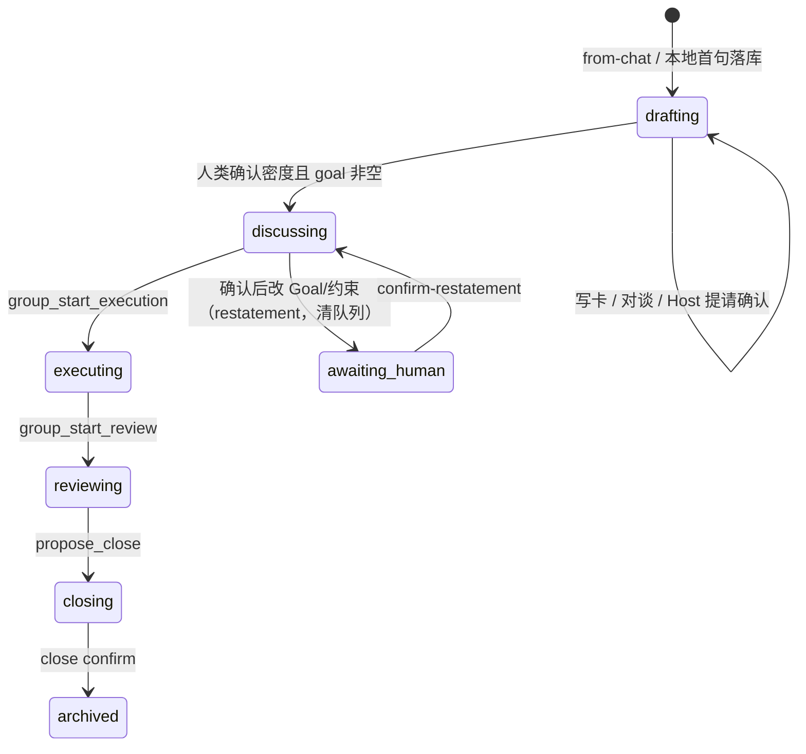
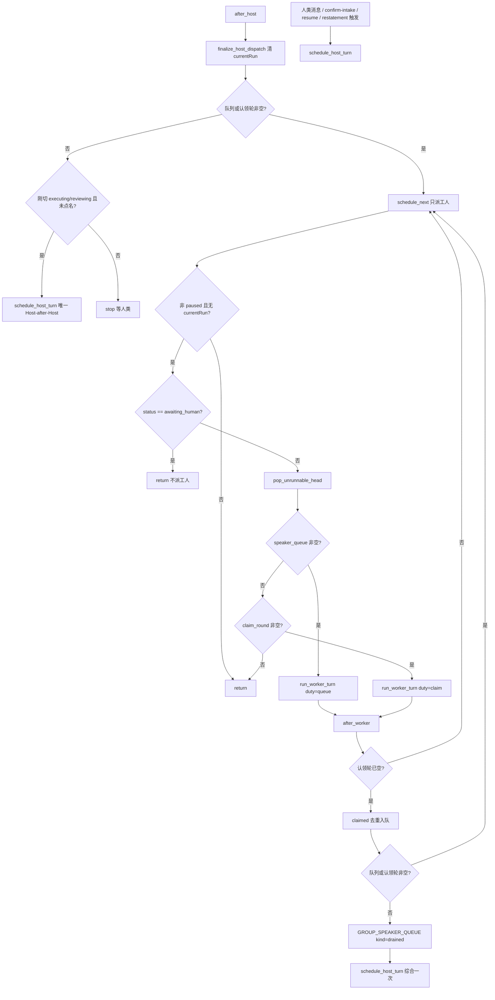

# 群聊工作室 Intake 对谈与任务台（增量设计）

| 字段 | 值 |
| --- | --- |
| 状态 | 评审通过，待实现 |
| 作者 | 引力 YINLI |
| 日期 | 2026-08-28 |
| 修订 | R3（评审修复：Host 结束后不把自己再拉起；claim duty 熔断规则；`drained` 发射点） |
| 产品名 | 工作室 / Group Studio |
| 范围 | 现网 P0 的增量；不推翻独立产品隔离墙，不替换 Chat Team Runtime |
| 前置文档 | `docs/group-chat-studio-design.md`（P0 已落地）、`docs/group-studio-event-contract.md` |
| 实现前必须先改 | `docs/group-studio-event-contract.md`（本设计含事件字段草案） |

> 本文是 **P0 落地之后** 的可实施增量方案。已拍板的隔离墙、Host 哨兵、一 session 一间未归档工作室、P0 全串行、`maxParallelWorkers=1`、不恢复持久 `teams` 表，一律不得重新打开。真并行（parent/child GroupRun、`maxParallelWorkers>1`）仍是 P1，本方案不做。

---

## Overview

现网群聊工作室把 `drafting` 做成「右侧填任务卡、Goal 非空就开会」：`from-chat` 把 Chat 上一句写成 `TaskCard.goal` 并直接 `discussing`，`PUT /task-card` 在 drafting 下 goal 非空就切阶段并 `schedule_host_turn`，人类在 drafting 发消息不派 Host，`assert_floor_allowed` 对 drafting 抛 `drafting_no_floor`。开会之后又是主持人面试：`group_assign_floor` 只能点一人，工人说完立刻回 Host，`pendingSpeakerMemberId` 单列。

产品要改的是两件事，且必须按这个顺序落地：

1. **Intake 对谈。** `drafting` 只允许用户和主持人说话。主持人用工具写任务卡，写卡不等于开会。离开 drafting 的唯一开关是**人类确认密度**（对话确认 ≡ 右侧「确认并开始」）。Chat 带过来的上一句是工作室第一条人类消息，不是 Goal。
2. **任务台 + 点名队列 + 认领。** 接手之后主持人可以一次点 1～N 人（FIFO 队列，中间不回 Host），也可以只发工作项让工人认领。真并行仍留 P1。群内认领不是人数字典式自动建群抢单，也不是抄 Chat Team Mailbox。

隔离边界不变：`backend/src/group_studio/`、`/api/group-studio`、独立 SSE、Host 哨兵 `group-studio-host`、`include_default_tools=False`、`PermissionMode.BYPASS`。Chat handlers / Team Runtime 禁止 import `group_studio`。不写 Chat `PENDING_INTERACTIONS`，不 import `leader_stream` / `chat.hitl`。

---

## Background & Motivation

### 现网事实（必须改的锚点）

| 现网行为 | 代码锚点 | 产品问题 |
| --- | --- | --- |
| `from-chat` 用 `last_user` / `draft_text` 当 `TaskCard.goal`，非空则 `discussing` | `service.from_chat()` 约 L258–267、L344–345 | 用户还没和主持人说话，工人已经进入讨论场 |
| drafting 下 `PUT /task-card` goal 非空 → `discussing` + `schedule_host_turn` | `service.update_task_card()` L394–399、L473–474 | 写卡 = 开会 |
| drafting 人类消息只入列，不派 Host | `service.post_human_message()` L698–699 只调度 `discussing\|executing\|reviewing\|awaiting_human` | 对谈期主持人哑火 |
| drafting 禁止任何 floor | `orchestrator.assert_floor_allowed()` L41–42 抛 `DRAFTING_NO_FLOOR`；`FLOOR_ALLOWED_STATUSES = {discussing, executing, reviewing}` | 主持人无法在对谈期 `reply()` |
| `schedule_host_turn` 要求 status ∈ 计费阶段且 goal 非空 | `scheduler.schedule_host_turn()` L32–33 | 空 Goal 的 intake 无法点火 |
| 工人结束立刻 `schedule_host_turn` | `scheduler._run_worker_guarded()` L90–93 | 一问一答面试 |
| 点名只能 1 人 | `tools_host.GroupAssignFloor` 只收 `memberId`；`HostToolContext.assigned_member_id: str` | 无法一轮点多人 |
| pending 单列 | `group_studios.pending_speaker_member_id`；`models.GroupStudio.pending_speaker_member_id` | 没有队列 |
| Host 无写卡工具；`GroupPatchBlackboard.goal` 写的是黑板投影 | `tools_host.host_tools()` / `GroupPatchBlackboard` | 主持人不能写 `group_task_cards` 真源 |
| 右侧是主输入表单 | `StudioGoalModal` + `GroupStudioPage.handleSaveGoal`；空状态文案「先在右侧填写目标。没有目标时主持人不发言。」 | 用户被引导去填表，而不是找主持人说话 |
| 本地草稿 `persistStudio` 把 goal 当 `draftText` 传给 from-chat | `GroupStudioPage.persistStudio` L216–222 | 本地一保存就踩上「goal 非空 → discussing」 |

P0 设计明确写过：`drafting` 时 FloorScheduler **禁止** Host/Worker `reply()`；人类只能改任务卡；`from-chat` 且 goal 非空 → `discussing`。这些转移是本增量要**作废**的旧合同，不是要继续补丁的不变量。

P0 Key Decision 7（全串行、`maxParallelWorkers=1`）和 Non-Goal「P0 不做人数字典式自动建群、抢单」仍然有效。本方案的认领是**群内工作项认领**，不是自动建群抢单。

### 痛点

用户拉起群聊是为了「找主持人把目标说清楚」，不是先填一张验收表。现网把 Goal 当成开会开关，导致：（1）Chat 上一句被当成已经冻结的任务卡；（2）对谈期没人回话；（3）开会后主持人必须轮流点名，工人说完就停下来等下一问。复杂任务需要的是「先把卡片写满、人类点头、再把工作项摊到台上、点名或认领一轮、主持人才综合」。

---

## Goals & Non-Goals

### Goals

- 把 `drafting` 改成 **intake 对谈**：只允许人类 ↔ Host；Host 可 `reply()`，Worker 不可。
- Host 用工具写 `group_task_cards` 真源（Goal / 背景 / 约束 / DoD），发已有 `GROUP_TASK_CARD` / `GROUP_DOD`。**写卡不切 `studio.status`，卡仍是 `draft`。**
- 离开 drafting 只有人类确认密度。对话确认与右侧「确认并开始」等价。Goal 仍空则拒绝。Host 可提请确认，不可自己把群带进 `discussing`。
- 用户说得太早：Host 必须挡并说出缺口，不得切阶段。
- 从 Chat 带来的上一句 / 草稿成为工作室第一条人类消息，**不**自动写成 `TaskCard.goal`，**不**直接 `discussing`。
- 本地草稿仍可：新建不落库；用户一说话是持久化动作，然后派主持人。
- 空 DoD 仍可结项；Host 应默认给出清单，用户可以砍空。
- 对谈期 Host 可以**建议**拉谁；真正 `group_invite_member` 放在确认接手之后。
- 接手后 Host 可一次点名 1～N 人（FIFO 队列，中间不回 Host）。
- Host 可只发工作项、不点名；工人认领必须写领域事实。同一工作项不能两人同时领成。静音者不能领、不能被点名。
- 没有工作项、也没有被点名，工人不能自己 `reply()`。
- 人类插话仍最高：取消当前生成，清空队列 / pending / 认领轮，下一轮给 Host。
- 契约变更先改 `docs/group-studio-event-contract.md`。

### Non-Goals

- 不演进 `TeamRun` / Mailbox / Team Console，不向 `POST /api/chat/send` 加字段。
- 不走 Chat `AskUser`，不引入第二个 ReadinessAgent，不把密度做成系统打分门槛。
- 不做真并行：`maxParallelWorkers` 仍强制 1，不引入 parent/child GroupRun。
- 不做人数字典式自动建群、跨群抢单、红蓝对抗、独立 QA。
- 不改 Worker skills / MCP / HTTP 装配与权限模型（仍 BYPASS + 现网 allowlist）。
- 不恢复持久 `teams` 表，不把工作室事件写入 `run_events` / Chat SSE。
- 不把工作项塞进 `openQuestions` 冒充任务。
- 本方案不改结项 / 熔断 / 审批主路径；drafting Host 轮次继续**不计** `used_turns`（沿用 `circuit.BILLABLE_STATUSES`）。

---

## Proposed Design

### 1. 隔离墙（不得破坏）

```text
backend/src/group_studio/          # 领域，禁止被 chat handlers / team_runtime import
backend/src/server/routes/group_studio.py
backend/src/storage/group_studio_records.py
```

- 路由前缀 `/api/group-studio`，独立 SSE `GET /{id}/events?afterSeq=`。
- Host 哨兵 `agent_id="group-studio-host"`，`include_default_tools=False`，`PermissionMode.BYPASS`。
- 不写 Chat `PENDING_INTERACTIONS`，禁止 import `leader_stream` / `chat.hitl`。
- 一 Chat session 一间未归档工作室。
- Host/Worker 工具上下文仍按 `group_id`（工人再加 `member_id`）单例，见 P0 Key Decision 19。**不要**按阶段换一套 extra_tools 对象（会与 Agent 缓存打架）；阶段守卫写在工具内部。

### 2. 阶段机

工作室 `status` 取值不变。变的是 **谁能进 `discussing`，以及 drafting 是否允许 Host floor**。

#### 2.1 作废的旧转移

| 旧 from | 旧 event | 旧 to | 处理 |
| --- | --- | --- | --- |
| — | `from-chat` 且 `goal` 非空 | `discussing` | **作废**。from-chat 一律 `drafting` + 卡 `draft`；种子文本变成第一条人类消息 |
| `drafting` | `PUT task-card` 且 `goal.strip()` 非空 | `discussing`（卡 `active`） | **作废**。写卡保持 `drafting` / `draft` |
| `drafting` | 任意 Run 启动 | 409 `drafting_no_floor` | **作废（对 Host）**。Host 允许；Worker 仍拒绝 |

`test_group_studio_pr2.py::test_draft_text_enters_discussing`、`test_existing_messages_seed_from_last_user`、`test_group_studio_pr4.py::test_drafting_put_goal_enters_discussing_without_restatement` 必须改预期，不能再当回归绿。

#### 2.2 新转移表（仅列出相对 P0 的增量 / 替换行）

未列出的 P0 行（`discussing → executing`、restatement、pause/resume、close、熔断）保持原样。

| from | event | guard | to |
| --- | --- | --- | --- |
| — | `from-chat`（无论 Chat 是否有上一句 / 草稿） | 无 active studio | **`drafting`**，卡 **`draft`**，goal **空** |
| `drafting` | Host `group_update_task_card` 或人类 `PUT /task-card` | `assert_can_mutate` | **仍 `drafting`**，卡仍 **`draft`**；goal 可反复写 |
| `drafting` | Host `group_request_intake_confirm` | `goal.strip()` 非空 | **仍 `drafting`**，`awaitingIntakeConfirm=true` |
| `drafting` | 人类 `POST /confirm-intake` 或确认短语 **且** `awaitingIntakeConfirm=true` | `goal.strip()` 非空 | **`discussing`**，卡 **`active`**，`awaitingIntakeConfirm=false` |
| `drafting` | 人类确认短语 / 按钮 **且** `awaitingIntakeConfirm=false` | — | **不切阶段**；当普通人类消息派 Host，Host 必须列出缺口 |
| `drafting` | 人类确认 **且** goal 空 | — | 422 `goal_required`，不切阶段 |
| `drafting` | Host `group_assign_floor` / `group_invite_member` / `group_publish_work_items` / `group_cancel_work_item` | — | 409 `intake_not_confirmed` |
| `drafting` | Host `group_start_execution` / `group_start_review` / `group_propose_close` | — | 409 `illegal_transition`（阶段工具，沿用现网码） |
| `discussing`/`executing`/`reviewing` | Goal/约束变更 | 现网 `group_studio_has_runs`（confirm-intake 之后恒为 true，见下） | restatement → `awaiting_human`；**同时** `clear_speaker_queue` + `clear_claim_round`，发 `GROUP_SPEAKER_QUEUE` `kind=restatement` |

不变量：

- `drafting`：**只允许 Host `reply()`**，Worker `assert_floor_allowed(..., role="worker")` 失败，code `intake_worker_forbidden`（不要用 `intake_not_confirmed`）。
- `card.status=draft` 当且仅当 `studio.status=drafting`（进入 discussing 时卡变 `active`，与 P0 一致，只是触发源换成 confirm-intake）。
- Host **没有** `group_confirm_intake` 工具。确认是人类 API / 人类短语。
- **drafting 改卡不看 `has_runs`、不 restatement。** 这是 restatement 的唯一例外。
- **confirm-intake 之后 `group_studio_has_runs` 恒为 true**：`group_request_intake_confirm` 本身就是一次 Host Run，会插入 `group_runs`。因此不存在「刚确认、尚无 Run」行；确认后改 Goal/约束一律走现网 `discussing|executing|reviewing` restatement 路径。作废任何「尚无 Run 则直接改卡」的增量行。
- `awaitingIntakeConfirm` 不是新的 studio status，也不是 overlay。它是 drafting 上的布尔字段，类似 `awaitingRestatement` 之于 `awaiting_human`。禁止复用 `awaiting_restatement`。
- `awaiting_human` **禁止** `run_worker_turn`（现网 `schedule_host_turn` L40–44 已跳过 pending 工人）。`schedule_next` 必须保留这条例外，不能因为队列非空就派工人。Host 复述结束走 `after_host` → stop，禁止再派一轮 Host。



#### 2.3 Floor 允许表

替换 `orchestrator.FLOOR_ALLOWED_STATUSES` 与 `assert_floor_allowed`：

```python
HOST_FLOOR_STATUSES = frozenset({
    "drafting", "discussing", "executing", "reviewing", "awaiting_human",
})
WORKER_FLOOR_STATUSES = frozenset({"discussing", "executing", "reviewing"})


def assert_floor_allowed(status: str, *, role: str = "host") -> None:
    if status == "paused":
        raise GroupStudioError(409, STUDIO_PAUSED)
    if status == "circuit_broken":
        raise GroupStudioError(409, STUDIO_CIRCUIT_BROKEN)
    if role == "host":
        if status not in HOST_FLOOR_STATUSES:
            raise GroupStudioError(409, ILLEGAL_TRANSITION)
        return
    if status == "drafting":
        raise GroupStudioError(409, INTAKE_WORKER_FORBIDDEN)
    if status == "awaiting_human":
        raise GroupStudioError(409, ILLEGAL_TRANSITION)
    if status not in WORKER_FLOOR_STATUSES:
        raise GroupStudioError(409, ILLEGAL_TRANSITION)
```

`DRAFTING_NO_FLOOR` 退出主路径。保留常量一个版本以免前端映射空转。错误码分工见 API 节：Worker 在 drafting 获 floor → `intake_worker_forbidden`；需要 discussing 的控场工具（invite / assign / publish / cancel_work_item）→ `intake_not_confirmed`；已经按阶段机返回 `illegal_transition` 的切阶段工具保持该码。`test_start_execution_in_drafting_is_forbidden` 改为预期 `illegal_transition`（`assert_can_start_execution` 会先通过新的 Host floor 检查，再因 `status != discussing` 失败）。

### 3. Intake 对谈

#### 3.1 from-chat 种子

`service.from_chat()` 重写目标选择段（现网 L258–267、L344–345）：

```python
# 伪代码，字段名对齐现网 payload
studio_status = "drafting"
card_status = "draft"
goal = ""
seed_text = ""
if message_count >= 1:
    seed_text = last_user
    seed_from_chat = True
else:
    seed_text = draft
    seed_from_chat = False
# title：有种子则用前 28 字，否则「未命名工作室」
```

落库后若 `seed_text.strip()`：

1. `insert_group_studio_message` 一条 `role=human`、`intent=human_directive`、`visibleInTimeline=true`。
2. 发 `GROUP_MESSAGE_OPEN` + `GROUP_MESSAGE_CLOSE`（与 `post_human_message` 同形，无 Run）。
3. `schedule_host_turn(studio.id)` —— drafting 下现在合法。

禁止把 `seed_text` 写入 `taskCard.goal` / `blackboard.goal`。`seedFromChat` 仅表示「开场白来自 Chat」，不再表示「Goal 已冻结」。

前端 `useGroupStudioEntry.enterStudio`：Chat 已有用户消息时即使 composer 为空也必须走 `from-chat`，不能掉进本地草稿，否则 `last_user` 丢失。现网只在 `draftText || filePaths` 时才 from-chat（`useGroupStudioEntry.ts` L131–142）。

数据源（hook 本身没有 `message_count`）：给 `useGroupStudioEntry` 增加参数 `userMessageCount: number`。`ChatPage`（现网 L162 调用处）传入：

```ts
Math.max(
  messages.filter((item) => item.role === 'user').length,       // 本页已加载气泡（含尚未 catalog 刷新的刚发消息）
  sessions.find((item) => item.id === activeSessionId)?.message_count ?? 0,  // ChatSession.message_count，见 features/chat/types.ts
)
```

`enterStudio` 当 `userMessageCount >= 1 || draftText.trim() || filePaths.length` 走 from-chat；空 session + 空草稿仍走 `createLocalStudioId()`。

#### 本地 `persistStudio` / `handleSaveGoal` 算法

`GroupStudioPage.persistStudio` **禁止**再把 `extras.goal` / `taskCard.goal` 当作 `draftText` 传给 from-chat（现网 L216–222 会把微调写成 Goal 并开会）。统一算法：

1. **落库**：`createStudioFromChat({ draftText: '', filePaths: [] })`，得到 `drafting` + 空 goal 的持久工作室，`openGroupStudio(created.id)`。
2. **若调用方是第一句说话**（`handleSend`）：再 `POST /messages`，由 §3.2 派 Host。不要走 `handleSaveGoal`。
3. **若调用方是右侧微调**（`handleSaveGoal`）：落库后再 `PUT /task-card` `{ goal }`，studio 仍 `drafting`，卡仍 `draft`。禁止只 persist 就把 goal 丢掉。
4. **若调用方是加人**：drafting 隐藏添加成员，本地草稿同样禁用。即使 UI 泄漏，`POST /members` 也 409 `intake_not_confirmed`。
5. Toast：drafting 下保存卡 →「已记到任务卡，确认后才开始群聊」。删除对 `snapshot.status === 'discussing'` 显示「任务卡已生效，可以开始讨论。」的分支（该状态不再由写卡触发）。

#### 3.2 人类消息在 drafting 必须派 Host

`post_human_message`（现网 L655–700）：

1. 非 paused：仍 `cancel_active_run` + **清空 speaker queue / claim round / pending**（见 §4.6）。
2. 插入人类消息。
3. 调度条件从  
   `status in {discussing, executing, reviewing, awaiting_human}`  
   改为  
   `status in {drafting, discussing, executing, reviewing, awaiting_human}`。
4. drafting 下用下面的 **单一分类函数** 决定是否切阶段（`POST /messages` 与按钮共用，禁止两套 if）。

```python
INTAKE_CONFIRM_RE = re.compile(
    r"^(你接手|开始|就这样|确认并开始|可以开始|就这么定|"
    r"开始讨论|开始群聊|我们开始吧|就这么开始)$"
)

class IntakePhraseResult(str, Enum):
    confirmed = "confirmed"               # awaiting + goal 非空 → confirm_intake
    blocked_no_flag = "blocked_no_flag"   # 是短语但尚未提请 → 当普通消息派 Host
    blocked_no_goal = "blocked_no_goal"   # 是短语且已提请但 goal 空
    not_a_phrase = "not_a_phrase"

def classify_intake_phrase(body: str) -> bool:
    text = body.strip().rstrip("。.!！")
    return bool(INTAKE_CONFIRM_RE.fullmatch(text))

def maybe_confirm_intake(studio, body: str) -> IntakePhraseResult:
    if studio.status != "drafting" or not classify_intake_phrase(body):
        return IntakePhraseResult.not_a_phrase
    if not studio.awaiting_intake_confirm:
        return IntakePhraseResult.blocked_no_flag
    if not studio.task_card.goal.strip():
        return IntakePhraseResult.blocked_no_goal
    return IntakePhraseResult.confirmed
```

| 结果 | `POST /messages` | 右侧按钮 |
| --- | --- | --- |
| `confirmed` | 插入短语消息后调 `confirm_intake`，不再派一轮「再问一遍」 | `POST /confirm-intake`（不插气泡；用响应体刷新 snapshot） |
| `blocked_no_flag` | 当普通消息派 Host | 发送正文「确认并开始」（命中短语，走同一函数） |
| `blocked_no_goal` | 插入消息并派 Host（Host 去要 Goal） | 按钮在 goal 空时 disable；若仍打到 `POST /confirm-intake` → 422 `goal_required` |
| `not_a_phrase` | 普通消息 | 不适用 |

短语匹配 **只靠上面的锚定正则**（去首尾空白与句末标点后 `fullmatch`）。冻结列表最长「确认并开始」5 字，「还没开始调研」不会 `fullmatch`，**不要**再加一道 24 字长度检查。

**空 DoD 允许确认。** `group_request_intake_confirm` 与 `confirm_intake` 的硬守卫只有 `goal.strip()`，不要求约束或 DoD 非空。「缺约束 / 缺范围就挡」是 Host 判断与 prompt 合同，**不是**工具/API 硬条件。

paused 期间确认短语只入列，**恢复后不回溯执行 `confirm_intake`**。开关仍是 banner/按钮（`awaitingIntakeConfirm` 在 pause 期间保持 true），或用户 resume 后再说一次。

#### 3.3 确认接手

新增服务 `confirm_intake(group_id, *, project_id) -> GroupStudio`：

```python
# 守卫
studio.status == "drafting"          # 否则 409 illegal_transition
studio.awaiting_intake_confirm       # 否则 409 intake_not_ready
studio.task_card.goal.strip()        # 否则 422 goal_required
assert_can_mutate(studio.status)
```

动作：卡 `draft → active`；工作室 `drafting → discussing`；`awaitingIntakeConfirm=false`；黑板 goal/constraints 投影为当前卡；`GROUP_STATUS` `reason=confirm_intake`；`GROUP_TASK_CARD`；`GROUP_INTAKE` `{ awaitingConfirm: false, reason: "confirmed" }`；`schedule_host_turn`（接手后第一轮：邀请 + 任务台）。

Host 工具 `group_request_intake_confirm`：goal 空则 `goal_required`；**不**检查 DoD/约束是否为空。成功则置 `awaitingIntakeConfirm=true`，加入 `HOST_STOP_TOOLS`，结束本轮。**不**改 status。发 `GROUP_INTAKE` `{ awaitingConfirm: true, reason: "host_request" }`。`reason` 只有 `host_request | confirmed`，不发 `human_continue`。

人类可以在 Host 提请之前继续改卡、继续说话。`awaitingIntakeConfirm` 在用户继续普通对话时**保持 true**（不因新消息自动翻回 false），避免 Host 刚问「可以开始吗」用户回一句补充就被取消按钮。用户若明确否定（例如「还不行」「再改改」），Host 可再调一次写卡工具；不另做 NLP。否定不切阶段。

#### 3.4 对谈期加人

- from-chat 仍创建 Host + 第一 Worker（选中 Chat Agent）。工人**入座但不获 floor**。
- `group_invite_member` / `POST /members` 在 `status=drafting` 返回 409 `intake_not_confirmed`。避免「工人坐着不说话」。
- Host 对谈期用 `group_list_available_agents` 读名单，**口头建议**「确认后拉某某」。
- 确认后的第一轮 Host 再真正邀请。

人类右侧成员管理在 drafting：新增禁用；静音/移除第一 Worker 仍允许（现网 `mute`/`remove` + `host_required`）。

#### 3.5 右侧从填表改投影

intake 期间 TaskCard 的真源是 Host 工具 / 人类微调，UI 是投影：

- 目标、约束、DoD 只读预览 + 「微调」入口。微调走现网 `PUT /task-card`，**drafting 不 restatement、不切阶段**。
- 主 CTA 不是「保存目标」，而是 **「确认并开始」**（goal 空 disable；`awaitingIntakeConfirm=false` 时按钮次要样式，文案「想开始的话点这里，主持人若觉得不够会拦住」）。
- 空状态文案替换为：「先在下面跟主持人说说这次要做什么。目标和验收会出现在右侧，你确认后才开始群聊。」
- `STATUS_LABEL.drafting`：`填写任务卡` → `对谈中`。
- Composer placeholder（drafting）：`跟主持人说说目标、约束和验收…`

确认之后改 Goal/约束：走现网 restatement。因为提请确认已经产生 Host Run，`group_studio_has_runs` 在 confirm-intake 之后恒为 true，**不要**再写「尚无 Run 则直接改卡」。drafting 期间改卡仍走 drafting 分支，不看 has_runs、不 restatement。

熔断：`circuit.BILLABLE_STATUSES` 已不含 `drafting`（`circuit.py` L16），intake 来回问不烧 `used_turns`。本增量 **不改** `circuit.py`，只加回归断言。

快照刷新（否则右侧投影是空的）：`useGroupStudioStream` 的 `BOARD_EVENTS` 必须包含 `GROUP_TASK_CARD`、`GROUP_STATUS`、`GROUP_DOD`（现网已有）、`GROUP_INTAKE`。`GroupStudioPage.onDomainEvent` 对这些事件 `fetchGroupStudio` 或补丁 `taskCard` / `status` / `awaitingIntakeConfirm`。确认短语走 `POST /messages`，响应体是 `GroupMessage` 不是 studio——**必须靠 `GROUP_STATUS` + `GROUP_INTAKE` 刷新**，不能等 messages POST 的返回值切 CTA。按钮路径可以用 `POST /confirm-intake` 的 `GroupStudio` 响应，但仍应订阅同一组事件以免和 SSE 竞态。

### 4. 任务台 + 点名队列 + 认领

交互形状改了，执行模型仍是 **P0 全串行**：同一时刻 `current_run_id` 最多一条，`maxParallelWorkers=1`。

#### 4.1 三种 Host 动作

| Host 本轮做了什么 | 调度（**一律在 Host 回合结束时**由 `finalize_host_dispatch` 决策，不在单个工具调用时刻写认领轮） |
| --- | --- |
| 只 `group_assign_floor(memberIds=[A,B,C])` | 写入 FIFO 队列。依次 A → B → C，**中间不回 Host**。队列清空后回 Host 综合。`claim_round_json='[]'` |
| 只 `group_publish_work_items`（无点名、无 assignee） | 回合末队列仍空 → 进入 **认领轮**。未静音工人按入座顺序各一次。认领轮结束：把成功认领者按 `claimed_at` 去重保序写入执行队列；若无人认领则回 Host |
| 点名 **或** publish 带 `assigneeMemberId` 导致队列非空 | **不开认领轮**（若本回合早先误写了 `claim_round_json`，回合末清掉）。点名/被指派的工人在自己的回合里认领或干活。仍 `open` 且未指派的项留给后续工人认领或 Host 综合，**不**另开认领轮 |
| 只说话、不点名、不发工作项 | 与现网 Host 自然结束相同，不拉工人 |

硬规则：**认领轮成立 ⇔ Host 回合结束时 `speaker_queue` 为空且本回合发布了仍为 `open` 的未指派工作项。** 禁止按「publish 当时队列是否为空」写入 `claim_round_json`，否则 publish-then-assign 会留下双结构。

没有工作项、也不在队列/认领轮里的工人，调度器不得 `run_worker_turn`。`run_worker_turn` 入口再断言一次：调用方必须是（弹出前的）队首或认领轮首，否则 `GROUP_ERROR` `floor_not_granted`。

#### 4.2 点名多人

`GroupAssignFloor` 升级：

```python
# 兼容：memberId 与 memberIds 二选一，都传则以 memberIds 为准
input_schema = {
    "type": "object",
    "properties": {
        "memberId": {"type": "string"},
        "memberIds": {"type": "array", "items": {"type": "string"}},
    },
}
```

校验：去重保序；逐个走现网 `_resolve_assignee`（静音 / Host / removed / `awaiting_human` 失败则整个调用失败，不部分入队）。写入 `ctx.assigned_member_ids` 与 `speaker_queue_json`，队首同步到 `pending_speaker_member_id`，发 `GROUP_SPEAKER_QUEUE` `{ kind: "assign", memberIds, pendingMemberId }`。加入 `HOST_STOP_TOOLS`。`GROUP_FLOOR` 在工人 **Run 开始** 时再发（见 §5），本工具不预发工人 floor。

`HostToolContext`：

```python
assigned_member_id: str = ""          # 队首，兼容 run_host_discussion 返回值
assigned_member_ids: list[str] = []   # 完整队列
published_work_item_ids: list[str] = []
```

`run_host_discussion` 在 `reply_stream` 结束后调用 `finalize_host_dispatch(ctx, group_id)`（见 §4.4），然后走 **`after_host`**（§5），**不是**无条件 `schedule_next`。调度不信 `assigned_member_id` 返回值，只信库里的队列 / 认领轮。

单人 `memberId` 路径保持，现网测试 `test_cached_host_assign_uses_current_run_and_starts_pending` 等继续绿。

#### 4.3 工作项数据模型（推荐独立表）

**推荐 `group_work_items` 新表**，不要把工作项塞进 blackboard `openQuestions` 或 `orchestrator_meta`。

理由：

- `openQuestions` 是未决问题，有「丢弃必红」合同（`OPEN_QUESTIONS_DROPPED`），语义不是可认领任务。
- 黑板 JSON 没有行级 `UPDATE ... WHERE status='open'` 的原子认领，冲突只能在 Python 里 read-modify-write，和 SQLite 真源原则不一致。
- TaskCard 是一群一卡的 Goal/DoD 真源，工作项是卡下面的可指派切片，生命周期更短、会 claimed/done/cancelled。
- 需要独立 SSE `GROUP_WORK_ITEM`、GET 快照 `workItems[]`、与 `GroupRun` 的 `source_run_id` 关联。
- GET 仍可把未完成项投影到 Host/Worker prompt；黑板继续只投影 `taskCardId` + goal/constraints/decisions/questions/artifacts。

```text
TaskCard 1 ── N WorkItem
WorkItem.assignee_member_id → Membership.id
WorkItem.source_run_id / claim_run_id → GroupRun.id（可空）
```

```sql
CREATE TABLE IF NOT EXISTS group_work_items (
    id TEXT PRIMARY KEY,                 -- gwitem_
    group_id TEXT NOT NULL,
    task_card_id TEXT NOT NULL,
    title TEXT NOT NULL,
    description TEXT NOT NULL DEFAULT '',
    status TEXT NOT NULL,                -- open | claimed | done | cancelled
    assignee_member_id TEXT NOT NULL DEFAULT '',
    sort_order INTEGER NOT NULL,
    source_run_id TEXT NOT NULL DEFAULT '',
    claim_run_id TEXT NOT NULL DEFAULT '',
    claimed_at TEXT,
    completed_at TEXT,
    created_at TEXT NOT NULL,
    updated_at TEXT NOT NULL,
    FOREIGN KEY(group_id) REFERENCES group_studios(id) ON DELETE CASCADE
);
CREATE INDEX IF NOT EXISTS idx_group_work_items_group_status
    ON group_work_items(group_id, status, sort_order);
```

`id` 前缀 `gwitem_`。JSON 空值规则与现网一致：`assigneeMemberId` / `claimRunId` / `sourceRunId` 在 records 层把 `''` 转 `null`。

```python
WorkItemStatus = Literal["open", "claimed", "done", "cancelled"]

class WorkItem(CamelModel):
    id: str
    group_id: str = Field(alias="groupId")
    task_card_id: str = Field(alias="taskCardId")
    title: str
    description: str = ""
    status: WorkItemStatus
    assignee_member_id: str | None = Field(default=None, alias="assigneeMemberId")
    sort_order: int = Field(alias="sortOrder")
    source_run_id: str | None = Field(default=None, alias="sourceRunId")
    claim_run_id: str | None = Field(default=None, alias="claimRunId")
    claimed_at: str | None = Field(default=None, alias="claimedAt")
    completed_at: str | None = Field(default=None, alias="completedAt")
    created_at: str = Field(alias="createdAt")
    updated_at: str = Field(alias="updatedAt")
```

状态机：

```text
open ──claim──► claimed ──complete──► done
  │                │
  └──cancel────────┴──cancel──► cancelled
```

禁止 `done → claimed`。Host 可 `group_cancel_work_item`。结项不要求工作项全部 done（DoD 仍是结项真源）；Host prompt 应在综合阶段指出未完成项。

#### 4.4 认领轮（选更简单、不引入并行的那个）

**选定：串行认领轮，决策点在 Host 回合结束，不在 `publish` 调用瞬间。被点名的执行回合里也可以认领。不开并行，不让工人无 floor 自启动。**

认领轮存储：`group_studios.claim_round_json TEXT NOT NULL DEFAULT '[]'`，值为剩余 `memberId[]`（入座顺序、跳过 Host / muted / removed）。**不要**依赖 `crash_count`：该列现网只插入 `0`，`worker_runtime` / `service` **没有**自增、也没有二次 crash 自动静音；本方案不把它当调度缓解。另用 `orchestrator_meta` 不推荐。

`group_publish_work_items` **只**插入行 + 更新 `ctx.published_work_item_ids`，**禁止**在工具体内写 `claim_round_json`。

`finalize_host_dispatch(ctx, group_id)`（Host `reply_stream` 结束后、清 `current_run_id` 之前）：

1. 若 `ctx.assigned_member_ids` 或已落库的 `speaker_queue` 非空：`clear_claim_round`；队列保持 assign 结果。
2. 否则若本回合发布了工作项，且仍存在 `status=open` 且 `assignee_member_id` 空的项：写入 `claim_round_json` = 当前未静音工人；发 `GROUP_SPEAKER_QUEUE` `{ kind: "claim_round", memberIds, pendingMemberId }`。
3. 否则什么都不写。

流程：

1. `group_publish_work_items` 插入 `status=open` 行，`GROUP_WORK_ITEM` `change=created`（一条事件带 `items[]`），加入 `HOST_STOP_TOOLS`。带 `assigneeMemberId` 的项：创建后立刻做与 claim 相同的原子更新；成功则把该人 **追加进** `ctx.assigned_member_ids`（去重保序）并写入 `speaker_queue`。这就是 auto-enqueue：**有 assignee 的项会入点名队列**。未指派项保持 `open`。
2. 同一 Host 回合若再调 `group_assign_floor`，队列以 assign 结果为准（与 auto-enqueue 合并去重保序，assign 顺序优先）。
3. 回合末 `finalize_host_dispatch`：队列非空 ⇒ 清认领轮；队列空且有未指派 open 项 ⇒ 开认领轮。
4. 混合指派：publish `{A 的项, 未指派 X}` 且未再 assign → 队列 = `[A]`，**不开认领轮**，X 保持 `open`。A 在自己的回合可以 `group_claim_work_item(X)`；A 结束后 Host 综合仍能看见 leftover X。不给其他人补一轮认领。
5. `schedule_next` 给认领轮首一次 Worker Run：`duty="claim"`。`kind=discussion`，**不**改 `WORKER_MAX_REACT_ITERS` / Worker spec（避免 cache miss）。prompt：「这是认领回合，认领或说跳过，不要开工；用 `group_claim_work_item`，最后 `group_post_message`」。
6. **N 个未静音工人 = 最多 N 次 discussing Worker Run。** `on_run_finished(..., duty=)` 由 `run_worker_turn` 传入，不必给 `group_runs` 加列（claim 仍 `kind=discussion`）。规则：
   - `duty=claim` **任何终态**都不加 `no_progress_turns`。
   - `used_turns` **只**在 `run_status=="completed"` 时 +1（与现网 `circuit.py` L81–91 一致）。触顶 / failed claim 因此既不加 `used_turns` 也不加 `no_progress`。
   - 全员 skip（各 completed 一句「跳过」）会计 N 次 `used_turns`，但 `noProgressTurns` 不涨，不 circuit。然后走 `after_worker`：队列空 → **一次** Host 综合。测试：`test_all_skip_claim_round_returns_to_host_without_circuit`。
7. 认领轮工人结束走 `after_worker`（§5）：round 非空 → 下一名；round 空 → claimed 去重入队再 `schedule_next`；无人认领且队列空 → **一次** Host 综合（不是 Host 结束后再拉 Host）。
8. 认领工具：

```python
# UPDATE group_work_items
#    SET status='claimed', assignee_member_id=?, claim_run_id=?, claimed_at=?
#  WHERE id=? AND group_id=? AND status='open'
# rowcount == 0 → error work_item_claimed（含已被自己领过、已取消、不存在）
```

静音工人：认领轮构造时跳过；工具内再查 `muted` → `member_muted`。Host / 人类不可替工人领（没有人类认领 API）。本方案也不做「人类指定认领」。

同一工人可领多项（多次调用）。认领轮结束入执行队列时按人去重，该工人一轮里交付多项。

认领必须写表，不能只在气泡里说「我来」。`group_post_message("我来做调研")` 若没调 claim，工作项仍 `open`。Host 综合时应能看见缺口。

#### 4.5 完成 / 交稿与 `group_post_message`

`group_post_message` **仍是 Worker 唯一 stop 工具**（`WORKER_STOP_TOOLS` 不变）。`group_claim_work_item` / `group_complete_work_item` 不结束回合。

`group_complete_work_item(workItemId)`：仅 `status=claimed` 且 `assignee_member_id == 自己`，改为 `done` + `completed_at`。否则 `work_item_not_owned`。随后仍须 `group_post_message` 才算本轮交付。执行期沿用 `record_worker_delivery` 写黑板摘要。

工人无 floor 时工具不可用——因为根本不会 `run_worker_turn`。

#### 4.6 人类插话与 restatement 清队列

以下路径都必须 `clear_speaker_queue` + `clear_claim_round`（已 claimed 未 done 的工作项保留）：

| 路径 | `GROUP_SPEAKER_QUEUE.kind` |
| --- | --- |
| `post_human_message`（非 paused） | `interrupt` |
| `interrupt_run` / `pause_studio` | `interrupt` |
| `update_task_card` 进入 `awaiting_human`（restatement） | `restatement` |

现网 restatement（`service.update_task_card` L405–472）只 `cancel_active_run` + `schedule_host_turn`，**不**清 pending。本增量必须补上清队列，否则 leftover FIFO 会让 `schedule_next` 在 `awaiting_human` 下试图派工人。

```python
clear_speaker_queue(group_id)      # speaker_queue_json='[]', pending=''
clear_claim_round(group_id)        # claim_round_json='[]'
emit GROUP_SPEAKER_QUEUE { memberIds: [], kind, pendingMemberId: null }
```

paused 只入列、不派 floor，与 P0 相同。paused 期间入列的确认短语 **resume 后不当 `confirm_intake`**（§3.2）。

### 5. 调度

禁止把所有空闲都收成「派 Host」。现网 `_run_host_guarded`（`scheduler.py`）在 Host 结束后**不会**再调 `schedule_host_turn`：有 `assigned` 才拉工人；刚切到 `executing`/`reviewing` 且未点名才 followup 一次（`host_runtime.py` L338–342 在 `restating` 时直接 `return ""`）。工人结束才回 Host。本增量必须保持这条空闲规则，否则 intake / restatement / 只说话的综合会把自己连拉起来。

写成 **两条入口**，不要合流成「任何时候空闲就派 Host」：

```text
after_host:                         # Host 回合刚结束（_run_host_guarded 出口）
  finalize_host_dispatch()
  清 current_run_id
  if speaker_queue or claim_round:
      schedule_next()               # 只去跑工人
  elif executing/reviewing followup（本回合刚切阶段且未点名）:
      schedule_host_turn()          # P0 KD-20 的唯一 Host-after-Host 特例
  else:
      stop                          # 等人类。含 drafting、awaiting_human、discussing 只说话

after_worker:                       # 工人回合刚结束（含早退）
  pop_unrunnable_head 已在派工前做过；本回合在 Run 开始时已 pop
  if claim_round 刚空: claimed 去重入队
  if speaker_queue or claim_round:
      schedule_next()               # 下一名工人
  else:
      emit GROUP_SPEAKER_QUEUE kind=drained, memberIds=[], pendingMemberId=null
      schedule_host_turn()          # 综合一轮，然后那一轮走 after_host → stop

after_human / confirm-intake / resume / confirm-restatement / 进入 awaiting_human:
  显式 schedule_host_turn()         # 人类侧触发，不是 Host 刚结束
```

`schedule_next` **只负责派工人**（队列 / 认领轮）。它在队列与认领轮都空时 **return，不派 Host**。派 Host 只用 `schedule_host_turn`，且调用方必须是上表后两段，不能是 `after_host` 的 else。



关键规则：

1. **`schedule_next` 永不派 Host。** 队列空 + 认领轮空 → return。禁止 `status ∈ Host 允许集 then run_host_discussion`。
2. **`after_host` 默认 stop。** intake 问完一句、`group_request_intake_confirm` stop、restatement 复述结束、discussing 只说话：`currentRunId is None`，等人类。`awaiting_human` **禁止**从刚结束的 Host 回合再进 `schedule_host_turn`（该阶段不在 `BILLABLE_STATUSES`，连熔断都挡不住无限复述）。Host 复述只由 `update_task_card` 进入 `awaiting_human` 时的那一次 `schedule_host_turn` 触发；`confirm-restatement` 再显式派一轮回到 `phaseBeforePause`。
3. **Host-after-Host 的唯一例外**：本回合 `group_start_execution` / `group_start_review` 刚切阶段且队列仍空（P0 KD-20 nudge 点名）。用 `before_status != after_status` 且 `after in {executing, reviewing}` 判断，与现网 `_run_host_guarded` followup 相同，且 `phase_followup=True` 防止递归。
4. **`awaiting_human` 永远不派工人**（`schedule_next` 直接 return）。对齐现网 L40–44。restatement 必须先清队列（§4.6）。
5. **`pop_unrunnable_head`**：派工人前从队列和认领轮弹出 muted / `removed` / `crashed` / 查无此人的头。禁止对同一 muted 头反复 `run_worker_turn`。
6. **弹出时机 = Worker Run 开始**，不是 `finally`。pending = 弹出后的新队首。当前说话人看 `group_runs.speaker_member_id`。`assert_serial_run` 仍是硬守卫。
7. `run_worker_turn` 早退必须再 `pop_unrunnable_head` 后走 `after_worker`。
8. **`schedule_host_turn` 允许集**：`drafting`（goal 可空）、`discussing` / `executing` / `reviewing`（goal 非空）、`awaiting_human`（仅 restatement 触发与 `confirm-restatement`）。`resume_studio` 回到 drafting 时显式 `schedule_host_turn`（现网 L763–764 不含 drafting，必须补上）。

pytest 下 `should_auto_start_host()` 仍为 false。

测试：`test_host_natural_end_does_not_reschedule_host`（drafting 问一句后 `currentRunId is None` 且不自动第二轮）；`test_restatement_host_waits_for_confirm`（复述结束不连开第二轮 Host）；`test_executing_followup_hosts_once_when_queue_empty`（切 executing 未点名才 followup）。

队首缓存：`pending_speaker_member_id` **保留**，由 `set_speaker_queue` 同步为 JSON[0]。PR13 之后调度 **只读 JSON 队列 / 认领轮**，pending 列只给 GET 快照和旧测试兼容。一次性迁移：pending 非空且 JSON 空 → `[pending]`。不要把 pending 当作第二调度输入（否则与 pop-on-start 窗口打架）。

`GROUP_FLOOR.reason` 在 `run_worker_turn` 发出（替换现网 L316 一律 `host_assign`）：

| 条件 | reason |
| --- | --- |
| `duty=queue` 且这是 Host 刚 assign 后的第一人 | `host_assign` |
| `duty=queue` 且队列里还有后续（或刚从非第一人弹到） | `queue_next` |
| `duty=claim` | `claim_round` |
| Host 自己获 floor | 现网 `host_default` |

实现：`pop` 之前若 `len(queue)==N` 且 `N` 等于 Host 本轮写入长度则为第一人；更简单的做法是 ctx/records 记 `queue_started_by_host`，第一人 `host_assign`，其余 `queue_next`。认领轮一律 `claim_round`。

### 6. Host / Worker 工具

#### 6.1 Host 工具增量

| 工具 | stop? | drafting | discussing+ | 说明 |
| --- | --- | --- | --- | --- |
| `group_update_task_card` | 否 | 允许 | 允许（有 Run 则 restatement 走现网 PUT 同一服务） | 写 `group_task_cards`，发 `GROUP_TASK_CARD` / `GROUP_DOD` |
| `group_request_intake_confirm` | 是 | 允许 | 错误 `illegal_transition` | 只置 awaiting 标志 |
| `group_assign_floor` | 是 | `intake_not_confirmed` | 允许，升级为队列 | 兼容 `memberId` |
| `group_publish_work_items` | 是 | `intake_not_confirmed` | 允许 | 可空 `assigneeMemberId` |
| `group_cancel_work_item` | 否 | `intake_not_confirmed` | 允许 | open/claimed → cancelled |
| `group_invite_member` | 否 | `intake_not_confirmed` | 允许 | 对谈期只能口头建议 |
| `group_start_execution` | 是 | `illegal_transition` | 现网 | 可选 `memberIds[]` 写入队列 |
| 现网 `group_read_*` / patch blackboard / mute / remove / start_review / propose_close | 同 P0 | read 允许；start_review/close 仍按转移表 | 同 P0 | patch blackboard 的 `goal` **不是**任务卡。Prompt 写明：改 Goal 必须 `group_update_task_card` |

`group_update_task_card` schema：

```json
{
  "type": "object",
  "properties": {
    "goal": {"type": "string"},
    "background": {"type": "string"},
    "constraints": {"type": "array", "items": {"type": "string"}},
    "dodChecklist": {
      "type": "array",
      "items": {
        "type": "object",
        "properties": {"text": {"type": "string"}, "id": {"type": "string"}},
        "required": ["text"]
      }
    }
  }
}
```

内部调用 `update_task_card` 的领域函数，避免第二套写卡路径。drafting 下即使 goal 非空也不切阶段（§2.2）。

`group_publish_work_items` schema：

```json
{
  "type": "object",
  "properties": {
    "items": {
      "type": "array",
      "minItems": 1,
      "items": {
        "type": "object",
        "properties": {
          "title": {"type": "string"},
          "description": {"type": "string"},
          "assigneeMemberId": {"type": "string"}
        },
        "required": ["title"]
      }
    }
  },
  "required": ["items"]
}
```

若某项带 `assigneeMemberId`：创建后立刻原子 claim；失败则该项保持 `open` 并在工具结果里列出。成功则 **auto-enqueue**：该人追加进 `ctx.assigned_member_ids` 与 `speaker_queue`（去重保序）。不要再写「不入队」——那句与「队列空则写入」互相矛盾，以本段为准。未指派项保持 `open`，**不**因此立刻开认领轮；认领轮只在 Host 回合结束且队列仍空时由 `finalize_host_dispatch` 决定。

`HOST_STOP_TOOLS` 增补：

```python
HOST_STOP_TOOLS = {
    "group_assign_floor",
    "group_start_execution",
    "group_start_review",
    "group_propose_close",
    "group_request_intake_confirm",
    "group_publish_work_items",
}
```

`group_update_task_card` 不是 stop：对谈期要能一回合写多次卡再开口。

#### 6.2 Worker 工具增量

| 工具 | stop? | 说明 |
| --- | --- | --- |
| `group_claim_work_item` | 否 | `workItemId`；原子 open→claimed |
| `group_complete_work_item` | 否 | 仅自己的 claimed 项 |
| `group_post_message` | 是 | 现网不变，仍是交稿/结束 |
| 现网 read blackboard / propose_decision / request_help | 否 | 不变 |

认领轮 prompt 禁止 `Write`/`Bash` 开工——这是 prompt 合同，不是收回工具（权限模型本方案不改）。若工人在认领轮写了文件，仍算一次认领回合结束，不自动 claimed。认领轮不改 Worker spec / `max_react_iters`（仍 40）；「短」只体现在 prompt。

PR14 给 `on_run_finished(..., duty: str | None = None)` 增加参数，由 `run_worker_turn` 传入（claim 仍 `kind=discussion`，不靠 kind 分支）。

| `duty` | `run_status` | `used_turns` | `no_progress_turns` |
| --- | --- | --- | --- |
| `claim` | `completed` | +1 | 不加 |
| `claim` | `failed` / 触顶 / 非人类 cancel | 不加 | 不加 |
| `queue` 或 Host（非 drafting） | 与现网 `circuit.py` L81–91 相同 | completed +1 | completed 无进展或 failed/触顶 +1 |

#### 6.3 一轮如何结束（增量）

在 P0 结束协议上加：

- Host：`group_request_intake_confirm` / `group_publish_work_items` / 多成员 `group_assign_floor` 成功后 `stop_after_tool_name`。
- Worker：claim/complete 不 stop。没有 `group_post_message` 触顶：queue duty 仍计 no_progress（billable 阶段）；claim duty **既不加 `no_progress` 也不加 `used_turns`**（`used_turns` 只在 completed 时 +1）。

### 7. Host / Worker system prompt 行为协议

替换/追加 `_host_system_prompt` / `_host_turn_user_message`（`host_runtime.py`）与 `_worker_system_prompt` / `_worker_user_message`（`worker_runtime.py`）。按 `snapshot.status` 分支，避免对谈期还说「指派工人」。

#### 7.1 Host × drafting（intake）

必须：

- 只对人类说话。先根据最近人类消息（含 from-chat 开场白）追问目标、约束、验收、范围。
- 信息落到任务卡时调用 `group_update_task_card`，不要只用 `group_patch_blackboard.goal`。
- 默认给出 3～7 条 DoD；用户说「不要验收/砍空」则把 `dodChecklist` 写成 `[]`。空 DoD 可以结项。
- 可建议拉谁（点名 `group_list_available_agents` 里的 displayName），**不要** `group_invite_member`。
- 密度够了：调用 `group_request_intake_confirm`，用一句话请用户说「开始 / 就这样」或点右侧「确认并开始」。
- 用户过早说「开始」：列出缺口（缺目标；缺约束/范围若你判断还不够），**不要** `group_request_intake_confirm`。空 DoD **不是**必须挡住的理由。
- 禁止：`group_assign_floor`、`group_start_execution`、`group_publish_work_items`、`group_invite_member`。工具层另有 `intake_not_confirmed` / `illegal_transition`，prompt 守不住时硬规则仍在。

user 消息骨架：

```text
当前是 intake 对谈，还没有开始群聊。只和人类把任务卡写清楚。
写卡用 group_update_task_card；不要进入执行、不要点名、不要邀请。
目标仍空：继续问。目标已有且你认为密度够：group_request_intake_confirm（空 DoD 允许）。
人类刚要求开始但你尚未提请确认：拦住并列出缺口（Goal 仍是硬条件；约束/范围由你判断）。
```

#### 7.2 Host × discussing（接手后）

必须：

- 先邀请对谈期口头建议过的人（`group_invite_member`）。
- 把工作拆成工作项：`group_publish_work_items`；需要指定顺序就同时 `group_assign_floor(memberIds=[...])`。
- **禁止每句回自己。** 点名队列未清空前不要指望再发言。不要「问完 A 再问 B」地一次只点一个人，除非确实只要一个人。
- 队列清空 / 认领轮结束才综合：更新黑板、决定下一轮工作项或 `group_start_execution` / `group_start_review`。
- 进入执行仍必须调 `group_start_execution`（P0 KD-20）。可带 `memberIds`。

#### 7.3 Worker

追加：

- 没有点名、没有认领轮、没有工作项时你根本不会被调度；不要假设自己能插话。
- 认领轮：读工作项列表，用 `group_claim_work_item` 领你能做的，或 `group_post_message` 说明跳过。不要在认领轮写交付文件。
- 被点名的执行回合：若有 open 项，先 claim 再干活，最后 `group_complete_work_item` + `group_post_message`。
- 口头「我来」无效。

user 消息按 `claim_round` 是否包含自己切换认领/执行文本。注入当前 `workItems`（open+claimed）摘要，避免只靠黑板。

### 8. 前端最小表面

不新开第四栏。三栏 + Topbar 不变。

| 表面 | 改动 |
| --- | --- |
| 中栏空状态 | drafting：「先在下面跟主持人说说这次要做什么。目标和验收会出现在右侧，你确认后才开始群聊。」 |
| Composer | drafting placeholder 见 §3.5；paused 文案不变 |
| 右侧目标/验收 | 预览投影；微调弹窗标题「微调目标」（不是「填写才能开始」）；drafting 保存成功 toast 改为「已记到任务卡，确认后才开始群聊」 |
| 确认并开始 | 右侧目标区底部主按钮；`awaitingIntakeConfirm` 时高亮；goal 空 disable |
| Host 提请确认 | 中栏一条非 ApprovalBar 的提示条（不要复用 `GroupApprovalBar`）：「主持人认为可以开始了」+ 按钮，走 `confirm-intake` |
| 工作项 | 右侧目标/验收下方一小节「工作项 · N」。每项：title、status、assignee 名。最小实现只读；认领由工人工具完成，人类不点「代领」 |
| 队列 | 成员预览旁可用极小圆点标记「下一位 / 队列中」；数据来自 snapshot `speakerQueue` + `pendingSpeakerMemberId` |
| 成员 | drafting **隐藏「添加成员」**（含本地草稿）；确认后恢复 |
| SSE | 见下；第一版对下列事件一律 `fetchGroupStudio(id)` 即可 |

**快照刷新合同**（现网缺口：`BOARD_EVENTS` 不含 `GROUP_TASK_CARD` / `GROUP_STATUS`，`GROUP_DOD` 才 refetch；`liveStatus` 不写回 `studio.status` / `taskCard` / `awaitingIntakeConfirm`）：

`useGroupStudioStream.ts` 的 `BOARD_EVENTS` 增补并保持：

```ts
'GROUP_BLACKBOARD', 'GROUP_MEMBER', 'GROUP_FILE', 'GROUP_APPROVAL',
'GROUP_RUN_ENDED', 'GROUP_BUDGET', 'GROUP_CIRCUIT', 'GROUP_DOD',
'GROUP_ERROR', 'GROUP_TASK_CARD', 'GROUP_STATUS', 'GROUP_INTAKE',
'GROUP_WORK_ITEM', 'GROUP_SPEAKER_QUEUE',
```

未列入的 type 继续不进 `onDomainEvent`（现网是 fall-through，不是显式 `return`；行为等价于忽略）。PR11 契约合入后，**消费这些事件的 PR 必须改 `BOARD_EVENTS`**，不能只写「未知事件应忽略」。

`GroupStudioPage.onDomainEvent` 最低要求：`GROUP_TASK_CARD` / `GROUP_STATUS` / `GROUP_DOD` / `GROUP_INTAKE` 触发 `refreshStudio`（或补丁对应字段）。确认短语路径没有 studio 响应体，全靠这组事件把 CTA 从「对谈中」切到「讨论中」。

本地草稿：时间线空、右侧空投影、用户第一句话按 §3.1 算法 `from-chat`（空 goal）+ `POST /messages`。微调走落库 + `PUT /task-card`。不要为了「先有卡」只调旧 `persistStudio({ goal })`。

`types.ts` 增补：`awaitingIntakeConfirm`, `speakerQueue: string[]`, `claimRoundMemberIds: string[]`, `workItems: GroupStudioWorkItem[]`。

---

## API / Interface Changes

前缀不变。新增 / 行为变化如下。

### 错误码

| code | HTTP | 何时 |
| --- | --- | --- |
| `intake_worker_forbidden` | 409 | **仅** drafting 启动 Worker Run（`assert_floor_allowed(role=worker)`） |
| `intake_not_confirmed` | 409 | drafting 下需要 discussing 的控场工具：`group_invite_member` / `POST /members` / `group_assign_floor` / `group_publish_work_items` / `group_cancel_work_item`。**不要**把工人 floor 算进此码 |
| `intake_not_ready` | 409 | `POST /confirm-intake` 但 Host 尚未 `group_request_intake_confirm` |
| `goal_required` | 422 | 确认或提请确认时 goal 空（现网码，沿用）。空 DoD 不触发 |
| `work_item_claimed` | 409 | 认领时 `status != open` |
| `work_item_not_owned` | 409 | complete 时不是自己的 claimed 项 |
| `floor_not_granted` | 409 | Worker Run 入口发现自己不是队首/轮首（非 drafting；drafting 用 `intake_worker_forbidden`） |
| `illegal_transition` | 409 | 切阶段工具不合法（`group_start_execution` 在 drafting、`confirm-intake` 在非 drafting、`group_request_intake_confirm` 在非 drafting 等） |
| `drafting_no_floor` | 409 | **不再由 Host 路径抛出**；前端映射可留一版 |

### 路由

| 方法 | 路径 | Body | 成功 | 主要错误 |
| --- | --- | --- | --- | --- |
| POST | `/{id}/confirm-intake` | `{ projectId }` | 200 `GroupStudio` `discussing` | 409 `intake_not_ready` / `illegal_transition`；422 `goal_required` |
| GET | `/{id}` | — | 快照增补字段见下 | 404 |
| PUT | `/{id}/task-card` | 现网 | drafting **不切阶段** | 现网 + drafting 空 goal 仍可只改 DoD |
| POST | `/{id}/messages` | 现网 | drafting 派 Host；确认短语见 §3.2 | 现网 |
| POST | `/{id}/members` | 现网 | drafting → 409 `intake_not_confirmed` | 新增该码 |
| POST | `/from-chat` | 现网 `draftText` 语义改为开场白，不再当 goal | 200 恒 `drafting`（新建） | 现网 |

不单独提供人类「代领工作项」API。不把 confirm-intake 做成 Chat `AskUser`。

`POST /from-chat` 的 `draftText` 字段名保持，避免前端大改；文档与 docstring 写明「seed message，不是 Goal」。

### `GroupStudio` 快照增补

```python
class GroupStudio(CamelModel):
    # ...现网字段...
    awaiting_intake_confirm: bool = Field(default=False, alias="awaitingIntakeConfirm")
    pending_speaker_member_id: str | None = Field(default=None, alias="pendingSpeakerMemberId")
    speaker_queue: list[str] = Field(default_factory=list, alias="speakerQueue")
    claim_round_member_ids: list[str] = Field(default_factory=list, alias="claimRoundMemberIds")
    work_items: list[WorkItem] = Field(default_factory=list, alias="workItems")
```

`GROUP_STUDIO_STATE` 首包 = `GET /{id}`，自动带上这些字段。

### Host/Worker 工具对前端不可见

工具只在 Agent 回合内调用。前端不直调 Host 工具。

---

## Data Model Changes

沿用 `_ensure_column` + `CREATE TABLE IF NOT EXISTS`，与 `database.py` 对 `pending_speaker_member_id` 的升级方式相同。禁止 `CREATE TABLE teams`。

### `group_studios` 新列

```text
awaiting_intake_confirm INTEGER NOT NULL DEFAULT 0
speaker_queue_json      TEXT    NOT NULL DEFAULT '[]'
claim_round_json        TEXT    NOT NULL DEFAULT '[]'
```

`pending_speaker_member_id` **保留为队首/轮首缓存**。迁移：

1. `_ensure_column` 三列。
2. 一次性：若 `pending_speaker_member_id != ''` 且 `speaker_queue_json in ('', '[]')`，把 `[pending]` 写入 `speaker_queue_json`。
3. records 写路径：任何 `set_pending_speaker` 改为 `set_speaker_queue(ids)` 内部同步两列。过渡期保留 `set_group_studio_pending_speaker` 包装，避免漏改调用点。

不删除单列，供 GET 快照与旧测试读取。PR13 之后 **调度只读 `speaker_queue_json` / `claim_round_json`**，不要再把 pending 列当第二调度输入（与 pop-on-start 窗口冲突）。`host_runtime.py` L342 的返回值忽略：出口走 **`after_host`**（有队列才 `schedule_next` 派工人，否则 stop；不要一律 `schedule_next`）。

`awaiting_intake_confirm` 不要塞进 `awaiting_restatement`。pause **不**清除它：paused 期间不能 confirm；resume 若 `phaseBeforePause=drafting` 仍可点按钮确认。`resume_studio` 现网把非法 phase 折成 `discussing`（L745–746）—— **必须把 `drafting` 列入合法 nxt**，否则 pause 对谈期会误进 discussing。这是本方案必改的一个 P0 缺陷。

```python
if nxt not in {"drafting", "discussing", "executing", "reviewing", "awaiting_human"}:
    nxt = "discussing"
```

现网 resume 只在 `nxt in {discussing, executing, reviewing, awaiting_human}` 时 `schedule_host_turn`（L763–764）。**必须把 `drafting` 加进这组**，否则恢复对谈后 Host 哑火，要等用户再打字。paused 时入列的「开始」**不**在 resume 时重放为 `confirm_intake`；banner/按钮仍是开关。`test_resume_returns_to_drafting` 还要断言 Host 回合可调度。

`pending_speaker_member_id` 迁移后，调度读路径见 §5：PR13 起只读 JSON；pending 只是缓存列。

### 新表 `group_work_items`

见 §4.3。`BASE_SCHEMA_SQL` 追加；启动时 `CREATE TABLE IF NOT EXISTS` 即可，无需迁移旧行。

### Snapshot / records

`group_studio_records` 的 `get_snapshot` 在现有 `pendingSpeakerMemberId` 旁读取 JSON 列与 `list_work_items(group_id)`。`create_from_chat` 插入工作室时新列用默认值。

---

## SSE / 事件契约

实现 PR 之前更新 `docs/group-studio-event-contract.md`。前端只认表内稳定事件。

### 现有事件够用的

| type | 用法 |
| --- | --- |
| `GROUP_TASK_CARD` | Host/人类写卡；payload 仍是完整 `TaskCard`（status 仍 `draft` 直到确认） |
| `GROUP_DOD` | 写/改 checklist |
| `GROUP_STATUS` | **仅真正改 studio.status**（confirm-intake、start-execution 等）。写卡不发本事件 |
| `GROUP_FLOOR` | 队首/认领轮首获 floor。`reason` 扩展见下 |
| `GROUP_MESSAGE_*` | 对谈、开场白、工人认领说明 |
| `GROUP_INTERRUPT` | 人类插话；随后 `GROUP_SPEAKER_QUEUE` 清空 |
| `GROUP_STUDIO_STATE` | 刷新恢复带上新快照字段 |

`GROUP_FLOOR.reason` 从  
`host_assign\|mention\|human_return\|host_default`  
扩展为  
`host_assign\|mention\|human_return\|host_default\|queue_next\|claim_round`。  
由 `run_worker_turn` / `run_host_discussion` 发出，映射见 §5。可选增补 `remainingMemberIds: string[]`（不替代 `GROUP_SPEAKER_QUEUE`）。

### 必须新增的事件

禁止未改契约就让前端猜字段。叙述与本表 **统一用 `kind`**，不要在 §4 写成 `reason` 又在本表写成 `kind`。

| type | 持久? | payload 必填 |
| --- | --- | --- |
| `GROUP_INTAKE` | 是 | `awaitingConfirm`（bool）, `reason`: `host_request\|confirmed`。不定义 `human_continue`（普通对话不发本事件，`awaitingIntakeConfirm` 保持 true） |
| `GROUP_WORK_ITEM` | 是 | `change`: `created\|claimed\|completed\|cancelled\|updated`；`items`: `WorkItem[]`（created 可多项，其余通常一项） |
| `GROUP_SPEAKER_QUEUE` | 是 | `memberIds`（剩余队列或认领轮）, `kind`: `assign\|claim_round\|interrupt\|restatement\|drained`, `pendingMemberId`（`string\|null`） |

`kind=drained` 发射点（唯一）：`after_worker` 在认领轮→入队转换之后，`speaker_queue` 与 `claim_round` 都空、即将 `schedule_host_turn` 综合之前，发 `{ memberIds: [], kind: "drained", pendingMemberId: null }`。`after_host` 的 idle stop、`interrupt`、`restatement` **不**发 `drained`（后两者已有自己的 kind）。前端不要把 `drained` 当「必须等到才显示综合」的门闩——没有工人队列时 Host 自然结束根本不会发它。

`GROUP_ERROR.code` 增补：`intake_not_confirmed`、`intake_not_ready`、`intake_worker_forbidden`、`work_item_claimed`、`work_item_not_owned`、`floor_not_granted`。现网 `member_muted` / `goal_required` 沿用。

DELTA 仍不落库。通知 kind 不因 intake 新增。`group_studio_awaiting_human` 仍只用于 restatement。

契约文档同步改 §3 表。`models.GroupStudioEventType` Literal 同步，供 `GroupStudioEnvelope` 与静态类型使用。`emit_envelope` 现网把 `event_type: str` 直接写入 `group_studio_events`，**SQLite 不会按 Literal 拒收**；不更新 Literal 只是类型与未来校验缺口，不是落库硬失败。

前端：`BOARD_EVENTS` / `onDomainEvent` 增补名单写在 §8，PR12 起必须改，否则右侧投影不更新。

---

## Alternatives Considered

### A. 用 ReadinessAgent / 规则给 intake 打分，分数够才允许确认

否决。产品冻结：密度是主持人判断，用户是唯一开关；不走 Chat `AskUser`，不引入第二个 ReadinessAgent。系统打分会把「主持人觉得不够、用户坚持开始」和「主持人觉得够、用户还想改」两种情况都做错过。Host 挡早确认已经覆盖质量，用户确认覆盖开关。

### B. 真并行先做（`maxParallelWorkers>1`、parent/child GroupRun）

否决。P0 Key Decision 7 与产品口头拍板：本方案改交互形状（队列 + 认领），执行模型仍串行。真并行涉及 Worker session 持有、approval 多行、预算、SSE 展示，属于 P1，单独立项。队列已能消除「每句回主持」的面试感。

### C. Goal 非空自动开会（保持现网 `drafting + nonempty goal → discussing`）

否决。这正是痛点。写卡会反复发生；自动开会让工人在目标未定时上场。确认必须是显式人类动作。

### D. 黑板 `openQuestions` / `orchestrator_meta` 冒充工作项，不建新表

否决。`openQuestions` 丢弃合同与认领冲突语义打架；JSON blob 无法原子 `WHERE status='open'`；GET/SSE 无法干净投影。独立表 + `GROUP_WORK_ITEM` 更可测。代价是一张新表和 records 方法，可接受。

### E. 确认按钮直接切 discussing，不需要 Host 先 `group_request_intake_confirm`

否决（作为唯一路径）。与「用户过早确认必须被 Host 挡住」冲突。采用双轨：按钮在 `awaitingIntakeConfirm=false` 时降级为普通消息「确认并开始」，Host 可挡；为 true 时才是开关。这样对话确认 ≡ 按钮，同时保留否决权。

### F. 认领轮改为「工人无 floor 也可调认领工具 / 前端点认领」

否决。会打破「没有 floor 不得 `reply()`」和 P0 串行。人类代领也不是产品要求。串行短认领回合复用 `run_worker_turn`，实现量最小。

---

## Security & Privacy

- 隔离墙不变：不因 intake 把群事件打进 Chat SSE，不写 `PENDING_INTERACTIONS`。
- 对谈期 Worker 无 floor，降低「目标未定工人已 Bash/写盘」的窗口。第一 Worker 仍入座，但 `assert_floor_allowed(role=worker)` 拒绝。
- 认领原子 UPDATE 防止双领；静音切断认领与点名。
- 工作项 title/description 来自模型与人类，存 SQLite，不进 Chat `chat_messages`。
- `confirm-intake` 必须带 `projectId` 并走 `_assert_project`，与其它写 API 一致。
- Host 仍 BYPASS、无 Bash/Write。不因写卡工具放宽 Host toolkit。
- 本地优先：无新增网络面。flag 关闭仍 404 `group_studio_disabled`。

---

## Observability

- 继续只写 `group_studio_events`。日志前缀 `[GroupStudio] group= run= member=`，intake 确认、入队、认领冲突各打一条 info。
- `GROUP_INTAKE` / `GROUP_WORK_ITEM` / `GROUP_SPEAKER_QUEUE` 可在工作室内 Trace 抽屉按现网事件列表展示；P0 仍不进全局 Trace 页。
- 认领冲突不发通知（人在场）；Host 崩溃仍 `awaiting_human`。
- 指标（本地日志级即可，不做新 telemetry 管道）：intake 确认次数、确认被挡次数（短语命中但 `awaitingIntakeConfirm=false`）、队列平均长度、认领冲突次数、工人结束后回 Host vs 弹队列比例。用于回归「Host 仍一问一答」。

---

## Rollout Plan

Feature flag **跟随**现网 `json_store system_settings/group_studio` 的 `enabled`。不另加 `intake_workboard` 子开关：本增量改的是主路径，半开会导致「有的工作室写卡就开会、有的对谈」更危险。

```json
{ "enabled": true, "maxMembers": 6, "maxParallelWorkers": 1, "maxTurns": 40 }
```

`maxParallelWorkers` 继续在 `settings.set_group_studio_settings` 里强制 1。

阶段：

1. 先合契约 PR。未列入 `BOARD_EVENTS` 的 type 不会进 `onDomainEvent`（现网 fall-through = 忽略，不是显式 default return）。消费方 PR 必须把新 type 加进该集合。
2. Intake PR：旧「填表即开会」测试改预期后合并。
3. 队列 PR、工作项 PR：Intake 之后立刻合，不需要第二道 flag。
4. 回滚：关 `group_studio.enabled`（已有 Run 现网合同：不杀，直到 pause/archive）。代码回滚时新列/新表可留，records 读默认空数组。

---

## Risks

| 风险 | 严重度 | 缓解 |
| --- | --- | --- |
| 主持人误提请确认（密度不够仍 `group_request_intake_confirm`） | 中 | 用户仍是开关，可继续说话改卡；prompt 要求列出 Goal+约束+DoD 后再提请；测试覆盖「过早短语不切阶段」 |
| 用户点按钮太早 | 中 | `awaitingIntakeConfirm=false` 时按钮只发消息，Host 必须挡；goal 空 disable / 422 |
| Host 仍一问一答（不调队列工具，点一个人就停） | 高 | discussing prompt 明确禁止每句回自己；`HOST_STOP_TOOLS` 含多成员 assign 与 publish；观测「工人结束回 Host」比例；测试：队列未空不得 `schedule_host_turn` |
| 队列饿死（工人 crash / 静音卡在队首） | 高 | `pop_unrunnable_head` 在派工前丢掉 muted/removed/missing；Run **开始时**弹出自己；早退也 `schedule_next`。**不要**指望 `crash_count` 二次静音——现网没有 writer |
| 认领死锁（全员跳过，open 项留着，Host 也不处理） | 中 | 认领轮空 → 回 Host；claim duty 不计 `no_progress`，避免 3 次 skip 熔断；Host 空转仍算无进展（P0 故意） |
| 认领轮 skip 风暴烧预算 | 中 | completed skip 计 `used_turns`、不计 no_progress；failed/触顶 claim 两者都不加；测试全跳过回 Host 且不 circuit |
| Host 结束后把自己再拉起来 | 高 | `after_host` 默认 stop；`schedule_next` 只派工人；唯一例外是 executing followup。测试 natural end / restatement wait |
| `awaiting_human` 时队列把工人派上场 | 高 | `schedule_next` 在 awaiting_human 直接 return；restatement 清队列 |
| publish 后 assign 留下认领轮 | 高 | `finalize_host_dispatch` 回合末决策，publish 不写 `claim_round_json` |
| 双领 | 低 | SQL `WHERE status='open'` + `work_item_claimed` |
| from-chat 仍把 last_user 当 goal（漏改测试当绿） | 高 | 改 `pr2` 预期；加「种子是 message 不是 goal」断言 |
| `resume` 把 drafting pause 折成 discussing | 高 | `resume_studio` 合法 nxt 加入 `drafting` |
| Agent 缓存导致 Host/Worker 工具列表不含新工具 | 中 | 不换 toolkit 对象（P0 KD-19）；**每个改 `host_tools()` / `worker_tools()` 的 PR 单独 bump `runtime_features_cache_key`**（`intake-v1` / `queue-v1` / `workboard-v1`） |
| 认领轮工人开工写盘 | 中 | prompt 禁止；权限模型不收工具。可接受为残余风险 |
| 前端未知 SSE 事件当错误 | 低 | 未进 `BOARD_EVENTS` 的 type 忽略；消费方必须把新 type 加进去 |
| 本地微调丢掉 Goal | 高 | persist 空 goal + `PUT /task-card`；禁止 `draftText: extras.goal` |

---

## 测试计划

保持 `backend/test/test_group_studio_pr*.py` 的分 PR 文件习惯。测试文件号与 PR 号对齐，避免两个 PR 同写 `pr12`：

- PR12（intake）→ `test_group_studio_pr12.py` + 改 `pr2`/`pr4` 预期
- PR13（队列）→ `test_group_studio_pr13.py` + 扩展 `pr5` 兼容
- PR14（工作项/认领）→ `test_group_studio_pr14.py`

必须改预期的旧测试列在各 PR 下，禁止 skip。

隔离回归（`pr1`/`pr10`）继续：chat handlers / team_runtime 不 import `group_studio`；`group_studio` 不 import `leader_stream` / `hitl` / `PENDING_INTERACTIONS`；无 `teams` 表。

### PR12 场景（intake）→ `test_group_studio_pr12.py`

| 测试 | 断言 |
| --- | --- |
| `test_drafting_human_message_schedules_host` | `post_human_message` 后可 `run_host_discussion`；不再 409 `drafting_no_floor` |
| `test_host_natural_end_does_not_reschedule_host` | drafting Host 问一句结束 → `currentRunId is None`，不自动开第二轮 Host |
| `test_drafting_worker_floor_forbidden` | `run_worker_turn` → `intake_worker_forbidden`（不是 `intake_not_confirmed`） |
| `test_update_task_card_in_drafting_keeps_status` | goal 非空，studio 仍 `drafting`，卡仍 `draft`，无 `GROUP_STATUS` 到 discussing |
| `test_host_update_task_card_emits_card_not_status` | Host 工具写卡发 `GROUP_TASK_CARD`/`GROUP_DOD`，status 不变 |
| `test_confirm_intake_requires_host_ready_and_goal` | 未提请 → 409 `intake_not_ready`；goal 空 → 422；两者满足 → discussing + 卡 active |
| `test_early_confirm_phrase_does_not_transition` | 未提请时 POST「开始」仍 drafting，并派 Host |
| `test_confirm_phrase_when_ready_transitions` | 提请后「就这样」≡ confirm-intake |
| `test_empty_dod_can_confirm_intake` | DoD `[]` + awaiting + goal → discussing |
| `test_from_chat_seed_is_first_human_message_not_goal` | last_user / draftText 出现在 `messages[0]`，`taskCard.goal==""`，`status=="drafting"` |
| `test_from_chat_empty_still_drafting` | 保持 pr2 空草稿行为 |
| `test_invite_and_assign_forbidden_in_drafting` | Host 工具与 `POST /members`（`service.add_member`）→ `intake_not_confirmed` |
| `test_start_execution_in_drafting_illegal_transition` | 替换原 `drafting_no_floor` 预期 |
| `test_resume_returns_to_drafting` | drafting 下 pause 再 resume 回到 drafting，且 Host 可调度；queued「开始」不自动 confirm |
| `test_drafting_host_turns_not_billed` | intake Host completed 不增加 `usedTurns`（不改 `circuit.py`，只断言） |
| `test_right_panel_put_no_restatement_in_drafting` | 重复写卡 `awaitingRestatement is False` |
| `test_confirm_intake_then_goal_change_restates` | 确认后改 Goal → `awaiting_human`（has_runs 已 true） |

改预期：

- `test_draft_text_enters_discussing` → drafting + 第一条消息 body=草稿
- `test_existing_messages_seed_from_last_user` → 同上，`seedFromChat=true`，goal 空
- `test_drafting_put_goal_enters_discussing_without_restatement` → 不进 discussing，revision 仍可 bump

### PR13 场景（队列）→ `test_group_studio_pr13.py`

| 测试 | 断言 |
| --- | --- |
| `test_assign_floor_member_ids_queue_does_not_return_host` | Host 写入 [A,B] 后 `schedule_next` 跑 A；A 结束跑 B 而**不**跑 Host；B 结束才 Host |
| `test_assign_floor_single_member_id_compat` | 现网单人路径仍写 pending=该人 |
| `test_human_interrupt_clears_queue` | 队列清空，pending 空，下一轮 Host |
| `test_restatement_clears_queue_and_hosts` | 非空队列 + 改 Goal → `awaiting_human`、队列空、下一 Run 是 Host restatement，**不**派工人 |
| `test_muted_queue_head_is_skipped` | enqueue [muted, A] → A 跑，不 busy-loop muted |
| `test_pop_on_worker_start` | Run 一开始 JSON 头变为下一人；pending = 新头 |
| `test_queue_head_cache_matches_json` | 空闲时 `pendingSpeakerMemberId == speakerQueue[0]` |
| `test_awaiting_human_never_dispatches_worker` | 即使残留队列（防御），`schedule_next` return，不派工人也不派 Host |
| `test_restatement_host_waits_for_confirm` | Host 复述结束 `currentRunId is None`，不连开第二轮 Host |
| `test_executing_followup_hosts_once_when_queue_empty` | 切 executing 且未点名 → followup 一次 Host；已有队列则不 followup |
| `test_host_natural_end_does_not_call_schedule_next_for_host` | discussing Host 只说话 → stop，不 `schedule_host_turn` |

现网 `test_human_message_clears_pending_speaker` 扩展为同时清 JSON 队列。

### PR14 场景（工作项 + 认领）→ `test_group_studio_pr14.py`

| 测试 | 断言 |
| --- | --- |
| `test_muted_cannot_claim` | 认领轮跳过静音；claim 工具 `member_muted` |
| `test_claim_conflict_second_loses` | 第二人 `work_item_claimed`，行仍第一人 |
| `test_publish_without_queue_starts_claim_round` | 未静音工人各一次；跳过者项仍 open；领了的人随后入执行队列 |
| `test_publish_then_assign_same_host_turn_no_claim_round` | 同一 Host 回合 publish 再 assign → `speakerQueue=assignees`，`claimRoundMemberIds=[]` |
| `test_mixed_assignee_leaves_unassigned_open` | 带 assignee + 未指派 → 队列=assignee，不开认领轮，未指派项仍 open |
| `test_all_skip_claim_round_returns_to_host_without_circuit` | 全员 skip completed：`usedTurns` +N、`noProgressTurns` 不变、回 Host 一次、发 `kind=drained` |
| `test_failed_claim_turn_adds_neither_budget` | claim 触顶/failed：`usedTurns` 与 `noProgressTurns` 都不加 |
| `test_worker_cannot_run_without_queue_or_claim` | 直接 `run_worker_turn` 无 floor → `floor_not_granted` |
| `test_complete_requires_owner` | 他人 complete → `work_item_not_owned` |
| `test_claim_is_table_not_chat` | 只有气泡「我来」则 status 仍 open |
| `test_cancel_work_item_in_drafting_forbidden` | drafting → `intake_not_confirmed` |

前端（本方案可手工，不强制新单测框架）：空状态文案、确认按钮、from-chat 不把 Chat 上一句显示成右侧 Goal、Host 写卡后右侧投影更新、确认短语后 CTA 切换、工作项列表随 `GROUP_WORK_ITEM` 更新。

---

## Open Questions

产品已拍板的不再列入。实现期已冻结、不必再找产品：

1. `GROUP_WORK_ITEM` created 用一条事件带 `items[]`。
2. 每个改工具集的 PR 单独 bump `runtime_features_cache_key`（§KD-22）。
3. 混合指派项：未指派 leftover 留给 Host 综合 / 被点名工人认领，不开第二轮认领。

无待产品拍板的开放问题。

---

## References

- `docs/group-chat-studio-design.md`：P0 转移表、KD-7 串行、Non-Goal 抢单、from-chat 升级现场
- `docs/group-studio-event-contract.md`：稳定事件表；本增量必须先改
- `AGENTS.md` 群聊工作室段落：隔离墙、Host 哨兵、独立 SSE、禁止 Chat handlers import
- `backend/src/group_studio/orchestrator.py`：`assert_floor_allowed`、`FLOOR_ALLOWED_STATUSES`
- `backend/src/group_studio/scheduler.py`：pending 一人、工人结束后 Host
- `backend/src/group_studio/service.py`：`from_chat`、`update_task_card`、`post_human_message`
- `backend/src/group_studio/tools_host.py`：`GroupAssignFloor`、`HOST_STOP_TOOLS`、无写卡工具
- `backend/src/group_studio/host_runtime.py` / `worker_runtime.py`：system prompt 与 stop 协议
- `backend/src/group_studio/models.py`、`backend/src/storage/database_schema.py`：`group_*` 表
- `frontend/src/features/group-studio/StudioContextPanel.tsx`、`GroupStudioPage.tsx`、`localStudio.ts`、`useGroupStudioEntry.ts`
- `docs/development-guidelines.md`：模块边界、中文注释、契约先行

---

## Key Decisions

1. **增量，不是新容器。** 继续 `backend/src/group_studio/` + `/api/group-studio` + 独立 SSE。不演进 TeamRun，不恢复 `teams` 表。
2. **`drafting` = intake 对谈。** 只允许人类 ↔ Host。`assert_floor_allowed` 对 Host 放行 drafting，对 Worker 拒绝。
3. **写卡 ≠ 开会。** `group_update_task_card` / `PUT /task-card` 在 drafting 可反复写 Goal/DoD，studio 仍 `drafting`，卡仍 `draft`。作废「drafting + nonempty goal → discussing」。
4. **用户是离开 drafting 的唯一开关。** Host 只能 `group_request_intake_confirm`。没有 Host 工具能把 status 写成 discussing。
5. **早确认由 Host 挡，不由系统打分。** `awaitingIntakeConfirm=false` 时确认短语/按钮 = 普通消息；为 true 且 goal 非空才 `confirm_intake`。不引入 ReadinessAgent。
6. **Chat 种子是第一条人类消息，不是 Goal。** 作废 from-chat `goal=last_user` 且直接 discussing。
7. **本地草稿：开口即落库。** 新建可不落库；第一句 `from-chat`（空 goal）+ `POST /messages` 并派 Host。
8. **对谈期不邀请新工人。** `group_invite_member` / `POST /members` 在 drafting 返回 `intake_not_confirmed`。第一 Worker 入座但不获 floor。
9. **空 DoD 可结项保持。** Host 默认写清单，用户可砍空。
10. **右侧是投影 + 可选微调。** intake 改卡不 restatement。confirm-intake 之后 `has_runs` 恒 true，改 Goal 一律 restatement。本地微调 = 空 goal from-chat + `PUT /task-card`。
11. **点名升级为 FIFO 队列。** `speaker_queue_json` + 保留 `pending_speaker_member_id` 作队首缓存。PR13 后调度只读 JSON。`group_assign_floor` 收 `memberIds[]`，兼容 `memberId`。
12. **工人结束弹队列，不立刻回 Host；Host 自然结束默认 stop。** `schedule_next` **只派工人**。`after_host` 仅当队列/认领轮非空才 `schedule_next`；否则 stop。Host-after-Host 的唯一例外是刚切 executing/reviewing 且未点名（P0 KD-20）。`after_worker` 队列空才 `schedule_host_turn` 综合一次。弹出在 Run **开始**时。`pop_unrunnable_head` 跳过 muted/removed/missing。
13. **工作项用新表 `group_work_items`。** 不把 `openQuestions` 或黑板 JSON 当任务。认领 = 原子 SQL。
14. **认领轮串行；决策在 Host 回合结束。** `finalize_host_dispatch`：队列非空 ⇒ 清认领轮。publish 带 assignee 则 auto-enqueue。`duty=claim` 任何终态不加 `no_progress`；`used_turns` 只在 completed +1。工人不能无 floor 自启动。
15. **`group_post_message` 仍是 Worker 唯一 stop 工具。** claim/complete 写领域事实但不结束回合。
16. **人类插话与 restatement 都清空队列与认领轮。** 已 claimed 项保留。
17. **真并行不做。** `maxParallelWorkers=1`，无 parent/child GroupRun。
18. **新 SSE：`GROUP_INTAKE`、`GROUP_WORK_ITEM`、`GROUP_SPEAKER_QUEUE`。** 字段名 `kind`。`GROUP_INTAKE.reason` 只有 `host_request|confirmed`。`GROUP_SPEAKER_QUEUE.kind=drained` 只在 `after_worker` 队列与认领轮都空、即将综合 Host 之前发。`GROUP_FLOOR.reason` 增 `queue_next` / `claim_round`。`BOARD_EVENTS` 必须列入消费事件。
19. **Feature flag 跟随 `group_studio.enabled`。** 不加 `intake_workboard` 子开关。
20. **PR 顺序：契约 → intake → 队列 → 认领。** 测试文件号与 PR 号对齐。
21. **drafting Host 轮次不计 `used_turns`。** `resume` 必须能回到 `drafting` 并派 Host。paused 入列短语不回溯确认。
22. **工具阶段守卫写在工具内，不换 toolkit 对象。** 每个改 `host_tools()` / `worker_tools()` 的 PR 单独 bump `runtime_features_cache_key`：PR12 `group-studio-intake-v1`；PR13 Host `group-studio-queue-v1`；PR14 Host+Worker `group-studio-workboard-v1`。

---

## PR Plan

每条可单独合并。真并行明确不在本方案 PR 内。契约变更先于消费方。

### PR 11 — 事件契约增量

- **标题：** `docs(group-studio): intake, work item, and speaker queue events`
- **影响文件：** `docs/group-studio-event-contract.md`、`backend/src/group_studio/models.py`（`GroupStudioEventType` Literal）
- **依赖：** 无
- **说明：** 先登记 `GROUP_INTAKE`（`reason: host_request|confirmed`）/ `GROUP_WORK_ITEM` / `GROUP_SPEAKER_QUEUE`（字段名 **`kind`**：`assign|claim_round|interrupt|restatement|drained`；`drained` 的发射点见 §5 `after_worker`）与 `GROUP_FLOOR.reason` 扩展。不改运行时。前端本 PR 仍可忽略未知 type。

### PR 12 — Intake 阶段机、写卡工具、确认接手、from-chat 种子

- **标题：** `feat(group-studio): intake conversation before discussing`
- **影响文件：** `orchestrator.py`、`scheduler.py`（drafting 允许 Host；**Host 结束后不 `schedule_host_turn`，保持现网 after_host stop**）、`service.py`（`from_chat`、`update_task_card` 不切阶段、`post_human_message` 派 Host、`maybe_confirm_intake`、`confirm_intake`、**`add_member` drafting 守卫**、**`resume_studio` 合法 nxt + 调度集含 drafting**）、`tools_host.py`（`group_update_task_card`、`group_request_intake_confirm`）、`host_runtime.py`（intake prompt；`runtime_features_cache_key=group-studio-intake-v1`）、`errors.py` 新码、`models.py`、`database_schema.py` / `database.py`（`awaiting_intake_confirm`）、`group_studio_records.py`、`routes/group_studio.py`；**不改 `circuit.py`**（`BILLABLE_STATUSES` 已排除 drafting，加测试即可）；`frontend`：`GroupStudioPage.tsx`（`persistStudio`/`handleSaveGoal` 算法、toast、`onDomainEvent` refetch）、`StudioContextPanel.tsx`、`StudioGoalModal.tsx`、`types.ts`、`api.ts`、`localStudio.ts`、`useGroupStudioEntry.ts`（`userMessageCount`）、**`useGroupStudioStream.ts` 的 `BOARD_EVENTS` 加入 `GROUP_TASK_CARD` / `GROUP_STATUS` / `GROUP_INTAKE`**；测试 `test_group_studio_pr2.py` / `pr4.py` 改预期 + 新 `test_group_studio_pr12.py`（含 `test_host_natural_end_does_not_reschedule_host`）
- **依赖：** PR 11
- **说明：** drafting 派 Host、写卡不切阶段、确认才 discussing、from-chat 不当 goal、invite/assign/`POST /members` 在 drafting 拒绝、右侧投影 + 确认按钮、空状态文案、resume 回 drafting 并派 Host。**Intake Host 问完一句必须停，等人类。** Worker 工具与工作项表本 PR 不做。

### PR 13 — 点名队列

- **标题：** `feat(group-studio): FIFO speaker queue without host between workers`
- **影响文件：** `database_schema.py` / `database.py`（`speaker_queue_json`）、`group_studio_records.py`（`set_speaker_queue` 同步 pending；调度只读 JSON）、`tools_host.py`（`memberIds[]`；Host `runtime_features_cache_key=group-studio-queue-v1`）、**`scheduler.py` 拆 `after_host` / `after_worker` / `schedule_next`（`schedule_next` 只派工人、永不派 Host；`awaiting_human` return；`pop_unrunnable_head`；pop-on-start；executing followup 是唯一 Host-after-Host）**、`service.py`（插话与 **restatement 清队列**）、`host_runtime.py`（ctx 列表 + discussing prompt）、`worker_runtime.py`（`GROUP_FLOOR.reason` = `host_assign|queue_next`）、`interrupt.py` 如有必要、`models.py` 快照字段、前端成员队列指示 + `BOARD_EVENTS` 加 `GROUP_SPEAKER_QUEUE`；`test_group_studio_pr5.py` 兼容 + **`test_group_studio_pr13.py`**
- **依赖：** PR 12（否则 drafting 队列无意义，且 confirm 前不能点名）
- **说明：** 工人结束弹下一人；队列空才综合 Host 一次并 `kind=drained`。单人 `memberId` 保持。人类插话与 restatement 清空。Host 自然结束 stop。不做工作项、不做认领轮。

### PR 14 — 工作项表、发布、认领、完成

- **标题：** `feat(group-studio): work items, claim round, and serial claim`
- **影响文件：** `database_schema.py`（`group_work_items`、`claim_round_json`）、records、`tools_host.py`（publish/cancel；`finalize_host_dispatch`；Host key `group-studio-workboard-v1`）、`tools_worker.py`（claim/complete；**ctx 仍按 group+member 单例**）、`worker_runtime.py`（prompt、`duty=claim`、`GROUP_FLOOR.reason=claim_round`；Worker key `group-studio-workboard-v1`）、`scheduler.py` 认领轮、`circuit.on_run_finished(..., duty=)`（claim 任何终态不加 no_progress；used_turns 只 completed +1）、`service.py` 快照、前端工作项只读列表、`BOARD_EVENTS` 加 `GROUP_WORK_ITEM`、**`test_group_studio_pr14.py`**
- **依赖：** PR 11、PR 13（认领轮结束要入队，复用队列调度）
- **说明：** 原子认领、静音不可领、冲突 409、无 floor 不 run、publish-then-assign 不开认领轮、全 skip 不 circuit。`group_post_message` 仍是唯一 Worker stop。真并行不做。

### 明确不做的 PR

- parent/child GroupRun、`maxParallelWorkers>1`
- ReadinessAgent 密度打分
- 人类代领 API
- Chat SSE / Team Runtime 任何改动
- `AGENTS.md` / `docs/README.md` 索引：本轮设计评审通过后再加一行（任务说明本轮不改 AGENTS.md）
