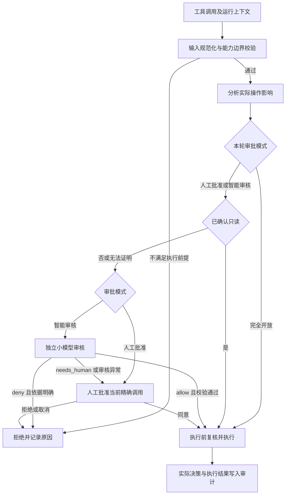

# 权限系统 V2：人工批准、智能审核、完全开放

> 状态：已接入运行时。2026-10-15。Chat / Sandbox 发送区选择人工批准、智能审核、完全开放；Agent 只保留能力边界。决策、一次许可和执行记录在租户库。智能审核在模型页配置自动审核模型后即可使用。危险或不确定的操作交给这个模型判断。第 2 节保留实施前调研，在线字段以架构总览和 `docs/chat-sse-event-contract.md` 为准。
>
> 技术前提：AgentScope 固定在 `2.0.5`，本方案不通过升级框架解决权限问题。新增的权限决策、模型审核、审批记录和审计由引力实现；继续复用原有 ReAct、模型协议适配和必要的暂停 / 恢复机制。

## 1. 产品决定

权限与审批只提供以下三个模式，不再并列展示 `accept_edits`、`trusted_tools`、`ask_every_time` 和额外的强制审批开关。

| 模式 | 配置值建议 | 已确认只读的操作 | 其他操作 | 审核不可用时 |
| --- | --- | --- | --- | --- |
| 人工批准 | `manual` | 自动执行 | 每次调用执行前由用户批准 | 继续等待用户，取消则不执行 |
| 智能审核 | `model_review` | 自动执行 | 小模型判断；明确允许则执行，明确不允许则拒绝，无法判断则转人工 | 转人工，绝不自动切到完全开放 |
| 完全开放 | `full_access` | 自动执行 | 直接执行，不调用审核模型、不请求工具人工批准 | 不依赖审核服务 |

三种模式决定的是已具备能力范围内的执行审批。租户隔离、Project binding、文件访问范围、网络开关、容器边界、输入校验和取消状态仍是执行前提；完全开放也不能访问别人的租户、调用未绑定的资源或执行已取消的任务。

Plan Mode 的只读阶段和计划确认属于工作模式合同，不随完全开放关闭。`AskUser` 收集缺失业务信息，也不属于工具权限审批。完全开放不会因此跳过必要的业务提问。

新建普通 Agent 建议默认人工批准；智能审核必须显式配置审核模型后启用。用户主动选择完全开放后，后续执行不再额外弹权限确认。系统无人值守 Job 的现行可信策略迁移为完全开放。

## 2. 现状调研与替换理由

### 2.1 当前调用链

`Agent guardrails → UnifiedPermissionProfile → AgentScope PermissionMode → 框架规则和工具 check_permissions → HITL → 恢复执行`。

关键代码：

| 位置 | 已确认的事实 | V2 处理 |
| --- | --- | --- |
| `backend/src/security/permissions.py` | 平台策略仍映射为框架 `DEFAULT / ACCEPT_EDITS / BYPASS` | 平台自己产生权威决策，框架模式退出产品规则判断 |
| `backend/src/tools/scoped_write.py`、`scoped_edit.py` | 路径边界自研，部分审批语义仍委托父类 | 保留路径边界，把审批交给平台 |
| `backend/src/server/routes/chat/hitl.py` | 审批和运行对象保存在进程内；记住审批按整个工具生成允许规则 | 审批决定落库；首版仅允许精确调用，不生成工具级长期允许规则 |
| `backend/src/server/routes/chat/trace_recorder.py` | 从工具名和 guardrails 重新推算权限审计 | 审计直接引用实际决策及其原因 |
| `backend/src/server/routes/chat/team_runtime/member_runtime.py` | 成员遇到需确认的工具会自动拒绝 | 支持挂起具体成员并把审批送至当前 Chat |
| `backend/src/scheduler/unattended_policy.py` | 使用框架模式推算无人值守可执行性 | 使用同一个平台决策服务和显式无人值守降级规则 |
| `backend/src/memory/model_review.py` | 已有无副作用模型判定抽象，但只输出 allow 布尔值；解析使用宽松转换 | 借鉴结构，权限审核使用独立三态和严格 schema，不复用宽松解析 |

2026-10-14 使用本地已安装 `2.0.5` 的 `PermissionEngine.check_permission()` 做了纯决策验证，没有执行文件操作或 HTTP 请求：

| 验证输入 | 平台意图或配置 | 框架返回 |
| --- | --- | --- |
| `human_approval=True`，调用 `ScopedRead` | 平台基础策略为 ask，旧界面宣称所有可用工具确认 | allow，只读快速通道生效 |
| HTTP 工具 `readonly=True`、`approvalPolicy=deny` | 工具自身配置 deny | allow，只读快速通道先于工具检查 |
| `trusted_tools`，HTTP 工具 `readonly=False`、`approvalPolicy=ask` | 工具自身要求 ask | allow，BYPASS 不保留该确认要求 |

第一项按 V2 的人工模式应当自动执行只读，不再宣称所有调用都确认。后两项说明，平台的禁止、工具能力和审批模式需要明确分层，不能继续由框架优先级隐式解释。

### 2.2 外部资料与采用范围

调研日期为 2026-10-14。外部产品文档可能持续变化，本文借鉴职责分工，不照搬它们的模式数量、默认版本或供应商限制。

| 来源 | 公开设计 | 本项目采用的结论 |
| --- | --- | --- |
| [Claude Code 权限](https://code.claude.com/docs/en/permissions)与[权限模式](https://code.claude.com/docs/en/permission-modes) | 人工模式、独立 classifier 审核、跳过权限提示；权限与沙箱分开 | 三种模式可共享执行边界；模型审核是执行前独立判断，不是主 Agent 自批 |
| [MCP Tools 规范 2025-11-25](https://modelcontextprotocol.io/specification/2025-11-25/server/tools) | 工具 annotations 来自不可信服务时不得直接信任 | MCP 的 readOnlyHint 不能直接成为免审批凭证 |
| [OWASP LLM Prompt Injection Prevention](https://cheatsheetseries.owasp.org/cheatsheets/LLM_Prompt_Injection_Prevention_Cheat_Sheet.html) | action screening 对照原始用户意图；审核模型也可能被注入；权限在工具执行代码落实 | 审核输入分离可信授权和不可信材料；精确动作批准、执行前复核；模型输出不直接执行 |

与外部产品的差异：本方案按用户要求，在审核无法判断或失败时转人工；不照搬外部产品“审核失败直接拒绝”的降级行为。无人值守场景的人工降级见第 9 节。

## 3. 唯一决策链



固定顺序：能力边界 → 操作分析 → 三种模式 → 必要的审核 → 执行前复核。未通过能力边界的调用不送模型，也不能通过人工审批扩大边界。

能力边界内，完全开放不受旧 `approvalPolicy=ask` 触发额外审批。显式禁止执行的配置属于能力限制，优先拒绝；需要在迁移时与旧审批 ask 分开存储和展示。

人工模式不把自然语言“帮我生成文件”当作取消弹框的授权；每个非只读调用仍需批准。用户可以一次批准界面完整列出的多个精确调用，但不能借此自动授权之后的新调用。

## 4. 怎样确定只读

判断“读取”针对操作的实际影响，不能只依据工具名、HTTP method、第三方声明，或主 Agent 自己提供的理由。

| 操作 | 首版分类 | 依据与处理 |
| --- | --- | --- |
| `Read / Grep / Glob` | 只读 | 平台校验目标路径和访问范围；工具执行时继续做路径校验 |
| 普通已知网页读取 | 可确认只读 | 使用受控 WebFetch；检查目标、重定向、凭据和敏感查询参数，不把上传本地内容伪装成读取 |
| HTTP 查询 | 只读或未知 | 已登记为查询且目标和参数匹配时可只读；未知接口即使 GET 也按未知；只读检索 API 即使 POST 也可经可信登记识别 |
| `Write / Edit`、生成 Office 文件 | 变更 | 新建和覆盖都属于非只读，人工模式每次确认 |
| 删除、移动、安装、提交、推送、发消息、上传 | 变更或对外提交 | 参数和目标进入批准快照；上传 GET query 同样可能产生外发影响 |
| Bash | 默认未知，少量严格模板可只读 | 首版只放行能完整解析的简单命令及参数；重定向、命令替换、管道、脚本、别名和未解析变量不自动认定只读 |
| 运行测试或任意脚本 | 非只读或未知 | 可能写缓存、修改数据、联网；不能因为命令含 test 就自动免审批 |
| MCP 工具 | 默认未知 | 只有可信来源、平台登记的操作定义及版本一致时才可只读，服务自报 annotations 不足以放行 |
| `plan_write / task_output / ScheduleJob / timeline_ingest` 等 | 变更 | 修改计划、任务、定时配置或会话材料；按模式审核，不因“内部工具”统一免审 |
| `DelegateTask`、创建 Team 任务 | 编排变更 | 不沿用现有 `is_read_only=True` 自动放行；委托的批准不替代 child 实际工具调用的批准 |

普通回复、流式输出、平台日志、审批记录和投影落库属于运行基础设施，不再对这些系统写入产生工具审批，避免审批递归。群聊当前的 `group_post_message` 是其回复输出通道，不为每段回复额外弹工具授权；以后增加外部行动工具时才进入通用审批链。

首版不承诺通过静态分析理解任意 Shell。无法证明只读就进入对应审核路径；完全开放直接执行，但仍执行沙箱及出网限制。

## 5. 小模型审核

### 5.1 审核问题与输入

小模型只判断：“在用户的原始目标、明确限制和当前能力范围内，这个具体操作是否可以执行？”它不负责选择工具、规划任务、修改参数或执行命令。

输入由平台构造，包含原始用户目标及本轮补充、明确禁止项、当前精确调用、已解析的目标与影响、必要的 diff / 参数摘要、已知事实及缺失信息。用户原文和审批记录按来源保存；不得把主 Agent 的总结、工具输出、网页指令或 Skill 内容升级为用户授权。

文件正文和第三方材料默认不整段输入；确有必要时作为不可信证据单列。敏感数据只给足够判断的类型、来源与去向。若脱敏或裁剪使目标、变更内容或外发数据无法判断，结果必须转人工，不能在缺证据时自动批准。

主 Agent 的“这是安全操作”只算待验证说明。小模型没有 Read、Bash、MCP、Skill、写记忆或自我委托能力；模型调用本身走独立基础设施入口，不再次触发权限审核。每次审核使用独立、无历史的上下文；并发审核不得共享可变 AgentState，也不能把上个任务的材料带到下个任务。

### 5.2 输出与判定

输出只接受去掉首尾空白后的小写 `allow`、`deny` 或 `needs_human`。平台自己填写原因、风险规则和是否可重试：

```json
{
  "verdict": "needs_human",
  "reasonCode": "target_not_resolved",
  "reason": "删除目标来自未解析变量，无法确定具体目录。",
  "missingEvidence": ["resolved_target"]
}
```

`verdict` 只有 `allow | deny | needs_human`。`reasonCode` 使用平台枚举，理由为简短中文，不输出思维链。首版不使用模型自报 confidence 作为安全概率或自动放行阈值。

| 输出 | 平台处理 |
| --- | --- |
| allow | 验证证据完整、目标和影响一致，再生成仅绑定当前调用的执行许可 |
| deny | 依据必须能关联明确限制或已知不匹配事实；返回简短原因，停止当前调用；用户可请求人工复核当前调用 |
| needs_human | 创建人工审批，指出哪些信息不足 |
| 超时、服务不可用、限流、非法 JSON、枚举错误、空结果 | 创建人工审批；不盲重试、不隐式切主模型、不自动放行 |

模型误拒绝不能让主 Agent无限换参数重试。相同调用保留审核结果；涉及参数、内容或目标变化时产生新决策。用户对模型拒绝的人工复核可以覆盖本次模型结论，不能覆盖平台硬限制。

### 5.3 模型选择和成本

审核模型从现有模型目录按配置 ID 单独选择，不把供应商 Key 或模型名称写进 Agent profile。新增独立的审核配置入口，例如 `system_settings/permission_review` 保存 `modelConfigId`、超时和 schema 版本；模型连接仍只来自既有模型目录与平台连接机制。

一次 Run 冻结执行模型与审核模型两份独立绑定。审核器显式使用自己的 binding，结束后恢复父 Run 的 ContextVar，不能因当前父绑定而实际调用主模型。配置变更影响新 Run，撤销凭据或硬边界仍需执行前生效。

候选路线：本地 7B–14B 指令模型和低延迟云端小模型做同一评测。参数量只作为资源选型，不能据此承诺审核正确率；通用内容安全分类器也不能直接替代任务授权判断。首版不绑定某个具体型号。云端审核沿用已有租户身份、平台额度和出网规则，敏感内容不能未经配置发到额外供应商。

初始建议：低随机性、严格结构化输出、单次 8 秒超时、最多 512 输出 tokens；这些是待实测参数。首版不启用审核模型的隐式多供应商 fallback，防止额外延迟和材料被送到未选择的审核服务。只读不调用模型；同一暂停调用不重复计费；审核 usage、延迟、供应商实际身份和失败原因单独记录，并计入 Run 的总消耗统计。

## 6. 自研权限模块与 AgentScope 接入

建议模块职责：

| 建议位置 | 职责 |
| --- | --- |
| `backend/src/security/authorization/models.py` | 模式、规范化调用、能力快照、三态审核结果、决策记录 |
| `backend/src/security/authorization/effects.py` | 解析路径、URL、命令和工具操作影响，识别只读及未知 |
| `backend/src/security/authorization/policy.py` | 能力边界、Plan 约束、父子权限和三种模式规则 |
| `backend/src/security/authorization/reviewer.py` | 无工具、独立模型连接、严格输出解析、失败转人工 |
| `backend/src/security/authorization/service.py` | 一次权威决策、精确许可、审批状态与执行前复核 |
| `backend/src/agents/permission_adapter.py` | 固定 `2.0.5` 的最小框架桥接；框架类型不进入新权限领域模型 |
| `backend/src/storage/permission_records.py` | 领域记录和事务；不继续向 `database.py` 堆业务查询 |
| `backend/src/runtime/authorization.py` | 各产品域的公开调用入口，避免群聊、调度再导入 Chat 私有逻辑 |

### 6.1 已验证的框架约束

本地 `agentscope/agent/_agent.py` 的 `_execute_tool_call()` 先调用 `_engine.check_permission()`，之后才进入 `_acting()` 和 `on_acting`。`is_external_tool=True` 的工具在 `_acting` 之前就发出外部执行事件。人工批准后，调用被标成 `ALLOWED`，再次执行会跳过 `_engine`。

因此，只加 `PermissionMiddleware.on_acting` 会漏掉外部工具与批准后复核；简单换成 BYPASS 也不能完成接管。

### 6.2 首选桥接方案

在唯一工厂中安装平台权限适配器，保留框架现有事件和工具生命周期。必要时使用一个薄 `PlatformAgent` 子类包装 `_execute_tool_call()`，绑定包含 call ID 的运行上下文，再委托 `super()`；不复制 ReAct 或整段工具执行实现，不修改 site-packages。

桥接必须实现以下约束：

1. 每次执行都经过平台权威决策。框架 `ALLOWED` 不能免除当前能力、参数、取消状态和许可复核；恢复时由适配器重新送入平台检查，平台识别已批准调用后返回 allow，不重复询问。
2. `allow / deny / ask` 映射为框架结果，仅用于继续、拒绝和暂停。框架旧 allow rules 不再产生额外授权，`suggested_rules` 不生成全工具允许规则；精确调用审批不被框架批量规则去重吞掉。
3. 实际工具执行前校验平台许可，外部执行分发也校验同一许可。MCP、HTTP、Subagent 和 Job 不可走旁路；重校验不重复调用审核模型。
4. 既有路径、出网、黑名单和执行隔离防护留在实际执行层。提取其中的硬校验供平台调用，旧父类审批结果不再作为第二套权威判断。
5. 已批准的规范化参数就是实际执行参数；解析、模板渲染、目标解析后不得静默扩大或替换动作。

私有接点限制在适配器中，以真实安装版本的契约测试锁定。实施第一阶段先验证普通调用、并发调用、批准后恢复、拒绝和 external tool；若薄包装不能覆盖，不通过散落 monkey patch 补齐，应先修订适配方案。

## 7. 决策、审批与执行记录

建议沿用租户 SQLite 和领域 record 模块，拆成以下三类事实；具体 DDL 在实现前结合现有主键与事务约定确定。

| 记录 | 主要内容 |
| --- | --- |
| `permission_decisions` | tenant / workspace / project / run / actor / call 归属，模式、策略版本、工具版本、动作指纹、实际决策、规则或模型来源、原因、审核模型身份与 usage |
| `permission_approvals` | decision ID、精确调用引用、批准者、pending / approved / rejected / cancelled / expired / interrupted、有效期与消费状态 |
| `permission_executions` | decision ID、执行占位、执行 ID、reserved / running / succeeded / failed / unknown、结果引用与幂等键 |

动作指纹绑定工具注册身份与版本、规范化参数、最终目标、变更内容摘要、运行归属及能力快照版本。JSON 键排序只是基础；相对路径、URL 和模板必须先规范化。涉及外部资源版本时绑定 ETag / version；文件变更尽量绑定原内容版本。

Key、Cookie 和 Authorization 不进入审核提示或普通审计。凭据只以 secret 引用及配置版本参与绑定；敏感参数按租户访问控制保存受限内容引用，展示和审计保留脱敏视图。首版不新增可供自动重放的明文密钥快照。

批准后修改参数、目标变化、文件已被改写、策略收紧、凭据撤销或许可过期，均需重新校验；原许可不覆盖新动作。完整规范化快照需要版本化，不能只保存哈希却丢失批准了什么。

批准和执行占位使用事务与唯一约束，防止双击批准、并发 resume 和重复事件重复执行。调用权限只解决“允许执行”，不承诺外部操作 exactly-once；发送后断线等结果不明的操作先对账，不能自动重发。

审批记录持久化不等于 Agent 执行现场可恢复。首版仍沿用当前进程重启失败收口：未消费许可和待审批记录标为 interrupted / expired，不在重启后自动执行旧动作。跨进程继续执行留给独立的 Run checkpoint 方案。

## 8. 三种模式的界面

Agent 安全边界仅展示一个「执行审批」选择框，三个选项和固定说明：

| 选项 | 说明 |
| --- | --- |
| 人工批准 | 只读操作自动执行，其他操作每次由你批准。 |
| 智能审核 | 只读操作自动执行，其他操作由审核模型判断，无法判断时交给你。 |
| 完全开放 | 在当前能力范围内直接执行，不进行模型审核或人工批准。 |

选择智能审核时显示已配置的审核模型和进入审核设置的入口；未配置时给出配置错误，不保存一个实际不能工作的“智能审核”。不在 Agent 编辑器复制供应商配置，不改变 Chat 主模型选择。

人工审批卡展示：谁要执行、操作与目标、文件 diff / 外发内容摘要、影响范围、转人工原因，以及「允许这一次」「拒绝」。多个调用只可对明确列出的调用批量批准。移除首版的「本会话后续自动允许这些工具」，防止破坏人工模式每次确认的约定。

模型审核通过时不弹确认框，工具记录显示“智能审核通过”；需要人工时显示理由；模型拒绝提供“人工复核”入口。普通用户界面不展示内部规则 ID、模型提示词或完整 JSON。审核过程不向用户流式输出推理链。

当前 Run 的模式固定，界面修改默认影响下一轮；若要立即收紧当前 Run，显式取消未执行许可并重新决策。切换为完全开放不自动批准旧的 pending 调用；它们需明确处理或在新 Run 重发。取消 Run 后迟到的审核响应与批准响应都不能触发工具。

## 9. 各执行入口

| 入口 | V2 行为 |
| --- | --- |
| 单 Agent Chat / Sandbox | 使用本轮模式；manual 和智能转人工时暂停原 Run，批准后只恢复绑定调用 |
| Team Leader / Member | 继承本轮模式及能力上限；每个实际行动独立决策；待审批只挂起对应成员，其他无依赖成员继续；等待人工时间不计成员执行超时，但 Run 取消仍立即生效 |
| Attached Subagent | 不得自行切到更宽松模式；继承父 Run 审批模式，定义可以收窄工具 / 能力；child 审批挂在原 Chat 中，结果仍走 wait/read、consumed 和父 Run barrier |
| 定时任务 | 使用 Job 的显式模式；只读可执行。manual 遇到非只读，或智能审核需人工时，终止本次 firing 并通知用户，不能因无人值守切开放；批准后明确重新运行，不宣称原执行现场可继续 |
| 系统 `WebSearch` Job | 将现行 trusted 配置迁移为 full_access，保留资源白名单、出网和沙箱限制 |
| 群聊工作室 | 当前 Worker 仅有回复工具，保留独立产品合同；未来外部行动走统一服务和工作室自己的审批通道，不写 Chat pending 字典 |
| readiness / intent / 审核等无工具系统调用 | 不产生工具审批，仍记录模型身份、usage、超时和失败 |

定时任务建立时提示其模式可能需要人工；智能模式有价值，但不承诺永远无人值守。后续若实现可恢复 firing，再设计持久 waiting 状态；首版不把进程内 Future 当成持久等待。

Team 必须同时接通审批通知和等待生命周期，不能只换引擎而保留当前自动拒绝逻辑。父 Run、Team 综合和 Subagent completion barrier 均不得绕过未完成审批。

## 10. 配置与历史迁移

建议新字段为 `guardrails.approvalMode`，值仅三种。文件权限、网络和工具 / 资源限制继续独立保存；历史只读能力可通过新增 `operationScope=read_only` 兼容，其正常值为 `normal`，不作为第四种审批模式展示。

审核配置属于租户系统设置，Agent 只选模式。Run 保存模式、能力和审核配置的不可变版本引用；凭据不写进普通 Run 记录。缓存指纹包含模式、能力和适配版本，修改后按既有机制 invalidate Agent。

| 历史配置 | 迁移建议 |
| --- | --- |
| `trusted_tools` / 旧 bypass | full_access；独立的资源限制继续保留 |
| `confirm_destructive` / 旧 accept_edits | manual；迁移后非只读每次确认，不假装与旧行为完全一致 |
| `ask_every_time` / `humanApproval=true` | manual；只读免确认，移除含混的旧界面承诺 |
| `read_only` | manual + 只读能力限制，显式保留旧模式禁用写入、网络、MCP 和 Bash 的效果，不仅修改审批字段 |
| 未知或缺失配置 | manual，记录迁移原因，不自动选智能审核或完全开放 |
| Subagent 旧 permissionMode | default 继承父模式；plan 等收窄能力；旧 bypass 不得扩大父 Run 权限，记录兼容提示 |

若 `humanApproval=true` 与 trusted 并存，先按人工配置迁移；历史 read_only 必须始终保留能力收窄。旧网络开关、filesystem scope 和资源绑定不因模式迁移扩大。

Agent 正文权威仍是 Workspace `.agents/profiles/<id>.md`，迁移写回文件，不恢复 SQLite Agent 正文。Subagent 定义仍来自 YAML / Markdown，Job 定义仍走现行 catalog；不新增模型可调用的另一套系统配置 CRUD 工具。

旧字段可以在导入阶段读取并转换，新运行路径只读新模型；不长期保留新旧两套决策双跑。迁移应幂等并保留可检查的配置备份；切换时已有执行完成或明确中止，旧 pending 不无缝迁入新权限引擎。

## 11. 展示协议、API 与审计边界

本草案不变更在线协议。实现前先更新 [Chat 稳定契约](chat-sse-event-contract.md) 中 approval / tool 的必要展示语义；字段只在契约定义，本文件不另起一份 SSE 字段表。

Chat 继续使用 `RUNTIME_EVENT` / DisplaySnapshot V4，经领域事件、单 ProjectionRunner 和 per-kind projector 回流；不新增顶层 `PERMISSION_EVENT`，不增加通用 Frame op，也不在命令响应里直接改前端状态。人工审批复用 approval Block，审核来源和结果经对应 kind 的版本化数据展示。

审批 API 验证当前登录者和 tenant / workspace / run / actor 归属，客户端不能提交替换后的工具输入。Chat 复用现有 resume API；模型拒绝转人工入口需明确绑定 decision ID。记录读取与审核配置使用领域管理 API，不把这些管理 API 注入 Agent。

Trace 读取实际决策记录：边界拒绝、只读放行、人工批准、模型放行 / 拒绝、失败转人工和 full_access 放行均有明确来源；执行成败另记。取消、拒绝和审核失败不得伪装成工具已执行。通知仅在需要用户行动时经现有 `src/notifications/` 分发，不把通知塞进 Chat SSE。

## 12. 实施顺序与验收

完整待办统一放在 [项目 TODO](project-todo.md)。建议按以下阶段落地，每阶段完成后再扩展入口，不在此阶段替换 ReAct 和模型 formatter。

| 阶段 | 交付结果 | 进入下一阶段的条件 |
| --- | --- | --- |
| A：锁定桥接与事实模型 | 核对 SQLite / Pydantic / TypeScript；真实 2.0.5 的权限、恢复、并发和 external tool 契约试验；三模式规范化和动作指纹 | 证明新决策不会被旧引擎或 ALLOWED 跳过；无副作用试验通过 |
| B：人工与开放闭环 | 单 Agent / Sandbox 两种模式、精确审批、执行占位、真实审计、界面和刷新 | 每次非只读确认、开放不弹审批、重复 resume 不重复执行；硬边界复核成立 |
| C：智能审核 | 独立模型绑定、三态严格解析、失败转人工、人工复核、成本观测 | 标注评测与故障注入通过，真实模型验证实际 provider / model，达到约定质量与延迟门槛 |
| D：全入口与迁移 | Team / Subagent / Job 适配、旧配置迁移、协议联调和桌面浏览器 QA | 不存在旧自动拒绝或无人值守静默放开的旁路；迁移不扩大已有能力 |

### 12.1 必须覆盖的确定性回归

| 类别 | 验收要求 |
| --- | --- |
| 模式矩阵 | 只读在 manual / model_review 自动执行；Write/Edit/未知 Bash 在 manual 每次确认；full_access 不调用审核、不弹工具审批 |
| 模型降级 | allow / deny / needs_human、超时、限流、非法 token、空响应、截断、断流分别验证；没有“失败默认允许” |
| 精确批准 | 参数被改、目标变、文件版本变、许可过期、跨租户批准、双击、并发 resume、取消后迟到响应均不能误执行 |
| 框架接点 | 真实 Agent + 无副作用工具验证 ALLOWED 复核、并发不同 call ID、拒绝结果配对、external tool、模型流式与审批恢复 |
| 能力边界 | readonly HTTP 的 deny 不被快速通道绕过；模式不扩大资源绑定；MCP 自报只读不免审；Plan 只读约束不能被开放模式绕过 |
| 多入口 | Team 待审批成员挂起与取消；child 结果未消费不完成；Job 转人工本次终止并通知；群聊不写 Chat pending |
| 重启与重试 | 未消费批准失效；外部结果 unknown 不自动重发；历史 UI 可查看但不出现可执行的过期按钮 |
| 前端 | 桌面浏览器验证配置三选一、审核模型缺失、diff/目标展示、同意/拒绝/复核、刷新、取消及多审批并存 |

### 12.2 启用条件

SmartGuard 不靠 200 条标注或 holdout 门槛启用。模型页保存时用固定无害动作探测一次；输出预算内没有合法 token 就不能保存为审核模型。运行时只检查配置、探测结果、已审定 prompt 版本和连接是否仍可用。说明文案是「危险或不确定的操作交给这个模型判断」。

仍要记录每次审核的 token、延迟和失败类型（空响应、截断、非法 token、超时、限流、断流）。这些观测不构成质量门槛。

智能审核上线前在沙箱中做模型评测和人工决策对照，不把普通用户的生产写操作作为试验。若模型质量或延迟不达标，先交付人工与完全开放，智能审核入口保持不可用并给出原因；不以一个返回 allow 的 prompt 代替完整验收。
