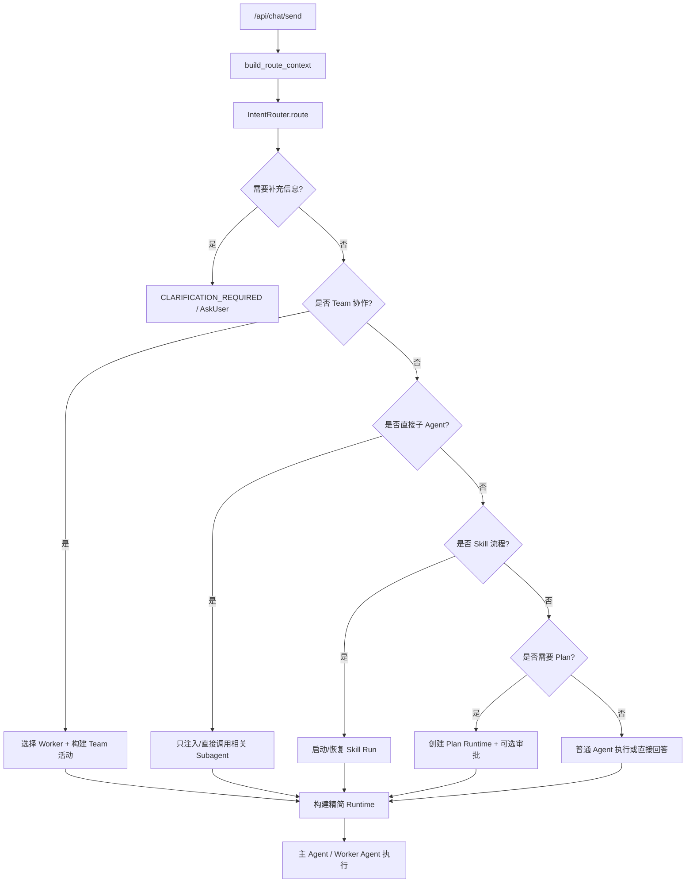

# 前置意图路由设计

> 状态：设计草案  
> 更新：2026-06-26 已下线旧 Plan Runtime 与 Subagent Runtime，本文中涉及 Plan/Subagent 注入的内容仅供历史参考；当前前置路由只驱动 Skill、Team worker、Clarification 和 ToolScope。
> 目标：在主 Agent 执行前完成轻量意图识别和运行时编排决策，降低主 Agent 同时承担“理解、选路、执行、纠偏”的压力。

## 背景问题

当前 `/api/chat/send` 不是单纯的消息发送入口，而是同时做了多类前置决策：

- Skill 选择：`select_relevant_skills()` 在主链路内按消息选择 Skill。
- Plan 创建：`should_create_plan()` 和 `create_runtime_plan()` 在主链路内决定是否创建 Plan Runtime。
- Team worker 初始化：`_build_team_activities()` 总是按 Team 成员构造活动，再由 worker 运行链路处理。
- Subagent 注入：`_build_runtime_subagents()` 将 `callableAgents` 递归构造成主 Agent 工具，是否调用完全交给主 Agent。
- Clarification：通过系统提示词让主 Agent 判断是否需要 AskUser 或输出 `<clarification>`。
- MCP / Knowledge Tool 注入：按 Agent 配置全部注入，缺少“本轮是否需要该能力”的路由裁剪。

这些逻辑分散在 `send.py`、`team.py`、`runtime.py`、`factory.py` 和 `prompts.py`，导致：

- 主 Agent 上下文变重，工具和子 Agent 选择压力变大。
- 计划、Skill、Subagent 等能力各自做判断，缺少统一优先级。
- 简单对话也容易被执行型提示词污染。
- 后续新增能力会继续耦合到主链路。

## 设计目标

1. 在创建主 Agent 之前生成一次 `IntentRoute`，作为本轮运行的编排说明。
2. 所有“是否启用某能力”的判断集中到 `chat/intent_router.py`。
3. 主 Agent 只接收本轮需要的上下文、工具、子 Agent、Skills 和 Plan。
4. 路由层默认轻量、可测试；只有低置信度或复杂协作时才调用小模型做选择。
5. 前端可通过 Trace 看到路由决策，但普通聊天界面不暴露内部细节。

## 路由输出模型

建议新增 `backend/src/server/routes/chat/intent_router.py`，核心模型如下：

```python
class RouteDecision(BaseModel):
    name: str
    enabled: bool
    confidence: float = 1.0
    reason: str = ""
    payload: dict[str, Any] = Field(default_factory=dict)


class IntentRoute(BaseModel):
    mode: Literal[
        "conversation",
        "clarification",
        "direct_answer",
        "agent_execution",
        "planned_execution",
        "team_execution",
        "subagent_execution",
        "skill_execution",
    ]
    decisions: list[RouteDecision] = Field(default_factory=list)
    selected_skill_ids: list[str] = Field(default_factory=list)
    selected_mcp_tool_ids: list[str] = Field(default_factory=list)
    selected_knowledge_tool_ids: list[str] = Field(default_factory=list)
    selected_subagent_ids: list[str] = Field(default_factory=list)
    selected_team_member_ids: list[str] = Field(default_factory=list)
    should_create_plan: bool = False
    require_clarification: bool = False
    clarification: dict[str, Any] | None = None
    main_agent_instruction: str = ""
```

## 路由流程



## 决策优先级

路由层必须先处理互斥和高优先级场景，建议顺序如下：

1. **安全和权限前置**：空消息、不可用 Agent、明显越权操作，直接失败或要求确认。
2. **Clarification**：缺少必填目标、文件路径、环境、账号、输出格式等执行前必要信息时，先问用户。
3. **Resume / Active Skill**：如果当前 session 有 `waiting_user` 的 Skill Run，优先恢复，不重新路由。
4. **Team Selection**：用户选择了 Team 时，先选择本轮 Worker，而不是把全部 Worker 塞给 Leader。
5. **Direct Subagent**：如果某个 callable Agent 明确匹配任务，优先由路由层选择，主 Agent 只做编排或总结。
6. **Skill Selection**：选择本轮需要的 Skill，避免全部 Skill 提示词污染主上下文。
7. **Plan Intent**：只有执行型、多步、协作型或用户显式要求规划时创建 Plan。
8. **Tool Scope**：根据任务裁剪 MCP / Knowledge / Bash / HTTP 等能力。
9. **Main Agent Mode**：普通对话走 conversation，不注入计划、子 Agent、工具选择提示。

## 当前能力映射

| 能力 | 当前位置 | 路由后归属 | 路由输出 |
| --- | --- | --- | --- |
| Plan | `chat/plans.py` + `send.py` | `intent_router.py` 调用 `detect_plan_intent()` | `should_create_plan` |
| Skill | `routes/skills.py` + `send.py` | `intent_router.py` 包装选择逻辑 | `selected_skill_ids` |
| Team Worker | `team_selection.py` + `team_state.py` | `intent_router.py` 统一 worker selection | `selected_team_member_ids` |
| Subagent | `runtime.py` + `factory.py` | `intent_router.py` 选择候选，`runtime.py` 只构建被选中规格 | `selected_subagent_ids` |
| Clarification | `prompts.py` + 主 Agent 输出解析 | 先做规则检查，复杂场景再走 AskUser | `require_clarification` |
| Tool Scope | `runtime.py` | 路由层输出工具白名单，runtime 只解析白名单 | `selected_*_tool_ids` |

## 模块拆分

建议新增以下文件：

- `backend/src/server/routes/chat/intent_router.py`  
  只负责路由决策，不创建 Agent，不消费 SSE。

- `backend/src/server/routes/chat/route_context.py`  
  汇总 Agent、Team、Skill、Tool、Memory、Session 状态，生成路由输入。

- `backend/src/server/routes/chat/route_trace.py`  
  将路由决策写入 `run_events`，事件类型建议为 `INTENT_ROUTE`。

- `backend/src/server/routes/chat/runtime_builder.py`  
  根据 `IntentRoute` 构建 runtime specs、system prompt、Plan Runtime、Skill Run 等。

`send.py` 最终只保留：

1. 读取请求和基础配置。
2. 调用前置路由。
3. 根据路由构建 runtime。
4. 执行主 Agent / Team / Subagent。
5. 记录 SSE 和持久化结果。

## 规则优先，模型兜底

第一版不建议一上来引入大模型做所有路由。推荐两层：

- **规则层**：显式关键词、Agent/Skill trigger、Team/子 Agent 描述匹配、是否有图片、是否有 active run。
- **轻量模型层**：当多个候选冲突、Team worker 选择、Subagent 选择置信度低时，调用小模型返回 JSON。

模型路由提示词必须严格要求 JSON，不允许调用工具，不允许输出 Markdown。路由模型的结果必须经过 schema 校验和候选 ID 白名单过滤。

## Subagent 路由设计

当前 Subagent 作为工具注入主 Agent，问题是主 Agent 要在工具列表里自己判断何时调用。路由后改成两种模式：

- `subagent_execution`：路由层判断某个子 Agent 可以独立完成任务，直接执行该子 Agent，主 Agent 只做可选总结。
- `agent_execution + selected_subagent_ids`：任务仍由主 Agent 主导，但只注入被选中的少数子 Agent 工具。

第一版可以先做“选择注入”，不做“直接执行”，降低改动风险。

## Clarification 路由设计

Clarification 不应只依赖主 Agent 自己输出 `<clarification>`。路由层可先识别这些场景：

- 用户要求修改/读取/运行，但没有给目标文件、项目、路径或对象。
- 用户要求外部 API / MCP / 网络动作，但缺少必要账号、URL、参数。
- 用户要求创建 Agent / Team / Skill，但缺少名称或目标。
- 用户要求执行破坏性动作，但需要用户确认。

如果规则能构造问题，直接发 `CLARIFICATION_REQUIRED`；否则再把 clarification prompt 注入主 Agent 作为兜底。

## 分阶段迁移

### Phase 1：路由壳与可观测性

- 新增 `IntentRoute` 数据模型和 `route_chat_message()`。
- 把现有 `should_create_plan()`、Skill 选择、Team worker 选择封装进路由层。
- 记录 `INTENT_ROUTE` trace，不改变最终执行行为。

### Phase 2：裁剪主 Agent 上下文

- `send.py` 根据 `IntentRoute` 决定是否注入 planning prompt、skill prompt、subagent tools。
- `_build_runtime_subagents()` 支持传入 `selected_subagent_ids`。
- runtime tool 构建支持本轮工具白名单。

### Phase 3：Clarification 前置

- 路由层可直接返回 clarification，不创建主 Agent。
- 保留主 Agent clarification prompt 作为兜底。

### Phase 4：Direct Subagent / Team Router

- 将 `/team-worker-selection` 的模型选择能力下沉到统一 IntentRouter。
- 支持某些任务直接发给最匹配的 Subagent，再由主 Agent 总结或直接返回。

## 验收标准

- 普通寒暄和解释型对话不创建 Plan、不注入 Subagent、不加载 Skill。
- 明确规划任务创建 Plan，并按 `requireUserApproval` 决定是否等待确认。
- Team 任务只运行被路由选中的 Worker。
- Subagent 只在匹配任务时注入，不再默认把所有 callableAgents 压给主 Agent。
- `run_events` 能看到本轮路由模式、启用能力、原因和置信度。
- `send.py` 的前置决策代码显著减少，新增能力不再直接修改主链路。
