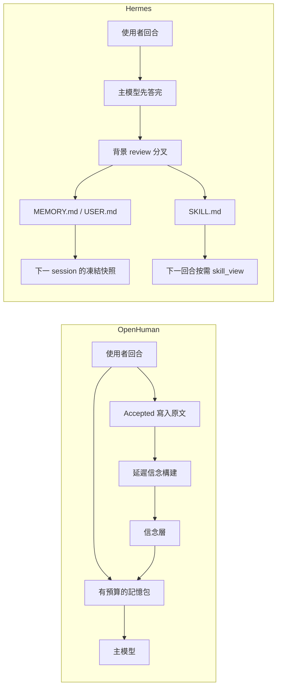

# OpenHuman 與 Hermes Agent 自進化機制調研

調研日期：2026-10-09。

這份文件只描述兩個倉庫裡**已經接到運行時**的學習閉環，以及它們明確留在提案、預設關閉或獨立倉庫裡的部分。兩邊都沒有做權重訓練或微調。學到的東西是寫進持久存儲、再在之後的回合注入上下文。

## 版本

| 倉庫 | 讀到的提交 | 時間 |
| --- | --- | --- |
| [tinyhumansai/openhuman](https://github.com/tinyhumansai/openhuman) | `a446d5594c39e08f091f101396fb3dc1f3f869a8`（main，PR #7053） | 2026-10-09 |
| 其 vendor `tinymemory` | OpenHuman 鎖定 `004763036e8ac6af36059ef5bcefed537d55a888`；引擎實作細節另讀 tinymemory main `fc4c2b0a78a28ee0f19ba99759ce753335c379a9` | 2026-10-09 |
| [NousResearch/hermes-agent](https://github.com/NousResearch/hermes-agent) | `1744a19e0df568c647e4f3ff9c37f2a284a282fb` | 2026-10-08 |

OpenHuman 的宿主行為以倉庫內 `docs/specs/memory-v2.md` 與 `crates/openhuman-core/src/memory/README.md` 為準。信念的 wire 細節（`v1/beliefs`、stance、三元組句子）來自 tinymemory main 的 `beliefs.rs`，若與 vendor pin 有落差，以 pin 為準、以 main 為引擎現況。

Hermes 另有獨立倉庫 [NousResearch/hermes-agent-self-evolution](https://github.com/NousResearch/hermes-agent-self-evolution)（DSPy + GEPA）。它**不在** hermes-agent 的對話運行時裡，文末單列。

## 一句話

- **OpenHuman**：每回合把對話寫進記憶引擎，背景把原文蒸成信念，下一回合用有預算的記憶包注入。技能是目錄裡的說明書，由獨立 worker 執行，回合結束後不會自動改 `SKILL.md`。
- **Hermes**：回合結束後另開一個只有記憶和技能工具的分叉，把教訓寫進 `MEMORY.md` / `USER.md`，或直接 patch `SKILL.md`。技能庫另有按閒置時間歸檔的 curator。



---

## 1. OpenHuman

### 1.1 現行閉環在哪

現行自進化不在技能檔，而在 TinyMemory 的 agent 生命週期。OpenHuman 是宿主：綁定引擎、決定「誰在行動」、在回合前後呼叫 hook、把慢工作丟進隊列、再暴露 RPC 和 `memory` 工具。引擎契約、layout、召回和信念在 `vendor/tinymemory`。

宿主文件寫明，這套生命週期換掉了更早的 memory v2 管線（每執行緒批次、閒置刷寫、cron 編譯的 `context.md`、巢狀 namespace）。更早的 v1 表面（`memory_tree`、`memory_goals`、`people`、`tree_summarizer` 等）在那之前就已刪除。

公開程式碼索引裡還能看到 `src/openhuman/learning/reflection.rs`（例如提交 `9fd5fde5`、`7fe3dd06`）。在本次 main 上，該路徑回 **404**。那一代進程內學習環（reflection、facet cache、agent experience）已不在當前樹裡，見第 1.6 節，避免和現行路徑混讀。

### 1.2 存儲布局

一棵樹，一個 root（租戶、團隊或本機安裝）。預設引擎是 `tinyhumans`（登入後走 TinyHumans 後端裡的 CortexDB）或自備 `cortexdb`（endpoint + keyring 裡的 `memory-cortexdb`）。

```text
<root>
├── source:<connector>     腦：共享文件，不帶 agent id
├── agent:<id>             該 agent 的對話，一回合一條
└── <root> 本身            共享 learnings；信念落在各自 scope
```

`[memory] layout = "v3"` 時，所有 agent 的對話收進同一個 chat node（`ws:main`），agent id 留在每條 turn 上。未登入時 root 是一次寫進 `<workspace>/memory/local_root.json` 的 `user:local-<install id>`。寫不了這個檔，記憶整段關閉。

身份解析順序（先命中者勝）：宿主綁定 `[memory] agent_id/root` → 定義釘選 `[memory.agents.<definition>]` → team member 用 definition id、root 為 `team:<team>` → 預設 definition id（否則 `assistant`）。身份不從模型參數讀。

所有寫入先經過 `guard::ScrubbingEngine`，按宿主策略清掉秘密和 PII，再進引擎。包住引擎，而不是只在呼叫點清，這樣 `pre_turn`、`Brain::ingest` 和背景寫入都走同一條。

記憶關閉時：不註冊 `memory` 工具，回合 hook 空轉，RPC 回 `MEMORY_OFF`。

### 1.3 回合怎麼學、怎麼用

熱路徑**不跑模型、不等索引**。`pre_turn` 的寫入用 `WaitFor::Accepted`（持久接受即可，不必等可搜尋）。

```text
使用者訊息
    │
    ▼
session host prelude
    pre_turn（與請求富化並行，預設 1500ms 超時）
      · 把使用者回合記成 index 2n（Accepted）
      · 並行召回 TurnPack
    │
    ▼
MemoryPackMiddleware
    把 pack 包成 <memory-context>
    以 ephemeral instruction 附在該回合每一次模型請求上
    不寫進 transcript，也不改供應商前綴快取
    │
    ▼
模型 + 工具，回合提交
    │
    ▼
post_turn
    把回覆記成 index 2n+1，附工具呼叫摘要
    （名稱、id、每則一行結果）
    交回 BuildBeliefs job，不在這裡執行
    │
    ▼
稍後，transcript 被壓縮時
    recall_for_compaction
    把「從記憶召回」附在 checkpoint 上
```

回合索引跟已提交 transcript 走：第 `n` 條之後的使用者句是 `2n`，回覆是 `2n+1`。重試和重啟後索引不變，所以重試是 replay，不會再插一條。

標準召回段，優先順序固定：

1. Learnings（整棵樹，含信念）
2. 可選的 core scope
3. Brain（文件；一回合最多讀 4 個 source scope）
4. 這個 agent 的 History
5. Team（其他 agent；對話已經池化時沒有這段）

預設預算（`[memory.recall]`）：

| 鍵 | 預設 |
| --- | --- |
| `budget_tokens` | 1200（4 字元估 1 token） |
| `learnings_limit` | 8 |
| `brain_limit` | 6 |
| `history_limit` | 6 |
| `team_limit` | 3（0 表示不看其他 agent） |
| `build_beliefs_every` | 10 回合；0 關閉 |
| `pre_turn_timeout_ms` | 1500 |
| `compaction_timeout_ms` | 8000 |
| `build_delay_secs` | 300 |

裁剪從最後一段的最後一行開始，前面的段落留得最久。pack 會丟掉「正在寫入的這一回合」以及「還原樣留在 prompt 裡的視窗」（`in_prompt_from` 之後的同 thread 回合），避免和現場上下文重複。

任一 hook 失敗只記 log，不讓回合失敗。引擎拒絕帳號（額度、未授權、不可用）時，pack 變成一段說明，避免模型把空包讀成「什麼都沒存」。`omit_memory_context` 關掉某個 agent 的 pack，它的回合仍會被記下來。

`start_session` 在壓縮後恢復的第一個回合，把該 thread 更早的回合放在 pack 最前（「Earlier in this thread」）。壓縮召回會先請引擎回答「討論了什麼、決定了什麼、還開著什麼」（引擎做不到就退回 fetch），再附標準段。這兩步不在熱路徑上。

### 1.4 信念：真正的「自己變聰明」

原文（對話、文件）和蒸餾結果是兩層。

`post_turn` 每 `build_beliefs_every` 個回合交回一個 `BuildBeliefs` job，範圍是該 agent 的對話。腦的每次 ingest 也交回來源 scope 的 job。宿主把它們寫進 `<workspace>/memory/jobs.json`，相同 job 合併成一個。系統 cron `memory_background` 每 5 分鐘跑一輪，job 至少要放滿 `build_delay_secs`（預設 5 分鐘）才執行，因為構建讀的是引擎從寫入裡抽出的事實，抽取本身有延遲。失敗最多重試 5 次；帳號級拒絕（沒額度、憑證被拒、引擎不可達）不算一次嘗試，job 繼續等。

引擎用 `EngineDescriptor::consolidation` 聲明自己怎麼蒸餾：

| 模式 | 行為 |
| --- | --- |
| `None` | `consolidate` 回 `Unsupported`，宿主記成 `Skipped` |
| `OnDemand` | 宿主呼叫時才構建 |
| `Scheduled` | 引擎自己的排程。宿主呼叫只回執，不發構建請求 |
| `Automatic` | 每次寫入後引擎自己重建。宿主不再為每次寫入排隊；顯式 `consolidate` 仍可立刻刷新 |

對應實作：

- **參考引擎**（測試 / 離線）：`OnDemand`。對每個文件或對話取第一句話，存成 `LearningKind::Fact`，信心 0.5，最長 240 字，tag `consolidated`。同一來源再蒸一次是 replay，不複製。這不是產品用的模型蒸餾。
- **CortexDB 直連、託管 API**：`Automatic`。顯式構建時對 reach 裡每個 scope `POST v1/beliefs/build`。伺服器在請求內建完則回執 `Completed` 並帶 `built` 數量；若回 job handle 則是 `Started`。
- **CortexDB 直連、其他 endpoint**：`OnDemand`，同樣打 `v1/beliefs/build`。可用 `EngineSettings::consolidation` 覆蓋。
- **經 TinyHumans 的託管線**（OpenHuman 預設 `engine = "tinyhumans"`）：`Scheduled`。客戶端**不發送**構建請求。規格裡仍開著一個問題：託管後端何時暴露 belief-build 路由。在那之前，信念是否出現取決於後端自己的排程。

CortexDB 把信念放在事件旁邊的衍生層。`fetch` / `list` 只解事件，**不會**帶回信念。信念也不是可按 id 列出、讀取或刪除的條目；忘掉來源條目，信念才消失。

讀取規則（`beliefs.rs`）：

- 只展示 stance 為 `supported` 或 `contested` 的信念。`contested` 的句子末尾加 ` (contested)`。
- 渲染成 `subject predicate object`，predicate 的底線改成空格。
- 類型是 `LearningKind::Fact`，tag 為 `belief`，信心夾在 0–1，缺省 0.5，時間取 `valid_from` / `updated_at` / `created_at`。
- 有查詢時，每個 scope 的 recall pack 只含 `beliefs` 層，最多 4 個 scope 並行，再按名次交錯，同一句子只留一次。
- 無查詢時，直連線 `GET v1/beliefs`，按信心再按新舊排序。託管線沒有這個列表，無查詢時回空。
- 有 learnings 段的 pack 會把信念插進該段：有查詢時跟這次 fetch 一起要；無查詢時走 `beliefs` 列表。存儲的 learning 排在同一名次的信念前面。信念讀取失敗時，該段仍保留已存的 learning。

所以「自進化」的產品形態是：對話先進事件日誌，引擎（通常是 CortexDB 上的模型）把它收成可爭辯的三元組信念，下一回合的 Learnings 段帶著這些句子進模型。庫本身不生成句子。

### 1.5 模型可以主動寫的 learning

除了自動記回合，還有一個 `memory` 工具，動作是 `recall | fetch | learn | forget`。只在記憶開啟時註冊。

`learn` 寫一條 learning。模型可以給正文、種類、信心、證據和 tag。種類是：

| 種類 | 含義 |
| --- | --- |
| `preference` | 使用者希望事情怎麼做 |
| `fact` | 關於使用者或世界的事實 |
| `procedure` | 怎麼做一件事 |
| `correction` | 對先前錯誤的修正 |
| `other` | 其餘 |

模型**不能**選 namespace、來源或觀察者。宿主強制：

- namespace = 當前身份 layout 的 learnings 節點（該 root 下所有 agent 共享）
- `source.kind = agent`
- 帶上 workspace、thread id、memory agent id、這次 tool call 的名稱和 id
- `observed_at` = 呼叫當下

`recall` / `fetch` / `forget` 的 reach 被覆寫成該身份的子樹。按 id 忘記時，先在 reach 內讀回，找不到的 id 放進 `skipped`，不會刪到別的租戶。空 filter 被拒絕，避免「沒填條件 = 全刪」。

這條 `learn` 是顯式程序記憶。它和信念並存在 Learnings 段裡，但是模型寫的原文，不是引擎蒸出來的三元組。

### 1.6 技能為什麼不算這條自進化

`crates/openhuman-core/src/skills/README.md` 把技能定義成 agentskills.io 式目錄（`SKILL.md` 或 `WORKFLOW.md` + 可選 sidecar）。發現順序是 Builtin → User（`~/.openhuman/skills/`、`~/.agents/skills/`）→ 受信任的 Project → Legacy。碰撞時 Project 勝。

執行路徑：

- 編排器 prompt 裡只有緊湊的 `## Installed Skills` 目錄。
- 正文**不會**拼進聊天回合。註解寫明，舊的關鍵字匹配注入會把全文永久留在使用者訊息裡。
- 模型用 `run_workflow`（RPC 為 `skills.run`）在**另一個** agent run 裡跑技能。缺必填輸入會同步拒絕。
- `triggers:` 只被索引並寫 log。匹配後自動開 session **還沒做**。
- `create_skill` 和從 URL 安裝的工具預設關閉（`tools/user_filter.rs`）。它們是搭架子和安裝，沒有「回合結束後根據教訓改正文」的 hook。

因此現行 OpenHuman 的程序知識若要跨回合復用，走的是 memory 的 `procedure` learning 和信念，而不是改技能檔。

### 1.7 已離開 main 的舊學習環，以及尚未落地的技能進化

下面三塊在 GitHub PR / issue 和舊提交裡描述完整，**當前 main 的檔案樹裡沒有對應模組**。列出來是為了對上外部文章，不代表今天的運行時。

**Post-turn reflection（舊 `learning/reflection.rs`）**

回合結束後，`ReflectionHook` 做兩件事：用規則抓使用者原話裡的明確線索（如 “remember that I”），再視節流呼叫 LLM，解析 JSON，把 observations、patterns、preferences、user reflections 寫進記憶。同一句話用集合去重。LLM 輸出會再發射 `LearningCandidate`（偏好 → Style，反思 → Goal）。

**環境個人化快取（PR #1460，issue #566）**

四段管線：捕獲 → 識別 → 評分 → 物化。六類 facet：`style / identity / tooling / veto / goal / channel`。穩定度是 `base × cue × user_state`，半衰期從 identity 90 天到 channel 7 天。衝突取穩定度最大者。每類有預算，活躍 facet 大約上限 25。結果寫入 `user_profile_facets`，並重寫 `PROFILE.md` 的受管區塊，經 `UserFilesSection` 進每次 system prompt。目前 main 上有 `phase_out_profile_md` 遷移，和這套「每回合注入 PROFILE.md」不是同一條路。

**操作經驗環（PR #2123）**

`agent_experience` 在學習開啟且允許工具記憶時，於回合後抓三種模式：多工具成功路徑、重複失敗（帶錯誤類）、部分恢復。秘密打碼、截斷後放 KV。下一回合按確定性分數取最多 3 條，渲染成有上限的 `Relevant Operating Experience`（PR 描述上限 2048 bytes），放在記憶和技能上下文之前。暴露 `capture / retrieve / list / dismiss`。

現行 `OpenHumanLearningSink` 仍是 `PostTurnHook` 的轉接，但註解寫明：上游 `TurnSummary` 只有工具**名稱**，沒有成功與否和耗時，所以 `tool_calls` 故意留空，避免把編造的結果寫進持久層。也就是說，舊經驗環依賴的工具結果，在今天這條 sink 上沒有誠實的投影。真正帶工具摘要的寫入是 TinyMemory 的 `post_turn`，不是這條 sink。

**QC 驅動的技能進化（issue #1855，未做）**

提案是：派任務前把最近 N 次重試指令、QC 拒絕原因、高分輸出模式、滾動品質分和幻覺率打成學習上下文。連續拒絕達到閾值（草案為 5）時，向操作者提議改 `SKILL.md`，核准後才寫入。草案裡 `skill_evolution.enabled` 預設 false。維護者指出它依賴尚未存在的 QC 審查（FR6）和每 agent 評分（FR15），單獨做只會得到一個沒人寫入的存儲。

### 1.8 背景還有什麼

同一條 `memory_background` cron 還會：恢復中斷的 v1 匯入、把舊 layout 遷到 v3、排空刪除隊列。腦可以同步資料夾、檔案、網頁、GitHub、RSS（最短 15 分鐘）。這些是記憶的進料，不是技能進化。

---

## 2. Hermes Agent

Hermes 的自進化是三條時鐘，寫的是同一套技能目錄和兩份記憶檔。

| 時鐘 | 何時跑 | 寫什麼 |
| --- | --- | --- |
| 前台回合 | 使用者在說話時，或 `/learn`、`/refine` | 模型自己呼叫 `memory`、`skill_manage` |
| 回合後 review | 答完且滿足計數器 | 分叉 agent，工具被收成記憶 + 技能 |
| Curator | 閒置且距上次運行夠久 | 先按時間改生命週期；可選再跑一輪 LLM 合併 |

產品句是 “the agent that grows with you”。成長的載體是 `~/.hermes/skills/**/SKILL.md` 和 `~/.hermes/memories/{MEMORY,USER}.md`，不是模型權重。

### 2.1 技能怎麼被用到

技能是目錄：`SKILL.md`，可選 `references/`、`templates/`、`scripts/`。位置是 `~/.hermes/skills/`，另可用外部目錄。相容 agentskills.io。

載入是漸進披露，控制 token：

| 層 | 呼叫 | 內容 |
| --- | --- | --- |
| 0 | 系統提示裡的技能索引，或 `skills_list` | 名稱、描述、分類 |
| 1 | `skill_view(name)` | 整份 `SKILL.md` |
| 2 | `skill_view(name, file_path)` | 某一個支援檔 |

斜線指令（`/skill-name`，最多疊 5 個）會把對應技能載入當前回合。全文作為使用者訊息注入，用來保住供應商前綴快取。索引放在系統提示的 **stable** 層；`MEMORY.md` / `USER.md` 放在 **volatile** 層，而且是 session 開始時的凍結快照。

`skill_manage` 的動作：

| 動作 | 作用 |
| --- | --- |
| `create` | 新建技能 |
| `patch` | `old_string`/`new_string` 局部替換；只給 `content` 則整篇重寫 |
| `edit` | 舊別名，整篇重寫，不在現行 schema 裡 |
| `write_file` / `remove_file` | 支援檔，路徑須在 `references/`、`templates/`、`scripts/` |
| `delete` | 刪除；curator 路徑通常改成可恢復的 archive |

限制：名稱 ≤ 64 字元，描述 ≤ 1024，`SKILL.md` ≤ 100_000 字元，單一支援檔 ≤ 1 MiB。成功寫入會記 skill ledger，並清掉技能系統提示快取。

`/learn` 不是另一個模型。它把一段作者規範 prompt 交回**同一個** agent，當作普通回合。agent 先盤點來源（本地檔、URL、剛做完的對話、貼上的筆記），再用 `skill_manage` 寫。已有同類技能就 patch，沒有才 create。大來源（書、論文、規格）做成精簡 `SKILL.md` 索引加逐章 `references/`，禁止把原文大段抄進技能。寫入同樣走下面的核准閘。

### 2.2 記憶怎麼被用到

兩份檔，都在 `~/.hermes/memories/`：

| 檔 | 放什麼 | 預設上限 |
| --- | --- | --- |
| `USER.md`（`target=user`） | 這個人是誰：語氣、偏好、個人細節 | 1375 字元 |
| `MEMORY.md`（`target=memory`） | 環境：工具怪癖、專案約定、路徑、設定 | 2200 字元 |

`memory` 工具只有 `add` / `replace` / `remove`，或一個原子的 `operations` 批次。沒有 read：內容已在系統提示裡。`replace` 用 `old_text` 定位**整條**條目，再用 `content` 整條覆蓋。

超限時工具回錯誤，附當前條目和還差多少字元。它不會自動丟掉舊條目。模型要在同一輪用一個 batch 先刪或縮短，再寫入。

凍結快照：session 開始時讀盤，寫進系統提示後不再改。本回合的 `add` 立刻落盤，但**這次**對話的系統提示看不到，下一次 session（或壓縮觸發的重建）才看得到。工具回傳裡是即時內容。因此長生命週期的 gateway 會話若從不 `/new`，學習環幾乎不經過「忘掉現場、再從記憶讀回來」這一步。

一條事實只進一個存儲。review prompt 寫明：偏好進技能（如果有技能管轄這類任務），跨技能的個人偏好才進 `USER.md`，環境事實進 `MEMORY.md`。兩邊各寫一遍會把兩個上限同時撐滿。

### 2.3 回合後的 review 分叉

這是 Hermes 自進化的主迴路。實作在 `agent/background_review.py`，由 `agent/turn_finalizer.py` 在**回覆已經交給使用者之後**拉起。註解說明它換掉了舊的行內 nudge：那些 nudge 被追加在使用者訊息上，和真正的任務搶注意力（抽樣裡約 43% 的使用者訊息帶著它）。

觸發（預設）：

- **記憶**：每 10 個使用者回合（`memory.nudge_interval`，`_turns_since_memory`）。需要 `memory` 在工具集裡，且記憶存儲開著。計數會按歷史使用者回合取模，避免每次載入 session 都立刻再跑。
- **技能**：本回合工具迭代數累計達到 10（`skills.creation_nudge_interval`，`_iters_since_skill`），且 `skill_manage` 可用。計數在工具迭代準備時 +1。
- 兩者可以同一次一起開，用合併 prompt。
- 還要：有最終回覆、沒被打斷、`skip_background_review` 為假。cron 這類無人值守任務會把這個旗標打開，註解寫一次 review 大約 3 萬 token。

執行：

1. `spawn_background_review_thread` 選 prompt：只記憶、只技能，或合併。`/refine` 可以把使用者給的 focus 接在 prompt 後面，並標記為 attended。
2. daemon 執行緒裡 `build_cache_parity_fork`。分叉繼承父級的 provider、模型、憑證和已快取的系統提示，讓前綴快取還能命中。
3. 迭代上限 `_REVIEW_MAX_ITERATIONS = 16`。
4. **廣告出去的工具 schema 與父級相同**（快取位元組不變）。真正的限制在派發白名單：`skill_view`、`skills_list`、`read_file`、`search_files`、`skill_manage`，以及這次若要審記憶則加上 `memory`。終端、任意寫檔被拒。拒絕訊息直接告訴模型改用 `skill_manage`。
5. 設定 `auxiliary.background_review.extra_tools` 可以再放行已存在於父級 schema 的具名工具。
6. 若 review 被路由到另一個模型（快取本來就是冷的），歷史先摘要再送；同一模型則送完整快照。
7. 分叉的 stdout 只在該執行緒裡丟棄，避免把 gateway 其他執行緒的輸出一併吞掉。
8. 寫入直接進記憶檔和技能目錄。分叉不改父對話、不改父級 prompt 快取。
9. 結束後把成功的 `memory` / `skill_manage` 收成一行摘要（例如記憶已更新）。usage 記回父 session。
10. 下一個前台回合可以打斷還在跑的 review。review 自己的 nudge 計數被設成 0，避免分叉再拉起分叉。
11. 父級若是發不出 Hermes 工具呼叫的供應商，且 review 沒被路由到正常模型，整次跳過。否則分叉無法落盤。

### 2.4 Review 被要求寫成什麼樣

技能 prompt 的立場是積極的：多數 session 至少該有一筆技能更新；什麼都不寫被定義成錯過，而不是中性結果。記憶 prompt 則相反：沒有值得記的就說 `Nothing to save.` 並停止。

技能的目標形狀是**類別級**技能：`SKILL.md` 放每次都要遵守的規則，`references/` 放偶爾才需要的深度。失敗形狀被寫進 prompt：一 session 一技能、一事故一檔、把 PR 號和使用者原話當正文、複述 `AGENTS.md` 或工具 schema。

優先順序：

1. 更新本回合已經載入的技能（誰寫的都可以：手寫、安裝、內建、釘選）。
2. 更新已有的類別級傘狀技能。
3. 在傘下加支援檔，並在 `SKILL.md` 加一行指標。
4. 都不覆蓋時才新建。名字必須是任務類別，不能是今天的 PR、錯誤字串或 `fix-X-today`。

寫作規則：步驟在前，坑用祈使句加一句機制原因；同一教訓只留一條，先搜再改；錯了就改原句，不要在底下追加 `UPDATE:`。

明確不寫進技能的：

- 缺二進位、沒設定憑證、剛裝完找不到命令
- 「某工具壞了」這類負面斷言（會變成數月後仍被引用的自我拒絕）
- 回合結束前已經用重試解決的瞬時錯誤
- 一次性任務敘事
- 沒找到可用方法的失敗嘗試，禁止把它寫成「可靠流程」

使用者糾正語氣、格式、步驟時，優先改管轄該類任務的技能，而不是只寫記憶。

### 2.5 寫入閘門

`tools/write_approval.py`：`memory.write_approval` 與 `skills.write_approval` 各自一個布林，預設都是關（未設定或非法值 = 直接寫）。打開後不直接提交：

- 記憶、互動 CLI、前台：行內核准
- 記憶、非互動或背景 review：落到 `~/.hermes/pending/memory/<id>.json`
- 技能：一律暫存到 `pending/skills/`，用 `/skills pending`、`diff`、`approve`、`reject` 看。技能太大，不做行內全文

另有一條**不看這個開關**的背景記憶保護（`memory_tool._background_delete_gate`）：無人值守的 review 可以 `add`，但 `replace` / `remove`（含 batch 裡的這兩種）一律暫存，不直接改舊條目。暫存失敗則直接拒絕。`/refine` 把分叉標成 attended 後，這條才放開，因為那是使用者當下要求的整理。

技能的背景保護分兩層：

**刪除 / 歸檔**（`_background_review_delete_guard`）很窄。只允許歸檔 `created_by: "agent"` 的 curator 技能。拒絕：釘選、外部目錄、受保護內建、Hub 安裝、bundled、沒有 usage 記錄或 `created_by` 為空。查不到來源記錄時失敗關閉。釘選只擋刪除，patch 仍允許。

**內容 patch** 不按所有權拒絕。review 可以改使用者寫的、內建的、Hub 的技能。每次寫入進 ledger。

**先讀後寫**是硬閘，不是只寫在 prompt 裡。背景分叉在 `skill_view` 或 `read_file` 時，把路徑放進一個 `ContextVar` 持有的、帶鎖的可變集合。之後 `patch` / `edit` / 覆蓋已有支援檔，必須命中**這個檔**的路徑；只讀過 `SKILL.md` 不能改 `references/workflow.md`。對話記錄裡引用過的正文不算。新建技能或新增檔案不必先讀。

這個集合必須是可變物件、在同一次 review 的各個工具執行緒之間共享。早期實作用每次 `.set()` 的不可變 `frozenset`，而每個工具呼叫跑在 `contextvars.copy_context()` 的 worker 裡，導致 `skill_view` 打下的標記在 `skill_manage` 裡看不見，patch 永遠被拒。現行修法保留 ContextVar，但裡面放同一份可變集合；每次 review 開始時換一份新集合，並行的 review 互不可見。

### 2.6 Curator：技能庫的新陳代謝

`agent/curator.py`。沒有常駐 cron。agent 閒置時 `maybe_run_now()` 看狀態檔 `.curator_state`。

預設：

| 項 | 值 |
| --- | --- |
| `enabled` | 開 |
| `interval_hours` | 168（7 天） |
| `min_idle_hours` | 2 |
| `stale_after_days` | 14 |
| `archive_after_days` | 30 |
| `consolidate` | **關**。只做確定性的閒置遷移，不為合併再叫一次模型 |

第一次看到沒有 `last_run_at` 時只播種、不改庫，避免剛安裝就動技能。`hermes curator run` 可以跳過這個閘。

確定性遷移只碰 curator 管理的技能（usage sidecar `~/.hermes/skills/.usage.json` 裡 `created_by: "agent"`）。生命週期是 `active → stale → archived`。archive 搬到 `.archive/`，可恢復，不是 `rm`。釘選技能、cron 引用到的技能不參與。內建技能第一次被看見時，閒置時鐘從現在起算，而不是從 epoch 起算，避免第一次運行就把全部內建送進 archive。

`consolidate=true`（或手動 `hermes curator run --consolidate`）才會再 fork 一個 agent，允許它 pin、archive、合併、patch。review 分叉若發現兩份技能重疊，prompt 要求它**只在回覆裡註明**，刪除交給 curator。

使用次數、最後活動、建立者放在 sidecar，不寫進 `SKILL.md` frontmatter，這樣遙測不會污染使用者正文，也不會寫進 bundled / Hub 技能本體。

### 2.7 學習圖

`agent/learning_graph.py` 是桌面端的可視化，不是學習器。節點只收兩類：非 base、且「agent 建立或至少用過一次」的技能，以及 `MEMORY.md` / `USER.md` 的條目。技能邊來自 frontmatter `related_skills`。記憶到技能的邊是詞彙重疊。沒用過的內建技能和純手寫且零使用的技能不進時間線。

### 2.8 旁邊那個 GEPA 倉庫

[hermes-agent-self-evolution](https://github.com/NousResearch/hermes-agent-self-evolution) 用 DSPy + GEPA（Genetic-Pareto）在執行軌跡上改寫文字，評估後留更好的變體。公開說明裡 Phase 1 是 `SKILL.md`，工具描述、系統提示、工具實作碼和持續迴圈仍是計畫。約束包括測試全過、技能 ≤ 15KB、不在對話中途改快取、語意不漂、變更走 PR 由人審。它和上面的回合後分叉是兩條產品線：一個在使用者機器上即時改檔，一個是離線優化後經審查合併。

---

## 3. 對照

| | OpenHuman（現行 main） | Hermes Agent |
| --- | --- | --- |
| 進化的物件 | 記憶條目和引擎信念 | `SKILL.md` 加上兩份有硬上限的 Markdown 記憶 |
| 誰產生新知識 | 宿主記原文；引擎（CortexDB）蒸信念；模型可選 `learn` | 同一個模型家族，在回合後的分叉裡自己決定寫什麼 |
| 熱路徑是否多一次模型 | 不。信念在 cron 之後 | 不擋回覆。分叉在送達之後，預設最多 16 步 |
| 程序知識落點 | `procedure` learning / 信念句子。技能檔不自動改 | 直接改技能正文和支援檔 |
| 注入方式 | 每回合 ephemeral `<memory-context>`，有 token 預算，不進 transcript | 記憶是 session 起點的凍結系統提示；技能按名載入 |
| 衝突與過期 | 信念有 stance（supported / contested）和信心；忘記來源即忘記信念 | 記憶超限由模型自己合併；技能由 curator 按 14/30 天變 stale/archived |
| 人的閘 | 引擎帳號、scrub、reach confine。技能建立工具預設關 | `write_approval` 預設關；背景記憶的刪改一律暫存；技能刪除按來源拒絕 |
| 先讀後寫 | 記憶工具不改技能 | 背景 patch 必須在本次 review 裡 `skill_view` 過目標檔 |
| 秘密 | 寫入前統一 scrub | 技能 prompt 禁止把一次性錯誤寫成永久約束；另有來源衛生規則 |
| 技能執行 | 目錄 + 獨立 `run_workflow`，正文不進父對話 | 漸進披露，`skill_view` 把正文載入父對話 |
| 尚未接到運行時 | QC 分數驅動的 `SKILL.md` 提案（#1855） | GEPA 離線進化（另一個倉庫）；curator 的 LLM 合併預設關 |

### 對引力現有技能自進化可對照的設計點

引力現在的技能自進化是候選、門檻、證據、粒度、合併和人工註冊，不在回合內直接改已安裝 `SKILL.md`。兩邊對這件事的做法可以分開看：

1. **Hermes 把「怎麼做這類事」和「這個人是誰」拆開**，並用 prompt 禁止同一教訓寫兩份。技能承載可重複的步驟和坑，記憶承載跨任務的個人與環境事實，而且記憶有硬字數上限，寫不下就必須合併。
2. **Hermes 的寫入發生在答完之後的分叉**，工具集收到只剩讀技能和改技能。前台任務的延遲和前綴快取不被學習呼叫打斷。廣告的工具 schema 保持和父級一致，限制只加在派發側。
3. **先讀後寫是程式閘，不是提示詞**。review 必須在同一次分叉裡載入目標檔的當前位元組，transcript 裡的舊引用不算。
4. **背景可以加、不能默默刪**。無人值守的記憶 `replace`/`remove` 進待審隊列。技能刪除只允許對 agent 自己建立且未釘選的技能做可恢復 archive。
5. **OpenHuman 把蒸餾移出熱路徑**。回合只做 Accepted 寫入和有預算的召回；信念晚幾分鐘，由引擎構建，失敗不拖垮回合。信念和原文分層，爭議句子帶 `contested`，不能按 id 單獨刪，只能隨來源一起忘。
6. **OpenHuman 不把技能正文灌進父對話**。目錄在提示裡，執行在獨立 run。若自進化的產物是「下次仍由主 agent 逐步遵循的說明」，Hermes 的 `SKILL.md` 更接近；若產物是「下一回合自動帶上的短事實」，OpenHuman 的 pack 更接近。
7. **兩家都拒絕把未驗證的失敗寫成最佳實踐**。Hermes 寫在 review prompt 裡；OpenHuman 舊的經驗環只留成功路徑、重複失敗和部分恢復，而且現行主路徑改為把工具摘要交給記憶引擎，而不是立刻改技能。
