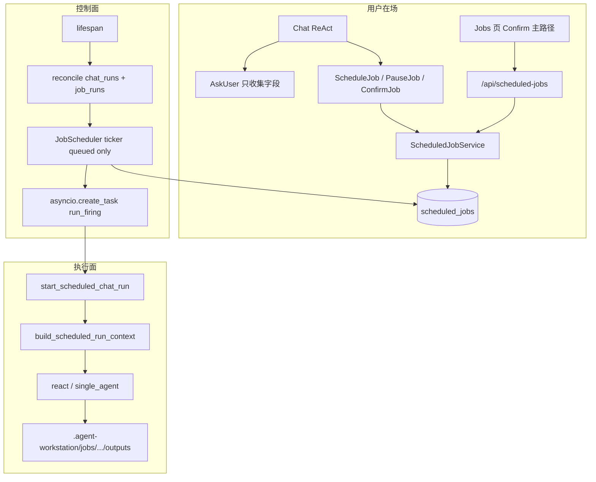

# 定时任务（Scheduled Jobs）后续路线设计

> 状态：Draft / 后续路线。2026-08-20。
> 作者：引力 YINLI 架构（已登记为后续路线）。
> 本文已在 `docs/README.md`「后续路线」登记；落地实现前不得当作在线行为基线。
> 稳定事件字段以 `docs/chat-sse-event-contract.md` 为准；本文不定义新的 Chat SSE 字段。
> 边界对照：`docs/team-runtime-redesign.md`、`docs/subagent-delegation-design.md`。

---

## Overview

办公场景需要可重复的到点执行：周报、对账、纪要、到期提醒。当前 Chat 链路是「用户在场、发一条、跑一轮」；Electron 退出后进程内 timer 全部消失。用户希望用对话把任务登记成结构化 Job，到点自动跑、生成办公产物，再按策略通知自己确认后外发。

本设计把能力拆成控制面与执行面：对话只负责问清并写入 SQLite `ScheduledJob`；后端进程内调度器到点 INSERT `queued` 并用 `create_task` 跑 firing；拿到信号量后才 `starting`，再通过领域 API `start_scheduled_chat_run()` 创建一次普通 `mode=agent` 的 ReAct Chat Run。禁止调度器直接 `await start_chat_run()`（该方法立即返回句柄、抛 `HTTPException`、会走交互式组装）。不新增 `runtime.kind`，不在对话进程里 sleep，不默认把文件发给客户。

第一版覆盖「应用开着准时、关着启动后补跑或标记 missed、产物入库、应用内通知」。预览发送、免审外发、OS 级唤醒分后续阶段。Phase 1 无系统托盘：Windows 关窗口即退出，下次启动再 reconcile。

---

## Background & Motivation

当前在线架构（`docs/architecture-overview.md`）里，一次交互任务必须经过：

1. 前端 `ChatPage` → `useEventStream.sendMessage()` → `POST /api/chat/send/start`
2. `handlers/send.py` 的 `start_chat_run()` 解析 `RuntimeContext`，调用 `start_chat_background_run()` **立即返回** Run 句柄；真正的 ReAct 在独立 `asyncio.Task` 里
3. architecture 只有 `react`；`mode=agent|team` 机械决定 executor
4. 信息缺口由主 Agent 调 `AskUser`（`is_external_tool=True`），经 `POST /api/chat/resume/start` 恢复同一 Run。AskUser 的 `kind=approval` Block 同时服务权限 HITL，不是 Job 专用
5. 权限 HITL 会把 Run 停在 `waiting_user` / `waiting_permission` 并写入 `PENDING_INTERACTIONS`。Team Member 对 HITL 是自动拒绝（`member_runtime.py`，`MAX_AUTOMATIC_TOOL_DENIALS=8`），交互式 Leader 不会自动拒绝
6. 主 Agent `workspace_dir` 是 `{project_root}/.agent-workstation/sessions/{session_id}/`（`run_context.py` + `project_session_directory()`）。`ScopedWrite` 把相对路径解析到该 session cwd；`list_project_session_artifacts` 只扫这个目录
7. Skill 可见集不是关键词选择：`skill_selector.select_runtime_skills()` 只返回已安装 Skill；`run_context.py` 用 Agent 绑定 ∩ 请求 `skill_ids` ∩ Project binding，缺的会 **静默丢掉**
8. `MAX_BACKGROUND_RUNS=50` 是进程内 `_prune_runs_locked` 的内存保留上限，不是启动拒绝闸门
9. `lifespan` 今天只收口 Subagent 文件任务和 TeamRun，**没有** Chat Run 孤儿 reconcile。崩溃后 `chat_runs` 会一直停在 `running` / `waiting_*`
10. `save_chat_store()` 先 `DELETE FROM chat_sessions` 再按 Pydantic 列全量写回；未进入 `ChatSession` 的列会被抹掉
11. SQLite 只开了 `PRAGMA journal_mode=WAL`，**没有** `PRAGMA foreign_keys=ON`，表上的 FOREIGN KEY 不会生效

痛点：周报不是「现在做一次」，而是固定 Agent / Project / Skill 的周期执行。在 ReAct 里 sleep 会占后台 Task，Electron 一关全丢。不得用新 `runtime.kind=scheduled` 绕过 ReAct。Artifact Phase 尚未定义所有权表（Write/Edit 的 `ARTIFACT_*` 只是 DisplaySnapshot 展示 Block）。自动外发不是默认能力。

产品已拍板的拆分：

| 段 | 第一版 | 默认行为 |
| --- | --- | --- |
| 到点跑并生成产物 | 做 | 应用开着准时；关着启动后补跑或 `missed` |
| 发给客户 | 不做默认能力 | 生成后通知用户；确认后才允许发送 |

---

## Goals & Non-Goals

### Goals

1. 用户能在 Chat 里通过 AskUser 把周期、时区、Agent、Project、Skill/模板、输入来源、失败策略、投递策略问清，并登记为结构化 Job。
2. Job 有独立管理页：查看、暂停、恢复、删除、改调度、确认启用；「关掉周五那个周报」更新已有 Job。
3. 到点创建一次普通 Chat Run，复用 ReAct、Skill catalog、权限、Trace、Workspace/Project 绑定、Event Stream V3。
4. 产物写入 firing 工作目录（沿用 `.agent-workstation/` 约定），并在 Job 运行历史上记录 manifest；为未来 Artifact 留下 hook。
5. 应用内通知成功/失败/错过；电脑开着尽量准时，关着启动后按策略补跑或标记 missed。
6. 外发通道、Secret、收件人白名单作为后续阶段预留；第一版投递策略字段不可空，默认 `notify`。

### Non-Goals

- 不新增 `runtime.kind`，不恢复旧独立 Plan / Subagent / Memory Runtime，不恢复持久 Team。
- 不在对话进程、AskUser 等待或 ReAct 迭代里 sleep 到点。
- 不把 Dynamic Workflow 当成定时任务执行引擎。
- 不默认 Team、不每次定时重规划、不在无人值守 firing 中注入 AskUser / Plan Mode / DelegateTask。
- Phase 1 不实现 OS 级唤醒、系统托盘、常驻无 UI 后端、免审自动发送、五字段 cron。
- 不把模型输出的任意邮箱当成收件人。
- 不把 Job 领域事件做成顶层 Chat SSE（`JOB_EVENT` 禁止）。
- 不把 Artifact 生命周期提前做完；只约定路径和后续 hook。
- 不把 AgentScope 内部 permission mode 名（`ACCEPT_EDITS` / `BYPASS`）暴露给用户。用户只看到 `read_only | trusted_tools | confirm_destructive | ask_every_time`。

---

## Key Decisions

1. **到点走领域 API `start_scheduled_chat_run()`，不新开 Runtime，也不直接 `await start_chat_run()`。** 调度器是控制面，Chat Run 是执行面。`runtime.kind` 仍只有 `react`，`mode` 固定 `agent`。包装层负责：内部 DTO、领域错误、冻结 ToolScope/Skill、无人值守裁剪、返回 `chat_run_id` 且不等待终态。
2. **SQLite 是 Job 控制面事实源；产物文件是 firing 事实源。** 控制面要按 `next_run_at` 扫描；办公文件必须是用户可打开的真实文件。
3. **对话工具是普通工具，不是 external HITL 工具。** `ScheduleJob` / `ListJobs` / `PauseJob` 立即写库。缺口用现有 `AskUser` 问。Job 生命周期不属于某次 Run 的暂停点。
4. **每次 firing 新建 `kind=scheduled_job` 的 Chat session，禁止复用登记会话，也禁止跨周复用执行会话。** 冻结提示词是本轮唯一用户消息；`_build_conversation_history_prompt(limit=12)` 因此为空。历史 firing 挂在 `scheduled_job_runs.chat_session_id`。
5. **firing 去掉 AskUser / Plan / Subagent；HITL 在进入 `waiting_*` 之前由 `hitl_unattended_resolve` 处理。** cwd 内 Write/Edit **自动批准**；其余交互一律拒绝。Team Member 仍用纯 deny helper，二者只共享 resume 事件构造，不共用决策。上限 8 **只计 deny**。禁止把 Team 的 deny-only 原样套到 scheduled Leader，也禁止在 `leader_stream.py` 复制仍会写入 `PENDING_INTERACTIONS` 的暂停路径。
6. **ToolScope 在 Job 上冻结，firing 不跑 `tool_scope_resolver`。Skill 不是关键词选择。** Phase 1 默认冻结 scope **全关** Bash/HTTP/Web/MCP/知识库（见数据模型）；`RuntimeToolScope()` 的 dataclass 全 True 不得当 Job 默认值。`used_skills` 必须 **等于** 冻结 `skill_ids`，且全部仍安装、仍在 Agent 绑定、仍在 Project binding，否则 `skill_unbound`。Skill 包含 `scripts/` 才打开 `allow_bash`。
7. **调度器放 FastAPI 进程内。ticker 只 INSERT `queued` + `create_task`，禁止 await 信号量或完整 ReAct。** Electron 不持有 Job timer。OS 唤醒是 Phase 4。
8. **错过只补跑最近一次，不追赶堆积。** 处理完当次 due（catch-up 或 missed）后 `next_run_at = next_anchor_after(max(scheduled_for, now))`，一次跳过积压周期。weekly 按钟面（weekday + clock）算下一锚点，不是「现在 + 7 天」。
9. **生成与外发解耦。** Agent 只写产物；投递由控制面在 Run 成功后执行。firing 的 ToolScope 不含投递通道。
10. **投递策略默认 `notify`，`auto_send` 必须连续成功且用户显式打开。** 收件人只允许 Project 白名单。Phase 1 拒绝 `auto_send` 进入 `active`。
11. **Job 启用由控制面 `ScheduledJobService.confirm()` 完成，不以模型漏调 `ConfirmJob` 为唯一路径。** Jobs 页确认按钮是主路径。AskUser 只收集字段，resume 答案不会自动把 Job 变 `active`。不先改 SSE 契约。
12. **产物目录沿用 `.agent-workstation/`，firing 的 `workspace_dir` 设为该次 run 目录。** Read/Grep/Glob 的 `scope_dir` 是 Project∩Agent；**Write/Edit 的 `scope_dir` 收窄为 `workspace_dir`**（工厂不得给 Write 同一个宽 `filesystem_scope`）。禁止依赖模型写绝对路径。不新建 `.yinli/`。
13. **Phase 1 无人值守工具：Read/Grep/Glob 可读 Project 交集；Write/Edit 仅 cwd 内自动批准。** Bash/网络/MCP 默认不注入。需要 Skill `scripts/` / Bash 的 Job，Agent 必须是用户可见的 `trusted_tools` 才能 `active`。`ask_every_time` 的 Markdown 周报靠 HITL **批准** cwd Write，而不是 deny。不把该 Agent 改成全局 BYPASS。
14. **ticker 只插入 `queued` 并 `create_task`；信号量在 Task 内、claim `starting` 之前获取。** `JobScheduler` 持有 in-flight `set[Task]`。stale 60s 只回收「`starting` + 空 `chat_run_id` + 进程内无对应 Task」。禁止把排队中的 `queued` 当 stale。硬超时 `min(agent.timeout_seconds, 900)`。
15. **Phase 1 调度种类只有 `weekly` 与 `once`。** cron 留后续 PR，并同时显式依赖 `croniter` 与 `tzdata`（Windows 常缺系统 IANA，见 `prompts.py` 注释）。
16. **Phase 1 无系统托盘。** Windows 关窗口即 `app.quit()`，视为错过，下次启动 catch-up 或 `missed`。要准时请保持应用开着（macOS 关窗留 Dock 时后端仍在）。
17. **Chat 历史默认隐藏 `kind=scheduled_job`。** `GET /api/chat/sessions` 与 `/sessions/catalog` 默认 `kind=chat`。Jobs 页按 firing 查看。

---

## 不变量

1. Chat architecture 只有 `react`。定时 firing 不得引入 `runtime.kind=scheduled` 或任何新 architecture。
2. 每次到期最多创建 **一次** 普通 Chat Run；`mode` 必须是 `agent`。禁止 `mode=team`，禁止 `plan_requested=true`。
3. Job 身份是 `job_id`。对话、自然语言、工具参数里的名称只用于查找，不能代替主键。
4. 未进入 `active` 的 Job（`pending_confirmation` / `paused` / `archived` / `completed`）不得被调度器触发。
5. 同一 Job 同一时刻最多一个非终态 firing（`queued` / `starting` / `running`）。新的 due 必须 skip，不得并行。`run-now` 在已有非终态 firing 时 HTTP 409。
6. 对话登记进程不得 `sleep`、`asyncio.sleep` 到点，也不得把到期时间写进 ReAct 迭代等待。
7. firing Run 不得注入 `AskUser`、Plan Mode 工具 / middleware、`DelegateTask` 工具组。缺信息必须失败并写 `needs_job_update`。
8. firing 遇到 `REQUIRE_USER_CONFIRM` 或 `REQUIRE_EXTERNAL_EXECUTION` 必须在写入 `PENDING_INTERACTIONS` / `waiting_*` **之前**由 `hitl_unattended_resolve` 处理：cwd 内 Write/Edit **批准**（`confirmed=True`），其余 **拒绝**。deny 累计超过 8 次则 Run `failed`。批准不计入该上限。不得把 `waiting_user` 当成功路径。
9. `frozen_prompt`、`agent_id`、`project_id`、`skill_ids`、`tool_scope`、输入/产出约定、投递策略在 `active` 后是调度依据；改投递/收件人/Skill 必须回到 `pending_confirmation`。
10. Workspace / Project 归属与普通 Chat 相同：Job 绑定 `project_id`，Workspace 由 Project 反查；Session 不得跨 Project。Project 归档、Agent 禁用/删除、冻结 Skill 移出 binding 时，service 立即 `paused`（不只等下次 due）。
11. firing 的 `workspace_dir` 必须是 `{project_root}/.agent-workstation/jobs/{job_id}/runs/{firing_id}/`。Read/Grep/Glob：`base_dir=workspace_dir`，`scope_dir=Project∩Agent`。Write/Edit：`base_dir=scope_dir=workspace_dir`。相对路径 Write 只进 cwd；`../` 或绝对路径即使仍在 Project 内也必须 DENY。产物必须落在 `workspace_dir` 内。
12. 收件人只能来自 `project_job_recipients` 白名单。模型输出、冻结提示词、邮件正文里的地址一律不得进入投递 API。
13. 投递策略 `auto_send` 仅当 `consecutive_successes >= required_successes` 且 `auto_send_enabled_at` 非空时生效；任一失败将连续成功清零。
14. Secret 不得写入 `scheduled_jobs` / SQLite JSON。出站凭据走现有 `secret_store` 的同一 Keychain service 名 `agent-workstation-desktop.model-credentials.v1`，account 前缀 `outbound-channel:{channel_id}`。
15. 调度器重启必须幂等：`UNIQUE (job_id, scheduled_for, trigger)` 去重，不得把同一到期点跑两遍。任一 firing 进入终态（含启动 reconcile）必须调用 `finalize_job_clock`：weekly（`trigger≠manual`）把 `next_run_at` 推到 `next_anchor_after(max(scheduled_for, now), expr, tz)`，一次跳过积压周期；once 成功 → `completed`，失败/missed → `paused` 且 `next_run_at=NULL`。`notify_keep_schedule` 不是用同一 `scheduled_for` 再试。`trigger=manual` 的 weekly **不改** 周期 `next_run_at`。
16. 错过策略不得把多个积压周期一次性全部执行。一次 tick 每个 Job 最多补 1 次。
17. 定时 Run 计入 `chat_runs`，带内部 `trigger_source=scheduled_job`；Runs / Trace 可按该列筛选。禁止用普通 `/runs/{id}/rerun` 重跑定时 Run（409，引导 `run-now`）。
18. 「关掉周五那个周报」必须落到已有 Job 的 `paused`，禁止再插入一条语义相同的新 Job 作为关闭手段。
19. 后端启动必须先跑 **新的** Chat Run 孤儿 reconcile（本进程 `_runs` 中无活 Task 的 `running`/`waiting_*` → `failed`，`error_code=process_restart`），再把非终态 `scheduled_job_runs` 标失败并 `finalize_job_clock`，最后才 start ticker。交互 HITL 重启后对用户显示失败/请重新发送（与现有「进程重启不能 resume」一致）。热重载不得误杀仍在 `_runs` 里的 Task。当前 **不存在** 通用 Chat 孤儿策略。
20. Chat SSE 仍只有 `RUNTIME_EVENT` 与 DisplaySnapshot V4。Job 列表、下次运行、投递状态不以顶层业务 SSE 推送。
21. Agent 缓存 key 的 `runtime_features_cache_key` 必须区分 `scheduled-job-tools` 与 `scheduled-job-unattended`，并含 denylist 排序指纹。同一 `agent_id` 的交互实例不得被 firing 复用。
22. `kind=scheduled_job` 的 session 必须经 ChatStore / `ChatSession` 写入（含 `kind` 列的 load/save INSERT）。禁止 JobService 直接 SQL INSERT session。catalog 默认不返回这类 session。
23. ticker 协程不得 await 完整 ReAct，也不得 await 信号量。tick 只 INSERT `queued` 并 `create_task`；Task 进 `JobScheduler._inflight`。`queued` **不是** stale。`starting` 超过 60s、`chat_run_id` 仍空、且 `_inflight` 无对应 Task，才视为 `failed`。
24. 调度器 `stop()` 必须在 `close_db()` 之前：取消 ticker、cancel `_inflight` 集合、`run_firing` 的 `finally` 把未完成 firing 标 `cancelled`/`failed`。任何异常都 `finalize_failed` + `finalize_job_clock`。

---

## 删除 / 禁止边界

实施与后续迭代明确禁止：

| 禁止项 | 原因 |
| --- | --- |
| `runtime.kind=scheduled` / `cron` / `job` | architecture 只保留 `react` |
| 恢复旧独立 Plan / Subagent / Memory Runtime、持久 Team | 已删除设计，不得借定时任务复活 |
| 在 `AskUser`、HITL resume、ReAct acting 里 sleep 到点 | 进程不可靠，且占用后台 Task |
| 调度器直接 `await start_chat_run()` | 立即返回、抛 HTTPException、走交互组装 |
| Electron 渲染进程 `setTimeout` / 主进程独立 cron 与后端同时触发 | 双发 |
| firing 注入 AskUser、Plan Mode、DelegateTask | 无人值守会卡死或产生未审批子任务 |
| 把 Team Member deny-only HITL 原样套到 scheduled Leader | `ask_every_time` 下 cwd Write 会被拒绝，Markdown 周报失败 |
| 给 firing Write 使用与 Read 相同的宽 `filesystem_scope` | `../` 只要在 Project 内就能写出 cwd |
| 冻结 `tool_scope` 缺省落入 `RuntimeToolScope()` 全 True | Markdown Job 被误标需要 Bash/`trusted_tools` |
| 模型解析任意收件人、从 Memory 里「找到客户邮箱就发」 | 外发必须白名单 |
| 默认 `auto_send`、UI 把「发送给客户」画成开关默认开 | 产品结论 |
| 顶层 `JOB_EVENT` / 独立 Job SSE / 前端第二份 Job 状态树当 Chat 展示源 | 违反 Event Stream V3 |
| 把 Workflow 节点、`workflow_artifacts` 表复用为 Job 产物 | Workflow 是另一条后续路线 |
| 为 Job 新建 IM Runtime | 通道复用 HTTP Tool / MCP |
| 在 `http_tools.auth_config` 或 Job JSON 里存 SMTP/Bot token 明文 | Secret 走 `secret_store` |
| 没有 Artifact 时编造 `artifact_id` 给前端下载 | 第一版用文件路径；Artifact 后接 hook |
| 用关键词 `tool_scope_resolver` 在 firing 时重新裁剪工具 | 必须用 Job 冻结范围 |
| 静默交集丢掉冻结 Skill | 必须 `skill_unbound` 失败 |
| 定时默认 Team executor | 产品：固定单 Agent |
| 把登记用 Chat session 或跨周 execution session 拿来当 firing session | 历史污染冻结任务 |
| 公开 `ChatMessage.trigger_source` | 伪造可绕过 AskUser；用内部 DTO |
| 普通 Runs `rerun` 重跑 scheduled Chat Run | 会走交互路径，绕过冻结规格 |
| Phase 1 五字段 cron / APScheduler / `retry_once` failure_policy | 语义未闭合；见调度语义 |
| 复用当前过窄的 `resolveSafeLocalPath` 打开任意产物 | 外置盘 Project 会失败 |
| 把 AgentScope `ACCEPT_EDITS` 写进用户设置文案 | 用户枚举是 `confirm_destructive` 等 |

当前 **不删除** 的在线能力：Plan Mode middleware、`DelegateTask` Subagent、AskUser、TeamRun。它们继续服务交互式 Chat；只是 **不进入 scheduled firing 的工具集**。

---

## Proposed Design

### 组件边界

```text
交互式 Chat（用户在场）
  AskUser 问清字段（不激活 Job）
  ScheduleJob / ListJobs / PauseJob / UpdateJob / ResumeJob / DeleteJob / ConfirmJob
       -> ScheduledJobService -> SQLite
  前端 Jobs 页 REST 确认启用 = 同一 confirm()

FastAPI lifespan
  1. init_db
  2. 现有 Subagent / Team 收口
  3. NEW reconcile_interrupted_chat_runs()
  4. NEW reconcile_interrupted_job_runs()
  5. scheduler.start()          # ticker，不 await ReAct
  shutdown: scheduler.stop()    # 先于 close_db()

JobScheduler.tick()
  -> reclaim_orphan_starting()     # 仅 starting + 无 inflight Task
  -> INSERT queued（UNIQUE claim，不占信号量）
  -> create_task(run_firing)；Task 加入 _inflight
  -> 立即返回（不 await 信号量、不 await ReAct）

run_firing
  -> async with semaphore:         # 先拿槽，再 starting
       queued -> starting
       start_scheduled_chat_run -> chat_run_id
       running -> 终态
  -> finally: finalize_job_clock + 从 _inflight 移除
```



### firing 工作目录（不变量 11）

当前交互 Chat：

```text
workspace_dir = {project_root}/.agent-workstation/sessions/{session_id}/
scope_dir     = Project root ∩ Agent filesystem_scope
```

`ScopedWrite` 相对路径 → `base_dir`（session cwd）。`resolve_existing_workspace_path` 在 session 中不存在时允许按 `scope_dir` 读输入文件。`list_project_session_artifacts` 只认 session 目录，因此 **Chat/Runs 详情里的 artifact Block 不能当 Job 产物清单**。

Phase 1 选定方案 **(a)**，并新增与 `project_session_directory()` 并列的函数 `project_job_run_directory(project_root, job_id, firing_id)`：

```text
workspace_dir = {project_root}/.agent-workstation/jobs/{job_id}/runs/{firing_id}/
                  result.md
                  outputs/          # 扫描目标
                  error.md          # 仅失败
                  spec.json         # 系统写的冻结规格副本，不依赖模型
Read/Grep/Glob: base_dir=workspace_dir, scope_dir=Project ∩ Agent filesystem_scope
Write/Edit:     base_dir=scope_dir=workspace_dir   # 比 Project 更窄，工厂不得复用宽 filesystem_scope
```

规则：

- `frozen_prompt` 与 system addendum 写明：最终文件用 **相对路径** 写到 `outputs/`（例如 `outputs/weekly-report.md`），禁止绝对路径。
- JobFiringService 扫描 `workspace_dir/outputs/`，系统生成 `manifest.json`（sha256、字节数、相对路径）。不信任模型自报路径。
- 输入文件用 `input_spec.paths`（相对 Project root）。Read 走现有 scope-relative fallback，不要求输入先拷进 firing cwd。
- 不使用 `.yinli/`。`ScopedGlob.ignored_directories` 当前不含 `.agent-workstation`；firing cwd 已在该目录内，从 cwd Glob `outputs/**` 可见。不要把 `.agent-workstation` 加入忽略列表。
- Jobs 页打开产物：Electron `open-path` 白名单必须包含 **当前 Project root 及其子路径**（与选目录 IPC 同源），不得复用只允许 `cwd` / `userData` / `home` 的 `resolveSafeLocalPath`。

### 对话登记，不在对话里等待

1. 用户说「每周五生成周报发给客户」。
2. Readiness 通过后进入交互式 ReAct（现有 `readiness_gate.py`，不让 ReadinessAgent 选择 Job）。
3. 主 Agent 用 **AskUser** 补齐字段。投递 options **第一项且默认选中** 必须是「生成后通知我」。Phase 1 不出现「直接发给客户」。
4. Agent 调用 `ScheduleJob`：字段必须齐全，写入 `pending_confirmation`。同 Project 重名拒绝。没有 `draft` 状态。
5. **启用不发生在 AskUser resume。** 助手告知用户到「定时任务」页点击确认；Jobs 页 `POST .../confirm` 是主路径。用户在对话里说「确认启用」时，模型可调幂等 `ConfirmJob(job_id)`，内部仍是 `ScheduledJobService.confirm()`。
6. `confirm()` 成功后 `active`，按 timezone 计算 `next_run_at`。本轮交互 Chat **结束**。到期与本 session 无关。

「关掉周五那个周报」：`ListJobs` → 唯一命中则 `PauseJob(job_id)`；0 命中失败；多命中再 AskUser 选择。禁止再 `ScheduleJob` 一条「已关闭」记录。

feature flag `scheduled_jobs.enabled`（`json_store` / `system_settings`）默认 **false**，直到 ticker（PR 5）与管理页（PR 7）都亮灯。flag 为 false 时：写工具与 POST create/confirm 返回 403「调度未启用」，`ListJobs` / GET 仍可读；UI 标明未启用。

### 调度器放哪

| 阶段 | 谁触发 | 谁执行 | 进程不在时 |
| --- | --- | --- | --- |
| Phase 1 | FastAPI `lifespan` 的 `JobScheduler` ticker | `create_task(run_firing)` → `start_scheduled_chat_run` | 下次启动 reconcile |
| Phase 2–3 | 同上 | 成功后再走 DeliveryDispatcher | 同 Phase 1 |
| Phase 4 | OS（launchd / 任务计划）或常驻后端 | 仍是 Python `tick()` | OS 拉起后端做一次 tick |

Phase 1 ticker：`asyncio` 循环 15s 扫 `status='active' AND next_run_at <= now`。不用 APScheduler。到期计算：`zoneinfo` + 显式依赖 `tzdata`（写进 `backend/pyproject.toml`，不要只靠 AgentScope 传递依赖）。Phase 1 **不解析 cron 五字段**。

Electron `electron/main.ts` **不** 为 Job 建 timer。`window-all-closed` 非 darwin 会 `app.quit()`；`before-quit` 已 `stopPythonBackend()`。macOS 关窗留 Dock 时后端仍在，Phase 1 仍可触发。无 tray（KD 16）。

休眠：asyncio 时钟暂停；唤醒后下一次 tick 看到 overdue，走 missed/catch-up。目标是「开着大约准时」（秒到一分钟），不是交易所级。

### Job 状态机

```text
pending_confirmation -> active <-> paused
                          |           |
                          v           v
                       archived    archived

active -> completed   # 仅 kind=once 成功结束后
```

没有 `draft`。不完整表单只存在于 AskUser 轮次，不写库。REST 创建也必须字段齐全，否则 422。

合法迁移由 `ScheduledJobService` 唯一执行。

| 状态 | 调度 | 含义 |
| --- | --- | --- |
| `pending_confirmation` | 否 | 字段齐全，等人在 Jobs 页或 `ConfirmJob` 启用 |
| `active` | 是 | `next_run_at` 有效 |
| `paused` | 否 | 用户暂停、资源失效自动暂停、`once` 失败、或超过每日/连续失败上限 |
| `archived` | 否 | 删除的默认语义，不级联抹 firing / Trace |
| `completed` | 否 | `kind=once` 成功结束 |

自动暂停必须写 `pause_reason` 并发通知。接线点（不只等 tick）：

- `workspaces.py` Project 归档 / 删除
- Agent disable / delete
- Project resource binding 变更（Skill / Agent 移出）
- tick 前的兜底校验（执行目录消失等）

`kind=once`：成功 → `completed` 且 `next_run_at=NULL`。失败或 missed → Job `paused`（`pause_reason=once_failed`），`next_run_at=NULL`。**禁止**每 15s 用同一个 `next_run_at` 重试。

pause 时已 `queued`/`starting`/`running` 的 firing：**默认不杀**，跑完。Jobs 页提供 `POST .../runs/{firingId}/cancel` 才取消。pause 只阻止下一次 INSERT。

### 一次 firing 的生命周期

```text
due -> queued -> starting -> running -> succeeded
       \              \        \-----> failed
       \              \--------------> cancelled
due -> missed
due -> skipped     # 已有非终态 firing，或 due 前已 pause
```

`queued` 表示 UNIQUE 行已插入、Task 已在 `_inflight`，但尚未拿到信号量。`starting` 表示已持有信号量、正在 `start_scheduled_chat_run`。

投递状态与执行状态正交（Phase 1 几乎只有 `not_applicable` 或成功后的 notify，无真正发送）：

```text
not_applicable
pending_review -> approved -> sending -> sent
                           \          -> send_failed
             -> skipped
```

#### 领域 API（禁止直接调 `start_chat_run`）

`start_chat_run()`（`handlers/send.py`）只做：校验 → `start_chat_background_run()` → **立即返回句柄**。它会 `raise HTTPException`，不接收冻结规格，会走 `build_chat_run_context()` 的 Readiness / intent / 关键词 ToolScope / Skill 静默交集，并注入 AskUser/Plan/DelegateTask。无 HTTP 时没有 FastAPI auth 问题（本机即 owner，`LocalAccessMiddleware` 只管 HTTP），缺口是语义而不是认证。

```python
# backend/src/scheduler/chat_bridge.py
class ScheduledChatLaunchError(Exception):
    """领域错误，不抛 HTTPException。"""

@dataclass(frozen=True)
class ScheduledRunRequest:
    job_id: str
    firing_id: str
    workspace_id: str
    project_id: str
    agent_id: str
    frozen_prompt: str
    skill_ids: list[str]
    tool_scope: RuntimeToolScope
    scheduled_for: str
    trigger: Literal["schedule", "manual", "catch_up"]

async def start_scheduled_chat_run(req: ScheduledRunRequest) -> str:
    """创建 kind=scheduled_job 的新 session 与 Chat Run，返回 chat_run_id。
    不等待终态。失败抛 ScheduledChatLaunchError。
    """

async def await_scheduled_chat_run(
    chat_run_id: str, *, timeout_seconds: float,
) -> str:
    """等待 chat_runs 进入 completed/failed/cancelled。
    超时则 cancel_chat_background_run，返回 cancelled。
    """
```

`start_scheduled_chat_run` 内部：经 ChatStore 创建 session（`kind=scheduled_job`）→ `resolve_runtime_context` → `build_scheduled_run_context` → `start_chat_background_run(..., persist=True, trigger_source="scheduled_job", scheduled_job_id=..., scheduled_firing_id=...)`。`send.py` **不得** import scheduler。`ChatBackgroundRun` / `_persist_run` / `chat_run_records.upsert` 必须持久化这三列。

公开 `ChatMessage` **不增加** `trigger_source`。HTTP `/send` 与 `/send/start` 保持现有 schema（`extra=forbid`）。定时路径只用 `ScheduledRunRequest`。

`POST /api/chat/runs/{id}/rerun`：若源 Run `trigger_source=scheduled_job` → 409，说明使用 Job `run-now`。

#### ticker 与完成路径伪代码

```python
MAX_SCHEDULED_FIRINGS = 2
STARTING_STALE_SECONDS = 60
DEFAULT_FIRING_TIMEOUT = 900

_sem = asyncio.Semaphore(MAX_SCHEDULED_FIRINGS)
_inflight: set[asyncio.Task] = set()          # 禁止裸 create_task 无引用
_firing_tasks: dict[str, asyncio.Task] = {}   # firing_id -> Task

def _track(task: asyncio.Task, firing_id: str) -> None:
    _inflight.add(task)
    _firing_tasks[firing_id] = task
    task.add_done_callback(lambda t: (_inflight.discard(t), _firing_tasks.pop(firing_id, None)))

async def tick():
    reclaim_orphan_starting()
    for job, scheduled_for, trigger in due_jobs():
        if job.has_non_terminal_firing():
            continue
        firing_id = insert_queued(job.id, scheduled_for, trigger)  # UNIQUE
        if firing_id is None:
            repair_clock_if_terminal_row_exists(job, scheduled_for, trigger)
            continue
        task = asyncio.create_task(run_firing(job.id, firing_id), name=f"job-{firing_id}")
        _track(task, firing_id)
    # tick 绝不 await 信号量或 run_firing

async def run_firing(job_id, firing_id):
    try:
        async with _sem:  # 先拿槽，再 starting
            mark_starting(firing_id)
            req = build_request(job_id, firing_id)
            chat_run_id = await start_scheduled_chat_run(req)
            mark_running(firing_id, chat_run_id)
            timeout = min(agent_timeout_seconds(req.agent_id), DEFAULT_FIRING_TIMEOUT)
            terminal = await await_scheduled_chat_run(chat_run_id, timeout_seconds=timeout)
            manifest = scan_outputs(workspace_dir / "outputs")
            finalize(firing_id, terminal, manifest)
    except Exception as exc:
        finalize_failed(firing_id, exc)
    finally:
        # finalize_* 必须调用 finalize_job_clock；幂等
        ensure_terminal_and_clock(firing_id)

def reclaim_orphan_starting() -> None:
    """只回收「starting + 空 chat_run_id + 进程内无 Task」。
    queued 即使等待超过 60s 也不是 stale。
    """
    for row in list_starting_without_run_id():
        if row.age_seconds < STARTING_STALE_SECONDS:
            continue
        if row.id in _firing_tasks:
            continue
        finalize_failed(row.id, error_code="stale_starting")

async def stop() -> None:
    ticker_task.cancel()
    for task in list(_inflight):
        task.cancel()
    if _inflight:
        await asyncio.gather(*_inflight, return_exceptions=True)
```

`MAX_SCHEDULED_FIRINGS=2` 限制同时处于 `starting`/`running` 的 firing。`queued` 可以多于 2，它们等信号量，**不算 stale**。交互 Chat 仍走 `MAX_BACKGROUND_RUNS=50` 内存 prune，与 scheduled 信号量不是同一闸门。

#### `finalize_job_clock`（失败后必须推钟）

`UNIQUE (job_id, scheduled_for, trigger)` 禁止用同一到期点再 INSERT。因此 **任何终态**（`succeeded` / `failed` / `cancelled` / `missed` / `skipped`，含启动 reconcile）都必须改 Job 时钟，否则 Job 会表面 `active`、`next_run_at` 仍指向已占用的 `scheduled_for`，以后 claim 全部 UNIQUE 失败。

```text
finalize_job_clock(job, firing):
  weekly:
    若 firing.trigger == manual：不改 next_run_at
    否则 next_run_at = next_anchor_after(max(firing.scheduled_for, now), expr, tz)
    # 钟面锚点，不是 now+7d；max(..., now) 一次跳过关闭期间积压的周
    若 failure_policy=pause_job 且 firing 非 succeeded → paused
    否则保持 active（notify_keep_schedule ≠ 同一次 scheduled_for 再试）
  once:
    succeeded → status=completed, next_run_at=NULL
    failed/missed/cancelled → status=paused, next_run_at=NULL, pause_reason=once_failed
```

若 tick 发现 UNIQUE 冲突且该行已终态、但 Job.`next_run_at` 仍等于该 `scheduled_for`，视为时钟损坏，补跑一次 `finalize_job_clock`。

#### 超时、陈旧 starting、pause、run-now

| 场景 | 行为 |
| --- | --- |
| ReAct hang | `await_scheduled_chat_run` 超时 → `cancel_chat_background_run` → firing `failed` `timeout` → `finalize_job_clock` |
| 排队 `queued` 超过 60s | **继续等信号量**，不是 stale |
| `starting` + 空 `chat_run_id` + `_firing_tasks` 有本行 | 启动中，不回收 |
| `starting` + 空 `chat_run_id` + 无 Task + 超过 60s | `stale_starting` → `finalize_job_clock` |
| 进程崩溃留下 `queued`/`starting`/`running` | 启动 reconcile：无活 `_runs` Task 则失败 + `finalize_job_clock` |
| `run-now` 时已有非终态 firing | 409 |
| `run-now` 成功 | `trigger=manual`，`scheduled_for=now`；weekly **不改** 周期 `next_run_at`；once 成功则 completed |
| pause 时 in-flight | 不自动 cancel |
| 每日 firing（含 missed/catch_up/manual）超过 `max_firings_per_day`（默认 8） | 本 Job `paused` `pause_reason=daily_cap` |
| 连续失败达到 `max_consecutive_failures`（默认 3） | `paused` `pause_reason=consecutive_failures` |

### 错过运行（missed）策略

| `missed_policy` | 行为 |
| --- | --- |
| `catch_up_once`（默认） | 过期且 `now - scheduled_for <= grace` 则补跑 **一次**（`trigger=catch_up`）。过期且超出 grace：**不跑**，记一条 `missed` 并通知。无论补跑还是记 missed，随后 `next_run_at = next_anchor_after(max(scheduled_for, now))` |
| `mark_missed` | 不跑，记录 `missed`，通知，`next_run_at = next_anchor_after(max(scheduled_for, now))` |
| `skip_silent` | 同 mark_missed 但不通知（AskUser 默认不选） |

`grace_seconds` 默认 `min(6 * 3600, max(300, interval_seconds / 2))`。周任务 6 小时。

**钟面锚点（weekly）：** `schedule_expr = {"weekdays":["fri"],"at":"18:00"}`，timezone `Asia/Shanghai`。catch-up 在周六 10:00 跑完后，`next_run_at` 是 **下一个周五 18:00**，不是周六 10:00 + 7 天。若应用关了三周，`max(scheduled_for, now)` 一次跳到 now 之后的下一周五，禁止按周连续 `missed`/`catch_up`。`once` 没有下一锚点。

启动顺序：

1. `reconcile_interrupted_chat_runs()`（**新增**）：仅当 `run_id not in` 本进程 `_runs` 活 Task 时，把 `running`/`waiting_*` 标 `failed` `process_restart`。冷启动 `_runs` 为空，全部孤儿收口。uvicorn `--reload` 热重载必须先看 `_runs`，禁止误杀仍在跑的交互 Chat。用户侧：原 HITL `waiting_*` 显示失败并提示「进程已重启，请重新发送」（与现有「重启不能 resume `PENDING_INTERACTIONS`」一致，不是定时任务专属语义，但必须写明）。
2. 非终态 `scheduled_job_runs`（`queued`/`starting`/`running`）→ `failed` `process_restart`，并 **对每一行** `finalize_job_clock`。
3. `scheduler.start()` 后第一次 tick 处理 overdue Job（此时时钟已推进，不会撞上旧 `scheduled_for`）。

### 冻结规格与执行接缝

抽出 `build_scheduled_run_context(job, firing) -> ChatRunContext`，**不要**给现有 `build_chat_run_context()` 加一堆 `if trigger_source` 分支后仍调用模型 Readiness。工程师若只改 `react_runtime` 会漏掉组装层。

| 现有步骤（`build_chat_run_context`） | firing |
| --- | --- |
| `check_message_readiness_with_model` | **不调用**。结构校验：冻结提示非空、Project active、Agent 可用 |
| `route_chat_message_with_model` | **不调用**。固定 `react` + `single_agent` |
| `tool_scope_resolver` / `resolve_react_runtime_tool_scope` | **不调用**。按 Job JSON 反序列化；**缺省键视为 false**，禁止落入 `RuntimeToolScope` dataclass 的全 True |
| Skill | 不走「Agent 绑定 ∩ 请求 id」的静默交集。冻结 `skill_ids` 必须全部 ∈ Agent.skills 且 ∈ Project binding 且仍安装，否则 `skill_unbound`。`select_runtime_skills` 可以用来 **物化** 已安装对象，但不得丢 id |
| Plan / Subagent | `_build_runtime_feature_parts` 在 scheduled 路径返回空 extra_tools / middleware；`runtime_features_cache_key=scheduled-job-unattended:{denylist_fp}` |
| AskUser | denylist 含 `AskUser`；不进入 toolkit |
| HITL | scheduled Leader 用 `hitl_unattended_resolve`（cwd Write/Edit 批准，其余 deny）。Team Member 仍用 deny-only。只共享 resume 事件构造。deny 上限 8，批准不计。先于 `PENDING_INTERACTIONS` |
| Memory | 仍注入；成功后仍走 `MemoryAdmissionGate` |
| 权限 overlay | 见下一小节。不 `invalidate_agent()`，不改 Agent 全局 guardrails |
| session / cwd | 新 session；`session_workspace_dir = project_job_run_directory(...)` |
| 历史 prompt | 新 session，limit=12 为空 |
| `persist_run` | `true`，禁止 sandbox |
| `ChatMessage.skill_ids` | 内部组装时传入冻结列表，但公开 HTTP schema 不变 |

交互登记路径：`runtime_features_cache_key` 含 `scheduled-job-tools:{tool_names_fp}`，否则旧缓存 Agent 没有 `ScheduleJob`。Team executor 不注入 Job 工具。

#### 无人值守权限 overlay（KD 13）

用户可见策略仍是 `read_only | trusted_tools | confirm_destructive | ask_every_time`。工厂今天用 **同一个** `filesystem_scope` 构造 Read 和 Write（`factory.py` `_create_default_toolkit`）。若 firing 也这么做，`../` 只要仍在 Project∩Agent 内，Write 就会成功，overlay「仅 cwd」是空话。

`ask_every_time` 下每次 Write 都会 `REQUIRE_USER_CONFIRM`。若 scheduled 路径套用 Team Member 的 **deny-only** helper，Markdown 周报必然失败。因此 scheduled Leader **不能** 复用 `member_runtime` 的决策。

Phase 1 toolkit 装配（`build_scheduled_run_context` / firing 专用 toolkit，不是改 Agent 全局 guardrails）：

| 工具 | `base_dir` | `scope_dir` | HITL |
| --- | --- | --- | --- |
| Read / Grep / Glob | `workspace_dir` | Project∩Agent | 只读，无 HITL。输入走 scope-relative fallback |
| Write / Edit | `workspace_dir` | **`workspace_dir`**（窄于 Project） | cwd 内路径 → `hitl_unattended_resolve` **批准**；越界 DENY |
| Bash / HttpRequest / WebFetch / MCP / 知识库 | n/a | n/a | **默认不注入**。仅当冻结 `tool_scope.allow_*=true` 才注入；一旦 HITL 则 deny |
| AskUser / DelegateTask / Plan | n/a | n/a | 不注入 |

`hitl_unattended_resolve(event) -> approved | denied`：

1. 工具名 ∈ {Write, Edit} 且规范化路径 `is_relative_to(workspace_dir)` → 构造批准 resume（`confirmed=True`），**不计入** deny 上限。
2. 否则构造拒绝 resume（对齐 `_build_team_tool_denial` 的事件形状）。deny 累计 > 8 → Run `failed` `hitl_denied`。
3. 不得写入 `PENDING_INTERACTIONS`，不得把 Run 标 `waiting_*`。

`confirm()` / `would_fail_tools` 算法：

```text
injected = 冻结 tool_scope 为 true 的工具 ∪ {Read,Grep,Glob,Write,Edit}
若任一冻结 skill 包存在 scripts/ 目录 → 视为需要 Bash，confirm 时强制 allow_bash=true
would_fail = {t ∈ injected |
    Agent 策略下 t 会 HITL
    且 t 不是「cwd 内 Write/Edit」（overlay 会批准）}
若 would_fail 非空且 Agent 不是 trusted_tools → 422，列出工具名
```

禁止从交互试跑原样拷贝 `allow_bash=True` 的 scope。`ScheduleJob` 未声明时写入下一节的默认 JSON。`read_only` Agent 不能激活任何写产物的 Job。

### 产物路径与 Artifact 接入点

Write/Edit 仍可能投影 `kind=artifact` Block，但 `list_project_session_artifacts` 扫的是 session 目录，**Jobs 页以 `scheduled_job_runs.output_manifest` 为准**。Runs 详情里的 artifact Block 可能空白或不含 outputs/，这是已知分裂，不在 Phase 1 用假 `artifactId` 填平。

```python
class ArtifactIngestHook(Protocol):
    def ingest_job_outputs(
        self, *, workspace_id: str, project_id: str,
        job_id: str, firing_id: str, run_id: str,
        files: list[OutputFile],
    ) -> None: ...
```

Phase 1 `NullArtifactIngestHook`。

### 投递策略

```text
none | notify | confirm_then_send | auto_send
```

Phase 1：`notify` 默认；`confirm_then_send` 当作 notify + UI 标明发送未开放；`auto_send` 无法 `active`。生成与发送解耦不变。Secret：同一 Keychain service，account `outbound-channel:{channel_id}`。

### 对话工具

注入点：交互式单 Agent `extra_tools`，`is_external_tool=False`。实现：`backend/src/tools/scheduled_job_tools.py`。

| Tool | 职责 |
| --- | --- |
| `ScheduleJob` | 齐全字段 → `pending_confirmation`；重名拒绝；未传 `tool_scope` 则写入全 false 默认 JSON，禁止拷贝交互试跑的 `allow_bash=true` |
| `ListJobs` | 当前 Project：id/name/status/next_run_at/last_outcome |
| `DescribeJob` | 冻结规格 + 最近 N 次 firing |
| `PauseJob` | `job_id` 必填 |
| `ResumeJob` | 重新校验 binding 后 `paused` → `active` |
| `UpdateJob` | 改调度可保持 active；改投递/收件人/Skill → `pending_confirmation` |
| `DeleteJob` | 默认归档 |
| `ConfirmJob` | 幂等调用 `confirm()`；不是激活的唯一路径 |

`PauseJob` 不接受模糊 name。AskUser 投递选项顺序：通知我（默认） / 不投递。工具 description 与测试锁定该顺序。

### 前端

**Chat**

- 不改 SSE。登记确认 **不** 把 AskUser 当激活。
- `ScheduleJob` 保持通用 `tool` Block。助手文案指向管理页。
- 禁止解析工具参数自制 Job 状态树。`approval` Block 仍同时服务权限 HITL。

**独立管理页**

- 必须同时改以下入口，并用 `Record<ViewType, …>` 穷尽类型检查（`mcp` 已在 `VIEW_PAGES` 却不在 `NAV_ITEMS`，漏入口是真实风险；workbench 非 Chat 页当前主菜单是 `WORKBENCH_MENU_ITEMS`）：
  1. `frontend/src/stores/appStore.ts` `ViewType`
  2. `frontend/src/App.tsx` `VIEW_PAGES`
  3. `frontend/src/layouts/ActivityBar.tsx` `NAV_ITEMS`
  4. `frontend/src/layouts/AppLayout.tsx` `WORKBENCH_MENU_ITEMS`
- 页面：`pages/ScheduledJobsPage.tsx` 装配；`features/scheduled-jobs/` 列表/详情/表单/历史/产物。不要用已空的 `features/teams/`。
- 表单走 `components/form/`。
- 按 `activeWorkspaceId` / `activeProjectId` 过滤。
- 确认启用、暂停、cancel in-flight、打开产物目录（扩展后的 Project root 白名单）、跳转 Trace。

**通知**

见 API 节。顶栏徽标用独立 hook 轮询通知 API（例如 15s），不要绑死 `/api/health` 的 10s。Electron `Notification` 可选，非事实源。

### 模块与依赖方向

```text
routes/scheduled_jobs.py          -> scheduler/service.py
routes/notifications.py           -> scheduler/notifications.py
tools/scheduled_job_tools.py      -> scheduler/service.py
scheduler/service.py              -> storage/database.py + chat store（建 session）
scheduler/ticker.py               -> service claim + create_task(firing)
scheduler/firing.py               -> scheduler/chat_bridge.py
scheduler/chat_bridge.py          -> start_chat_background_run, build_scheduled_run_context
scheduler/schedule.py             -> zoneinfo / tzdata（weekly + once）
hitl_unattended_resolve           -> 仅 scheduled Leader（批准 cwd Write）
member_runtime deny helper        -> 仅 Team Member；二者共享 resume 事件形状
workspaces / agents / bindings    -> service.pause_for_resource_change
storage 不反向依赖 scheduler
chat/send.py 不 import scheduler
```

---

## API / Interface Changes

前缀 `/api/scheduled-jobs`，注册于 `main.py`。全部经 `LocalAccessMiddleware`。

```http
GET    /api/scheduled-jobs?projectId=&status=
POST   /api/scheduled-jobs
GET    /api/scheduled-jobs/{jobId}
PATCH  /api/scheduled-jobs/{jobId}
POST   /api/scheduled-jobs/{jobId}/pause
POST   /api/scheduled-jobs/{jobId}/resume
POST   /api/scheduled-jobs/{jobId}/confirm
POST   /api/scheduled-jobs/{jobId}/run-now
DELETE /api/scheduled-jobs/{jobId}
GET    /api/scheduled-jobs/{jobId}/runs
GET    /api/scheduled-jobs/{jobId}/runs/{firingId}
POST   /api/scheduled-jobs/{jobId}/runs/{firingId}/cancel
```

通知：

```http
GET    /api/notifications?projectId=&unreadOnly=&limit=&before=
POST   /api/notifications/{id}/read
POST   /api/notifications/read-all
GET    /api/notifications/unread-count?projectId=
```

`GET /api/notifications` 返回 `{ items, unreadCount, nextBefore }`。`limit` 默认 50。

Chat session：

```http
GET /api/chat/sessions?projectId=&kind=chat
GET /api/chat/sessions/catalog?kind=chat
```

`kind` 缺省 `chat`，不返回 `scheduled_job`。`kind=all` 仅管理调试。

Runs：

```http
GET /api/chat/runs?projectId=&triggerSource=
```

`list_chat_runs` 增加可选 `trigger_source`。前端 Runs/Trace 可筛 `scheduled_job`。

`run-now`：已有非终态 firing → 409。`trigger=manual`。

Phase 2 再加 recipients 与 deliver。

---

## Data Model Changes

沿用 `sqlite3 + RLock`、`ensure_db()`、`_ensure_column()`。FOREIGN KEY 列可写，但 **service 必须强制 `project_id` / `workspace_id` 一致性**，不能指望 SQLite FK。

### `scheduled_jobs`

```sql
CREATE TABLE IF NOT EXISTS scheduled_jobs (
    id TEXT PRIMARY KEY,
    workspace_id TEXT NOT NULL,
    project_id TEXT NOT NULL,
    name TEXT NOT NULL,
    summary TEXT NOT NULL DEFAULT '',
    status TEXT NOT NULL,
    pause_reason TEXT NOT NULL DEFAULT '',
    agent_id TEXT NOT NULL,
    mode TEXT NOT NULL DEFAULT 'agent',
    schedule_kind TEXT NOT NULL,
    schedule_expr TEXT NOT NULL,
    timezone TEXT NOT NULL,
    next_run_at TEXT,
    last_run_at TEXT,
    frozen_prompt TEXT NOT NULL,
    skill_ids TEXT NOT NULL DEFAULT '[]',
    tool_scope TEXT NOT NULL DEFAULT '{"allow_bash":false,"allow_http":false,"allow_web":false,"allow_mcp":false,"allow_knowledge":false}',
    input_spec TEXT NOT NULL DEFAULT '{}',
    output_spec TEXT NOT NULL DEFAULT '{}',
    missed_policy TEXT NOT NULL DEFAULT 'catch_up_once',
    failure_policy TEXT NOT NULL DEFAULT 'notify_keep_schedule',
    delivery_policy TEXT NOT NULL DEFAULT 'notify',
    delivery_channel_ref TEXT NOT NULL DEFAULT '',
    recipient_ids TEXT NOT NULL DEFAULT '[]',
    unattended_permission TEXT NOT NULL DEFAULT 'overlay_workspace_write',
    auto_send_enabled_at TEXT,
    required_successes INTEGER NOT NULL DEFAULT 3,
    consecutive_successes INTEGER NOT NULL DEFAULT 0,
    consecutive_failures INTEGER NOT NULL DEFAULT 0,
    max_consecutive_failures INTEGER NOT NULL DEFAULT 3,
    max_firings_per_day INTEGER NOT NULL DEFAULT 8,
    created_from_session_id TEXT NOT NULL DEFAULT '',
    created_at TEXT NOT NULL,
    updated_at TEXT NOT NULL,
    archived_at TEXT,
    UNIQUE (project_id, name)
);
CREATE INDEX IF NOT EXISTS idx_scheduled_jobs_due
    ON scheduled_jobs(status, next_run_at);
CREATE INDEX IF NOT EXISTS idx_scheduled_jobs_project
    ON scheduled_jobs(project_id, status, updated_at DESC);
```

- `schedule_kind` Phase 1：`weekly` | `once`。其它值 422。
- `schedule_expr`：`{"weekdays":["fri"],"at":"18:00"}` 或 `{"at":"2026-08-22T18:00:00"}`（once，无 tz 偏移，tz 用 `timezone` 列）。
- `failure_policy`：`notify_keep_schedule` | `pause_job`。**删除 `retry_once`**（与 `UNIQUE (job_id, scheduled_for, trigger)` 冲突）。
- `mode` 恒 `agent`。
- 不再使用 `execution_session_id`；session 在每次 firing 创建，记在 `scheduled_job_runs.chat_session_id`。
- `unattended_permission` Phase 1 只有 `overlay_workspace_write`。
- `tool_scope` 默认必须把 Bash/HTTP/Web/MCP/知识库写成 **false**。Pydantic/dataclass 反序列化缺键时按 false，**禁止** `RuntimeToolScope()` 的全 True 默认（`runtime_types.py` 交互路径默认全开，定时路径不得共用该默认）。`ScheduleJob` 与 REST create 未传 scope 时写入同一 JSON。Skill 含 `scripts/` 才把 `allow_bash` 设 true。

### `scheduled_job_runs`

```sql
CREATE TABLE IF NOT EXISTS scheduled_job_runs (
    id TEXT PRIMARY KEY,
    job_id TEXT NOT NULL,
    workspace_id TEXT NOT NULL,
    project_id TEXT NOT NULL,
    scheduled_for TEXT NOT NULL,
    trigger TEXT NOT NULL,
    status TEXT NOT NULL,
    chat_session_id TEXT NOT NULL DEFAULT '',
    chat_run_id TEXT NOT NULL DEFAULT '',
    output_manifest TEXT NOT NULL DEFAULT '{}',
    delivery_status TEXT NOT NULL DEFAULT 'not_applicable',
    error_code TEXT NOT NULL DEFAULT '',
    error_message TEXT NOT NULL DEFAULT '',
    started_at TEXT,
    finished_at TEXT,
    created_at TEXT NOT NULL,
    updated_at TEXT NOT NULL,
    UNIQUE (job_id, scheduled_for, trigger)
);
CREATE INDEX IF NOT EXISTS idx_scheduled_job_runs_job
    ON scheduled_job_runs(job_id, scheduled_for DESC);
CREATE INDEX IF NOT EXISTS idx_scheduled_job_runs_status
    ON scheduled_job_runs(status, updated_at);
```

- `trigger` ∈ `schedule | manual | catch_up`。没有 retry 第二行。
- `status`：非终态 `queued` / `starting` / `running`；终态 `succeeded` / `failed` / `cancelled` / `missed` / `skipped`。任一终态必须 `finalize_job_clock`。
- `skipped` 仅用于已有非终态 firing 或 due 前已 pause、且需要留下审计行的场景。因 UNIQUE，同一 `(job_id, scheduled_for, trigger)` 已有非终态行时不得再 INSERT `skipped`，tick 直接 continue。
- `error_code`：`missed` | `hitl_denied` | `skill_unbound` | `project_archived` | `agent_missing` | `output_missing` | `process_restart` | `needs_job_update` | `timeout` | `daily_cap` | `stale_starting` | `once_failed`。
- `delivery_status` 与执行状态正交：`not_applicable` | `pending_review` | `approved` | `sending` | `sent` | `send_failed` | `skipped`。Phase 1 几乎只有 `not_applicable` 或成功后的 notify。
- `output_manifest` 由系统扫描 `outputs/` 写入，不信任模型自报路径。`chat_session_id` / `chat_run_id` 在 `starting` 时仍可为空，进入 `running` 后必须非空。

### `project_job_recipients`

Phase 1 建表。Phase 2 才走投递；Job.`recipient_ids` 只允许引用本表 id。模型输出的地址不得写入。

```sql
CREATE TABLE IF NOT EXISTS project_job_recipients (
    id TEXT PRIMARY KEY,
    workspace_id TEXT NOT NULL,
    project_id TEXT NOT NULL,
    display_name TEXT NOT NULL DEFAULT '',
    channel TEXT NOT NULL,
    address TEXT NOT NULL,
    created_at TEXT NOT NULL,
    updated_at TEXT NOT NULL,
    archived_at TEXT,
    UNIQUE (project_id, channel, address)
);
CREATE INDEX IF NOT EXISTS idx_project_job_recipients_project
    ON project_job_recipients(project_id, archived_at, updated_at DESC);
```

### `user_notifications`

Phase 1 建表。REST 见 API 节。`kind`：`succeeded` | `failed` | `missed` | `paused`（自动暂停）。`read_at` 为空表示未读；`before` 游标用 `created_at`。

```sql
CREATE TABLE IF NOT EXISTS user_notifications (
    id TEXT PRIMARY KEY,
    workspace_id TEXT NOT NULL,
    project_id TEXT NOT NULL,
    job_id TEXT NOT NULL DEFAULT '',
    firing_id TEXT NOT NULL DEFAULT '',
    kind TEXT NOT NULL,
    title TEXT NOT NULL,
    body TEXT NOT NULL DEFAULT '',
    read_at TEXT,
    created_at TEXT NOT NULL,
    payload TEXT NOT NULL DEFAULT '{}'
);
CREATE INDEX IF NOT EXISTS idx_user_notifications_project
    ON user_notifications(project_id, created_at DESC);
CREATE INDEX IF NOT EXISTS idx_user_notifications_unread
    ON user_notifications(project_id, created_at DESC)
    WHERE read_at IS NULL;
```

### `chat_runs` / `chat_sessions`

```python
_ensure_column(conn, "chat_runs", "trigger_source", "TEXT NOT NULL DEFAULT 'user'")
_ensure_column(conn, "chat_runs", "scheduled_job_id", "TEXT NOT NULL DEFAULT ''")
_ensure_column(conn, "chat_runs", "scheduled_firing_id", "TEXT NOT NULL DEFAULT ''")
_ensure_column(conn, "chat_sessions", "kind", "TEXT NOT NULL DEFAULT 'chat'")
```

必须同步：

- `ChatSession.kind: Literal["chat", "scheduled_job"] = "chat"`
- `load_chat_store` / `save_chat_store` 的 SELECT/INSERT 包含 `kind`
- catalog / list sessions 默认 `kind=chat`

`trigger_source` 是存储列与内部 DTO 字段，不是公开 ChatMessage JSON。只 `_ensure_column` 不够：`storage/chat_run_records.py` 的 INSERT/UPSERT/SELECT、`ChatBackgroundRun`、`_persist_run`、`_run_from_persisted_record` 必须带上这三列，否则 `?triggerSource=` 全是默认 `user`，rerun 409 也判定不到。`start_scheduled_chat_run` 写入 `trigger_source=scheduled_job` 及 job/firing id。

### Secret

沿用 `SERVICE_NAME = "agent-workstation-desktop.model-credentials.v1"`，新增 account `outbound-channel:{channel_id}`。不要新建 Keychain service。

### 显式依赖

`backend/pyproject.toml` Phase 1 增加 `tzdata`。cron 后续 PR 再加 `croniter`。

---

## 与现有系统的接缝

### Chat send / resume

- 登记：现有 send + AskUser resume，零改协议。AskUser 不激活 Job。
- 执行：只允许 `start_scheduled_chat_run`。前端打开 Runs/Jobs 详情仍用现有 stream。
- firing 不得进入可恢复 waiting。bug 落入 waiting 时，reconcile 当失败。

### AskUser

只用于登记/改字段。firing toolkit 无 AskUser。Skill 正文里的「等待用户」在定时场景必须失败，确认文案写明。

### HITL / 权限

交互 Chat 的 Agent guardrails 不变。firing 用窄 Write `scope_dir` + `hitl_unattended_resolve`（cwd Write 批准，其余 deny）。Team Member 保持 deny-only。Jobs 页展示 `would_fail_tools`。需要 Bash 的任务要求 `trusted_tools`。

### Skill

冻结 id 全量校验，禁止静默丢掉。Office Skill 未稳定时，第一版允许只产出 Markdown。Skill 移出 binding：`pause_for_resource_change` 立即暂停。

### Plan Mode / Team / Subagent / Memory

与前一稿相同：Plan 只用于交互式把流程跑顺；firing 不 plan、不 team、不 DelegateTask；记忆仍注入；收件人不从 Memory 召回。

### Artifact

Jobs 页读 manifest。Chat/Runs 的 `kind=artifact` Block 可能不含 Job 产物。

### Electron 生命周期

与代码一致：非 darwin 关窗退出；macOS 留 Dock；无 tray；`backend-process.json` 防多实例。`lifespan` shutdown：`await scheduler.stop()`（cancel ticker 与 in-flight）**必须在** `close_db()` 之前。打开产物目录扩展 Project root 白名单。

### 资源变更接线

`ScheduledJobService.pause_for_resource_change(reason, project_id=..., agent_id=..., skill_id=...)` 由 Project 归档、Agent disable/delete、binding 更新调用。tick 仍做兜底。

---

## Alternatives Considered

### A. 新 `runtime.kind=scheduled`

复制整条 Chat 内核。违反红线。**不采用。**

### B. 对话里 sleep / `WaitUntil`

占 Task、关窗即丢、无法管理页。**不采用。**

### C. APScheduler / Celery / Redis

桌面端多一个 broker，退出后同样没了。**Phase 1 不采用。**

### D. Electron 主进程 cron 打后端 HTTP

Windows 关窗即退出；双发。**Phase 1 不采用。** Phase 4 只「拉起后端 tick」。

### E. 复用登记 session 或跨周复用 execution session

冻结提示会被 `_build_conversation_history_prompt` 灌进过去周报。**不采用。** 每次 firing 新 `kind=scheduled_job` session。

### F. 生成与发送都让 Agent 调 MCP 邮件

无人值守可改收件人。**不采用。**

### G. firing `workspace_dir = project_root`

相对 Write 可能污染仓库根。**不采用。** 用 `.agent-workstation/jobs/...` 与现有 session 目录同族。

### H. 给公开 `ChatMessage` 加 `trigger_source` 再 HTTP 422

字段一旦出现在 schema 就会被客户端发送；rerun 也会碰到。**不采用。** 内部 DTO。

---

## Security & Privacy Considerations

| 威胁 | 缓解 |
| --- | --- |
| 伪造 trigger_source | 公开 ChatMessage 无该字段；内部 DTO |
| 普通 rerun 绕过冻结规格 | scheduled Run 的 rerun 409 |
| 模型把文件发到任意地址 | firing 无投递工具；白名单 id |
| Secret 进 SQLite | 同一 secret_store service，不同 account |
| Job 写到 Project 外 | Write/Edit 的 `scope_dir=workspace_dir`，越界 DENY |
| 定时 Run 提升 Agent 权限 | 仅批准 cwd 内 Write/Edit HITL；Bash 默认不注入 |
| 局域网触发 | `LocalAccessMiddleware` |
| 未审文件出门 | 默认 notify；Phase 1 拒绝 auto_send |
| 跨 Project | service 强制 project_id；不依赖未启用的 FK |
| 错误 weekly 狂烧额度 | `max_firings_per_day=8`；连续失败 pause |
| Prompt injection 要求外发 | 无投递工具 |

---

## Observability

- `chat_runs.trigger_source` 供 `GET /api/chat/runs?triggerSource=` 与 Trace 筛选。
- `INTENT_ROUTE` 若写入，只进 **`run_events` payload**（Trace），不是 Chat SSE，也不是 `docs/chat-sse-event-contract.md` 的一部分。字段含 `triggerSource=scheduled_job` 与冻结 ToolScope 摘要。
- ticker 打日志：scan_ms、due_count、claimed、skipped_in_flight。不打 frozen_prompt。尚无 metrics 后端；Phase 1 只日志。
- 失败：`user_notifications` + unread-count。

---

## Rollout Plan

| 阶段 | 内容 | 关停 |
| --- | --- | --- |
| Phase 1 | weekly/once、登记工具、管理页、进程内 ticker、产物目录、通知、missed、Chat 孤儿 reconcile | flag false + 不 start ticker |
| Phase 2 | 预览发送、白名单、一个通道 | confirm_then_send 当 notify |
| Phase 3 | auto_send 门闩 | active 校验拒绝 |
| Phase 4 | launchd / 任务计划 / 托盘或常驻 | 不改状态机 |

回滚：停 ticker、暂停 Job、保留表。flag 默认 false，直到 PR 5+7。

---

## 风险与缓解

| 严重度 | 风险 | 缓解 |
| --- | --- | --- |
| 高 | 无人值守 HITL 卡死 | 去 AskUser；HITL 先于 waiting 决议；启动 reconcile Chat Run |
| 高 | 默认 Agent Bash 周报失败 | 默认 tool_scope 关 Bash；cwd Write 批准；Bash 任务要求 trusted_tools |
| 高 | 扫描错目录导致 output_missing | firing cwd = `.agent-workstation/jobs/...`；扫描 outputs/ |
| 高 | ticker await ReAct 堵住扫描 | queued + create_task；硬超时 |
| 高 | 失败后 UNIQUE 卡死 Job | 任何终态 `finalize_job_clock` |
| 高 | 排队 firing 被 60s stale 误杀 | stale 只对 starting 且无 inflight Task |
| 高 | 未审文件出门 | 默认 notify |
| 高 | 退出丢点 | Phase 1 接受 missed；文档写清保持开着 |
| 中 | 缓存复用带 AskUser 的 Agent | features cache key |
| 中 | save_chat_store 抹掉 kind | ChatSession + INSERT 同步 |
| 中 | 双发 | UNIQUE + 单进程 ticker |
| 中 | 额度烧尽 | daily cap + 连续失败 pause |
| 中 | Chat/Runs artifact 空白 | Jobs 页以 manifest 为准 |
| 低 | DST | weekly 钟面 + zoneinfo + tzdata |

---

## Open Questions

只保留仍需产品/桌面发布拍板、且不阻塞 Phase 1 的项。

1. **Phase 4 唤醒形态：** 拉起完整 Electron（用户能点通知看预览）还是 headless `backend-server --tick-scheduled-jobs`？取决于正式打包进度。

已收口、不再作为开放问题：Phase 1 无托盘（KD 16）；catalog 默认隐藏 scheduled session（KD 17）；firing cwd 与 Write 窄 scope（KD 12）；ticker queued + inflight Task（KD 14）；Phase 1 只 weekly+once（KD 15）；失败必须 `finalize_job_clock`（不变量 15）。

---

## References

- `AGENTS.md`：在线架构约束；禁止旧 Runtime 复活。
- `docs/architecture-overview.md`。
- `docs/chat-sse-event-contract.md`：本阶段不改。`INTENT_ROUTE` 属于 `run_events` / Trace，不属于该契约。
- `docs/team-runtime-redesign.md`：HITL 自动拒绝应对齐 `member_runtime`。
- `docs/subagent-delegation-design.md`：DelegateTask 不进入 firing。
- `docs/development-guidelines.md`。
- `docs/project-todo.md`：Artifact、Secret、自动化触发、Playwright 矩阵均未完成。
- `docs/electron-packaging-plan.md`。
- 代码：`handlers/send.py`、`run_context.py`、`skill_selector.py`、`tool_scope_resolver.py`、`runtime_builder.py` `build_runtime_agent_cache_key`、`background_runs.py`（`ChatBackgroundRun` / `_persist_run`）、`storage/chat_run_records.py`、`backend/src/server/routes/chat/lifecycle.py`、`handlers/runs.py` rerun、`handlers/sessions.py` catalog、`team_runtime/member_runtime.py`、`project_files.py`、`tools/scoped_paths.py`、`agents/runtime_types.py` `RuntimeToolScope`、`agents/factory.py` `_create_default_toolkit`、`storage/database.py` `save_chat_store`、`config/secret_store.py`、`electron/main.ts` `resolveSafeLocalPath`、`prompts.py`（Windows IANA）。

本文已是后续路线登记稿。任务只写入 `docs/project-todo.md` 短条目，不在本文复制完整 TODO。

---

## PR Plan

原则：每 PR 可独立审查、合入后主分支仍可运行；第一批不把 OS 唤醒和外发送在一起。Chat SSE 契约不改。feature flag 默认 false，直到 PR 5+7。Playwright 标可选（P0 Chat 工作流 Playwright 尚未补齐）。schema（含 notifications、`chat_runs` 列、`chat_sessions.kind`）全部留 PR 1，避免两套迁移故事。

### PR 1 — Schema、ChatSession.kind、状态机、weekly/once 计算

- **标题：** `feat(scheduler): scheduled_jobs schema、session kind 与 weekly/once 调度计算`
- **影响：** `database_schema.py`、`database.py`（含 `chat_sessions.kind` 的 load/save INSERT、`chat_runs` 列、`user_notifications`）、`storage/chat_run_records.py`（INSERT/UPSERT/SELECT 增加 `trigger_source` / `scheduled_job_id` / `scheduled_firing_id`，默认 `user`）、`ChatSession`、`scheduler/models.py`、`scheduler/service.py`（含 `finalize_job_clock`，无 ticker）、`scheduler/schedule.py`（zoneinfo + tzdata）、`pyproject.toml` 显式 `tzdata`、测试
- **依赖：** 无
- **内容：** 表、唯一约束、状态迁移（无 draft、无 retry_once；firing 含 `queued`）、默认 `tool_scope` JSON 全 false、`pause_for_resource_change` service 方法（本 PR 尚未接到路由）。flag 默认 false。`chat_run_records` 本 PR 就能读写新列，避免筛选全是 `user`。

### PR 2 — REST 管理 API + 通知 API + session catalog 过滤

- **标题：** `feat(scheduler): scheduled-jobs 与 notifications REST`
- **影响：** `routes/scheduled_jobs.py`、`routes/notifications.py`、`handlers/sessions.py` 默认 `kind=chat`、`handlers/runs.py` `triggerSource` 查询、`main.py`、测试
- **依赖：** PR 1
- **内容：** CRUD/pause/resume/confirm/archive；auto_send 422；notifications list/read/unread-count；flag 关闭时写接口 403。不启动 ticker。

### PR 2b — Project/Agent/binding 自动暂停接线

- **标题：** `feat(scheduler): Project 归档与 Agent/Skill 变更时暂停 Job`
- **影响：** `workspaces.py`、`agents.py`、binding 更新路径、测试
- **依赖：** PR 1–2
- **内容：** 调用 `pause_for_resource_change`；立即通知。tick 仍兜底。

### PR 3 — Chat 登记工具

- **标题：** `feat(scheduler): 单 Agent 注入 ScheduleJob 工具组`
- **影响：** `tools/scheduled_job_tools.py`、`react_runtime.py`（feature key `scheduled-job-tools`）、测试
- **依赖：** PR 1–2
- **内容：** 立即写库；Team / firing 不注入；Pause 必须 `job_id`；AskUser 投递默认「通知我」。flag 关闭时工具失败信息明确。ConfirmJob 幂等。激活主路径仍是 REST。

### PR 4a — 内部 firing 桥接（等待/超时，仍可走交互 toolkit）

- **标题：** `feat(scheduler): start_scheduled_chat_run 领域 API`
- **影响：** `scheduler/chat_bridge.py`、`project_job_run_directory`、每次 firing 新 session、`ChatBackgroundRun` / `_persist_run` / `start_chat_background_run` 增加三列参数、`await_scheduled_chat_run` + timeout + `cancel_chat_background_run`、产物扫描 `outputs/`、`handlers/runs.py` 禁止 scheduled rerun、测试（fake agent）
- **依赖：** PR 1
- **内容：** 不抛 HTTPException；返回 `chat_run_id`；persist `trigger_source=scheduled_job`。不等待由调用方 `await_scheduled_chat_run`。本 PR 的 context 仍可暂时复用交互 toolkit，以便单测桥接。禁止 ticker 在本 PR 接入。

### PR 4b — 无人值守裁剪

- **标题：** `feat(scheduler): build_scheduled_run_context 与 hitl_unattended_resolve`
- **影响：** `run_context` 旁路新函数、firing toolkit（Write `scope_dir=workspace_dir`）、`react_runtime` feature key `scheduled-job-unattended`、denylist 指纹进 cache key、`hitl_unattended_resolve`（cwd Write 批准；Team Member 仍 deny-only）、`confirm()` 的 `would_fail_tools`（含 Skill `scripts/` → Bash）、测试：同一 agent 先 interactive 再 firing，firing 无 AskUser/DelegateTask；`ask_every_time` 下 cwd Write 成功
- **依赖：** PR 4a
- **内容：** 不调用模型 Readiness/intent；不跑 tool_scope_resolver；冻结 Skill 全量校验；默认 tool_scope 全 false。

### PR 5 — ticker、missed、Chat 孤儿 reconcile、并发

- **标题：** `feat(scheduler): JobScheduler ticker 与 Chat Run 启动 reconcile`
- **影响：** `scheduler/ticker.py`、`firing.py`、`main.py` lifespan（reconcile_interrupted_chat_runs → job_runs → start；shutdown stop 先于 close_db）、测试
- **依赖：** PR 4a–4b
- **内容：** 15s INSERT `queued`、`_inflight` Task 集、信号量在 Task 内再 `starting`、UNIQUE、`finalize_job_clock`（`next_run_at = next_anchor_after(max(scheduled_for, now))`）、catch_up 钟面锚点、stale 仅 orphan starting、semaphore 2、daily cap。`run_firing` try/except/finally。不在 tick 里 await 信号量或 ReAct。flag 仍可关。

### PR 6 — 通知写入

- **标题：** `feat(scheduler): firing 终态写入 user_notifications`
- **影响：** firing finalize、可选 Electron Notification IPC
- **依赖：** PR 2（API）+ PR 5
- **内容：** schema 已在 PR 1。成功/失败/错过/自动暂停。OS 唤醒不做。

### PR 7 — 前端管理页

- **标题：** `feat(ui): Scheduled Jobs 管理页`
- **影响：** `appStore.ViewType`、`App.tsx VIEW_PAGES`、`ActivityBar NAV_ITEMS`、`AppLayout WORKBENCH_MENU_ITEMS`（四处写死 + Record 穷尽）、`pages/ScheduledJobsPage.tsx`、`features/scheduled-jobs/*`、`hooks/useScheduledJobs.ts`、`electron/main.ts` Project root `open-path` 白名单
- **依赖：** PR 2（可在 PR 5 前合入）
- **内容：** 列表/详情/确认启用/暂停/删除/改 weekly 调度/历史/manifest/打开目录。Chat 不改 SSE。

### PR 8 — 登记与暂停的后端集成测试

- **标题：** `test(scheduler): ScheduleJob 与 PauseJob 工具层回归`
- **影响：** 后端测试；可选 Playwright 标 skip/可选
- **依赖：** PR 3、PR 7
- **内容：** pending→REST confirm→active；List+Pause 更新同一 Job；不把 AskUser resume 当激活。Playwright 不是第一批门禁。

### PR 9 — 文档入库

- **标题：** `docs: 将定时任务设计登记为后续路线`
- **影响：** `docs/scheduled-jobs-design.md`、`docs/README.md` 后续路线、`docs/project-todo.md` 一条 P7 短任务
- **依赖：** 设计评审通过
- **内容：** 标明后续路线。不改 `chat-sse-event-contract.md`。

---

以下不进第一批，不得与 PR 1–9 捆绑。

### PR 10 — Phase 2 白名单与确认发送

- **依赖：** PR 5–7、可用 HTTP/MCP 通道、secret account 前缀
- **内容：** firing 仍无投递工具。

### PR 11 — Phase 3 auto_send 门闩

- **依赖：** PR 10

### PR 12 — Phase 4 OS 唤醒 / 托盘

- **依赖：** 正式打包；PR 5
- **内容：** 不改 Job 状态机。可含托盘，以保持 Windows 关窗后后端仍在。

### PR 13 — Artifact hook

- **依赖：** Artifact 数据模型 + PR 4a manifest
- **内容：** 不得在 Artifact 未就绪时合入假 ID。

### PR 14 — cron 五字段（非第一批）

- **标题：** `feat(scheduler): cron 表达式与 croniter`
- **依赖：** PR 5、`croniter` + 已有 `tzdata`
- **内容：** 才允许 `schedule_kind=cron`。
