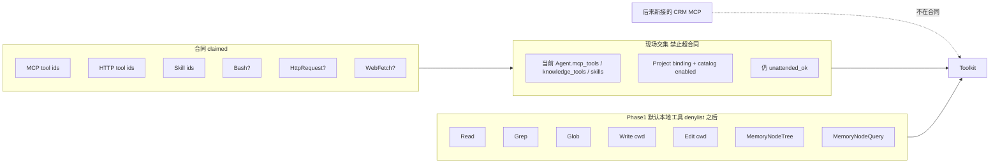
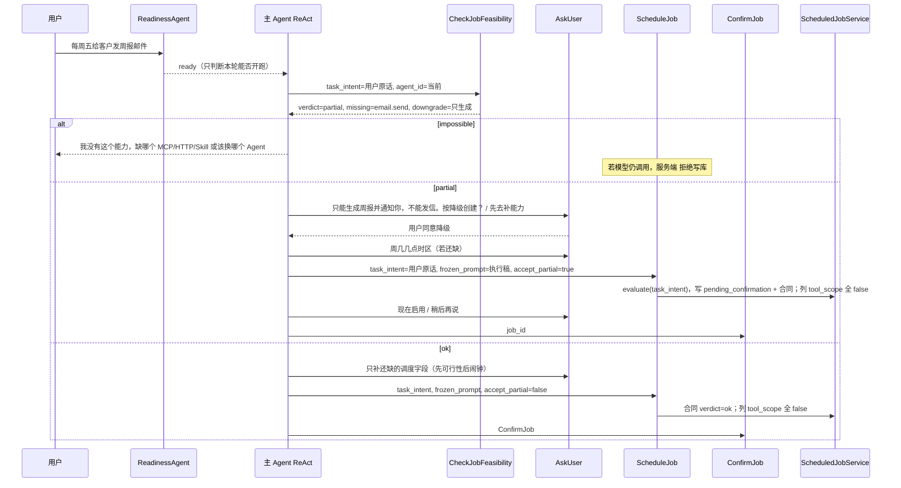

# 定时任务 v2：到点激活 Agent 与能力合同

> 状态：已落地，是 Job Agent 能力合同专题，不是待做路线图。2026-08-25：Job Agent 与 Chat Agent 拆分；必注入工具不受 CheckJobFeasibility 裁剪。
> 当前架构事实以 `docs/architecture-overview.md` 为准。未完成项只记 `docs/project-todo.md`。
> 稳定事件字段以 `docs/chat-sse-event-contract.md` 为准；本文 **不** 新增 Chat SSE 字段，**禁止** 顶层 `JOB_EVENT`。
> 边界对照：`docs/architecture-overview.md`、`docs/team-runtime-redesign.md`、`docs/subagent-delegation-design.md`。

---

## Overview

Phase 1 已经能在对话里登记 `ScheduledJob`，到点经 `start_scheduled_chat_run()` 创建一次普通 `mode=agent` 的 ReAct Chat Run。缺口是：到期跑的不是该 Agent 平时的工具箱，而是 Job 上冻结的、默认全关的 `tool_scope`（`JobToolScope` 五旗全 `false`）。给 Agent 新接 MCP 不会增强已有定时任务；用户让 Agent「每周五发邮件」时，系统仍可能建一条只能写 `outputs/` 的空头 Job。

Phase 2 把定时任务改成：**先证明这个 Agent 在无人值守下做得到，再允许到点把它叫醒。** 能力长在 Agent 上（工具 / MCP / HTTP Tool / Skill）；调度只是按点激活。创建前用真实工具表做能力门禁；Job 持久化本次认领过的 **能力合同（capability contract）**；到期只用合同内能力 ∩ 当前 Agent ∩ Project binding，外加始终开启的读写文件基本工具。后来给 Agent 新接 CRM MCP，旧任务不会自己去改客户系统。

本次升级替换原 Phase 1 路线图里「Phase 2 预览发送」的排期位置。预览发送、收件人白名单通道、`auto_send` 仍是后续阶段，不在本文范围；控制面默认仍 `notify`。不新增 `runtime.kind`，不恢复旧 Plan / Subagent / Memory Runtime，不恢复持久 Team。

---

## Background & Motivation

### Phase 1 已落地（以代码为准）

控制面与执行面已经按 Phase 1 设计拆开：

| 层 | 现状 |
| --- | --- |
| 登记工具 | `backend/src/tools/scheduled_job_tools.py`：`ScheduleJob` / `ListJobs` / `PauseJob` / `ConfirmJob`。交互式单 Agent 由 `react_runtime._build_runtime_feature_parts()` 注入；Team 与 firing 不注入。 |
| 状态机 | `ScheduledJobService`（`backend/src/scheduler/service.py`）是唯一迁移入口。`create_job()` 未传 `tool_scope` 则写入全 false；`confirm()` 调 `would_fail_unattended_tools()`。 |
| 冻结 scope | `JobToolScope`（`scheduler/models.py`）缺键按 false。`DEFAULT_JOB_TOOL_SCOPE` 五旗全关。禁止落入 `RuntimeToolScope()` 的全 True 默认。 |
| firing | `scheduler/firing.py` → `start_scheduled_chat_run()` → `build_scheduled_run_context()`。`runtime.kind` 固定 `react`，`executor.kind` 固定 `single_agent`。 |
| 工具裁剪 | `SCHEDULED_JOB_UNATTENDED_DENYLIST` 去掉 AskUser / Plan / DelegateTask / ScheduleJob 工具组。`hitl_unattended_resolve()` 只批准 cwd 内 Write/Edit。 |
| MCP 列表 | `build_scheduled_run_context()` 仍用 `_build_runtime_mcp_servers(agent_config, allowed_server_ids=project_resources.mcp_server_ids)` 算出 MCP list，但 `deserialize_frozen_runtime_tool_scope()` 默认 `allow_mcp=false`，工厂 `_create_default_toolkit()` 因此不注入。 |
| 权限 | `trusted_tools` 且无 `human_approval` 才是 AgentScope `BYPASS`。`ask_every_time` / `human_approval` 是 `DEFAULT`。`read_only` 不能激活写产物 Job。 |
| 资源变更 | `pause_jobs_for_catalog_change` / `pause_jobs_for_binding_change` 对 MCP 用 `require_tool_flags=("allow_mcp",)`，过粗：任意 MCP 卸载会暂停所有 `allow_mcp=true` 的 Job。Phase 1 默认全 false，这条路径几乎走不到。 |
| flag | `json_store` / `system_settings` / `scheduled_jobs.enabled`，默认 false。 |
| 前端 | `frontend/src/features/scheduled-jobs/` 展示冻结 `toolScope` 五旗与 `skillIds`，没有能力合同、缺能力原因或「将实际跑哪些工具」。 |

### 痛点（产品已拍板）

1. 现在只让模型拥有「开启定时任务」能力，没有「调度 / 激活 Agent」能力。到期跑的是 Job 上冻结的、默认全关的 `tool_scope`。
2. 给 Agent 加 MCP 不会增强已有定时任务——这在 Phase 2 **仍然正确**（合同冻结），但新任务必须能认领当时已有的无人值守能力。
3. 用户让 Agent 发邮件，但该 Agent 没有发邮件能力时，建空头 Job 比拒绝更糟。
4. 对话里能用、但每次都要 HITL 确认的能力，到期会被 `hitl_unattended_resolve` deny，**不算**定时任务能力。
5. Phase 1 `would_fail_unattended_tools()`（`unattended_policy.py`）只把 `read_only` 的 Write/Edit 和未 BYPASS 的 `Bash` 算失败；`allow_mcp=true` 且 Agent 是 `confirm_destructive` 时 **不会** 挡住 confirm。这与「HITL 能力不算无人值守能力」不一致，Phase 2 必须收紧。

### 与原 Phase 1 路线图的关系

| 原 Phase 1 路线图阶段 | 本文之后 |
| --- | --- |
| Phase 1 weekly/once、登记、ticker、产物、notify | 保持；已实现，现网事实见 `docs/architecture-overview.md` |
| 原 Phase 2 预览发送 / 白名单通道 | **顺延**，不在本次 |
| 原 Phase 3 `auto_send` | 仍拒绝进入 `active` |
| 原 Phase 4 OS 唤醒 / 托盘 | 仍后续 |
| **本文 Phase 2** | 能力目录、可行性门禁、能力合同、按合同装配 firing toolkit |

---

## Goals & Non-Goals

### Goals

1. 用真实 MCP / HTTP Tool / Skill / 内置工具表登记 Agent 的 **无人值守能力**，不靠模型猜。
2. 提供普通工具 `CheckJobFeasibility`：输入任务意图与 Agent，输出 `ok` / `partial` / `impossible`。
3. `ScheduleJob` 在门禁失败时拒绝创建；部分可行必须明示缺口并得到用户同意才建。
4. Job 持久化本次认领的能力合同；到期 toolkit = 合同 ∩ 当前 Agent ∩ Project binding ∪ Phase 1 默认本地工具（含记忆工具，减去 denylist）。
5. `confirm()` / `resume()` 第二道门：合同仍可满足，权限仍允许无人值守。
6. Agent / MCP / HTTP / Skill 绑定变化时，按 **合同内资源 id** 暂停或要求重新确认，并通知。
7. Jobs 页展示合同、缺能力、拒绝原因、到期将跑哪些工具。
8. `trusted_tools` Agent 对合同覆盖的 HTTP/MCP/Bash 无人值守放行；`ask_every_time` 与会 HITL 的外呼不能作为定时能力。
9. 现有 Phase 1 行迁移为 generate-only（复用今日五旗语义，含 Skill `scripts/` → Bash），除非用户重新确认。
10. 对话内可对已有 Job 扩合同：新增普通工具 `RecheckJobCapabilities`，与 REST `POST .../recheck-capabilities` 走同一 `update_job()`。

### Non-Goals

- 不新增 `runtime.kind`，到期仍走 `start_scheduled_chat_run()` / ReAct / `mode=agent`。
- 不恢复旧 Plan / Subagent / Memory Runtime，不恢复持久 Team。
- firing 仍去掉 AskUser / Plan Mode / DelegateTask / ScheduleJob / CheckJobFeasibility / RecheckJobCapabilities 工具组；缺信息就失败。不得改用窄 `tool_name_allowlist` 替换 denylist。
- ReadinessAgent 仍然只判断「这轮对话能不能开跑」，不选 Agent、不选 MCP、不决定 Job 能不能建。
- 不改 Chat SSE 契约，不引入顶层 `JOB_EVENT`。
- 不把 `auto_send` 做成默认；生成 vs 系统代发通道仍拆开。Agent 用自己合同内的 MCP 发出去算完成任务；控制面默认仍 notify。
- 不在第一天建立巨大 ontology / 行业能力图谱。
- 不让后来给 Agent 新接的 MCP 自动进入旧合同。
- 不把通用 `HttpRequest` 当成「发邮件」能力。
- 不把 stdio MCP 假装成可无人值守能力：`transport=="stdio"` 一律 `unattended_ok=false`，即使脏数据填了 `url`（工厂谓词更宽，库存取更严）。
- 不实现 OS 唤醒、预览发送 UI、收件人白名单投递。

---

## Key Decisions

1. **定时任务 = 到点调度并激活一个已有 Agent，不是「让模型记住一个闹钟」。** 能力长在 Agent 上；Job 只冻结本次认领的合同。调度器、**Chat session** 隔离（`ChatSession.kind=scheduled_job`、内部 `trigger_source=scheduled_job`）、钟面锚点、missed 策略沿用 Phase 1。`runtime.kind` 仍为 `react`，`executor.kind` 仍为 `single_agent`，禁止把 session kind 写进 IntentRoute。
2. **能力合同赢过「现场继承全部 Agent 工具」和「confirm 时拷贝当时 tool_scope」。** 现场继承会让后来新接的 CRM MCP 进入旧周报；整表拷贝 `tool_scope` 太粗（一个 `allow_mcp` 打开该 Agent 当时全部 MCP），也绑不住「发邮件」这种意图。合同记录 **具体** MCP tool id / HTTP tool id / knowledge tool id / Skill id / 是否允许通用 HttpRequest。
3. **判断必须落地在真实工具表。** `CheckJobFeasibility` 是普通工具（`is_external_tool=False`），内部调 `evaluate_job_feasibility()`。`ScheduleJob` **再次**调用同一函数，门禁用必填 `task_intent`（用户原话）抽标签，**不用** `frozen_prompt` 代替原意。
4. **三种登记结果：`ok` / `partial` / `impossible`。** `impossible` 拒绝创建；`partial` 必须把缺口和降级方案问清，用户同意（`ScheduleJob.accept_partial=true`）才建；`ok` 才能按完整意图建。非 `read_only` 的写产物 Agent 在通道缺失时默认 **partial**（降级生成），除非意图明确「只发送、不生成」。
5. **对话能用但会 HITL 的能力 ≠ 定时任务能力。** 外呼 / Bash 的 `unattended_ok` 当且仅当 `agent_approval_policy(agent)==ApprovalPolicy.TRUSTED_TOOLS`（该函数已把 `human_approval=True` 映射成 `ASK_EVERY_TIME`）。HTTP `approvalPolicy=ask|deny` 另挡。不要再手写一套 `tool_policy != trusted_tools or human_approval`。
6. **`read_only` Agent 不能激活写产物或外呼 Job。** 文件生成需要 Write/Edit。
7. **通用 `HttpRequest` 默认不是合同能力。** `email.send` 禁止匹配 `builtin:HttpRequest`。`allow_http_request` / `allow_web_fetch` / `allow_bash` 仅当 required intents **显式**含对应标签（或 Skill `scripts/` → bash）时置位；`task_intent` 含发信 token 时忽略调用方传入的 `http.call`。
8. **stdio MCP 一律不可无人值守。** 库存谓词：`transport=="stdio"` → `unattended_ok=false`（即使填了 url）。HTTP MCP 可注入 iff `(transport in {sse, websocket} or url) and url` 且 `network_enabled`。比工厂更严，避免把 stdio 假装成能力。
9. **Phase 1 存量 Job 视为 generate-only，但必须复用今日五旗语义。** 空合同 **保留** `allow_bash`（`frozen_skills_require_bash`）；只忽略脏的外呼旗（`allow_mcp` / `allow_http` / `allow_web` / `allow_knowledge`）并打 `legacy_tool_scope_ignored`。用户改任务或重新确认后才扩合同。
10. **合同才是 Phase 2 firing 事实源；列上五旗在装配 PR 落地前必须继续全 false。** PR 2 可把派生 scope 写进合同 JSON 的 `assembledToolScope`，**禁止**把 `allow_mcp=true` 写进 `scheduled_jobs.tool_scope` 列，否则今日 `_build_runtime_mcp_servers(agent 全量)` 会整表注入。PR 3 的 `assemble_scheduled_firing_toolkit_spec` 同时改 `enable_tools` 子集与列快照。
11. **资源变更按合同资源 id 精确匹配，不再只看 `allow_mcp`。** 卸掉无关 MCP 不应暂停 generate-only 周报。`update_agent` 必须比较 `mcp_tools` / `knowledge_tools` / `guardrails.tool_permission_profile` / `human_approval` / `network_enabled`。
12. **不改 SSE，不新增 `JOB_EVENT`。** Jobs 页继续 REST；Chat 里可行性结果走普通 `tool` Block。firing **继续 denylist、不用窄 allowlist**。最终回答由收尾这一次无工具生成的正文决定，firing 不注入阶段标记工具。
13. **feature 子开关 `scheduled_jobs.capability_gate`，JSON 缺省为 `false`。** 主开关仍是 `scheduled_jobs.enabled`。显式打开门禁后才拒绝空头 Job。`set_scheduled_jobs_enabled()` 必须读-改-写合并，不得整文档覆盖以致抹掉 `capability_gate`。
14. **`CheckJobFeasibility` 尽量在收集一长串调度字段之前调用。** 先回答「做不做得到」，再问周五几点。扩已有 Job 走 `RecheckJobCapabilities`，不假设尚不存在的 `UpdateJob` 对话工具。

---

## Proposed Design

### 一句话架构

```text
交互式 Chat
  CheckJobFeasibility(task_intent=用户原话, agent_id)  → 真实工具表
  若 impossible → 告诉用户缺什么，禁止 ScheduleJob
  若 partial    → AskUser 明示缺口 / 降级，用户同意才继续
  若 ok/已同意  → AskUser 补齐调度字段（若还缺）
  ScheduleJob(task_intent, frozen_prompt, accept_partial?)
    → 再次 evaluate_job_feasibility(task_intent=原话) → pending_confirmation + 合同
    → 列 tool_scope 在装配 PR 前保持全 false
  ConfirmJob    → 合同仍可满足 + would_fail 为空 → active
  RecheckJobCapabilities(job_id, task_intent?)
    → 省略则 task_intent=contract.task_intent；仍空（Phase 1 行）→ 422，禁止 frozen_prompt / 空串保底
    → update_job 合同 → pending_confirmation

到期
  start_scheduled_chat_run
  toolkit = Phase 1 默认本地工具（Read/Grep/Glob/Write/Edit/MemoryNode*）
            减去 denylist
            ∪ (合同 claimed ∩ 当前 Agent.mcp_tools/knowledge_tools/skills
               ∩ Project binding ∩ 仍 installed/enabled ∩ 仍 unattended_ok)
  缺合同内资源 → 失败 capability_unbound，禁止静默丢掉
  后来新接的 MCP 不在合同内 → 不注入
```

### 组件边界

```text
tools/scheduled_job_tools.py          + CheckJobFeasibility + RecheckJobCapabilities
scheduler/mcp_runtime.py              纯函数 resolve_mcp_runtime_servers(tool_ids, servers, …)
scheduler/http_runtime.py             纯函数：从 list_http_tools / knowledge JSON 滤启用行
scheduler/capability_catalog.py       从 MCP/HTTP/knowledge/Skill/builtin 建库存
scheduler/capability_match.py         意图别名 + 启发式标签 + CHANNEL_INTENTS
scheduler/capability_contract.py      Pydantic 合同
scheduler/feasibility.py              evaluate_job_feasibility()
scheduler/unattended_policy.py        收紧 would_fail；合同覆盖的外呼
scheduler/service.py                  create/confirm/resume/update 吃合同
scheduler/firing.py                   assemble_scheduled_firing_toolkit_spec（denylist，不用窄 allowlist）
run_context.build_scheduled_run_context
  mcp_servers / knowledge_tools 按合同 id 过滤，不再只靠五旗
pause_for_resource_change             按 claimed resource id
routes/scheduled_jobs.py              REST 增加 capabilityContract
features/scheduled-jobs/              合同 / 缺能力 / 将跑工具
scheduler/settings.py                 读-改-写合并 enabled 与 capability_gate
```

`storage` 不反向依赖 scheduler。`send.py` 不 import scheduler。

**禁止** `scheduler.feasibility` / `capability_catalog` / `mcp_runtime` / `http_runtime` 以任何方式 import `src.server.routes.*`（`routes/mcp.py` 与 `routes/tools.py` 均顶层 `_job_service = ScheduledJobService()`）。PR 2 的 `service → feasibility → catalog` 一旦再 import 路由，环依赖会在烟测之后才爆。

依赖方向：

```text
service → feasibility → catalog → mcp_runtime / http_runtime → storage
routes/mcp.py     → mcp_runtime.resolve_mcp_runtime_servers(tool_ids, list(_mcp_servers.values()), …)
routes/tools.py   → 继续给 HTTP 管理 UI 用；catalog **不** 调 get_enabled_http_tools
routes/agents.py  → get_registered_agent 仅函数内 lazy import（与今日 confirm() 相同）
```

`mcp_runtime.resolve_mcp_runtime_servers` **新签名**（纯函数，无模块全局、不读 `_mcp_servers`）：

```python
def resolve_mcp_runtime_servers(
    tool_ids: list[str],
    servers: list[Any],
    *,
    allowed_server_ids: set[str] | frozenset[str] | None = None,
    builtin_server_ids: frozenset[str] | tuple[str, ...] = (),
) -> list[dict[str, object]]:
    """把 Agent.mcp_tools 的 tool id 收成 McpRuntimeSpec 字典。servers 由调用方传入。"""
```

- `routes/mcp.py`：`servers=list(_mcp_servers.values())`，`builtin_server_ids=frozenset(_builtin_mcp_servers)`
- catalog / firing：`servers=list_mcp_servers()` 反序列化结果（storage），**不要** import 路由全局

`http_runtime.py` 同样纯函数，例如 `enabled_http_tools(tool_ids, records)` / `enabled_knowledge_tools(tool_ids, records)`。catalog 传入 `storage.list_http_tools()` 与 `list_json_records("knowledge_tools")`（与 `routes/tools.py` 的 `KNOWLEDGE_TOOLS_NAMESPACE` 同源），再按 Agent.knowledge_tools ∩ Project binding 过滤。逻辑对齐今日 `get_enabled_http_tools` / `get_enabled_knowledge_tools`（含「已投影成 HTTP 的 id 不再当 legacy knowledge」），但实现不得 import `routes.tools`。

PR 1 烟测：`import src.scheduler.feasibility` 与 `import src.server.routes.mcp` **以及** `import src.server.routes.tools` 互不爆炸。PR 2 合入前核对 import 图 `service → feasibility → catalog → mcp_runtime/http_runtime`，图中无 `routes`。

```mermaid
flowchart TB
  subgraph interactive [用户在场]
    User[用户: 每周五发周报邮件]
    Ready[ReadinessAgent 只判断本轮能否开跑]
    Feas[CheckJobFeasibility]
    AskMiss[AskUser: 缺能力 / 降级]
    AskSched[AskUser: 周期 / 时区 / 启用]
    SJ[ScheduleJob 再次门禁]
    CJ[ConfirmJob]
    Recheck[RecheckJobCapabilities]
    User --> Ready --> Feas
    Feas -->|impossible| Refuse[拒绝创建 指出缺 MCP/HTTP/Skill 或换 Agent]
    Feas -->|partial| AskMiss
    AskMiss -->|用户不同意| Refuse
    AskMiss -->|用户同意降级| AskSched
    Feas -->|ok| AskSched
    AskSched --> SJ --> CJ
    Recheck --> Job
  end

  subgraph control [控制面 SQLite]
    Job[(scheduled_jobs.capability_contract)]
    SJ --> Job
    CJ --> Job
  end

  subgraph execute [到期执行面]
    Tick[JobScheduler ticker]
    Fire[run_firing]
    Bridge[start_scheduled_chat_run]
    Ctx[build_scheduled_run_context]
    TK[合同 ∩ Agent ∩ Project ∪ Phase1 本地工具]
    ReAct[react / single_agent]
    Tick --> Fire --> Bridge --> Ctx --> TK --> ReAct
  end
```



---

## 1. Capability model

不建行业图谱。Phase 2 的「能力」是 **可注入、可无人值守的具体工具行**，外加一层很薄的意图标签，用来回答「发邮件」这种用户说法。

### 1.1 Capability id（稳定、可持久化）

| kind | id 格式 | 对应真实对象 |
| --- | --- | --- |
| builtin | `builtin:Read` `builtin:Write` `builtin:Edit` `builtin:Grep` `builtin:Glob` `builtin:Bash` `builtin:HttpRequest` `builtin:WebFetch` | 工厂本地工具名 |
| mcp | `mcp:{tool_id}` | `mcp_servers.tools[].id`，与 `Agent.mcp_tools` 同一套 id（见 `resolve_mcp_runtime_servers()`） |
| http | `http:{tool_id}` | `http_tools.id`，经 `http_runtime.enabled_http_tools`（storage `list_http_tools`）；`Agent.knowledge_tools` 里的通用 HTTP 工具 |
| knowledge | `knowledge:{tool_id}` | `http_runtime.enabled_knowledge_tools`（`list_json_records("knowledge_tools")`）仍对应的 legacy `KnowledgeBaseSearch`；id 同样来自 `Agent.knowledge_tools` |
| skill | `skill:{skill_id}` | `skills.id`，与 `Agent.skills` 同一套 id |

MCP **不要** 用 `mcp:{server_id}` 当认领单位：一个 Gmail server 可能同时有 `send_email` 和 `list_labels`；合同必须钉到 tool id。库存行额外带 `server_id` / `tool_name`，供 firing 转成 `McpRuntimeSpec.enable_tools`。

### 1.2 意图标签（小闭集，可扩展）

第一批只服务办公定时场景，写在 `scheduler/capability_match.py` 的常量里，测试锁定：

```text
file.read
file.write
email.send
email.read
calendar.read
calendar.write
messaging.send
crm.read
crm.write
knowledge.search
web.fetch
http.call
shell.execute
office.generate
```

「发邮件」→ **只** 映射 `email.send`。满足该标签的只能是 `kind in {mcp, http}` 且 `unattended_ok` 的库存行，**禁止** `builtin:HttpRequest`，**禁止** Skill 单独充当发信通道。

`capability_match.py` 拆两集（测试锁定）：

```python
CHANNEL_INTENTS = frozenset({
    "email.send", "email.read",
    "messaging.send",
    "calendar.read", "calendar.write",
    "crm.read", "crm.write",
    "knowledge.search", "web.fetch", "http.call",
})
SKILL_OK_INTENTS = frozenset({
    "file.read", "file.write", "office.generate", "shell.execute",
})
```

通道 intent 默认必须有 `kind in {mcp, http}` 的 `unattended_ok` 行。**唯一例外：** `knowledge.search` 允许 `kind in {mcp, http, knowledge}`。`kind=knowledge`（legacy `KnowledgeBaseSearch`）**不得**满足 `email.send` / `messaging.send` / 其它非检索通道；即使 tags 被启发式打上 `email.send` 也不能单独当发信通道。Skill 只能附加到 `SKILL_OK_INTENTS`。仅 Skill tags 含 `email.send` → 不能 `ok`。

### 1.3 库存行

`CapabilityInventoryItem`：

```python
class CapabilityInventoryItem(BaseModel):
    capability_id: str          # mcp:gmail-send-email
    kind: Literal["builtin", "mcp", "http", "knowledge", "skill"]
    resource_id: str            # tool_id / skill_id / builtin name
    server_id: str = ""         # 仅 mcp
    tool_name: str              # MCP tool.name 或 HTTP/builtin 名
    title: str
    description: str = ""
    tags: list[str] = []        # 声明 ∪ 启发式，去重
    tag_source: dict[str, str] = {}  # tag -> declared|name|description|seed
    unattended_ok: bool
    blocked_reason: str = ""    # 非空则 unattended_ok=false
    project_bound: bool = True
    agent_bound: bool = True
```

`build_agent_capability_inventory(agent_id, project_id, workspace_id)` 只读：

1. lazy import `get_registered_agent` / `get_workspace_resource("agent", …)`（禁止模块级 import `routes.agents`）
2. `storage.list_mcp_servers()` 作为 `servers` 传入 `mcp_runtime.resolve_mcp_runtime_servers(tool_ids, servers, allowed_server_ids=…, builtin_server_ids=…)`：`status==installed`、`enabled`、tool id ∈ `Agent.mcp_tools`、server ∈ Project MCP binding（builtin server 沿用现逻辑）
3. `http_runtime.enabled_http_tools(agent.knowledge_tools, storage.list_http_tools())` ∩ Project `http_tool` binding → `kind=http`
4. `http_runtime.enabled_knowledge_tools(agent.knowledge_tools, list_json_records("knowledge_tools"))` 中尚未被 HTTP 行占用的 id → `kind=knowledge`（对齐 `_build_runtime_knowledge_tools` 跳过已投影 HTTP）
5. `storage.list_skills()` 中 id ∈ `Agent.skills` ∩ Project skill binding、`status==installed`、enabled
6. 内置工具按 `agent_approval_policy(agent)` 与 `UnifiedPermissionProfile` 计算是否无人值守可用

catalog / mcp_runtime / http_runtime **零** `from src.server.routes import …`。

MCP 可注入谓词（库存，比工厂更严）：

```text
injectable_http_mcp =
    transport != "stdio"
    and bool(url)
    and (transport in {"sse", "websocket"} or bool(url))
    and network_enabled
stdio（无论是否有 url）→ unattended_ok=false, blocked_reason=stdio_mcp_not_injectable
```

### 1.4 标签从哪来（第一批：现有字段 + 启发式，不加列）

**已拍板：PR 1 / 门禁切片不加 `http_tools.capability_tags` 列，也不给 `McpTool` 加 `capabilityTags` 字段。** 发邮件用例靠名称 token、description 启发式、HTTP `category`、现有 Skill.tags 与 MCP server.tags。声明标签独立小 PR 再加；门禁代码对缺字段按 `[]` 忽略。

**第一批声明来源（只用已有列）：**

| 来源 | 现有字段 | Phase 2 第一批 |
| --- | --- | --- |
| MCP server | `mcp_servers.tags` | 继承到该 server 下每个 tool |
| MCP tool | `McpTool` 无 tags | **不加字段**；只靠 tool `name` / `description` 启发式 |
| HTTP tool | 无 tags 列；有 `category` | **不加列**；`category` + 名称 / description 启发式 |
| Skill | `skills.tags` | 直接用（已有列，不是新 schema） |
| builtin | 代码常量 | `Write/Edit → file.write`；`Bash → shell.execute`；`WebFetch → web.fetch`；`HttpRequest → http.call`（**不含** `email.send`） |

给库存行打标签分三层，**声明优先于名称 token，名称 token 优先于描述启发式**：

| 层 | `tag_source` | 规则 |
| --- | --- | --- |
| 声明 | `declared` | 第一批：MCP server.tags（继承）、Skill.tags、HTTP `category` 若能映射到闭集、builtin 常量。独立 PR 之后才读 HTTP `capability_tags` / MCP tool `capabilityTags` |
| 名称 | `name` | 只扫 `tool_name` / `title`，**不扫 description** |
| 描述 | `description` | 只在名称层未命中该 intent 时，扫 description；**不得**用描述把 `list_*` 工具升成 send |

**用户意图抽取**（`extract_required_intents`，扫 `task_intent` 全文）与 **库存打标** 用两张表。用户说「发邮件」可以命中 `email.send`；Gmail `list_messages` 的 description 含「邮件」**不得**因此打上 `email.send`。

库存 `email.send` 名称 token（缺一不可的一类；测试锁定）：

```text
send_email, send-mail, sendMail, send_mail, 发信, 发邮件
```

仅有 `mail` / `gmail` / `outlook` / `邮件` / `smtp` **不够** 给库存行打 `email.send`。这些词可以出现在 **用户意图** 表里（用户说「gmail 发信」→ required `email.send`），但库存行必须看到 send 类名称或声明标签。

| 意图 | 用户意图 token（抽 required） | 库存名称 token（打标） |
| --- | --- | --- |
| `email.send` | 发邮件、发信、邮件、smtp、gmail、outlook、mailgun | `send_email` / `send-mail` / `sendMail` / `发信` / `发邮件` |
| `email.read` | 收件箱、读邮件 | `list_messages` / `fetch_mail` / `inbox` / `list_labels`（list_* → read，**不是** send） |
| `messaging.send` | slack、钉钉、飞书、发消息 | `send_message` / `post_message` / 发消息 |
| `crm.write` | 更新客户、crm | `create_contact` / `update_deal` 等写动词；纯 `list_contacts` → `crm.read` |
| `office.generate` | 周报、日报、纪要 | Skill/HTTP 名称含周报等 |
| `file.write` | 写文件、生成文档 | builtin Write/Edit |
| `http.call` | 调用 HTTP、通用 API | **仅** `builtin:HttpRequest` 常量，不加在带 email.send 的通道上 |

规则：启发式只给库存行打标签，**不**给用户意图发明一个不存在的工具。Skill 打上 `email.send` 但没有对应 MCP/HTTP，**不能**单独满足「发邮件」。

Skill 含 `scripts/`（沿用 `skill_package_has_scripts()`）额外打 `shell.execute`，并在合同里要求 `allow_bash`。

### 1.4.1 合同认领算法（每个 intent 最少一行）

`claim_capabilities(required_intents, inventory) -> claimed`：

```text
claimed = []
对每个 intent in required_intents:
  candidates = [row in inventory if intent in row.tags and row.unattended_ok]
  若 intent == "knowledge.search":
      candidates = [c for c in candidates if c.kind in {mcp, http, knowledge}]
  否则若 intent in CHANNEL_INTENTS:
      candidates = [c for c in candidates if c.kind in {mcp, http}]
      # kind=knowledge 即使 tags 含 email.send 也不得入选
  若 intent in SKILL_OK_INTENTS:
      允许 skill / builtin
  若 candidates 空:
      该 intent → missing（或 blocked_by_permission 若仅有 unattended_ok=false 的命中）
      不确定则 missing，不要 ok
  否则认领恰好 1 行，排序：
      1. tag_source[intent]==declared
      2. tag_source[intent]==name
      3. tag_source[intent]==description
      同分：capability_id 字典序（稳定，可测）
  不要把同 server 其它工具带上
永远附带 unattended_ok 的 builtin Write/Edit/Read（写产物保底），除非 Agent read_only
```

测试锁定：`list_messages` / `list_labels` 不得进入「发邮件」合同；`send_email` 可以。`kind=knowledge` 行即使 `tags` 含 `email.send` 也不得进入发邮件合同。

### 1.5 无人值守 overlay（库存计算 `unattended_ok`）

对每一行，复用 `unattended_policy.agent_approval_policy(agent)`，不要复制 if：

```text
policy = agent_approval_policy(agent)   # human_approval=True → ASK_EVERY_TIME

若 kind=builtin 且 name ∈ {Read, Grep, Glob}:
    unattended_ok = True
若 kind=builtin 且 name ∈ {Write, Edit}:
    unattended_ok = Agent 不是 read_only
若 kind ∈ {mcp, http, knowledge} 或 builtin ∈ {HttpRequest, WebFetch, Bash} 或 skill 需 bash:
    若 policy != TRUSTED_TOOLS: blocked_by_permission
    若 read_only: blocked
    若 network 工具且 network_enabled=false: blocked
    若 HTTP approvalPolicy == deny: blocked（bypass_immune DENY）
    若 HTTP approvalPolicy == ask: blocked（bypass_immune ASK）
    若 HTTP approvalPolicy == inherit: 跟随 policy；仅 TRUSTED_TOOLS 时 unattended_ok
    若 HTTP approvalPolicy == allow: 工具自身 ALLOW（非 bypass_immune），仍要求 policy==TRUSTED_TOOLS
      （产品：trusted_tools Agent 才允许无人值守 HTTP；allow 不能让 ask_every_time Agent 发信）
    若 MCP transport==stdio: blocked
    若 MCP 非 stdio 但不满足 injectable_http_mcp: blocked
    否则 unattended_ok = True
```

`confirm_destructive` 经 `agent_approval_policy` 不是 `TRUSTED_TOOLS`，外呼会 HITL → 不算定时能力。这是对 Phase 1 `would_fail_unattended_tools()` 的收紧。

### 1.6 「发邮件」必须落地

验收固定用例（写入测试，不靠模型）：

| Agent 现状 | 用户原话 | 结果 |
| --- | --- | --- |
| 无 MCP/HTTP 带 `email.send`，只有文件工具 | 「每周五给客户发周报邮件」 | **`partial`**：可降级生成。`downgradeOffer` = 到点写 `outputs/` + notify，不发信。AskUser / `message` **测试只锁关键字**「不能」「发邮件/外发」「生成」，不锁完整句子。 |
| 同上 | 「每周五只把周报邮件发出去，不要生成文件」 | **`impossible`**：明确只发送、不生成，且通道缺失 |
| 有 Gmail MCP `send_email`，Agent `ask_every_time` | 「发周报邮件」 | **`partial`**（可降级生成）+ `blockedByPermission` 指出需 `trusted_tools`；若原话是「只发送」则 `impossible` |
| 有 Gmail `send_email` + `list_messages`，Agent `trusted_tools`，已绑定 | 「发周报邮件」 | **`ok`**，claimed **仅** `mcp:{send_email 的 tool id}` + 文件 builtin；`list_messages` 不进合同 |
| 只有通用 `HttpRequest` | 「发邮件」 | 与第一行相同，**不**匹配 `email.send` |
| HTTP「企业邮发信」`approvalPolicy=ask` | 「发邮件」 | 通道行 `unattended_ok=false` → 同 HITL 行 |
| HTTP「企业邮发信」`approvalPolicy=inherit` 或 `allow`，Agent `trusted_tools` | 「发邮件」 | **`ok`**，claimed `http:{id}` |
| HTTP inherit，Agent `confirm_destructive` | 「发邮件」 | inherit 跟随 Agent → 非 TRUSTED_TOOLS → 不能 ok |
| 仅 Skill tags 含 `email.send` | 「发邮件」 | 不能 ok（通道 intent 禁止 Skill 单独满足） |
| 仅 `kind=knowledge` 且 tags 含 `email.send` | 「发邮件」 | 不能 ok（knowledge 只满足 `knowledge.search`） |

拍板：任何非 `read_only`、可写产物的 Agent，在通道缺失时默认 **partial + 降级生成**，除非用户意图明确「只发送、不生成」且没有 `file.write` / `office.generate` 语义。必须 AskUser，禁止默默建成 generate-only 还声称会发信。

---

## 2. `CheckJobFeasibility`

普通工具，与 `ScheduleJob` 同组注入，`is_external_tool=False`，立即返回 JSON。实现放 `scheduled_job_tools.py`，核心算法放 `scheduler/feasibility.py`，工具只做 I/O。

### 2.0 `evaluate_job_feasibility()` 签名

工具与 REST 只做 I/O，Python 函数对齐：

```python
class FeasibilityResult(BaseModel):
    verdict: Literal["ok", "partial", "impossible"]
    agent_id: str
    workspace_id: str
    project_id: str
    task_intent: str
    required_intents: list[str]
    claimed: list[JobCapabilityClaim]
    missing: list[JobCapabilityGap]
    blocked_by_permission: list[JobCapabilityGap]
    downgrade_offer: dict[str, Any] | None = None
    assembled_tool_scope: JobToolScope
    allow_http_request: bool = False
    allow_web_fetch: bool = False
    allow_bash: bool = False
    firing_tools_preview: list[str]
    unattended_ok: bool
    message: str
    suggested_agent_ids: list[str] = []

    def to_public_json(self) -> dict[str, Any]:
        """工具 Block / REST 一律 camelCase。"""

def evaluate_job_feasibility(
    *,
    task_intent: str,
    agent_id: str,
    workspace_id: str,
    project_id: str,
    required_intents: tuple[str, ...] | list[str] = (),
    claimed_must_include: frozenset[str] | None = None,
) -> FeasibilityResult:
    """纯函数式门禁。不写库。不调模型。"""
```

- `workspace_id` / `project_id`：交互工具用 `self.workspace_id` / `self.project_id`；REST body 必填。
- `claimed_must_include` **仅** `assert_contract_satisfiable`（confirm/resume）传入合同 claimed ids。Check / Schedule **不得**传。每个 id 必须仍在库存且 `unattended_ok`，否则 verdict 至少 `partial`，并在 missing/blocked 列出。
- **没有** `accept_partial` 参数。该标志只属于 `ScheduleJob` / REST create 写库闸门，不改变本函数 verdict。`impossible` 不会因为调用方想降级就变成 `ok`。
- `downgrade_offer`：只要通道缺失且可写产物，始终填充；Check 不必传任何同意标志。

### 2.1 Check 工具输入

```python
# CheckJobFeasibility.input_schema
{
  "type": "object",
  "properties": {
    "task_intent": {
      "type": "string",
      "description": "用户要定时做的事，必须用用户原话。例：每周五给客户发周报邮件。"
    },
    "agent_id": {
      "type": "string",
      "description": "要激活的 Agent。默认当前对话 Agent。"
    },
    "required_intents": {
      "type": "array",
      "items": {"type": "string"},
      "description": "可选。调用方已归纳的意图标签。服务端仍从 task_intent 规则抽取并取并集；不能发明工具。task_intent 含发信 token 时忽略传入的 http.call。"
    }
  },
  "required": ["task_intent"]
}
```

不在本工具收集 `schedule_expr`。可行性与闹钟字段解耦。Check **没有** `accept_partial`：始终返回 `downgradeOffer`（若可降级）。写库同意只存在于 `ScheduleJob.accept_partial`。

### 2.2 输出

所有 **新** 公开 JSON（工具、`POST /feasibility`、`capabilityContract`、preview）统一 **camelCase**。现网 Job 顶层 `toolScope` 五旗继续双读（`mapToolScope` 已兼容 `allowBash` / `allow_bash`），本升级不改写入字段名。

真实 **partial** 示例（无发信通道、可降级生成）。不要把 ok 的 claimed MCP 和 missing `email.send` 写在同一个 payload：

```json
{
  "verdict": "partial",
  "agentId": "agent-1",
  "workspaceId": "default",
  "projectId": "default",
  "taskIntent": "每周五给客户发周报邮件",
  "requiredCapabilities": ["email.send", "file.write", "office.generate"],
  "claimed": [
    {
      "capabilityId": "builtin:Write",
      "kind": "builtin",
      "resourceId": "Write",
      "toolName": "Write",
      "tags": ["file.write"],
      "unattendedOk": true
    }
  ],
  "missing": [
    {
      "intent": "email.send",
      "reason": "当前 Agent 没有带 email.send 的 MCP/HTTP 通道",
      "suggestedAction": "给该 Agent 安装并绑定 Gmail MCP，或换一个已有发信能力的 Agent",
      "suggestedResource": "mcp send_email"
    }
  ],
  "blockedByPermission": [],
  "downgradeOffer": {
    "summary": "可以到点生成周报到 outputs/ 并通知你，但不能发出邮件",
    "droppedIntents": ["email.send"],
    "claimedIfAccepted": ["builtin:Write", "builtin:Edit", "builtin:Read"]
  },
  "assembledToolScope": {
    "allowMcp": false,
    "allowHttp": false,
    "allowWeb": false,
    "allowBash": false,
    "allowKnowledge": false
  },
  "allowHttpRequest": false,
  "allowWebFetch": false,
  "allowBash": false,
  "firingToolsPreview": ["Read", "Grep", "Glob", "Write", "Edit", "MemoryNodeTree", "MemoryNodeQuery"],
  "unattendedOk": false,
  "suggestedAgentIds": [],
  "message": "我没有无人值守发邮件的能力，只能降级为到点生成周报并通知你。"
}
```

上表 `message` / `downgradeOffer.summary` 是示例，**测试不得锁全文**；只 assert 同时出现关键字「不能」「发邮件」或「外发」「生成」。

真实 **ok** 示例要点：`verdict=ok`，`missing=[]`，`claimed` 含 `mcp:{send_email tool id}` 与文件 builtin，`assembledToolScope.allowMcp=true`，`unattendedOk=true`，`firingToolsPreview` 含 `send_email`，不含 `list_messages`。

`verdict` 规则：

| 条件 | verdict |
| --- | --- |
| 每个 required intent 都有认领行；通道 intent 由 `mcp/http/knowledge` 满足 | `ok` |
| 通道 intent 缺失或被权限挡住，但 Agent 非 `read_only` 且意图含 `file.write` / `office.generate`（或未声明「只发送」） | `partial` |
| 写产物需要 Write 但 Agent `read_only` | `impossible` |
| 明确「只发送、不生成」且通道缺失或被权限挡住 | `impossible` |
| 无法映射任何标签 | 保底 `required += file.write` → 非 read_only 则 `partial`（纯提醒也 generate-only + notify） |

`suggestedAgentIds`：同 Project 内 **其他** Agent（含 `default`，排除当前 `agent_id`）。最多扫描 **20** 个 Agent，命中最多返回 **3** 个 id；扫描失败或超时则 `[]`，**不影响** verdict。不调模型。

### 2.3 意图抽取（规则，不调模型）

`extract_required_intents(task_intent, required_intents=())`：

1. 并入调用方传入的已知标签（非法标签忽略，打日志）
2. 用 **用户意图 token 表**（不是库存名称表）扫 `task_intent`
3. 若命中「周报 / 日报 / 纪要 / 生成文档」→ 加 `file.write`、`office.generate`
4. 若命中发信 token（发邮件/发信/邮件/gmail/smtp/outlook/mailgun）→ 加 `email.send`，并 **丢掉** 调用方传入的 `http.call`
5. 若命中「只发送 / 不要生成 / 不要写文件」且没有周报/生成 token → 不加 `file.write`（供 impossible 分支）
6. 若什么都没命中 → 默认 `[file.write]`。测试锁定：纯「提醒我喝水」也是 `file.write` + notify，不发明通知通道

**禁止**在 feasibility 里再开一次 ChatModel。

### 2.3.1 三旗置位

默认 `allow_http_request = allow_web_fetch = allow_bash = False`。

| 旗 | 置 true 当且仅当 |
| --- | --- |
| `allow_http_request` | required intents **显式**含 `http.call`，且 `builtin:HttpRequest` `unattended_ok`，且 `task_intent` **不含**发信 token |
| `allow_web_fetch` | required 含 `web.fetch` 且 `builtin:WebFetch` `unattended_ok` |
| `allow_bash` | required 含 `shell.execute`，或任一将写入合同的 Skill `skill_package_has_scripts()`，且 `builtin:Bash` `unattended_ok` |

`email.send` **不得**置 `allow_http_request`。禁止只凭 `required_intents=["http.call"]` 在发信语境下打开通用 HTTP。库存有 builtin HttpRequest 不等于合同打开它。

### 2.4 模型何时必须拒绝 `ScheduleJob`

Prompt addendum（扩展 `scheduled_job_prompt_addendum()`）强制：

1. 用户提出定时任务后，**先** `CheckJobFeasibility`，再收集一长串 `schedule_expr`。
2. `impossible` → 向用户复述 `message` / `missing` / `blockedByPermission`，**不得**调用 `ScheduleJob`。
3. `partial` → AskUser 两项：第一项且默认选中 = 按降级创建；第二项 = 先去补能力。测试只锁关键字串「不能」「发邮件/外发」「生成」，**不要锁完整句子**（产品可改短）。未得到同意不得 `ScheduleJob`。
4. `ok` 后再 AskUser 收集周期/时区/启用。

硬闸门不靠 prompt。`ScheduleJob` / REST create **必填** `task_intent`（用户原话或 Check 时的文本）。`frozen_prompt` 只当到期执行稿。

```text
result = evaluate_job_feasibility(
    task_intent=task_intent,          # 不是 frozen_prompt
    agent_id=…, workspace_id=…, project_id=…,
    required_intents=required_intents or (),
)
```

- `task_intent` 抽出 `email.send` 而 claimed 无通道 → 必须 `partial`+`accept_partial` 或 `impossible`，即使 `frozen_prompt` 只谈写文件
- `impossible` → `ScheduledJobValidationError`（**不是** StateError）。HTTP **422**，`detail` 过渡期仍为 **string**（`result.message`），完整 `FeasibilityResult.to_public_json()` 放在响应体并列字段 `feasibility` 或 FastAPI `detail` 为 `{"code":"capability_unbound","message":"…","feasibility":{…}}`。PR 2 **同步**改 `frontend/src/hooks/useScheduledJobs.ts` `readApiDetail`：若 `detail` 为对象则读 `detail.message`，避免 toast 变成无信息的 `HTTP 422`
- `partial` 且 `accept_partial` 不为 true → 同样 422
- `ok` 或已 `accept_partial` → 服务端生成合同；持久化原始 `task_intent` 与 `missing`；**列 `tool_scope` 仍写入全 false**（直到 PR 3）
- `accept_partial` 不能把 `impossible` 写成库

`ScheduleJob` 新增字段：`task_intent: str`（必填，gate 开时）、`accept_partial: bool = false`、`required_intents: list[str] | None`。不把完整合同交给模型手写。模型传 `tool_scope` 在 gate 开启后 **忽略**。

测试：原话含发邮件、`frozen_prompt` 只写文件、无 `accept_partial` → 拒绝。

flag 关闭或 `capability_gate=false`：保持 Phase 1，不跑门禁，写入空合同，五旗全 false。

---

## 3. 能力合同（持久化）

### 3.1 字段

`scheduler/capability_contract.py`：

```python
class JobCapabilityClaim(BaseModel):
    capability_id: str
    kind: Literal["builtin", "mcp", "http", "knowledge", "skill"]
    resource_id: str
    server_id: str = ""
    tool_name: str = ""
    tags: list[str] = Field(default_factory=list)
    unattended_ok: bool = True

class JobCapabilityGap(BaseModel):
    intent: str
    reason: str
    suggested_action: str = ""

class JobCapabilityContract(BaseModel):
    version: int = 1
    verdict: Literal["ok", "partial", "generate_only"]
    task_intent: str = ""
    required_intents: list[str] = Field(default_factory=list)
    claimed: list[JobCapabilityClaim] = Field(default_factory=list)
    missing: list[JobCapabilityGap] = Field(default_factory=list)
    blocked_by_permission: list[JobCapabilityGap] = Field(default_factory=list)
    accepted_partial: bool = False
    allow_http_request: bool = False
    allow_web_fetch: bool = False
    allow_bash: bool = False
    skill_ids: list[str] = Field(default_factory=list)
    assembled_tool_scope: JobToolScope = Field(default_factory=JobToolScope)
    evaluated_at: str = ""
    confirmed_at: str | None = None
```

`verdict=generate_only` 专给 Phase 1 迁移行与用户明确只要写文件的任务。

派生 `assembled_tool_scope`（写在 **合同 JSON** 内，供 UI / preview；**PR 2 不得写进 Job 列**）：

```text
allow_mcp        = 存在 kind=mcp 的 claim
allow_knowledge  = 存在 kind in {http, knowledge} 的 claim
allow_http       = contract.allow_http_request   # 默认 false
allow_web        = contract.allow_web_fetch
allow_bash       = contract.allow_bash 或任一冻结 skill 含 scripts/
```

`allow_knowledge=true` 只表示合同里有 http/knowledge claim，firing 必须按 claimed id 过滤 `_build_runtime_knowledge_tools`，**不得**把 Agent 当前全部 `knowledge_tools` 注入。

`skill_ids` 与 Job 列 `skill_ids` 保持同一列表：合同认领的 skill ∪ 用户显式传入且仍绑定的 skill。通道 intent 未被满足时，不要因为 Skill 正文提到「发邮件」就把邮件 MCP 写进合同。

### 3.2 SQLite

沿用 `_ensure_column`，不引入迁移框架。PR 1 必须打通 **整条写入路径**，只 ALTER 不够：

1. `backend/src/storage/database.py` `ensure_db()`：`_ensure_column(conn, "scheduled_jobs", "capability_contract", "TEXT NOT NULL DEFAULT '{}'")`
2. `backend/src/storage/database_schema.py` 的 `CREATE TABLE scheduled_jobs`（`BASE_SCHEMA_SQL`）加上该列，否则全新库 `CREATE IF NOT EXISTS` 不会再走 ALTER
3. `scheduled_job_records.py` INSERT 列清单（今日约 35 列，80–94 行）、`_job_params()`、`_job_from_row()`、`_JOB_JSON_FIELDS`、`_JOB_UPDATE_FIELDS`
4. `ScheduledJob` 增加字段，并用 `before` validator 把 `None` / `{}` / 缺键变成 `verdict=generate_only`（对齐今日 `tool_scope` 缺键 false）

```python
capability_contract: JobCapabilityContract = Field(
    default_factory=lambda: JobCapabilityContract(verdict="generate_only"),
)

@field_validator("capability_contract", mode="before")
def _empty_contract_generate_only(cls, value):
    if value in (None, "", {}, "null"):
        return JobCapabilityContract(verdict="generate_only")
    return value
```

`_RECONFIRM_FIELDS` 加上 `capability_contract`：改合同必须回到 `pending_confirmation`。

REST `serialize_job` 增加 camelCase `capabilityContract`。`toolScope` **保持现网 `model_dump()` snake_case**，前端 `mapToolScope` 已双读。本升级先加合同字段，**不要**一次性改五旗 camelCase（避免 PR 范围膨胀）。新公开 JSON（合同、feasibility、preview）一律 camelCase。

测试：`create_job` 写入非空合同再 `get_job` JSON 往返；空 `{}` 读成 generate-only。

### 3.3 存量 Phase 1 行

| 现有行 | 迁移 |
| --- | --- |
| 空合同 + 五旗全 false | `verdict=generate_only`。到期 **完全复用** 今日语义：文件工具 + `frozen_skills_require_bash` 时 `allow_bash` |
| 空合同但 `allow_bash=true`（scripts Skill confirm 写回） | **保留** `allow_bash`。测试：空合同 + scripts Skill + trusted_tools → 仍注入 Bash |
| 空合同但 `allow_mcp/http/web/knowledge=true` 脏数据 | **忽略外呼旗**，打 warning `legacy_tool_scope_ignored`，不注入 MCP/HTTP。不改 `allow_bash` |
| 已 `active` 的周报 | 保持 active；通知不说「会发邮件」 |

没有后台改写 status。

用户若要给已有周报加发信：

1. Chat：`ListJobs` → `RecheckJobCapabilities(job_id, task_intent=用户原话)`（新增普通工具）→ 内部 `evaluate_job_feasibility` → `update_job({capability_contract})`（走 `_RECONFIRM_FIELDS`，`active → pending_confirmation`，`next_run_at=None`）→ AskUser 启用 → `ConfirmJob`
2. Jobs 页：`POST /api/scheduled-jobs/{jobId}/recheck-capabilities` 同一条 `update_job` 路径

**`task_intent` 解析（工具与 REST 相同，硬闸门，不靠 prompt）：**

```text
effective_intent = (传入的 task_intent or "").strip()
若 effective_intent 为空:
    effective_intent = (job.capability_contract.task_intent or "").strip()
若 effective_intent 仍为空:   # Phase 1 generate-only，合同无原话
    422 ScheduledJobValidationError
    message 要求调用方传入 task_intent（给已有任务加发信必须传用户原话）
禁止回退 job.frozen_prompt
禁止把空串送进 evaluate_job_feasibility（否则会走 §2.3 保底 [file.write]，把已有 email.send 合同重写成 generate-only）
```

工具 description / prompt addendum 写明：「给已有任务加发信必须传用户原话；只传 job_id 时沿用合同已存原话。」

测试：
- ok 发信合同上 `Recheck(job_id)` 无 `task_intent` → 仍按 `contract.task_intent` 评估，不得变成 generate-only，claimed 仍含发信通道
- 空合同 / `task_intent=""` 且合同原话为空 → **422**，不得用 `frozen_prompt` 或 `file.write` 保底写回

**不要**假设对话里已有 `UpdateJob`。Phase 1 交互工具只有 Schedule/List/Pause/Confirm；`UpdateJob` 仅 REST PATCH + firing denylist。有非终态 firing 的 Job：recheck **拒绝**（409 Conflict），不取消 in-flight（与 pause 默认不杀 firing 一致）。

---

## 4. Phase 2 firing toolkit 装配

PR 3 起，非空合同以 claimed 为 firing 事实源。PR 2 期间列上五旗保持全 false，到期行为仍等于 Phase 1。空合同 **永远**走今日五旗语义（含 Bash），不是「只有五个文件工具」。



### 4.1 算法（`assemble_scheduled_firing_toolkit_spec`）

纯函数，**不启动 Run**。PR 3 实现；GET 详情 / Jobs UI 的 `firingToolsPreview` 必须调用它，禁止前端重算。

输入：`ScheduledJob`、当前 Agent、`ProjectResourceAccess`。

```text
若 contract 空或 verdict==generate_only:
    返回今日语义：
      RuntimeToolScope = runtime_tool_scope_from_job(job.tool_scope)
        但将 allow_mcp/http/web/knowledge 的脏 true 置 false
      allow_bash 保持列值（scripts Skill）
      本地工具 = 工厂默认 − SCHEDULED_JOB_UNATTENDED_DENYLIST
      （含 MemoryNodeTree、MemoryNodeQuery）
      不传 tool_name_allowlist

否则（非空合同）:
    claimed_mcp = {c.resource_id for c in claimed if c.kind == "mcp"}
    claimed_http = {c.resource_id for c in claimed if c.kind == "http"}
    claimed_knowledge = {c.resource_id for c in claimed if c.kind == "knowledge"}

    live_mcp = mcp_runtime.resolve_mcp_runtime_servers(
        tool_ids = Agent.mcp_tools ∩ claimed_mcp,
        servers = storage.list_mcp_servers(),
        allowed_server_ids = project.mcp_server_ids,
    )
    每个 server.enable_tools 只保留合同内 tool.name

    live_http = http_runtime.enabled_http_tools(
        Agent.knowledge_tools ∩ claimed_http, storage.list_http_tools())
    live_knowledge = http_runtime.enabled_knowledge_tools(
        Agent.knowledge_tools ∩ claimed_knowledge,
        list_json_records("knowledge_tools"))
                   去掉已是 HTTP 的 id

    live_skills = _resolve_frozen_runtime_skills（禁止静默丢掉）

    任一 claimed mcp/http/knowledge id 不在 live → 失败 capability_unbound

    RuntimeToolScope:
      allow_mcp = bool(live_mcp)
      allow_knowledge = bool(live_http or live_knowledge)
      allow_http = contract.allow_http_request 且 agent_approval_policy==TRUSTED_TOOLS
      allow_web = contract.allow_web_fetch 且 TRUSTED_TOOLS
      allow_bash = contract.allow_bash 且 TRUSTED_TOOLS

    本地工具：**不要**设 tool_name_allowlist
      denylist = SCHEDULED_JOB_UNATTENDED_DENYLIST
                 ∪ {CheckJobFeasibility, RecheckJobCapabilities}
      工厂默认仍注入 MemoryNode*
      Bash / HttpRequest / WebFetch 仅当对应 RuntimeToolScope 旗为 true（现网工厂已按旗注入）
    MCP 靠 enable_tools 收口
```

PR 3 才允许把派生五旗 **写回 Job 列**（与 `enable_tools` 子集同一 PR）。此前 `create_job` / `confirm` 列上保持全 false。

`build_scheduled_run_context()`：`mcp_servers` / `knowledge_tools` 传入合同 id 子集。`runtime_features_cache_key` = `scheduled-job-unattended:{denylist_fp}:{contract_fp}`。

测试锁定 firing schemas **不含** AskUser / CheckJobFeasibility / RecheckJobCapabilities。记忆工具 **保留**（与 Phase 1 及 AGENTS.md「定时 Run 仍注入记忆」一致）；若要删除必须另开 PR 并改测试，本文不删。

Write/Edit 的 `write_scope_dir=workspace_dir` 不变。HITL overlay 不变。

### 4.2 这如何替换默认 false 的 `Job.tool_scope`

| 阶段 | 注入谁 |
| --- | --- |
| Phase 1 | 工厂默认 − denylist；五旗默认 false ⇒ 无外呼；scripts Skill confirm 可开 Bash |
| Phase 2 generate-only 存量 | **与 Phase 1 相同**（含 Bash 旗） |
| PR 2 已写合同、PR 3 未合 | 列五旗仍全 false ⇒ 到期仍无 MCP（安全增量） |
| PR 3 后新合同 ok | 默认本地工具 − denylist ∪ 合同 claimed 的具体 MCP/HTTP/knowledge ∪ 可选 Bash |
| PR 3 后新合同 partial | 同上，通常无外呼通道 |

**不是** confirm 时拷 Agent 全量 MCP。**不是** firing 现场 `RuntimeToolScope()`。**不是** 用窄 allowlist 替换 denylist。

---

## 5. 登记顺序

ReadinessAgent **不**参与本决策。



约束：

1. **可行性优先于闹钟字段。** Prompt 写明：尚未调用 `CheckJobFeasibility` 前，不要为了周五 18:00 连问三轮。
2. 启用确认顺序沿用 Phase 1：`ScheduleJob` 不激活；用户已要求启用则立即 `ConfirmJob`；否则 AskUser「现在启用」默认选中。
3. 投递选项沿用 Phase 1：`生成后通知我` / `不投递`。Agent 用合同内 MCP 自己发信 **不算** 控制面 `auto_send`，不必改投递枚举；AskUser 不要出现「直接发给客户」。
4. firing 仍无 AskUser。登记阶段才能问。
5. `CheckJobFeasibility` 与 `RecheckJobCapabilities` 加入 `SCHEDULED_JOB_UNATTENDED_DENYLIST` 与 `SCHEDULED_JOB_TOOL_NAMES`。
6. `ScheduleJob.task_intent` 必填（gate 开）；门禁用它而不是 `frozen_prompt`。

---

## 6. `confirm()` / `resume()` 第二道门

`ScheduledJobService.confirm()` 在现有校验之后增加 `assert_contract_satisfiable(job)`；`resume()` 同样调用（今日 resume 只 `_assert_resources_available`，不跑 `would_fail_unattended_tools`，这是 Phase 1 缺口，Phase 2 补上）。

`assert_contract_satisfiable(job)` 抛 `ScheduledJobValidationError`（HTTP 422），**不是** `ScheduledJobStateError`（409）。非法状态迁移仍 409。

```text
assert_contract_satisfiable(job):
  若 contract 空或 generate_only:
      完全复用今日 confirm()：
        frozen_skills_require_bash → 列 allow_bash=true
        would_fail_unattended_tools(列上的 scope, agent)
        read_only 挡 Write/Edit
      禁止因为 Agent 现在有 MCP 就扩合同
      脏外呼旗忽略，不写入 allow_mcp=true
  否则:
      live = evaluate_job_feasibility(
          task_intent=contract.task_intent,   # 合同持久化的原话，禁止回退到只谈写文件的 frozen_prompt
          agent_id=job.agent_id,
          workspace_id=job.workspace_id,
          project_id=job.project_id,
          required_intents=contract.required_intents,
          claimed_must_include=frozenset(c.capability_id for c in contract.claimed),
      )
      每个 claimed id 仍必须 unattended_ok，否则 422 {code, message, feasibility}
      PR 3 之前：不把派生 true 旗写进列
      PR 3 起：列同步成派生快照，不改 claimed
      would_fail 使用合同外呼名单 + agent_approval_policy==TRUSTED_TOOLS
      auto_send 仍拒绝
```

`would_fail_unattended_tools()` 升级（PR 4，与 firing 装配同一语义）：

```text
policy = agent_approval_policy(agent)
injected = 工厂将注入的本地名 ∪ 合同 MCP/HTTP 名
read_only → Write/Edit 失败
policy != TRUSTED_TOOLS → 所有非 overlay 外呼失败
HTTP approvalPolicy=ask|deny → 该工具失败
stdio MCP → 失败
```

`confirm()` 成功后写 `contract.confirmed_at`。已 active 的幂等 confirm 仍直接返回。`resume()` 必须调用同一 `assert_contract_satisfiable`（今日缺口）。

---

## 7. Agent / MCP / HTTP / Skill 绑定变化

今日 `pause_jobs_for_catalog_change(resource_type="mcp")` 会暂停所有 `allow_mcp=true` 的 Job。Phase 2 改为 **合同精确匹配**。新暂停写新码，**不改写历史行**的 `needs_job_update`。通知 body 用中文。前端按码映射，未知码回退「需要重新确认」。

```text
pause_jobs_for_catalog_change(mcp, server_id):
  暂停 claimed.server_id == server_id 或 claimed.kind==mcp 且该 tool 属于该 server
  pause_reason=capability_unbound

pause_jobs_for_catalog_change(http_tool, tool_id):
  暂停 claimed.kind in {http, knowledge} 且 resource_id==tool_id
  pause_reason=capability_unbound

pause_jobs_for_catalog_change(skill, skill_id):
  skill_ids 包含该 id → pause_reason=skill_unbound（与今日一致）

pause_jobs_for_binding_change(project, …): 同上，仅该 project
```

`update_agent()` 今日只在删除 **skills** 时 `_pause_jobs_for_removed_agent_skills`。Phase 2 必须比较这些字段（PR 4）：

| 字段 | 变化 | 动作 |
| --- | --- | --- |
| `mcp_tools` 删除某 id | claimed 含该 mcp resource_id | pause `capability_unbound` |
| `knowledge_tools` 删除某 id | claimed kind in {http, knowledge} 且 resource_id 匹配 | 同上；`remove_knowledge_tools_from_agents` 与 MCP 对称 |
| `guardrails.tool_permission_profile` 离开 `trusted_tools`（改为 `ask_every_time` / `confirm_destructive` / `read_only`） | 合同含 mcp/http/knowledge/bash/http_request/web_fetch | pause `permission_revoked` |
| `guardrails.human_approval` false→true | 同上（`agent_approval_policy` 会变成 ASK_EVERY_TIME） | pause `permission_revoked` |
| `guardrails.network_enabled` true→false | 合同含 mcp/http/knowledge/http_request/web_fetch | pause `permission_revoked` |
| 新绑 CRM MCP / 新 knowledge_tools | — | 不暂停、不扩合同 |

generate-only 合同：MCP/HTTP 卸载 **不停**（空 claimed）。scripts Skill 删除仍按 `skill_ids` 暂停。

恢复：`ResumeJob` / REST resume → `assert_contract_satisfiable`。不满足 → **422** ValidationError，不是 409。改 Agent 后仍 `invalidate_agent()`。

---

## 8. Jobs 页 UI

现详情只展示五旗 Tag（`ScheduledJobDetailPage.tsx`「工具范围」）。Phase 2 在 `features/scheduled-jobs/` 增加合同区，页面文件继续只做装配。

展示：

1. **能力合同**
   - verdict：做得到 / 已降级 / 仅生成文件
   - `taskIntent`
   - claimed：工具名、kind、tags、server
   - missing / blockedByPermission（降级任务也要留下当时缺口，避免用户以为会发信）
   - `acceptedPartial`
2. **到期将跑的工具** = GET 详情调用 `assemble_scheduled_firing_toolkit_spec` 的 dry 预览（PR 3 导出；PR 5 不得在前端重算）。空合同显示 Phase 1 集合（scripts 时含 Bash）
3. **拒绝创建原因**
   - 对话：普通 tool Block
   - REST 422：`readApiDetail` 读 `detail.message`（PR 2 已改 hook）
4. 操作
   - 现有确认启用 / 暂停 / 恢复 / 删除
   - 「重新确认能力合同」→ `POST .../recheck-capabilities`（内部 `update_job`）；Chat 等价工具 `RecheckJobCapabilities`
5. 表单仍走 `components/form/`，筛选走领域组件，不在页面堆原生 input

`frontend/src/types/scheduledJob.ts` 增加 `JobCapabilityContract`。不改 Chat SSE，不在 Chat 解析工具参数做第二份 Job 状态树。

---

## 9. 权限 overlay

firing 路径继续：`hitl_unattended_resolve` + 窄 Write `scope_dir`。Phase 2 增量：

| 工具 | Phase 1 | Phase 2 |
| --- | --- | --- |
| Read/Grep/Glob | 注入，无 HITL | 同 |
| Write/Edit | cwd 自动批准 | 同；`read_only` 仍不能 confirm |
| MemoryNodeTree / MemoryNodeQuery | 注入 | **保留** |
| Bash | 默认不注入；scripts Skill confirm 可开 | generate-only 复用列旗；非空合同仅 `allow_bash` 且 `agent_approval_policy==TRUSTED_TOOLS` |
| HttpRequest | 默认不注入 | 仅合同 `allow_http_request`（§2.3.1）；`email.send` 不得置位 |
| WebFetch | 默认不注入 | 合同 `allow_web_fetch` + TRUSTED_TOOLS |
| MCP | 算出 list 但不注入 | 合同 tool id ∩ live |
| ConfiguredHttpTool / KnowledgeBaseSearch | `allow_knowledge` 时 Agent 全量 | 合同 http/knowledge **id 交集**；ask/deny 不能进合同；inherit 仅 TRUSTED_TOOLS；allow 仍要求 Agent TRUSTED_TOOLS |
| AskUser / Plan / DelegateTask / ScheduleJob / Check / Recheck | denylist | denylist 增加 Check 与 Recheck |
| 合同外 MCP/HTTP | 五旗 false | 即使后来拥有也不注入 |

`trusted_tools` **不是** 把 Agent 全部 MCP 送给 Job，只放行合同覆盖的那些。

若 BYPASS 下 MCP 仍 ASK（远端工具自己的 permission），overlay 拒绝并计 deny。不要为定时任务改 Agent 全局 guardrails，不要 `invalidate` 成 BYPASS 以外的模式。

---

## API / Interface Changes

交互工具：

| Tool | 变化 |
| --- | --- |
| `CheckJobFeasibility` | **新增**；无 `accept_partial` |
| `ScheduleJob` | 必填 `task_intent`；`accept_partial` 仅此工具写库；忽略手写 `tool_scope`；列五旗全 false（PR 3 前） |
| `RecheckJobCapabilities` | **新增**。输入 `job_id` + 可选 `task_intent` / `accept_partial`。省略 `task_intent` 时用 `contract.task_intent`；二者都空 → 422，禁止 `frozen_prompt`。内部 `update_job({capability_contract})`，不自己改状态机 |
| `ConfirmJob` | 合同第二道门（422 ValidationError） |
| `ListJobs` | 增加 `capabilityVerdict`、`missingCount` |
| denylist | + `CheckJobFeasibility` + `RecheckJobCapabilities` |

REST（前缀仍 `/api/scheduled-jobs`）：

```http
POST /api/scheduled-jobs/feasibility
# body: { workspaceId, projectId, agentId, taskIntent, requiredIntents? }
# 无 acceptPartial。与 Check 共用 evaluate_job_feasibility

GET  /api/scheduled-jobs/{jobId}
# capabilityContract、firingToolsPreview（assemble_* dry）、contractLiveGaps

POST /api/scheduled-jobs/{jobId}/recheck-capabilities
# body: { taskIntent?, acceptPartial? }
# effective taskIntent = body.taskIntent or contract.task_intent；都空 → 422
# 禁止回退 frozenPrompt；禁止空串走进 evaluate 的 file.write 保底
# 必须 service.update_job({capability_contract, …})
# _RECONFIRM_FIELDS 把 active 写成 pending_confirmation 且 next_run_at=None
# 有非终态 firing → 409
# 不自动 active；不调用 _assert_transition(active, pending_confirmation)
```

`POST /api/scheduled-jobs` 在 `capability_gate` 开启时走同一门禁；`impossible` / 未同意的 `partial` → **422** `{code, message, feasibility}`。PR 2 改 `readApiDetail`。非法状态仍 409。

公开 ChatMessage schema 不变。`ChatMessage.trigger_source` 仍不公开。不新增 SSE 事件。

`runtime_features_cache_key`：交互路径 `scheduled-job-tools:` 指纹含 `CheckJobFeasibility`；firing 路径合同指纹。

---

## Data Model Changes

见 §3.2：`_ensure_column` + `database_schema.py` CREATE TABLE + INSERT/`_job_params`/`_job_from_row` + validator。只 ALTER 会导致 `create_job` 写入的合同丢失（INSERT 不含该列，只能靠 DEFAULT `{}`）。

不新增表。不把合同拆成多行。

**PR 1 不加** `http_tools.capability_tags` 列，也 **不改** `McpTool` schema。声明标签独立小 PR；门禁对缺字段按空列表忽略。

---

## Alternatives Considered

### A. firing 现场继承 Agent 当前全部工具

到期总是最新工具箱。实现最短。

- 优点：给 Agent 加 MCP 立即增强所有 Job。
- 缺点：旧周报会去改新接的 CRM；无法回答「这次任务认领过什么」；HITL 工具混入后被 overlay deny，表现为随机失败。
- **不采用。** 产品明确：后来新接的能力不自动进入旧任务。

### B. `confirm()` 时把 Agent 当时 `RuntimeToolScope` + 全部 `mcp_tools` 冻进 Job

比五旗细，仍比合同粗。

- 优点：比 Phase 1 能发信；不依赖意图标签。
- 缺点：一次 confirm 冻进该 Agent 当时所有 MCP（含无关 `list_labels`）；「发邮件」在没有 Gmail 时仍可能 confirm 成功（五旗/列表与意图脱节）；用户无法看到「缺发信通道」。
- **不采用。** 可作为合同的底层材料，但不能当门禁。

### C. 先 dry-run 跑一轮 ReAct 再允许建 Job

最接近「证明做得到」。

- 优点：能抓到提示词缺口、Skill 幻觉。
- 缺点：要模型额度、可能产生副作用（真发出邮件）、与「创建前检查」的同步体验冲突；AskUser 已被 denylist，dry-run 缺信息会失败，误杀可降级任务。
- **不采用为创建门禁。** 后续可做可选「试跑一次」（`run-now` 已存在），不能替代库存检查。

### D. 能力合同（采用）

创建时用真实库存匹配意图，把 **具体 tool id** 写入 Job；到期只装配合同 ∩ live。

- 优点：空头 Job 被挡住；扩容需重新确认；测试可锁定「发邮件」。
- 缺点：标签会漏匹配；需维护小别名表。
- 缓解：标签闭集 + 启发式 + `required_intents` 可由模型补充但必须落在库存行上；不确定则 partial 而不是假装 ok。

### E. 巨大 ontology / 技能图谱

- 超出办公工作台；Phase 2 不采用。标签不够时加一条别名，不加知识图谱。

---

## Security & Privacy Considerations

| 威胁 | 严重度 | 缓解 |
| --- | --- | --- |
| 模型用 `HttpRequest` 发明发信 | 高 | `email.send` 禁止匹配 builtin HttpRequest；`allow_http_request` 默认 false |
| `trusted_tools` Agent 绑了过宽 MCP，合同却写 `allow_mcp=true` 整表注入 | 高 | 合同钉 tool id，`enable_tools` 子集；禁止只靠五旗 |
| 后来新接 CRM 被旧 Job 调用 | 高 | 现场交集不得超合同 |
| HITL 外呼当无人值守 | 高 | 库存 `unattended_ok`；confirm 第二道门；overlay deny |
| `ask_every_time` 登记时试跑成功、到期 deny | 高 | 可行性看策略而不是「刚才那轮对话成功了」 |
| 合同 JSON 被 REST 篡改加入未绑定 MCP | 中 | `create_job` / `update_job` 忽略客户端手写 claimed，只接受服务端 `evaluate_job_feasibility` 结果 |
| stdio MCP 在工厂未注入却被标 ok | 中 | `transport==stdio` 一律不可无人值守（即使有 url） |
| 通用 WebFetch 外带凭据 URL | 中 | 沿用 WebFetch 私网/凭据防护；合同默认不开 web |
| 局域网伪造 Job | 低 | `LocalAccessMiddleware` 不变 |
| 合同写入 Secret | 低 | 合同只存 id/name/tags，不存 headers、`auth_config` |

威胁模型不改变本机单用户假设。收件人仍不得从模型输出或 Memory 进入投递 API（投递本阶段仍 notify）。

---

## Observability

- `evaluate_job_feasibility` 打结构化日志：`agent_id`、`verdict`、`required_intents`、claimed ids、missing intents、**不打** `task_intent` / `frozen_prompt` 全文（可 hash）。
- `INTENT_ROUTE` 仍只进 `run_events`（Trace），firing 可在现有 payload 增加 `capabilityVerdict` 与 claimed 摘要。不是 Chat SSE，不改 `docs/chat-sse-event-contract.md`。
- ticker 日志增加 `capability_unbound` 失败计数。
- `user_notifications`：`paused` 时带 `pause_reason=capability_unbound|permission_revoked`。
- 尚无 metrics 后端；Phase 2 仍以日志 + 通知为准。

---

## Rollout Plan

| 开关 | 位置 | 默认 | 行为 |
| --- | --- | --- | --- |
| `scheduled_jobs.enabled` | `json_store` `system_settings.scheduled_jobs` | false | Phase 1 主开关。false：写工具/POST 403，GET/ListJobs 可读 |
| `scheduled_jobs.capability_gate` | 同一 JSON 文档新键 | **false**（缺键也是 false） | 显式 true 才门禁。主开关未开时本键无意义 |

```python
def get_scheduled_jobs_settings() -> dict:
    raw = get_json_record(SYSTEM_SETTINGS_NAMESPACE, SCHEDULED_JOBS_SETTINGS_KEY) or {}
    return {
        "enabled": bool(raw.get("enabled", False)),
        "capability_gate": bool(raw.get("capability_gate", False)),
    }

def set_scheduled_jobs_settings(*, enabled: bool | None = None, capability_gate: bool | None = None) -> dict:
    current = get_scheduled_jobs_settings()
    if enabled is not None:
        current["enabled"] = bool(enabled)
    if capability_gate is not None:
        current["capability_gate"] = bool(capability_gate)
    upsert_json_record(..., current)  # 整份合并后的文档，不是 {"enabled": ...} 覆盖
    return current

def set_scheduled_jobs_enabled(enabled: bool) -> None:
    """兼容旧调用：只改 enabled，保留 capability_gate。"""
    set_scheduled_jobs_settings(enabled=enabled)

def is_capability_gate_enabled() -> bool:
    s = get_scheduled_jobs_settings()
    return s["enabled"] and s["capability_gate"]
```

PR 1 就改合并写入。测试：先写 `enabled=true, capability_gate=false`，再 `set_scheduled_jobs_enabled(True)`，gate 仍为 false。

已开主开关的开发库：合入 PR 2 **不会**自动门禁（缺省 false）。PR 2 changelog 写明：要拒绝空头 Job 必须显式 `capability_gate: true`。

分阶段：

1. schema + catalog + settings 合并；gate 默认 false（行为=Phase 1）。
2. 门禁代码合入但仍默认关；内部显式打开后再拒绝 ScheduleJob。
3. firing 按合同装配；存量空合同 = 旧行为。
4. confirm/resume/绑定精确暂停。
5. Jobs UI。
6. 主开关本来就默认 false；内部打开主开关后观察 `impossible`/`partial` 比例。

回滚：

1. 设 `capability_gate=false`：新 Job 再变 generate-only；已写入的合同 firing 仍按合同装配（避免回滚后突然继承全部 MCP）。若要连 firing 一起回滚，再加 `scheduled_jobs.contract_firing=false`：**不建议**两个子开关，优先只关 gate；紧急时读合同失败则按 generate-only 并 pause `needs_job_update`。
2. 停 ticker / `enabled=false`。
3. 保留列与 JSON，不做 drop column。

---

## 测试

在现有文件上增量，不另开测试金字塔。建议：

| 文件 | 覆盖 |
| --- | --- |
| `backend/test/test_capability_catalog.py` | **新建**。库存子集、stdio（含 stdio+url）不可用、HTTP MCP 谓词、Project 未绑定剔除、Skill tags、`approvalPolicy=ask` → 非 unattended；`list_messages` 不得打 `email.send`；`send_email` 可打；`kind=knowledge` 即使 tags 含 `email.send` 也不得认领发信；`import src.scheduler.feasibility` 与 `import src.server.routes.mcp` **以及** `routes.tools` 烟测 |
| `backend/test/test_job_feasibility.py` | **新建**。发邮件矩阵：无通道 partial；只发送 impossible；HITL partial/impossible；trusted+Gmail ok 且 claimed 不含 `list_messages`；仅 HttpRequest 不匹配；仅 Skill tags 不能 ok；仅 knowledge 行不能 ok；`http.call` 在发信 token 下不置 `allow_http_request`；read_only impossible。partial `message` / AskUser 相关字符串 **只 assert 关键字**「不能」「发邮件」或「外发」「生成」，不锁全文 |
| `test_scheduled_job_tools.py` | Check / Recheck 注入与 cache key；`task_intent` 含发邮件 + frozen_prompt 只写文件 + 无 `accept_partial` → ScheduleJob 失败；Check schema 无 `accept_partial`；ok 发信合同上 Recheck 省略 task_intent 仍按合同原话、不得变成 generate-only；空合同省略 task_intent → 422；prompt addendum 的 partial AskUser 只锁关键字串，不锁完整句子 |
| `test_scheduled_unattended.py` | PR 2：有 MCP claim 的 Job **列** `allow_mcp is False`。PR 3：合同 MCP 注入、合同外不注入、空合同不注入 MCP、空合同+scripts Skill+trusted_tools **仍注入 Bash**、空合同+脏 `allow_mcp` 不注入 MCP。firing schemas 不含 AskUser/Check/Recheck。cwd Write 仍批准。`would_fail` 收紧 confirm_destructive+MCP |
| `test_scheduled_job_resource_pause.py` | 卸无关 MCP 不停 generate-only；卸合同内 MCP/HTTP/knowledge 暂停；`update_agent` 删 mcp_tools / knowledge_tools / 降级 profile / 打开 human_approval / 关 network 暂停外呼合同 |
| `test_scheduled_jobs.py` / `test_scheduled_jobs_api.py` | 合同 INSERT 往返；空 `{}` → generate_only；confirm/resume 422 结构；recheck 走 `update_job` → pending_confirmation 且 `next_run_at is None`；非终态 firing 时 recheck 409；settings 合并写入 |
| `test_scheduled_chat_bridge.py` | `enable_tools` 等于合同；knowledge id 交集 |
| `frontend` `useScheduledJobs.ts` | `readApiDetail` 读对象 `detail.message` |
| 前端 UI | 合同区；不引入 JOB_EVENT |

不测模型是否听话先调可行性；测服务端硬闸门。

---

## 风险与缓解

| 严重度 | 风险 | 缓解 |
| --- | --- | --- |
| 高 | 模型发明 email via HttpRequest | 标签闭集；builtin HttpRequest ≠ `email.send`；合同默认关 `allow_http_request` |
| 高 | 标签过粗：任意含「mail」的 list 工具被当成 send | 库存 `email.send` 仅名称 send_* / 声明标签；每个 intent 最少一行；`list_messages` 测试锁定不得入合同 |
| 高 | `trusted_tools` + 过宽 MCP，合同只写了 allow_mcp | 合同必须是 tool id 列表；PR 2 禁止把派生 true 写入列；测试锁定 enable_tools 子集 |
| 高 | PR 2 提前把 `allow_mcp=true` 写入列导致整表 MCP | DoD：列保持全 false 直到 PR 3 同时改 enable_tools |
| 高 | 窄 allowlist 替换 denylist，裁掉默认本地工具 | firing 继续 denylist；测试锁定 schemas |
| 高 | 存量 Job 被误升格，突然外呼 | 空合同只忽略脏外呼旗，**保留** `allow_bash`；不自动扩合同 |
| 中 | 启发式漏匹配，用户有 Gmail 仍 impossible | missing 带库存摘要（Agent 已绑 MCP 名），便于人工 `required_intents` 或补 tags |
| 中 | Skill 正文声称会发信 | Skill 不能单独满足通道 intent |
| 中 | confirm_destructive 用户以为「我平时能发」 | 工具返回 `blockedByPermission` 明确要求 `trusted_tools` |
| 中 | 缓存 Agent 带超合同 MCP | cache key 加合同指纹 |
| 中 | 过粗 pause 误伤 | 按 claimed id 暂停 |
| 低 | 别名表膨胀 | 闭集 + 单文件，新增 intent 要测试 |

---

## Open Questions

无未决项。用户已拍板（不再开放）：

1. **HTTP / MCP `capability_tags` 列：第一批 schema PR 不加列。** 用名称 / description 启发式 + HTTP `category`（及现有 Skill.tags、MCP server.tags）覆盖发邮件用例。声明标签（HTTP 列或 MCP tool JSON `capabilityTags`）作为独立小 PR，避免和门禁绑死。PR 1 若读到未来字段则忽略缺失，不得 `ALTER` `http_tools`。
2. **Jobs 页 REST `recheck-capabilities` 与 Chat `RecheckJobCapabilities` 都做。**
3. **partial 降级 AskUser 文案：测试只锁关键字串「不能」「发邮件/外发」「生成」，不要锁完整句子。** 选项顺序仍为第一项降级创建、第二项先去补能力；产品可改短句子。

此前已拍板：不新增 `runtime.kind`；不 JOB_EVENT；不 auto_send 默认；ReadinessAgent 不选 Job；空头 Job 禁止；HITL 能力不算定时能力。

---

## 不变量（Phase 2 增量）

Phase 1 不变量 1–24 继续生效。新增：

25. 能力判断只读真实 catalog / Agent 绑定 / Project binding / `agent_approval_policy`，禁止 ChatModel 参与 `evaluate_job_feasibility`。
26. `ScheduleJob` 在 `capability_gate` 开启时必须经同一可行性函数，门禁用 `task_intent` 而非 `frozen_prompt`；`impossible` 不得插入行。
27. firing 注入的 MCP/HTTP/knowledge 必须 ⊆ 合同 claimed；后来新增的 Agent 工具不得出现。
28. 合同内资源缺失或不再 `unattended_ok` 时，禁止静默交集；应 `capability_unbound` 失败或在 confirm/resume **422**。
29. `builtin:HttpRequest` 不得满足 `email.send`；发信 token 存在时不得置 `allow_http_request`。
30. 空合同 Job 的到期行为与 Phase 1 一致（含 Skill scripts → Bash）；不得因防脏数据丢掉 `allow_bash`。
31. Chat SSE 仍只有契约内事件。firing 不注入最终答案阶段标记；收尾正文走既有 `text` 投影。
32. PR 3 之前，即使合同 claimed 含 MCP，**列** `tool_scope.allow_mcp` 必须仍为 false。
33. `set_scheduled_jobs_enabled` 不得抹掉 `capability_gate`。
34. `RecheckJobCapabilities` / REST recheck 省略 `task_intent` 时只能用 `contract.task_intent`；仍空则 422，禁止 `frozen_prompt` 或空串保底。
35. `scheduler.capability_catalog` / `mcp_runtime` / `http_runtime` / `feasibility` 不得 import `src.server.routes.*`。
36. `kind=knowledge` 只能满足 `knowledge.search`，不得满足 `email.send` 等其它通道 intent。

---

## 删除 / 禁止边界（增量）

| 禁止项 | 原因 |
| --- | --- |
| 顶层 `JOB_EVENT` | 违反 Event Stream V3 / SSE 契约流程 |
| firing 现场 `RuntimeToolScope()` 或继承 Agent 全量 MCP | 合同被绕过 |
| 用窄 `tool_name_allowlist` 替换 denylist | 会裁掉默认本地工具与记忆工具 |
| 把 session `kind=scheduled_job` 写成 `runtime.kind` | architecture 只保留 `react` |
| catalog import `routes.mcp` / `routes.tools` | 顶层 `_job_service` 与 service→feasibility 环依赖 |
| Recheck 空 `task_intent` 回退 `frozen_prompt` 或 `file.write` 保底 | 会把发信合同重写成 generate-only |
| 用模型「觉得能发邮件」写合同 | 必须落工具表 |
| 把 `HttpRequest` 当 SMTP | 发明外呼 |
| 把 HITL 成功当成无人值守证明 | 到期会 deny |
| 恢复 `runtime.kind=scheduled` / 旧 Plan / Subagent / Memory Runtime / 持久 Team | 红线 |
| ReadinessAgent 选择 Agent/MCP/Job | 职责越界 |
| 为可行性新建独立 Runtime | 普通工具即可 |

---

## References

- `docs/architecture-overview.md` — 定时任务控制面与 Job Agent 现网事实
- `docs/chat-sse-event-contract.md` — 稳定 SSE 契约
- `docs/development-guidelines.md`
- `AGENTS.md`
- 代码：
  - `backend/src/tools/scheduled_job_tools.py`
  - `backend/src/scheduler/service.py` `confirm()` / `pause_jobs_for_*`
  - `backend/src/scheduler/unattended_policy.py` `would_fail_unattended_tools()`
  - `backend/src/scheduler/firing.py` `runtime_tool_scope_from_job()`
  - `backend/src/server/routes/chat/run_context.py` `build_scheduled_run_context()`
  - `backend/src/server/routes/chat/runtime.py` `_build_runtime_mcp_servers()` / `_build_runtime_knowledge_tools()`
  - `backend/src/server/routes/chat/scheduled_runtime.py` denylist
  - `backend/src/server/routes/chat/hitl_unattended.py`
  - `backend/src/server/routes/mcp.py` `resolve_mcp_runtime_servers()`（Phase 2 抽到纯函数 `scheduler/mcp_runtime.py`，servers 由调用方传入）
  - `backend/src/server/routes/tools.py` `get_enabled_http_tools` / `get_enabled_knowledge_tools`（catalog 改走 `scheduler/http_runtime.py` + storage，禁止 import 本路由）
  - `backend/src/agents/factory.py` `_create_default_toolkit()` / `_create_mcp_clients()`
  - `backend/src/security/permissions.py` / `unattended_policy.agent_approval_policy`
  - `backend/src/tools/configured_http_tool.py` `approvalPolicy`
  - `frontend/src/hooks/useScheduledJobs.ts` `readApiDetail` / `mapToolScope`
  - `frontend/src/features/scheduled-jobs/ScheduledJobDetailPage.tsx`

---

## PR Plan

每条 PR 应可独立审查、独立合并：有测试、不依赖未合的后续行为。开关默认使未完成切片对用户仍等于 Phase 1。

### PR 1 — 能力库存 + 合同 schema + settings 合并

- **标题：** `feat(scheduler): add capability inventory and JobCapabilityContract schema`
- **影响文件：**
  - `backend/src/scheduler/mcp_runtime.py`（新；纯函数 `resolve_mcp_runtime_servers(tool_ids, servers, …)`，禁止 import routes）
  - `backend/src/scheduler/http_runtime.py`（新；纯函数滤 HTTP / legacy knowledge，输入 storage 记录）
  - `backend/src/scheduler/capability_catalog.py`（新）
  - `backend/src/scheduler/capability_match.py`（新；含 `CHANNEL_INTENTS` / 认领算法）
  - `backend/src/scheduler/capability_contract.py`（新）
  - `backend/src/scheduler/models.py`（字段 + empty-contract validator）
  - `backend/src/storage/database.py`（`_ensure_column`）
  - `backend/src/storage/database_schema.py`（`CREATE TABLE scheduled_jobs` 含新列）
  - `backend/src/storage/scheduled_job_records.py`（INSERT、`_job_params`、`_job_from_row`、JSON/UPDATE 字段）
  - `backend/src/scheduler/settings.py`（`set_scheduled_jobs_settings` 读-改-写；`capability_gate` 缺省 **false**）
  - `backend/src/server/routes/mcp.py`（调用纯函数并传入 `list(_mcp_servers.values())`，自身不再被 catalog import）
  - `backend/test/test_capability_catalog.py`（新）
  - `backend/test/test_scheduled_jobs.py`（空 JSON 迁移、INSERT 往返、settings 合并）
- **依赖：** 无
- **DoD：** create 非空合同再 get 往返成功；`{}` → generate_only；`set_scheduled_jobs_enabled(True)` 不抹掉 `capability_gate=false`；stdio+url 库存 `unattended_ok=false`；`list_messages` 不得打 `email.send`；`kind=knowledge` 不得认领 `email.send`；`import src.scheduler.feasibility` 与 `routes.mcp` **及** `routes.tools` 互不爆炸；mcp_runtime / http_runtime / catalog 源码不得出现 `src.server.routes`。**不加** `http_tools.capability_tags` / MCP `capabilityTags`。不改 firing，不改 ScheduleJob。可导出 `assemble_scheduled_firing_toolkit_spec` 的 **空合同分支**（= 今日五旗语义）供后续 GET preview，非空合同分支可先返回「仅文件+denylist」占位。

### PR 2 — `CheckJobFeasibility` + `ScheduleJob` 拒绝空头任务 + Chat 扩合同

- **标题：** `feat(scheduler): gate ScheduleJob with CheckJobFeasibility`
- **影响文件：**
  - `backend/src/scheduler/feasibility.py`（新）
  - `backend/src/tools/scheduled_job_tools.py`（Check、Recheck、`task_intent`）
  - `backend/src/server/routes/chat/react_runtime.py`（cache key）
  - `backend/src/server/routes/chat/scheduled_runtime.py`（denylist）
  - `backend/src/scheduler/service.py`（`create_job` 门禁；**列 tool_scope 保持全 false**）
  - `backend/src/server/routes/scheduled_jobs.py`（`POST /feasibility`、create 422、`POST .../recheck-capabilities` 走 `update_job`）
  - `frontend/src/hooks/useScheduledJobs.ts`（`readApiDetail` 读 `detail.message`）
  - `backend/test/test_job_feasibility.py`（新）
  - `backend/test/test_scheduled_job_tools.py`
  - `backend/test/test_scheduled_jobs_api.py`
  - `backend/test/test_scheduled_unattended.py`（有 MCP claim 的 Job `tool_scope.allow_mcp is False`）
- **依赖：** PR 1
- **DoD：** 门禁用 `task_intent` 不是 `frozen_prompt`；发邮件+只写文件的 frozen_prompt 无 `accept_partial` 拒绝；Check 无 `accept_partial` 字段；**不得把派生 true 旗写入 `tool_scope` 列**；`capability_gate` 缺省 false，changelog 写明已开主开关环境不受影响。Recheck 省略 `task_intent`：有合同原话则沿用且不得变成 generate-only；空合同 → 422。partial AskUser / `message` 测试只锁「不能」「发邮件/外发」「生成」。PR 2 合入前再跑 `service → feasibility → catalog → mcp_runtime` import 图，图中无 routes。本 PR 不改变 firing 注入。含对话扩合同工具，不插 2b。

### PR 3 — 按合同装配 firing toolkit

- **标题：** `feat(scheduler): assemble unattended toolkit from capability contract`
- **影响文件：**
  - `backend/src/scheduler/firing.py`（`assemble_scheduled_firing_toolkit_spec`，导出 dry preview）
  - `backend/src/server/routes/chat/run_context.py`
  - `backend/src/server/routes/chat/runtime.py`（MCP/HTTP/knowledge 按 tool id 子集）
  - `backend/src/server/routes/chat/runtime_builder.py`（合同指纹）
  - `backend/src/server/routes/scheduled_jobs.py`（GET `firingToolsPreview` 调 assemble，不在 UI 重算）
  - **不**把工厂改成窄 allowlist
  - `backend/test/test_scheduled_unattended.py`
  - `backend/test/test_scheduled_chat_bridge.py`
- **依赖：** PR 1、PR 2（**不可**与 PR 2 并行合并：PR 2 DoD 已锁列五旗 false，必须等本 PR 同时改 enable_tools 才写回列）
- **DoD：** 空合同 = Phase 1（含 Bash 旗、脏 allow_mcp 不注入 MCP）；非空合同 claimed ∩ live；缺资源 `capability_unbound`；schemas 不含 AskUser/Check/Recheck。本 PR 才把派生五旗写回列。

### PR 4 — confirm/resume 第二道门 + 绑定变更精确暂停

- **标题：** `feat(scheduler): revalidate capability contract on confirm and resource change`
- **影响文件：**
  - `backend/src/scheduler/service.py`（`confirm` / `resume` / `pause_jobs_for_*` / `assert_contract_satisfiable` → ValidationError）
  - `backend/src/scheduler/unattended_policy.py`（`would_fail` 收紧外呼，复用 `agent_approval_policy`）
  - `backend/src/server/routes/agents.py`（比较 `mcp_tools`、`knowledge_tools`、`tool_permission_profile`、`human_approval`、`network_enabled`；`remove_knowledge_tools_from_agents` 对称暂停）
  - `backend/src/server/routes/mcp.py` / `tools.py` / `skills.py` / `workspaces.py`
  - `backend/test/test_scheduled_job_resource_pause.py`
  - `backend/test/test_scheduled_unattended.py`
- **依赖：** PR 2；**建议 PR 3 先合**（否则第二道门放行的 MCP 在 firing 仍可能没注入）。resume 补 `would_fail` 与精确暂停可在 PR 3 后立即合，不阻塞 UI。
- **内容：** generate-only 完全复用今日 confirm（含 force_bash）；按 claimed id 暂停；新码不改写历史 `needs_job_update` 行。recheck REST 已在 PR 2。

### PR 5 — Jobs 页合同 UI

- **标题：** `feat(ui): show scheduled job capability contract and firing tools`
- **影响文件：**
  - `frontend/src/types/scheduledJob.ts`
  - `frontend/src/features/scheduled-jobs/ScheduledJobDetailPage.tsx`
  - 新：`ScheduledJobContractPanel.tsx`
  - `frontend/src/features/scheduled-jobs/jobViewUtils.ts`
  - `backend/src/server/routes/scheduled_jobs.py`（若 GET preview 未在 PR 3 接上则本 PR 接 assemble）
  - 表单走 `components/form/`
- **依赖：** PR 1、PR 2（422 形状）。`firingToolsPreview` 依赖 PR 3 的 assemble；**PR 5 应在 PR 3 之后合**，否则只能显示文件工具。recheck 按钮调 PR 2 REST。不改 Chat SSE。

### PR 6 — 回归测试收口与文档

- **标题：** `test(docs): lock scheduled-jobs v2 capability gate and update docs index`
- **影响文件：** 交叉缺口测试；`docs/scheduled-jobs-v2-agent-activation.md` 保留能力合同专题；`docs/project-todo.md` 只记未完成项；现网事实写在 `docs/architecture-overview.md`
- **依赖：** PR 2–5 已合部分
- **内容：** 发邮件矩阵必过；partial 文案只锁关键字不锁全文；Phase 1 文档仍是 Phase 1 事实。PR 1 确认未加 `capability_tags` 列。

**合并顺序：** 1 → 2 → 3 → 4 → 5 → 6。PR 5 不再与 PR 3 并行（preview 函数来自 PR 3）。紧急回滚只关 `capability_gate` 或主开关，不 revert schema。
