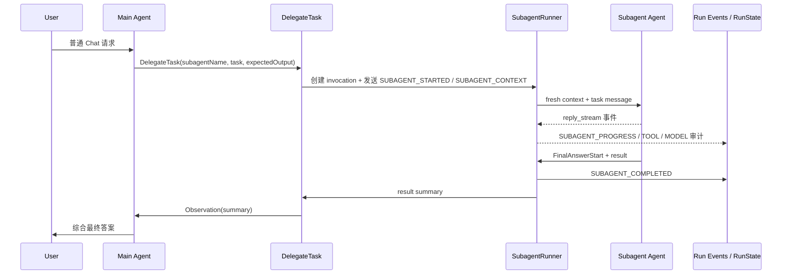

# Subagent 委托能力设计

> 状态：M1 已实现，M2 在线能力继续稳定化；M3 仅按精简持久任务方案推进。
> 外部参考：Claude Code sub-agents 文档。引力 YINLI 尽可能借鉴官方设计和实现思路，包括文件定义、frontmatter 字段、独立上下文、工具裁剪、模型继承、前后台、恢复、嵌套和隔离等能力；但稳定行为以本文和 `docs/chat-sse-event-contract.md` 为准，任何偏离官方设计的地方都必须写明原因。
> M3 详细设计：单进程持久任务、transcript、Supervisor、分级恢复和前端事件映射统一见 `docs/subagent-task-runtime-redesign.md`；嵌套、隔离和长期兼容特性不属于当前实施计划。

## 设计结论

引力 YINLI 的 Subagent 采用“文件定义 + ReAct 内部委托”的稳定产品模型：**Subagent 定义源是 Markdown 文件 + YAML frontmatter**，不是数据库配置。V1.0 将 Subagent 设计为 ReAct Runtime 内的 `DelegateTask` 系统工具：主 Agent 在同一轮 ReAct 中按需调用该工具，把自包含任务交给一个独立上下文的专员 Agent 执行，专员返回结构化摘要后主 Agent 继续推理或最终回答。

为了贴合本项目已有命名和目录约定，引力 YINLI 不强制复刻 Claude Code 的外部名称：

- 定义目录继续使用 `.agents/subagents/` 与 `~/.agent-workstation/subagents/`，而不是 `.claude/agents/`。
- 主 Agent 暴露的委托工具继续命名为 `DelegateTask`，而不是 `Agent`。
- 功能设计以 Claude Code 为 baseline：能直接复用的概念直接复用，不能直接复用的部分通过 AW 的权限、Trace、RunState、恢复、测试和前端展示模型做稳定化适配。目录名和工具名可以不同，但不要无理由改变用户可感知的配置方式和委托心智。

旧 `runtime.kind=subagent` 不恢复，历史 Subagent 配置入口也不复用。新的 Subagent 能力只从文件定义加载。

如果后续实现过程中遇到旧独立 Subagent Runtime（`runtime.kind=subagent`）、旧 Agent Builder callable agent、旧 `subagentCalls` 消息字段、旧 `callableAgents` / `maxDepth` API 字段、旧 `SUBAGENT_*` 事件兼容代码或对应前端入口，必须删除，不能改造成新版能力，也不能继续补兼容逻辑。此处不包括当前 ReAct 内的 `DelegateTask` 委托及其 `SUBAGENT_*` 稳定事件。历史 SQLite 开发库只允许保留启动所需的最小 schema 兼容，且不得暴露为当前 API / UI / Runtime 事实源。

这条路线和当前架构一致：

- `readiness_gate.py` 仍只判断是否可启动 Runtime。
- `intent_router.py` 仍只返回 `runtime.kind=react`。
- `runtime_dispatcher.py` 不新增 `subagent` 分支。
- Team Runtime 继续表示用户显式选择的多人协作；Subagent 表示主 Agent 在任务中临时委托的内部工作单元。
- Chat UI 继续依赖 RunState / DisplaySnapshot，Subagent 过程通过新的 `SUBAGENT_*` Runtime Event 投影，不直接消费 raw SSE。

## 产品语义

Subagent 用来处理会污染主上下文但结果又有价值的支线任务，例如代码库探索、独立审查、日志分析、复现定位、资料整理。它和 Skill / Team 的边界如下：

| 能力 | 使用时机 | 上下文 | 由谁触发 |
| --- | --- | --- | --- |
| Skill | 可复用流程、提示词或资源注入，仍在主 Agent 上下文内执行 | 共享主上下文 | 运行时 Skill selector / Agent |
| Subagent | 支线任务需要独立探索，只需要返回摘要 | 独立上下文 | 主 Agent 调用 `DelegateTask` |
| Team | 用户选择角色素材，Leader 在本轮组建临时 Member | Member 隔离，Leader 综合 | 前端 executor 选择 |
| Workflow | 明确多阶段自动化、变量流、产物和 Cockpit | 独立 workflow runtime | Workflow 入口 |

## V1.0 范围

V1.0 做“前台、一次性、可审计”的 Subagent，作为引力 YINLI 的稳定最小闭环：

- 支持 Markdown + YAML frontmatter 定义文件：Markdown 正文是系统提示词，YAML frontmatter 配置名称、描述、工具、模型、权限、Skill、最大 ReAct 轮次。
- 支持项目级和用户级 Subagent 目录扫描，名称冲突按项目级优先。
- 注入 `DelegateTask` 工具，参数包括 `subagentName`、`task`、`expectedOutput`、`context`、`constraints`。M1 中 `DelegateTask` 是 blocking 前台工具：每个模型回复最多发起一条委托；主 Agent 必须等待子 Agent 完成并拿到 observation 后，才能继续 ReAct 或输出最终答案。若模型批量发起多条委托，后端返回每条对应的错误结果，要求其改为串行委托，避免 HITL 恢复关联错位。
- 子 Agent fresh context 执行，不读取主会话历史，只接收委托任务、必要环境信息、当前项目规则摘要、git 状态快照、运行前记忆摘要和预加载 Skill。内置 `explorer` / `plan` 为低成本研究代理，默认跳过项目规则和 git 状态；自定义 Subagent 默认加载这些启动上下文。
- 子 Agent 结果以短摘要返回给主 Agent；完整过程进入 Trace，RunState 只做轻量委托状态展示。
- 子 Agent 继承父 Agent guardrails 的上限，Subagent 文件配置只能进一步收窄权限，不能放大权限。
- 当前只支持 single-agent executor；Team executor 不注入 `DelegateTask`，是否仅允许 Leader 委托需后续单独决策。

当前 M1 已落地：

- `backend/src/subagents/*` 已实现 frontmatter loader、registry、工具策略、前台 runner 和委托 manager。
- `backend/src/tools/delegate_task.py` 已实现 `DelegateTask` 工具。
- `backend/src/server/routes/subagents.py` 已提供定义列表和 invocation 查询 API。
- `backend/src/storage/database.py` 已新增 `subagent_invocations`，并在启动迁移中删除旧 `callable_agents` / `max_depth` / `subagent_calls` 遗留列。
- `backend/src/server/routes/chat/react_runtime.py` 已在 single-agent 主 Agent 运行时注入 Subagent 摘要提示和 `DelegateTask`；Team 当前未注入。
- `backend/src/subagents/runtime_context.py` 已支持 frontmatter `skills` 预加载已安装启用 Skill，并以 `subagent:{name}` 作为 agent memory owner 注入 user / agent / global Markdown 摘要和最近 30 天历史记忆索引。
- `frontend/src/features/chat/ProcessTimeline.tsx` 已对 `DelegateTask` 做 Subagent 专用展示：标题显示 `Subagent · {name}`，展开后只展示 Markdown 委托任务和摘要，不展示原始调用 JSON。
- `frontend/src/pages/SubagentsPage.tsx` 已提供 Subagent 管理入口：展示定义、解析错误、来源路径、工具策略和 invocation 审计历史。
- `.agents/subagents/explorer.md` 已作为项目级只读探索 Subagent 示例定义；`.agents/subagents/debugger.md` 和 `.agents/subagents/general-purpose.md` 已作为项目级动作型 Subagent 定义，实际能力仍以父 Agent guardrails 为上限。

V1.0 不支持后台并发、持久 transcript、跨进程恢复和运行中消息；这些能力只按
`docs/subagent-task-runtime-redesign.md` 的 M3 单进程方案推进。嵌套、fork、worktree
隔离、更多 frontmatter 兼容字段仅作为产品调研素材，不是当前路线。始终不新增
`runtime.kind=subagent`，也不将旧 Subagent 配置入口改造成新能力入口。

## 官方设计借鉴矩阵

| 官方设计 / 能力 | 引力 YINLI 借鉴方案 | 状态 |
| --- | --- | --- |
| Markdown + YAML frontmatter 定义 | 保持同等格式，目录名使用 AW 约定 | M1 已实现 |
| `name` / `description` 决定自动委托 | 主 Agent system prompt 注入可用定义，按 description 自主调用 `DelegateTask` | M1 已实现 |
| 独立 context window，只返回摘要 | 子 Agent fresh context，完整过程进 Trace，摘要回主 Agent | M1 已实现 |
| 工具 allowlist / denylist | 借鉴官方规则：先 deny、再 allow，并与父工具池交集；内部 `FinalAnswerStart` 始终保留 | M1 已实现 |
| 模型继承 / 指定模型 | 已支持字段解析和指定模型；`inherit` 继承父本轮实际模型的缺口列入 M2.1 | 待修复 |
| 项目 / 用户 scope | 使用 `.agents/subagents/` 和 `~/.agent-workstation/subagents/` | M1 已实现 |
| `permissionMode` | 支持 `default`、`acceptEdits`、`auto`、`dontAsk`、`bypassPermissions`、`plan`，并按父 Agent guardrails 上限收窄 | M2 部分实现 |
| `skills` 预加载 | 解析 frontmatter `skills` 中的 Skill id / name，只加载已安装启用 Skill，并注入完整 Skill manual | M1 已实现 |
| 前台 / 后台 | M3 使用单进程 Supervisor、持久 task 和独立前端组件 | 待 spike 后实施 |
| resume / SendMessage | 以 `invocationId` 定位；恢复等级由 AgentScope checkpoint spike 决定 | 待 spike 后实施 |

## 稳定性原则

后续 Subagent 能力进入稳定版本前，必须满足：

- 先更新 `docs/chat-sse-event-contract.md`，再实现新的 Runtime Event / RunState 投影。
- 先定义 SQLite / Pydantic / TypeScript 数据结构，再接入运行时。
- 权限能力必须以父 Agent guardrails 为上限，不允许 Subagent 文件扩大权限。
- 后台和恢复必须有持久 transcript、取消语义、错误收口和最小回归测试。
- 前端只消费 DisplaySnapshot / RunState，不依赖 raw SSE 或临时 trace payload。
- 外部产品只作为能力参考；每项能力必须先有本项目产品理由和验收标准。

## 数据模型

Subagent 定义不进 SQLite。SQLite 只记录运行 invocation，便于 Trace、RunState 恢复和审计。

```sql
CREATE TABLE IF NOT EXISTS subagent_invocations (
  id TEXT PRIMARY KEY,
  run_id TEXT NOT NULL,
  session_id TEXT NOT NULL,
  tool_call_id TEXT NOT NULL DEFAULT '',
  parent_scope TEXT NOT NULL DEFAULT 'single',
  parent_agent_id TEXT NOT NULL,
  parent_agent_name TEXT NOT NULL,
  definition_scope TEXT NOT NULL DEFAULT '',
  definition_path TEXT NOT NULL DEFAULT '',
  subagent_name TEXT NOT NULL,
  status TEXT NOT NULL,
  task TEXT NOT NULL,
  expected_output TEXT NOT NULL DEFAULT '',
  result_preview TEXT NOT NULL DEFAULT '',
  error TEXT NOT NULL DEFAULT '',
  started_at TEXT NOT NULL,
  completed_at TEXT,
  updated_at TEXT NOT NULL
);
```

## 定义文件

Subagent 文件使用 Markdown + YAML frontmatter。只有 `name` 和 `description` 必填，Markdown 正文作为子 Agent system prompt。

```markdown
---
name: code-reviewer
description: Reviews code for quality, security, and maintainability. Use after code changes.
tools: Read, Grep, Glob
model: inherit
permissionMode: default
maxTurns: 20
skills: []
---

你是代码审查专家。被调用时，检查代码质量、安全性、可维护性，并按优先级输出具体问题和建议。
```

V1.0 解析官网字段；其中 M1 会执行 `name`、`description`、`tools`、`disallowedTools`、`model`、`maxTurns`、`skills` 和 `color`，其余字段先保留为 metadata 并在定义列表中标明执行状态：

| Field | Required | 说明 |
| --- | --- | --- |
| `name` | Yes | 唯一标识，建议小写字母、数字、短横线 |
| `description` | Yes | 主 Agent 判断何时委托的描述 |
| `tools` | No | 工具 allowlist；省略时继承父 Agent 本轮工具池 |
| `disallowedTools` | No | 工具 denylist，从继承工具池中移除 |
| `model` | No | `inherit` 或具体模型名；默认 `inherit` |
| `permissionMode` | No | 官网枚举：`default`、`acceptEdits`、`auto`、`dontAsk`、`bypassPermissions`、`plan`；默认继承父会话权限上下文 |
| `maxTurns` | No | 子 Agent 最大 ReAct 轮次，默认 20 |
| `skills` | No | 预加载 Skill id / name 列表，启动时注入完整 Skill 内容 |
| `mcpServers` | No | 引用已配置 MCP server，或使用 inline MCP server 定义；V1.0 可先解析并保留 inline 定义，M2 完整连接与生命周期清理 |
| `color` | No | 前端展示颜色，V1.0 可解析但不强依赖 |

V1.0 暂不执行 Claude 的 `background`、`isolation`、`hooks`、`memory`、`effort`、`initialPrompt`。解析到这些字段时保留在 metadata 中，并在定义列表 API 标记为“已识别但当前版本未执行”。后续版本必须按官网语义补齐，不另造字段。

## 定义目录与优先级

按 Claude 风格保留文件定义方式，但目录名使用本项目已有隐藏目录约定。完整能力目标的 scope 优先级如下，M1 只实现项目级和用户级：

| Location | Scope | Priority |
| --- | --- | --- |
| 托管设置中的 Subagent 目录 | 组织范围 | 1 |
| 运行时会话注入定义 | 当前会话 | 2 |
| `.agents/subagents/` | 当前项目 | 3 |
| `~/.agent-workstation/subagents/` | 当前用户所有项目 | 4 |
| Plugin `agents/` 目录 | 启用 plugin 的位置 | 5 |

扫描规则：

- 递归扫描目录下的 `*.md`。
- 同一 scope 内 `name` 重复时只加载第一个，并写入启动诊断 warning。
- 不同 scope 同名时按上表优先级覆盖，项目级覆盖用户级。
- 项目级定义支持递归扫描；如果后续支持多工作目录或 add-dir，要按“离当前工作目录最近的定义优先”处理同名项目定义。
- Plugin 定义后续使用 scoped identifier，子目录进入名称空间，避免和项目/用户定义混淆。
- V1.0 不做文件 watcher；每轮 Chat runtime 构建时重新扫描，或按 mtime 做轻量缓存。
- 文件解析失败不阻塞 Chat，只写入 Trace / 后端日志，并在 Subagent 管理 UI 显示错误。

## 工具与权限

```text
base_tools = parent_available_tools
after_deny = base_tools - disallowedTools
effective_tools = tools ? (after_deny ∩ tools) : after_deny
```

工具策略借鉴官方语义：Subagent 默认继承主对话当前可用工具池，再由 `disallowedTools` 和 `tools` 裁剪。Subagent 文件不能授予主对话没有的工具，也不能扩大父 Agent 权限：

- 父 Agent 不允许 Bash，则 Subagent 即使写了 `Bash` 也不可见。
- 父 Agent read-only，则 Subagent 即使写了 `Write` / `Edit` 也不可见。
- `permissionMode` 使用官方字段名和枚举值，但在 AW 内执行“父权限是上限，Subagent 可收窄不可放大”：`default` 继承父权限；`plan` 映射为 AgentScope `EXPLORE` + AW `read_only`；`acceptEdits` 映射为 `confirm_destructive`；`auto` 在 AW M2 中保守映射为 `confirm_destructive`，后续若引入官方式 classifier 再细化；`dontAsk` 映射为 AgentScope `DONT_ASK` / AW 审计中的严格确认策略；`bypassPermissions` 只有在父权限已允许 trusted tools 时才会生效，否则会被父级 guardrail clamp。任何代理消息都不能替代用户审批。
- 非法 `permissionMode` 不阻塞定义加载，运行时按 `default` 处理。
- V1.0 的默认内置 Subagent 均只读，不进入 HITL resume 链。
- 动作型 Subagent 如果触发 AgentScope `REQUIRE_USER_CONFIRM` / `REQUIRE_EXTERNAL_EXECUTION`，进入 `waiting` 状态并写入 `SUBAGENT_WAITING_HUMAN`；后端 `/resume` 可恢复 child agent、更新 invocation，并把恢复后的摘要作为 `DelegateTask` external result 交还父 Agent，继续父 ReAct。

`tools` 和 `disallowedTools` 按官网规则解释：

- 省略 `tools` 时继承父 Agent 本轮所有可用工具。
- 同时配置 `tools` 与 `disallowedTools` 时，先应用 `disallowedTools`，再从剩余工具池解析 `tools`。
- 同时出现在两者中的工具最终不可用。
- 支持精确工具名、知识库自定义工具名和 MCP server 级模式：`mcp__<server>`、`mcp__<server>__*`、`mcp__*`。策略结果会同步裁剪传给子 Agent 的 MCP server `enable_tools` 与知识库工具列表。
- 依赖主会话 UI 或会话状态的工具不进入 Subagent，例如 AskUser 类交互工具、Plan mode 切换工具、定时唤醒工具和 MCP 等待工具。
- M1 至 M3 不向子 Agent 注入 `DelegateTask`，因此不允许嵌套；未来如有明确产品需求必须另行设计，不能只靠增加深度字段开放。

## 后端模块

新增模块建议：

- `backend/src/server/routes/subagents.py`：列出可用 Subagent 定义、读取定义详情、校验文件解析结果。
- `backend/src/subagents/models.py`：Pydantic 请求 / 响应 / 运行时 spec。
- `backend/src/subagents/loader.py`：扫描 `.agents/subagents/` 和用户级目录，解析 Markdown frontmatter。
- `backend/src/subagents/registry.py`：合并不同 scope 的定义，按优先级处理重名，输出运行时 definition catalog。
- `backend/src/subagents/tool_policy.py`：计算父 Agent 与 Subagent 的有效工具集合。
- `backend/src/subagents/runner.py`：创建独立 AgentScope Agent，消费 `reply_stream()`，生成结果摘要和 Runtime Event。
- `backend/src/tools/delegate_task.py`：主 Agent 可见的 `DelegateTask` 工具。

`agents/factory.py` 需要轻量扩展：

- 支持按工具名过滤默认工具，而不只靠 `RuntimeToolScope` 粗粒度开关。
- 缓存 key 增加 definition scope、definition path、系统提示词 hash、工具策略 hash、权限策略 hash。
- 子 Agent 的 `parent_agent_id` 使用 `subagent:{name}`，Trace 与 Memory audit 可区分主 Agent / 子 Agent。

`runtime_builder.py` 注入逻辑：

1. 扫描并合并当前可用 Subagent 定义。
2. 如果列表非空，将 definition 摘要写入主 Agent system prompt：

```text
You may delegate self-contained side tasks by calling DelegateTask.
Available subagents:
- code-reviewer: Reviews code for quality and security. Use after code changes.
- explorer: Read-only codebase exploration.
Delegate only when the result can be summarized back into this run.
```

3. 将 `DelegateTask` 作为 `extra_tools` 注入主 Agent。
4. 将 Subagent definition catalog 摘要加入 `runtime_features_cache_key`，确保文件变更后缓存失效。

## 运行链路



V1.0 的子 Agent 必须调用 `FinalAnswerStart` 后输出结果。若自然结束但没有 final answer，复用 `leader_stream.py` 的 final answer recovery 思路，但不把子 Agent reasoning 直接提升为结果。

## Runtime Event 与 RunState

先更新 `docs/chat-sse-event-contract.md`，新增 `SUBAGENT_*` Runtime Event 家族。V1.0 稳定事件：

| type | status | payload |
| --- | --- | --- |
| `SUBAGENT_STARTED` | `running` | `{ invocationId, toolCallId, subagentName, definitionScope, definitionPath, taskPreview, expectedOutput }` |
| `SUBAGENT_CONTEXT` | `running` | `{ invocationId, toolCallId, subagentName, skillRefs, loadedSkills, missingSkillRefs, memoryAgentId, memoryInjected, errors, permission }` |
| `SUBAGENT_WAITING_HUMAN` | `waiting` | `{ invocationId, toolCallId, subagentName, interactionType, replyId, toolCalls, partialResultPreview, durationMs }` |
| `SUBAGENT_COMPLETED` | `completed` | `{ invocationId, toolCallId, subagentName, resultPreview, durationMs }` |
| `SUBAGENT_FAILED` | `failed` | `{ invocationId, toolCallId, subagentName, error, partialResultPreview }` |

Chat 主界面 V1.0 不展示子 Agent 完整 transcript，只在主 Agent process timeline 中展示一个 `DelegateTask` 工具项和轻量状态：

- `subagent.started`
- `subagent.completed`
- `subagent.failed`

完整子 Agent 模型调用、工具调用、权限决策和错误写入 Trace。这样可以避免 V1.0 修改 `DisplayActor.role` 枚举；V2 做后台并发面板时再增加 `subagents[]` 或 `role=subagent` 的展示模型。

## 权限与 HITL

权限原则：

- 子 Agent 不能比父 Agent 拥有更多权限。
- 子 Agent 定义里的 `permissionMode` 使用官网枚举，并只能在父权限和系统策略内生效。
- 子 Agent 的工具审批仍由用户决定，主 Agent / 子 Agent 的消息不能替代用户授权。
- V1.0 建议内置只读 `explorer` 和 `code-reviewer`，默认不启用 Write / Edit。

V1.0 / M2 当前 HITL 策略：

- M1 只注入只读工具，原则上不产生 HITL。
- 如果触发 `REQUIRE_USER_CONFIRM` / `REQUIRE_EXTERNAL_EXECUTION`，子 Agent invocation 标记为 `waiting`，写入 `SUBAGENT_WAITING_HUMAN`；`/api/chat/resume` 可恢复 child agent 并更新 invocation。
- 父 Agent 的 `DelegateTask` 采用 AgentScope external tool 语义暂停：子 Agent 完成或恢复后，后端发送 `ExternalExecutionResultEvent` 给父 Agent，父 ReAct 会拿到 observation 后继续推理或输出最终答案。
- 当前父子续接上下文是进程内状态，服务重启后的 pending Subagent 恢复、持久 transcript 和 SendMessage 式继续交互放到 M3。

## 记忆与 Skill

不新增 memory runtime，也不恢复旧记忆模块。

V1.0 使用现有新记忆方案：

- 运行前给子 Agent 注入 user / global Markdown 摘要。
- `agent` 维度记忆使用 `subagent:{name}` 作为 owner，存入 `backend/data/memory/agents/subagent-{name}/agent_memory.md`。
- 子 Agent 默认可用 `memory_node_tree` / `memory_node_query`，但 audit payload 必须带 `sourceAgentRole=subagent`、`subagentInvocationId`。
- 预加载 Skill 使用 frontmatter 的 `skills` 字段，由 `subagents/runtime_context.py` 按 Skill id / name 解析已安装启用 Skill，并复用 `build_skill_system_prompt_from_skills()` 注入格式；V1.0 不允许子 Agent 自行动态安装或注册 Skill。

## 前端入口

V1.0 最小 UI：

- ActivityBar 中增加 Subagents 管理入口，展示从 `.agents/subagents/` 和用户级目录扫描到的定义。
- 支持查看定义详情、解析错误、来源路径和优先级。
- V1.0 不做数据库式绑定 UI；所有已加载定义默认可供主 Agent 选择，是否委托由主 Agent 根据 description 判断。
- Chat 过程展示复用工具时间线，把 `DelegateTask` 渲染为 `Subagent · {subagentName}` 委托卡片，并只展示 Markdown task / summary。
- Trace 页面增加 `SUBAGENT_*` 筛选和 invocation 详情。

## 内置定义

建议随 V1.0 初始化两个内置定义：

### explorer

- 描述：只读代码库探索、文件定位、上下文收集。
- 工具：`Read`、`Grep`、`Glob`，可选只读 `Bash`。
- 权限：M1 通过只读工具集强制只读；后续可映射为 `permissionMode: plan`。
- 模型：`inherit`。
- 适用：主 Agent 需要大量搜索但只需要结论摘要。

### code-reviewer

- 描述：代码质量、安全性、可维护性审查。
- 工具：`Read`、`Grep`、`Glob`、只读 `Bash`。
- 权限：M1 通过只读工具集强制只读；如需写入修复，改用后续 `debugger` / `general-purpose`。
- 模型：`inherit` 或用户指定低成本模型。
- 适用：变更后审查、PR review、风险扫描。

`debugger` 和 `general-purpose` 已补项目级定义；在父权限允许时可使用 Write/Edit/Bash/Http，遇到需要人工审批的调用会进入 `SUBAGENT_WAITING_HUMAN`，经 `/api/chat/resume` 恢复后自动续接父 `DelegateTask`。

## 分期计划

### M1：只读前台 Subagent

- [x] 新增 Markdown + YAML frontmatter loader / registry 和定义列表 API。
- [x] 新增 `subagent_invocations` 审计表。
- [x] 新增 `DelegateTask` 工具和 `SubagentRunner`。
- [x] 子 Agent 支持 fresh context、只读工具和 `model` 字段；`inherit` 的父本轮实际模型继承仍列入 M2.1。
- [x] 新增 `SUBAGENT_STARTED` / `SUBAGENT_CONTEXT` / `SUBAGENT_COMPLETED` / `SUBAGENT_FAILED`。
- [x] Chat 将 `DelegateTask` 专门展示为 Subagent 委托卡片，Trace 可看详情。
- [x] Subagents 管理页展示定义、加载错误、来源路径、工具策略和 invocation 历史。
- [x] 后端测试覆盖 frontmatter 解析、scope 优先级、工具策略交集、事件发射、审计记录、旧 schema 删除。
- [x] Skill 预加载和 Subagent 维度记忆注入已接入运行时，并通过 `SUBAGENT_CONTEXT` 审计。
- [x] `permissionMode` 已接入父权限上限合并，`SUBAGENT_CONTEXT.permission` 记录 requested / effective mode、tool policy、AgentScope mode 和 clamp 状态。
- [x] 工具继承已基于父运行时真实工具池执行，MCP server 级模式和知识库自定义工具名会裁剪实际注入的子 Agent 工具。
- [x] 增加 `debugger` / `general-purpose` 项目级动作型定义，父级 read-only 时仍自动收窄为只读。
- [x] 子 Agent HITL 已结构化为 `SUBAGENT_WAITING_HUMAN` / invocation `waiting`，不再作为普通失败处理。
- [x] `/api/chat/resume` 已支持恢复 child agent，并根据恢复结果更新 `subagent_invocations`。

### M2：动作型 Subagent 与 HITL（部分完成）

- 已具备 Write/Edit/Bash/Http 等可能触发权限的工具，实际能力受父权限上限裁剪。
- 已具备子 Agent HITL 透传和当前进程内 resume；任何 Agent 消息都不能替代用户审批。
- [ ] 补齐动作型工具的权限 UI、拒绝路径和 resume 回归测试。
- [ ] 收紧子 Agent 关键进度投影，不扩充新的 frontmatter 能力。

### M2.1：前台链路稳定性

- [ ] 子任务失败返回结构化 error observation，不无条件击穿父 Run。
- [ ] `model: inherit` 使用父 Agent 本轮实际解析的模型配置。
- [ ] 未预期异常和取消都将 invocation 收口到明确终态。
- [ ] HITL resume 后的 child 事件补齐 `invocationId`、`toolCallId`、`subagentName` 和稳定 seq。

### M3：单进程持久任务

- 先验证 child / parent AgentScope checkpoint，再确定 exact resume、transcript replay 或显式 restart。
- 复用并扩展 `subagent_invocations`，新增一张规范化 transcript 表。
- 使用进程内 `SubagentSupervisor` 支持 background 和单一并发上限，不引入 lease / heartbeat / 多 Worker claim。
- 通过 `invocationId` 查询、取消和发送消息，禁止按名称定位运行实例。
- transcript 独立于主会话压缩；完整内容按需读取，不进入 RunState 常驻状态。
- Chat 使用独立 Subagent 组件：前台内联、后台列表、共用 Detail Drawer。
- 后端重启后遗留 running task 先标记 `interrupted`，恢复能力严格服从 spike 结论。

### 未来候选，非当前计划

嵌套 Subagent、worktree/Docker isolation、fork 会话、托管/Plugin scope、scoped/inline
MCP、frontmatter hooks、`memory`、`effort`、`initialPrompt` 和显式 @-mention 只有在
出现明确产品需求后重新设计，不在当前源码中预埋字段、事件或空抽象。

## 风险与决策点

- **AgentScope 工具内运行 Agent 的流式事件接入**：如果 `ToolBase` 内部无法自然向父 SSE 发送事件，`DelegateTask` 需要持有 `RuntimeEventSink` 或 queue 引用，由 `runtime_builder.py` 构造时注入。
- **文件定义热更新**：M1 不做 watcher，每轮 runtime 构建扫描或按 mtime 缓存；后续再加 watcher。
- **缓存污染**：子 Agent 必须用独立 cache key，不共享主 Agent 实例。
- **权限错配**：工具策略必须做交集，任何 Subagent 文件配置都不能绕过父 Agent guardrails。
- **上下文膨胀**：`DelegateTask` 返回给主 Agent 的 Observation 必须截断，完整 transcript 进 Trace。
- **Team 混用**：临时 Member 默认不注入 `DelegateTask`；是否允许 Team Leader 委托需先核对当前注入事实和总并发预算，不作为 M3 验收前提。
- **旧入口误用**：旧 Subagent 配置入口已从 API、前端类型和运行模型中移除，不作为新 UI、API 或 Runtime 的事实源。

## 验收标准

- 项目级 `.agents/subagents/explorer.md` 定义存在后，主 Agent 可委托其搜索代码并拿到摘要。
- Subagent 工具调用不进入主 Agent 上下文，只把最终摘要作为 `DelegateTask` Observation 返回。
- Trace 能看到 `SUBAGENT_STARTED`、`SUBAGENT_CONTEXT`、子 Agent 工具调用、`SUBAGENT_COMPLETED`。
- 删除或改名定义文件后，主 Agent system prompt 和工具列表不再出现对应 Subagent。
- 父 Agent read-only 时，即使 Subagent 文件配置 Write/Edit，实际也不可写。
- 后端单测覆盖工具 allowlist / denylist / 父权限交集。
