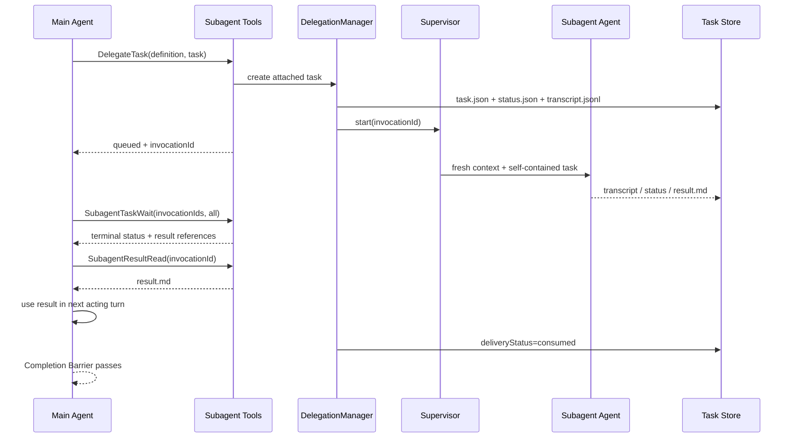

# Subagent 委托能力设计

> 状态：当前在线架构，2026-07-27。本文是 Subagent 定义、attached task、父子消费和前端展示的唯一专题设计。
> 稳定边界：事件字段以 `docs/chat-sse-event-contract.md` 为准，通用投影与恢复规则以 `docs/event-stream-architecture-redesign.md` 为准。

## 1. 设计结论

Subagent 是 ReAct 内部的 attached fork/join 任务，不是新的 Runtime architecture：

- 定义继续使用 Markdown + YAML frontmatter。
- 主 Agent 通过 `DelegateTask` fork 独立上下文任务，调用后立即得到 `invocationId`。
- 同一父 Run 可以并行 fork 多个 child，父 Agent 可在等待期间继续处理主任务。
- child 只把最终结果写入 `result.md`；中间过程写入独立 transcript 和 Trace。
- 父 Agent 必须通过 `SubagentTaskWait` / `SubagentResultRead` join 并消费每个结果。
- Completion Barrier 保证全部 attached child 终态且结果已消费后父 Run 才能成功结束。
- Chat 展示通过 `RUNTIME_EVENT` 投影为 `kind=subagent` Block，不从普通工具参数或结果反解析。

旧 `runtime.kind=subagent`、旧 Agent Builder callable agent、旧 `subagentCalls`、`callableAgents`、`maxDepth` 和旧前端入口不得恢复。Team executor 当前不注入 Subagent 工具，Team Member 与 Subagent 是两套独立的协作语义。

## 2. 产品边界

| 能力 | 适用场景 | 上下文与结果 | 触发方式 |
| --- | --- | --- | --- |
| Skill | 可复用流程、知识和资源 | 在当前 Agent 上下文内运行 | Runtime catalog / Agent |
| Subagent | 可独立完成、只需返回结果的支线 | fresh context，文件结果回到父 Agent | 主 Agent 调用工具 |
| Team | 用户显式选择的多人协作 | 隔离 Member、Task List、Mailbox、统一综合 | `mode=team` |
| Workflow | 明确阶段、变量流和产物的自动化 | 独立 Workflow Runtime | Workflow 入口 |

当前支持 attached、并行 fork、文件结果、显式 wait/read、取消、HITL same-process resume、任务控制台和强制消费。

当前不支持 detached、嵌套 Subagent、运行中消息、worktree 隔离和跨进程精确续跑。这些能力没有预埋兼容字段或空抽象。

## 3. 定义文件

项目级定义位于 `.agents/subagents/**/*.md`，用户级定义位于运行时用户数据根目录的 `subagents/**/*.md`。同名定义以项目级优先；解析错误不阻塞 Chat，会在 Subagents 页面展示。

```markdown
---
name: explorer
description: 只读探索代码并返回结论。
tools: Read, Grep, Glob
disallowedTools: Write, Edit
model: inherit
permissionMode: plan
maxTurns: 30
skills: []
---

你是只读探索代理。只完成委托范围内的调查，并返回可供父 Agent 直接使用的结论。
```

| Field | 必填 | 当前语义 |
| --- | --- | --- |
| `name` | 是 | 定义唯一标识 |
| `description` | 是 | 主 Agent 判断是否委托的简短说明 |
| `tools` | 否 | 从父运行时真实工具池取 allowlist |
| `disallowedTools` | 否 | 先于 allowlist 应用的 denylist |
| `model` | 否 | `inherit` 使用父本轮实际模型，也可指定模型 |
| `permissionMode` | 否 | 在父权限上限内进一步收窄 |
| `maxTurns` | 否 | 默认 30，配置上限 120 |
| `skills` | 否 | 预加载已安装、启用且处于 Project 白名单内的 Skill |
| `color` | 否 | 管理页展示元数据 |

`background`、`isolation`、`hooks`、`memory`、`effort`、`initialPrompt`、inline MCP 和 Plugin scope 不属于当前可执行契约。

## 4. 工具契约

主 Agent 注入以下完整工具组：

| Tool | 职责 |
| --- | --- |
| `DelegateTask` | fork 一个 attached child，立即返回 `invocationId` |
| `SubagentTaskList` | 列出当前父 Run 创建的 child 状态 |
| `SubagentTaskWait` | 按 `any/all` 等待 child 离开 queued/running |
| `SubagentResultRead` | 读取终态 child 的 `result.md` 并推进交付状态 |
| `SubagentTaskCancel` | 取消 child；取消结果仍需读取和消费 |

`SubagentTaskWait` 只返回状态与结果引用，不把完整结果隐式塞回父上下文。`SubagentResultRead` 才是结果交付入口。这样 fan-out/join、超时和结果消费都有明确语义。

## 5. 运行链路



`DelegateTask` 只负责 fork，不阻塞到 child 完成。`SubagentSupervisor` 使用单进程 `asyncio.Task` 和共享并发上限运行 child；任务身份始终是 `invocationId`，不能用名称或 `toolCallId` 代替。

## 6. 状态与消费

任务状态：

```text
queued -> running -> completed | failed | cancelled
                    -> waiting -> running
running | waiting -> interrupted
interrupted -> running | cancelled
```

交付状态独立于执行状态：

```text
none -> pending -> delivered -> consumed
```

- `completed`、`failed`、`cancelled` 和启动 reconciliation 生成的 `interrupted` 都必须有可读取结果。
- `waiting` 不是终态，不生成 `result.md`；它表示 child 正在等待用户审批或外部执行。
- `SubagentResultRead` 将 `pending` 推进为 `delivered`。
- 父 Agent 收到读取结果并完成后续 acting 后，系统将其推进为 `consumed`。
- 只读过结果但没有让父 Agent 继续处理，不能视为已经消费。

Completion Barrier 同时检查两类条件：不存在非终态 child，并且所有 child 的 `deliveryStatus=consumed`。模型提前输出的最终答案会被暂存，父 Agent 被要求继续 wait/read；未消费结果不会泄漏到用户界面。

## 7. 存储与模块边界

每个 Session 下的任务目录包含：

```text
subagents/{invocationId}/
  task.json
  status.json
  result.md
  transcript.jsonl
```

- `task.json`：创建时的不可变任务快照、父 Run 和 definition 引用。
- `status.json`：执行状态、交付状态、时间和错误摘要。
- `result.md`：父 Agent 唯一需要消费的终态结果。
- `transcript.jsonl`：child 的状态、模型、工具、HITL 和异常过程。
- `subagent_invocations`：控制台查询索引，不替代文件任务事实源。

后端职责固定为：

- `loader.py` / `registry.py`：定义解析、scope 合并和诊断。
- `tool_policy.py` / `permission_policy.py` / `runtime_context.py`：工具、权限、Skill、Memory 和 Project 范围裁剪。
- `runner.py`：构造和执行 fresh-context child。
- `task_store.py`：文件生命周期、结果和 transcript。
- `task_service.py`：合法状态迁移的唯一业务入口。
- `supervisor.py`：单进程并发任务注册与取消。
- `manager.py`：父 Run 编排、wait/read、HITL、事件和 Completion Barrier 门面。
- `tools/delegate_task.py`：主 Agent 可见工具契约。

## 8. 权限与上下文

有效工具按以下顺序计算：

```text
base = parent runtime tools
afterDeny = base - disallowedTools
effective = tools ? intersection(afterDeny, tools) : afterDeny
```

Subagent 定义只能收窄能力，不能扩大父 Agent 的 ToolScope、filesystem、Project binding、MCP/HTTP 白名单或 guardrails。`FinalAnswerStart` 等运行时内部工具由系统保留，依赖主会话状态的 AskUser、Plan、等待类工具和 `DelegateTask` 不注入 child。

child 不读取父会话历史，只接收自包含 task、必要 context/constraints、Project 规则摘要、受控 git 状态、记忆摘要和已裁剪 Skill catalog。内置低成本研究定义可以跳过与任务无关的启动上下文。

动作型 child 触发 AgentScope HITL 后进入 `waiting`。同一进程内 `/api/chat/resume` 可以恢复 child，并在 child 结束后继续父 ReAct；任何 Agent 消息都不能替代用户审批。

## 9. Event 与前端

Subagent 领域状态先形成 `SUBAGENT_*` Source Event，再经 Chat normalizer、Subagent projector 和 Block 生命周期协调器进入统一流：

```text
Subagent task / transcript
  -> SUBAGENT_* Source Event
  -> Chat Domain Event
  -> kind=subagent projector
  -> RUNTIME_EVENT(open/delta/close)
  -> DisplaySnapshot V4
```

浏览器只接收 `RUNTIME_EVENT`，不接收顶层 `SUBAGENT_*`。前端 `subagent` kind module 负责合并状态与选择组件；通用 reducer 不理解 Subagent 字段。Chat 只展示任务摘要、状态、耗时、结果预览和“主 Agent 已消费”状态，完整 transcript 通过 Subagents API 按需读取。

新增或修改 Block data 前必须先更新 `docs/chat-sse-event-contract.md`，不得恢复普通工具结果反解析、独立 Subagent SSE 或第二份前端状态树。

## 10. 恢复与清理

- 刷新和 SSE 重连由 DisplaySnapshot V4 + tail replay 恢复 Chat Block。
- Subagents 页面通过 Task API 查询定义、invocation 和 transcript。
- 后端重启时，遗留 queued/running task 收口为 `interrupted` 并生成可消费结果，避免父 Run 永久等待。
- 已持久化 HITL 的 `waiting` task 保持等待语义；跨进程 child/parent exact resume 尚未开放。
- 取消必须写终态结果并走相同的 read/consume 链路。

## 11. 验收基线

- 同一父 Run 可以并行 fork 多个 child，且主任务不被单次 `DelegateTask` 阻塞。
- `waitMode=all` 只在所有目标 child 离开 queued/running 后返回。
- 每个终态 child 都必须经过 `SubagentResultRead` 和父 Agent 后续 acting 才成为 consumed。
- 任一 child 未终态或未消费时，父 Run 不得输出最终答案或标记 completed。
- 失败、取消和 interrupted 结果可读取，不无条件击穿父 Run。
- 父 Agent read-only 时，任何 definition 都不能获得 Write/Edit/Bash 等超出父权限的能力。
- Snapshot 刷新后 Subagent Block 的任务状态和消费状态与文件任务一致。
- Subagents 控制台可查询定义、解析错误、invocation、结果和完整 transcript。

后续若要开放 detached、嵌套、运行中消息或跨进程精确恢复，必须先给出明确产品场景、状态机、资源预算和失败恢复设计；不能只增加 frontmatter 字段。
