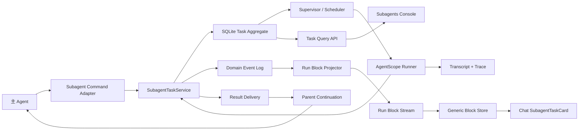
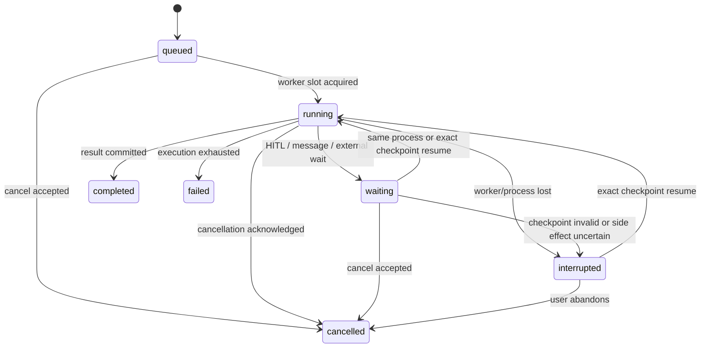

# Subagent 任务运行时与事件架构重设计

> 状态：后续领域接入草案，尚未实施。
> 适用范围：ReAct 内部 Subagent 委托、父子任务消费、Subagents 控制台和刷新恢复。
> 重要边界：本文不再定义通用 `RUNTIME_EVENT`、Projection Mutation、DisplaySnapshot 或 stream 恢复协议。通用事件流基础设施以 `docs/event-stream-architecture-redesign.md` 为唯一主设计；本文只定义 Subagent 自己的 aggregate、Domain Event、展示 Block schema 和父子消费语义。
> 取代范围：本文取代 `subagent-task-runtime-redesign.md` 中关于 TaskService、Supervisor、事件投影、前后台模式、消息和恢复的目标设计；旧文档只保留当前已实施行为的历史说明。
> 不变约束：不恢复 `runtime.kind=subagent`，不把 Subagent 混入 Team Runtime，不重写 AgentScope Runner、权限裁剪和 Project ToolScope。

## 1. 结论

当前实现已经解决 invocation identity、独立 transcript、基础状态机和任务控制台，但仍然把 Subagent 当作带持久化审计的 blocking `DelegateTask`。未来接入通用事件流后，Subagent 状态应经过以下领域适配链路进入前端：

```text
Subagent Domain Event(type=subagent.*)
  -> Subagent Projector
  -> Block Frame(open / delta / close)
  -> DisplaySnapshot.blocksById[blockId]
  -> blockRegistry["subagent"]
  -> SubagentTaskCard
```

当前旧链路把任务领域状态、普通工具状态、Trace 过程和 UI 展示数据混在一起。新增一个状态或活动类型需要同时修改后端事件、projector、RunState、DisplaySnapshot、前端 adapter 和组件，且 `invocationId` 被错误地降级为 `toolCallId` 的附属信息。目标链路不再增加 `display.subagent.*` 事件家族，通用 reducer 只处理 Block 生命周期，最终组件和 delta 合并都由 `Block.kind` 模块决定。

本文的领域接入原则如下；Block Frame、DisplaySnapshot、seq 和 stream 规则以通用设计为准：

1. `SubagentTask` 是独立领域实体，`invocationId` 是唯一运行身份。
2. foreground、background、wait、join 和 consume 是编排策略，不是任务身份。
3. Command、Domain Event、Trace Event 和 Projection Patch 分层，禁止互相冒充。
4. SQLite task aggregate 是事实状态；Subagent domain event 是可重放事实；transcript 是详细过程审计。
5. 通过通用 `RUNTIME_EVENT` 和 `DisplaySnapshot` 接入；Subagent 只新增 `kind=subagent` 的 Block module 和 projector，不新增通用 reducer 分支；主 Agent 时间线不从普通工具输入输出反解析。
6. Chat 只保存 Subagent 引用和当前 Run 所需的轻量 task snapshot；完整 transcript 按需读取。
7. 父 Run 对 attached child 有明确的等待、结果投递和消费协议，不能在存在未处理 child 时静默结束。
8. 保留首包 Snapshot + 增量 Block Frame 的恢复方式；删除 Subagent 经普通工具字段和 `tool.*` 事件的多层投影。

## 2. 外部设计依据

本方案只借鉴公开、可观察语义，不假设外部产品的私有实现：

- OpenAI Agents SDK 区分 raw response event、run item event、agent update 和 tracing span；UI 流事件不等同于完整 Trace。
- LangGraph 使用稳定 stream envelope 和多个 projection channel，分别传输 messages、values、updates、tasks、checkpoints 和 custom data。
- Claude Code Subagent 使用独立 agent identity、transcript、foreground/background、message、resume 和 task tree；background 完成后仍需主 Agent 接收通知并消费结果。
- 当前 Codex 协作语义以 canonical task identity 提供 spawn、wait、message、interrupt 和父子任务关系。
- AutoGen 将消息建模为纯可序列化数据，并明确区分 request/response 与 broadcast。
- CloudEvents 说明后端事件上下文与领域 data 可以分离；前端热流不需要复制完整审计包络。

这些实现的共同点是隔离业务事实、过程审计和消费者状态。对本项目而言，后端可以保留富 Domain Event，前端只接收固定形状的 Block Frame，不建立能够承载所有 UI 和 Trace 的万能事件对象。

## 3. 保留、重构与删除

### 3.1 保留

- ReAct 是唯一在线 architecture，Subagent 仍通过主 Agent 工具发起。
- Markdown + YAML frontmatter 定义、catalog、Project/User scope 和定义优先级。
- `SubagentRunner` 的 fresh context、模型继承、Skill/Memory 注入、工具和权限裁剪。
- `invocationId`、Workspace/Project/Session/Run 归属和定义 snapshot。
- SQLite 持久化、`subagent_transcript_items`、Subagents 页面和完整 transcript 按需加载。
- AgentScope `AgentState` checkpoint spike 的结论与 fingerprint 限制。
- 后端 Run lifecycle、首包 DisplaySnapshot、断线重订阅和终态不可逆原则。
- Team Runtime 的独立领域模型、Mailbox 和 Team Console，不与 Subagent reducer 混用。

### 3.2 重构

- `SubagentDelegationManager` 降为 Chat/AgentScope adapter，不再拥有 task 生命周期和事件缓冲。
- `SubagentTaskService` 升级为唯一领域写入口，负责命令、事务、状态迁移、事件追加和结果投递。
- `SubagentSupervisor` 只负责当前进程的执行句柄、并发槽位和取消信号；真实 `running` 状态必须在取得执行槽位后写入。
- blocking `DelegateTask` 改为 `spawn + wait + deliver + consume` 的兼容门面。
- 前端 Chat 和 Subagents 页面共用同一 task store、reducer、类型和卡片组件。
- HITL resume 从内存父 context 迁移到持久 parent continuation checkpoint。

### 3.3 删除

- Subagent 字段继续挂载到 `RunState.tools[]` 的做法。
- `subagentName/subagentStatus/subagentTimeline/subagentSummary/subagentError` 作为普通工具附加字段。
- `ProcessTimeline` 从 `DelegateTask.args/result`、JSON 或正则表达式反解析 Subagent。
- `mode=background` 在前端直接显示 completed/已提交的硬编码。
- Manager `_events` 内存数组作为 child 到父 SSE 的事件桥。
- 每个生命周期状态对应一个 `SUBAGENT_*` 展示事件的扩张方式。
- `PENDING_SUBAGENT_PARENT_CONTEXTS` 作为恢复事实源。
- Subagents 页面 1 秒轮询作为主要实时更新方式。

## 4. 总体架构



依赖方向固定为：

```text
routes/tools
  -> application services
  -> domain models and reducers
  -> repository/runtime adapters
```

storage、Runner 和前端组件不得反向依赖 Chat route 内部对象。

## 5. 四类数据必须分开

### 5.1 Command

Command 表示调用方请求系统执行动作，例如：

```text
SpawnSubagent
WaitSubagentTasks
SendSubagentMessage
CancelSubagentTask
ResumeSubagentTask
RestartSubagentTask
AcknowledgeSubagentResult
```

Command 可以失败，不进入事实日志。成功执行后由 TaskService 在事务内修改 aggregate 并追加 Domain Event。

### 5.2 Domain Event

Domain Event 表示已经发生且不可修改的 Subagent 业务事实，只在后端领域层、持久化层和 projector 输入侧使用，不通过前端 `RUNTIME_EVENT` 原样传输。本文只定义 Subagent 自己的 `subagent.*` type 和 data；前端只看到由这些事实生成的 `kind=subagent` Block Frame。

稳定事件词汇保持小而通用：

```text
subagent.task.created
subagent.task.status_changed
subagent.task.attempt_recorded
subagent.task.activity_recorded
subagent.task.message_added
subagent.task.result_recorded
subagent.task.delivery_changed
subagent.task.checkpoint_saved
subagent.task.child_linked
```

暂停、恢复、完成、失败、取消和中断都使用 `status_changed`，不再为每个状态增加一条全链路事件。

### 5.3 Trace Event

模型调用、token delta、工具输入输出、权限决策和 provider fallback 属于 Trace/Transcript：

```text
agent span
model span
tool span
permission span
handoff span
```

Trace 使用 `traceId/spanId/parentSpanId` 表达层级。除非某个过程需要用户操作或当前活动摘要，否则不得进入常驻 UI Snapshot。

### 5.4 Projection Snapshot/Block Frame

Projection 是面向具体消费者的可丢弃派生数据。`DisplaySnapshot` 保留为 Chat 的可恢复 projection，但不承担任务事实源：

- Run-scoped projection：当前 Chat Run 关联的 child task、父子关系、当前活动和结果消费状态，投影为 `DisplayBlock(kind=subagent)`；后续更新只使用 `delta` Frame 交给 Subagent Block module。
- Project-scoped projection：Subagents 控制台的任务列表、统计和活跃任务。
- Task detail projection：完整 transcript、messages、attempts、checkpoint 和错误详情，按需读取。

Projection 可以从 task aggregate 与 domain events 重建，不是事实源。

## 6. 领域模型

### 6.1 SubagentTask

核心字段分为六组：

- Identity：`invocationId`、`rootInvocationId`、`parentInvocationId`、`depth`。
- Ownership：Workspace、Project、Session、Run、parent Agent、parent tool call。
- Definition snapshot：definition name/scope/path/hash、prompt hash、model/tool/permission/runtime fingerprint。
- Execution：status、waiting reason、priority、attempt、worker instance、cancel request、timestamps。
- Result：result summary、structured result、partial result、failure code、artifact refs。
- Recovery：resume capability、checkpoint ref/version、continued-from identity。

`toolCallId` 只是 parent link，不是 task identity。Task 创建后定义文件变化不得改变历史 snapshot。

### 6.2 SubagentAttempt

一次 task 可以有多个 attempt：

```text
attempt-1: initial execution
attempt-2: exact checkpoint resume
attempt-3: explicit restart/replay
```

exact resume 可以沿用同一 invocation；从头重跑和 transcript replay 必须创建新 invocation，并使用 `continuedFromInvocationId` 关联，避免把副作用不确定的重跑伪装成同一次执行。

### 6.3 SubagentMessage

消息必须有稳定 `messageId`、sender、target invocation、createdAt、delivery/read 状态和 payload。父 Agent、用户和子 Agent的消息共享同一模型，但权限审批不能由普通 Agent message 代替。

### 6.4 ResultDelivery

child terminal result 与父 Agent消费是两个状态机：

```text
pending -> delivered -> consumed
                \-> rejected
pending -> orphaned
```

- `pending`：child 已有终态结果，尚未交给父 continuation。
- `delivered`：结果已写入父 Agent context 或新 Run continuation。
- `consumed`：父 Agent已基于该 observation 继续执行，允许父 Run 成功收口。
- `orphaned`：父 continuation 不可恢复；结果保留在任务控制台，等待用户显式续接。

`consumed` 表示结果已经进入父 Agent continuation 并完成至少一次后续 acting，不宣称模型一定做出了正确判断。

## 7. 状态机

Task 主状态保持有限：



终态为 `completed|failed|cancelled`。`cancelling` 是 `cancelRequestedAt != null` 的派生展示状态，不写入主状态。

waiting reason 使用稳定枚举：

```text
permission_required
user_input_required
external_execution_required
message_required
parent_join_required
```

状态写入必须使用 task `revision` 与 active attempt/process instance 做 compare-and-swap，禁止迟到 worker 覆盖终态。

## 8. 父子关系与执行策略

### 8.1 blocking attached

当前 `DelegateTask` 默认行为保留为兼容策略：

1. 创建 attached task。
2. 父 Agent停在 external tool call。
3. child 结束或进入 HITL。
4. result delivery 写为 delivered。
5. 父 Agent继续 ReAct 后写为 consumed。

这只是 `spawn + wait + consume` 的组合，不再由 Manager 直接 `await runner` 实现。

### 8.2 async attached

父 Agent创建 task 后可以继续处理其他工作，但 parent Run 持有 completion barrier：

- active child 存在时，父 Run不能成功完成。
- terminal child 的结果未 consumed 时，父 Run不能成功完成。
- 父 Agent必须 wait、consume、cancel，或由用户显式 detach。
- child 完成后向父 inbox 写持久通知，不依赖内存 callback。

这解决“后台任务没有消费就失去意义”的问题。

### 8.3 detached

detached task 不属于首期在线能力。未来开放时必须明确转移为用户/Project ownership，父 Run不再承担 completion barrier，但 UI 必须提供通知、结果入口和生命周期管理。

### 8.4 fan-out / join

同一父 Agent可以创建多个 attached child：

```text
spawn A
spawn B
spawn C
wait any|all
consume selected results
```

Supervisor 并发限制只决定何时从 queued 进入 running，不限制父 Agent创建任务。join 以 invocation ID 集合为输入，不按 Subagent name 匹配。

### 8.5 nesting

首期允许最大深度 2，默认 child 不拥有 spawn 工具。只有定义和父权限共同允许时才注入，所有 descendant 记录 root/parent identity，并计入同一 root 的并发和任务数量预算。

## 9. 持久化设计

### 9.1 继续使用的表

- `subagent_invocations`：升级为 task aggregate 表，保留历史主键和查询兼容。
- `subagent_transcript_items`：保留详细、有序过程，不承担领域状态恢复。

### 9.2 新增表

```text
subagent_domain_events
subagent_task_attempts
subagent_messages
subagent_result_deliveries
subagent_checkpoints
```

关键约束：

- `subagent_domain_events` 使用数据库级全局 cursor 和 `(invocation_id, seq)` 唯一约束。
- aggregate 更新与 domain event append 必须在同一个 SQLite transaction 中完成。
- task row 使用 `revision` 乐观锁。
- attempt 保存 `process_instance_id`，worker 写入必须校验 active attempt。
- checkpoint 保存 AgentState、parent continuation、runtime fingerprint 和 schema version；secret 不落库。
- transcript 与 domain event 分开保留和清理，不能用 UI timeline 反推状态。

不引入多 Worker 分布式 lease、外部消息队列和 exactly-once；单进程桌面应用通过 SQLite transaction、revision 和 process fencing 满足当前需求。

## 10. 后端模块边界

目标目录：

```text
backend/src/subagents/
  domain/
    models.py
    commands.py
    events.py
    transitions.py
    reducers.py
  application/
    task_service.py
    orchestrator.py
    result_delivery.py
    recovery_service.py
    projection_service.py
  infrastructure/
    repository.py
    supervisor.py
    checkpoint_store.py
    agentscope_adapter.py
  definitions/
    loader.py
    registry.py
    models.py
```

迁移期间可以保留 facade，但最终职责固定：

- Chat bridge：把 AgentScope external tool call 转成 Command，把 delivery 转成 `ExternalExecutionResultEvent`。
- TaskService：唯一写入口和事务边界。
- Repository：SQL 与 row mapping，不包含状态机判断。
- Supervisor：执行句柄、并发槽位、取消信号。
- AgentScopeAdapter：创建/恢复 child Agent并输出规范化 activity/trace。
- ProjectionService：从 aggregate/domain event 生成 run/project snapshot，不执行命令。

## 11. Agent 工具与 API

保留 `DelegateTask` 作为兼容入口，默认 blocking。逐步增加：

```text
SubagentTaskGet
SubagentTaskWait
SubagentSendMessage
SubagentTaskCancel
```

当支持 async attached 时，`DelegateTask` 增加显式 wait policy；不从 frontmatter 推断 foreground/background。

HTTP API 按命令与查询拆分：

```text
GET  /api/subagents/tasks
GET  /api/subagents/tasks/{invocationId}
GET  /api/subagents/tasks/{invocationId}/transcript
GET  /api/subagents/tasks/{invocationId}/messages
POST /api/subagents/tasks/{invocationId}/cancel
POST /api/subagents/tasks/{invocationId}/messages
POST /api/subagents/tasks/{invocationId}/resume
POST /api/subagents/tasks/{invocationId}/restart
GET  /api/subagents/stream?projectId=...
```

所有 command API 调用 TaskService；route 不直接写数据库或操作 Supervisor 状态。

## 12. Block Stream 与前端投影

精确传输字段见 `docs/event-stream-architecture-redesign.md` 和 `chat-sse-event-contract.md`。Subagent 不新增顶层 SSE 事件，也不新增公共 op。Chat Run 中的 Subagent 只是一个嵌套 Block：

```text
open  seq=21 id=subagent:inv-123 parent=message-7 kind=subagent dataVersion=1
open  seq=22 id=activity:1 parent=subagent:inv-123 kind=activity dataVersion=1
delta seq=23 id=activity:1 patch={summary: "正在读取文件"}
close seq=24 id=activity:1 outcome=completed
close seq=25 id=subagent:inv-123 outcome=completed patch={resultPreview: "..."}
```

`subagent.task.*` 只存在于后端 Domain Event Store；`trace.subagent.*` 只存在于 Trace/Transcript。二者都不会成为前端 Frame 的 kind。前端只识别 Block 生命周期和最终 `kind`：

```text
open / delta / close       如何改变 Block Tree
Block.kind                 使用哪个 reducer、renderer 和显示名称
```

新增 task status、activity 或 message 不增加顶层 SSE 类型，也不修改通用 reducer。只在 `kind=subagent` 的 data schema、projector 和 Block module 内处理。

Subagent 首期不新开 Chat stream。Subagents 控制台继续通过 Task API 查询列表和详情；未来确需实时刷新时，使用相同 RuntimeFrame 结构的 scoped endpoint，不把 channel 写入 Frame，也不让页面 reducer 解释 stream 类型。

### 12.1 RunSnapshot

RunSnapshot 保留 `DisplaySnapshot` 产品入口。当前 assistant message 是 `kind=message` 的 Block，Subagent Block 通过 parent 指向它；Block data 包含 Chat 恢复所需的 invocation identity、当前任务状态、活动摘要和 result delivery 状态，不复制完整 transcript。

前端使用 `blockRegistry["subagent"]` 渲染 `SubagentTaskCard`。未知 kind 或 dataVersion 使用 Generic Block：只展示 kind、phase 和 outcome，不展示未知 data。`subagent.data.activity` 的未知活动只作为 opaque data 保存，不得由通用层猜测结构。

### 12.2 Frontend module

Subagent 只需要自己的 Block module：

```text
frontend/src/features/runtime-blocks/subagent/
  schema.ts
  reducer.ts
  renderer.tsx
  api.ts
```

`reducer.ts` 只负责把 Subagent delta 合并到自己的 data；取消、发送消息、resume 等操作仍调用 command API，不能在 renderer 内直接改变 Block Tree。

### 12.3 实时与恢复

- Chat：订阅唯一 Run Block Stream，接收 Subagent open/delta/close Frame。
- 断线：携带最后应用的 `seq` 重连；seq 过期时服务端直接发送完整 Snapshot，不发送 reset event。
- 历史消息：Snapshot 只保留终态轻量 Subagent Block；完整 transcript、attempt、message 和 checkpoint 继续查 Task API。
- Subagents 页面：首期使用 Task API；低频 reconciliation 只用于对账，不作为 Chat 实时状态来源。

## 13. Event 与 Projection 扩展规则

新增能力时按以下判断：

1. 是调用意图：新增或扩展 Command，不新增 Event。
2. 是不可变业务事实：复用现有 Domain Event；只有 payload 语义不同且不能向后兼容时才新增 type。
3. 是详细调试过程：写 Trace/Transcript，不进入 task snapshot。
4. 是已有 Subagent Block 字段变化：发送 `delta` Frame，不新增顶层 SSE 事件。
5. 是新 UI activity：优先复用 `activity_recorded(kind=...)`；没有专属 renderer 时显示 generic fallback。
6. 是全新展示实体：新增 Block schema/projector/renderer，并注册 `Block.kind`；不得修改通用 stream/reducer，也不得塞进工具字段。

目标改动范围：

- 新 task status：领域枚举、状态转换、展示文案和测试。
- 新 activity kind：emitter 和可选 renderer；generic renderer 自动兜底。
- 新 task 字段：task schema、projection schema、共享类型和测试。
- 新领域：独立 Domain Event/projector 和 Block module，不修改通用 reducer。

## 14. 恢复与进程重启

启动 reconciliation：

1. 生成新的 process instance ID。
2. 查找 active attempt 属于旧进程的 running task。
3. 使用 revision/fencing 原子改为 interrupted，并追加 domain event。
4. waiting task 校验 checkpoint 与 interaction metadata；可 exact resume 时保持 waiting，否则标记 restart-only 或 interrupted。
5. queued task 尚未产生副作用，可以重新进入 Supervisor 队列；attached parent 是否仍可恢复由 parent continuation 决定。
6. 迟到旧 worker 的状态、result 和 transcript 写入必须被拒绝。

parent continuation checkpoint 至少保存父 AgentState、reply/tool call identity、RunState continuation metadata 和 runtime fingerprint。fingerprint 不匹配时不得 exact resume；child 结果进入 orphaned delivery，由用户新一轮显式消费。

## 15. 安全与副作用

- child 权限永远不超过父 Agent guardrails、Project ToolScope 和定义 allowlist。
- restart/replay 前区分只读与可能产生副作用的 attempt。
- 默认不自动重试 Write/Edit/Bash/Http/MCP side effect。
- message 不能改变 permission、tool scope、definition snapshot 或 checkpoint fingerprint。
- task/result/transcript API 必须校验 Workspace/Project ownership。
- UI projection 只保存脱敏 preview，完整内容按需读取并继续执行现有敏感信息策略。

## 16. 迁移计划

前置条件：`docs/event-stream-architecture-redesign.md` 的固定 Block Frame、DisplaySnapshot V4、Block module registry 和 Run stream seq/replay 已形成最小闭环。Subagent 不负责先行实现或反向定义这些通用能力。

### Phase 0：冻结与契约

- 冻结向 `RunState.tools[]` 增加新的 Subagent 字段。
- 在 Block registry 中注册 `kind=subagent` 的 schema/reducer/renderer，在后端注册 Subagent projector；不修改 RuntimeFrame 或通用 Block Tree reducer。
- 固化现有 blocking、HITL、取消、刷新和任务控制台回归基线。
- 为当前已知错误补测试：queued/running、waiting cancel、cancelled/interrupted 映射、background 状态硬编码。

### Phase 1：前端领域层

- 新增 Subagent domain types、reducer、store、API 和独立组件。
- Chat 使用 `Block.kind=subagent` 渲染 `SubagentTaskCard`，仍通过 `DisplaySnapshot` 恢复；不会读取 `tools[].subagent*`。
- Subagents 页面切换到共享 store；暂时可以由现有 API 填充 snapshot。
- 增加未知 activity generic renderer 和 reducer 幂等测试。

### Phase 2：Task aggregate 与 domain event

- 扩展 `subagent_invocations`、新增 events/attempts/deliveries/messages/checkpoints 表。
- TaskService 成为唯一写入口，状态与 event 同事务提交。
- 修正 Supervisor 的 queued/running 时机、revision 和 process fencing。
- Run projector 输出 Subagent open/delta/close Frame；Project/Detail 首期仍由 Task API 提供 Snapshot。

### Phase 3：blocking facade 与父消费

- `DelegateTask` 改为 spawn/wait/deliver/consume。
- 删除 Manager `_events` 和 child 状态直接写工具项。
- 实现 parent completion barrier 和 orphaned result。
- HITL 恢复改用持久 continuation；保留安全降级。

### Phase 4：并行与 async attached

- 支持多个 child 并发、wait any/all 和取消。
- 支持 async attached，父 Run结束前强制 join/consume/cancel/detach。
- 后续如需要 Project 实时刷新，复用 Block Frame endpoint；不新增另一套事件协议。
- 开放父到 child 的运行中 message。

### Phase 5：清理旧投影

- 删除 Subagent tool 附加字段、`subagentToolDataFromDisplayItem` 和前端反解析逻辑。
- 删除旧 `SUBAGENT_*` 到 `tool.*` DisplayEvent projector；保留 `RUNTIME_EVENT` 固定传输名，切换为 `kind=subagent` Block 的 open/delta/close Frame。
- 删除 background completed 硬编码和旧 polling。
- 数据迁移完成后删除兼容事件与旧测试 fixture。

## 17. 测试矩阵

### 17.1 Domain

- 所有合法/非法状态迁移。
- terminal 不可逆和 revision compare-and-swap。
- queued 只有在获得执行槽后进入 running。
- waiting 可以取消。
- result delivery 的 pending/delivered/consumed/orphaned。
- parent/child/root/depth 关系和循环保护。

### 17.2 Event/Projection

- aggregate + events 重建得到相同 snapshot。
- snapshot + 后续 Frame 与完整重放一致。
- 重复、乱序和迟到 `seq` 不改变终态。
- open/delta/close 生命周期、父 Block close barrier 和 Snapshot 水位一致。
- 未知 kind/dataVersion 使用安全 Generic Block。
- Trace event 不进入 task 常驻 snapshot。
- Run-scoped 与 Project-scoped projection 得到相同 task revision。

### 17.3 Runtime

- blocking child 成功、失败、取消和 HITL 后父 Agent均继续消费。
- fan-out 后 wait any/all。
- attached child 未消费时父 Run不能 completed。
- 父 context 丢失后 child result 进入 orphaned，不伪造失败或消费。
- 重启、旧 worker 迟到写和 checkpoint fingerprint 不匹配。
- 只读 restart 与副作用 task restart 的不同策略。

### 17.4 Frontend

- Chat 使用 Block Tree 显示 task 状态，Subagents 页面使用 Task API 显示同一 task revision/status。
- 刷新、断线、Snapshot hydrate 和历史回放。
- queued/running/waiting/cancelling/completed/failed/cancelled/interrupted 全状态。
- 并行任务树、消息、结果投递和消费状态。
- 不解析 DelegateTask args/result 获取领域状态。
- Playwright 覆盖真实 SSE、HITL、取消、并行和重启后的 UI。

## 18. 验收标准

满足以下条件才可称为新的 Subagent Task Runtime：

1. `invocationId` 从数据库、event、stream、store 到 UI 始终是唯一身份。
2. Chat 与任务控制台由同一 Subagent snapshot/reducer 驱动。
3. 新 activity/kind 不修改通用 `RUNTIME_EVENT`、DisplaySnapshot reducer 或 ToolCallInfo 链路也能显示。
4. blocking 是可组合 wait policy，不是 TaskService 内直接 await Runner。
5. attached child 不会在父 Run结束后无人消费。
6. 多 child 可以并发并按 invocation ID join。
7. waiting、cancelled、interrupted 不再映射为普通 tool running/failed。
8. task aggregate、domain event、transcript、trace 和 projection 职责明确且可独立测试。
9. 重启后不残留伪 running，迟到旧 worker 不能覆盖新状态。
10. 旧 Subagent tool 附加字段和前端反解析路径完全删除。

## 19. 非目标

- 不在首期引入外部消息队列、多 Worker 调度和分布式 lease。
- 不实现跨设备同步或多用户 RBAC。
- 不承诺任意副作用任务自动重试。
- 不把 Subagent 替换为 Team，也不让 Team 状态进入 Subagent store。
- 不恢复旧独立 Subagent Runtime 或历史配置入口。
- 不为每一种模型/provider 原始事件增加前端 renderer。

## 20. 最终决策

采用局部架构重构，而不是继续补丁或全量重写 Chat：

- 保留 AgentScope 执行、权限、定义、SQLite identity/transcript 和 Run 快照恢复。
- 重构 TaskService、Supervisor、父 continuation、event log 和前端领域状态。
- 保留 RUNTIME_EVENT 与 DisplaySnapshot，但删除 Subagent 经普通工具字段和 `tool.*` 事件反复投影的路径。
- 先完成通用 Event Stream 最小闭环，再把 Subagent 作为独立领域接入；Team、Plan 和 Artifact 各自按通用设计单独迁移，不由 Subagent 路线决定。

实现期间不得一边保留旧投影为事实源、一边让新 store 独立写状态。兼容窗口内旧路径只能由新 task projection 单向生成，最终必须删除。
