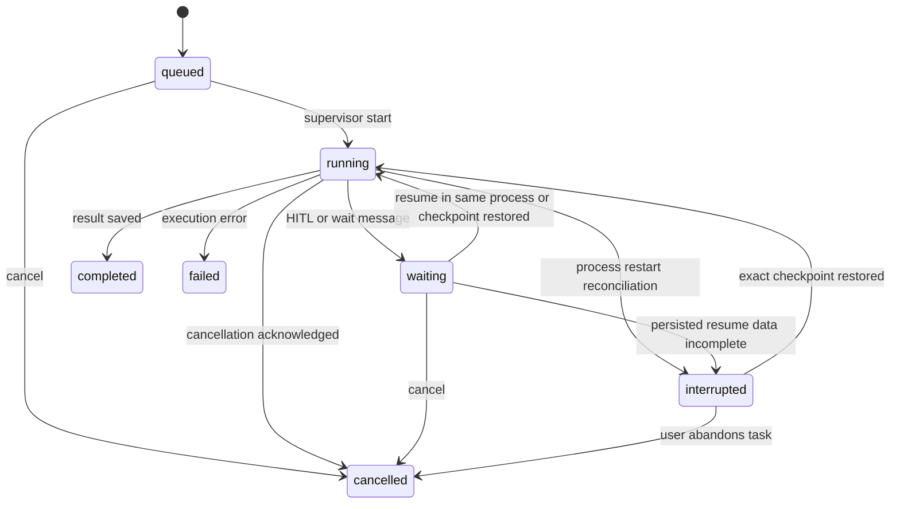

# Subagent 持久任务运行时重设计

> 历史说明：本文记录 M3 单进程持久 task MVP 的设计和已实施行为，不再作为后续事件/投影架构的目标文档。固定 Block Frame、DisplaySnapshot V4、Block module registry 和 seq/replay 协议以 `docs/event-stream-architecture-redesign.md` 为准；Subagent Domain Event、`kind=subagent` Block 和父结果消费以 `docs/subagent-runtime-event-redesign.md` 为准。
> 状态：M3 单进程前台持久任务闭环已实施；detached background、消息与跨进程 exact resume 推迟。
> 适用范围：M2 稳定性修复与 M3 单进程持久任务 MVP。
> 核心结论：保留 ReAct 内部 `DelegateTask` 和现有事件链路，在源代码上分层升级；不重写 Chat Runtime，不恢复 `runtime.kind=subagent`，也不为当前单用户桌面应用预建分布式调度系统。

## 1. 为什么要升级

当前 Subagent 已有文件定义、独立上下文、权限裁剪、前台委托、HITL 和轻量前端展示，但运行实例仍接近一次 blocking 函数调用：

- invocation 有审计 ID，但不是可长期控制的任务实体。
- 完整 transcript 没有独立持久化，无法按 invocation 查询和恢复。
- 父子续接依赖进程内 live Agent 对象，后端重启后链路丢失。
- invocation 查询、取消、transcript 和独立前端状态需要形成一个稳定闭环。
- 异常路径可能击穿父 Run，或让 invocation 永久停在 `running`。

目标仍然是把 Subagent 升级为：

> 有稳定身份、有 transcript、有明确生命周期、可通信、可取消，并能够根据 AgentScope 实际能力提供分级恢复的任务实体。

这项升级解决的是运行实例问题，不是继续扩充 frontmatter。

## 2. V2 决策

### 2.1 保留

- Markdown + YAML frontmatter 定义和现有 Registry。
- `DelegateTask` 作为主 Agent 的委托门面。
- 父 Agent 权限、Project ToolScope 和 filesystem scope 是能力上限。
- `RUNTIME_EVENT(scope=subagent)`、现有 `run_events`、EventHub、RunState 和 DisplaySnapshot 链路。
- 前台 Subagent 继续关联 `DelegateTask` 工具项。
- Subagent invocation 使用 `invocationId` 作为前端身份，并使用独立任务控制台组件；detached background 不属于当前在线能力。
- Team 与 Subagent 都进入统一 `RUNTIME_EVENT` / `DisplaySnapshot V4`，但分别使用独立 kind projector 和 Block 子树，不共享领域 reducer。

### 2.2 删除或推迟

当前版本不设计和实施：

- 多 Worker claim、lease、heartbeat 和分布式锁。
- 独立 `subagent_events`、outbox、attempt 表。
- 全局/Workspace/Session 多层公平调度器。
- 自动副作用 reconciliation 和 exactly-once 模型。
- 任意嵌套、worktree/Docker isolation、fork 会话。
- `memory` scope、`effort`、`@-mention` 等 Claude Code 特性对齐。
- 后台任务完成后自动复活已经结束的父 Chat Run。

这些能力只有满足第 20 节的触发条件后才重新设计，不属于当前待实施范围。

### 2.3 关键取舍

- 当前是单用户桌面应用，运行时使用一个 Python 后端进程和一个进程内 Supervisor。
- SQLite 保存任务和 transcript；`asyncio.Task` 只保存当前进程的执行句柄，不是事实源。
- 进程重启后，遗留 `running` task 先标记为 `interrupted`。
- 是否能把 `interrupted` 精确恢复，必须由 AgentScope checkpoint spike 决定。
- spike 未通过前，系统只能提供“历史可见 + 明确中断 + 用户确认后重新执行”，不能声称原地恢复。

## 3. 外部能力对标

只比较可观察能力，不推断外部产品未公开的内部实现：

| 参考系 | 值得借鉴的能力 | 当前差距 | 本版本处理 |
| --- | --- | --- | --- |
| Claude Code Subagents | 文件定义、独立上下文、工具裁剪、前后台、按身份通信/恢复 | 已有定义、前台委托、transcript 和身份控制面；缺 detached background、消息和 exact resume | 保留 blocking 消费链路，先完成持久 invocation、transcript、get/cancel 和任务控制台 |
| 当前 Codex 协作语义 | canonical task identity、父子任务、message、wait、interrupt、status | 已有持久 identity、状态、transcript 和取消；缺运行中消息与跨进程恢复 | 当前以 `invocationId` 提供 get/cancel，后续再设计 message/restart |
| Durable task 基本模式 | 状态持久化、进程句柄可丢弃、启动期 reconciliation | live Agent 与恢复上下文仍在内存 | SQLite 做事实源，Supervisor 只管理当前进程 |

Claude Code/Codex 的私有调度和持久化机制不作为设计前提。对齐的是用户可理解的任务语义，不是功能数量。

## 4. 实施顺序

必须按以下顺序推进：

1. M2.1：先修复现有前台链路的四个确定性问题。
2. Phase 0：验证 child 和 parent AgentScope checkpoint。
3. M3.1：引入稳定 task identity、简化状态机和持久 transcript，行为仍以前台为主。
4. M3.2：增加单进程后台执行、查询、取消、消息和独立前端组件。
5. M3.3：根据 spike 结果实现精确 resume、transcript replay 或显式重新执行。

任何 Chat SSE、Runtime Event、RunState 或 DisplaySnapshot 字段变更前，必须先更新 `docs/chat-sse-event-contract.md`。

## 5. M2.1：立即修复

这四项不依赖 checkpoint，也不等待持久任务 MVP：

### 5.1 错误隔离

- `SubagentRunError` 必须先将 invocation 收口为 `failed`。
- 外部 `DelegateTask` 返回 `ToolResultState.ERROR` 和结构化 error observation。
- 父 Agent 拿到错误 observation 后可以降级、修改任务或继续最终回答。
- 只有 task service、AgentScope continuation 或数据库等基础设施级错误才允许失败父 Run。

建议 observation 至少包含：

```json
{
  "ok": false,
  "invocationId": "subagent-...",
  "subagentName": "explorer",
  "failureCode": "subagent_run_failed",
  "error": "面向父 Agent 的短错误",
  "partialResult": "可用的部分结果"
}
```

### 5.2 `model: inherit`

- 继承父 Agent 本轮已经解析完成的实际 adapter、model、base URL 标识、fallback 和非敏感参数。
- 不重新读取全局默认模型来解释 inherit。
- 当前实现已复用父 Run 传入的 resolved model name 和 fallback 链；adapter/base URL 等运行时设置仍由同一轮已解析的应用配置构造，后续若支持 invocation 断点重启，必须把该模型 snapshot 持久化。
- API key 等 secret 不进入 invocation snapshot；运行时从当前 secret store 读取。

### 5.3 异常终态

- `SubagentManager` / 后续 adapter 顶层必须捕获预期错误、未预期异常和取消。
- invocation 最终必须进入 `waiting|completed|failed|cancelled` 之一。
- 如果进程直接退出、来不及写终态，由下次启动 reconciliation 标记为 `interrupted`。
- 禁止只记录日志并留下永久 `running`。

### 5.4 HITL 事件关联

- resume 后所有 child Runtime Event 必须补齐 `invocationId`、`toolCallId`、`subagentName`。
- 新事件增加 task 内单调 `seq` 后，projector 使用 `invocationId + seq` 幂等处理。
- 关联字段由统一 Event Bridge 补充，resume handler 不再逐个手工拼接。

## 6. Phase 0：Checkpoint Spike

在承诺跨重启 resume 前，先验证两个 checkpoint：

1. child Agent 在 `REQUIRE_USER_CONFIRM` / `REQUIRE_EXTERNAL_EXECUTION` 暂停后，能否序列化、退出进程、重建并接收 `ExternalExecutionResultEvent`。
2. parent Agent 在 external `DelegateTask` wait 点，能否序列化、退出进程、重建并接收 child observation。

验证用例：

- 普通多轮上下文。
- 单个和同轮多个 tool call。
- permission confirmation。
- external execution。
- 模型 fallback。
- 定义文件修改或删除。
- checkpoint schema/version 不兼容。
- 进程强制退出。

### 6.1 Spike 结果分支

| 结果 | 产品语义 | M3.3 行为 |
| --- | --- | --- |
| child 和 parent 都可恢复 | 精确 resume | 恢复原 task 和原父 Run |
| child 可恢复，parent 不可恢复 | child 可继续，父链路不能原地续接 | child 完成后保存结果；用户新一轮显式继续 |
| AgentState 不可安全恢复，但 transcript 可重建 | 语义 replay | 只读 task 可由用户确认 replay；明确标注不是精确续跑 |
| transcript 也不足以安全重建 | 只能重新执行 | 原 task 保持 interrupted，新建 invocation |

无论 spike 结果如何，task identity、transcript、后台状态、取消和前端刷新恢复仍有独立价值。

### 6.2 已验证结论（AgentScope 2.0.3）

- `Agent` 没有公开的 checkpoint / restore API；`AgentState` 是唯一可序列化的运行状态载体。
- `AgentState.model_dump_json()` 后，以相同系统提示词、模型、Toolkit、Middleware、权限和 Workspace 重建 `Agent`，再用 `AgentState.model_validate_json()` 注入状态，child 的 `ASKING` 和 parent `DelegateTask` 的 `SUBMITTED` 都能接收原 `replyId` 的恢复事件并继续 ReAct。
- 该结论由 `backend/test/test_subagent_checkpoint_spike.py` 固化：覆盖 `UserConfirmResultEvent` 与 `ExternalExecutionResultEvent`，不依赖真实模型或网络。
- 因此 M3.3 可提供 `exact_checkpoint`，但只在 runtime snapshot、AgentState schema 版本、definition/tool/Middleware/模型配置 fingerprint 都匹配时开放；不匹配时降为 `restart_only`，绝不能把 JSON state 当作跨版本通用恢复格式。
- 当前生产代码尚未持久化这些 snapshot，重启后的 waiting 仍不能恢复；本结论不改变当前运行时行为。
- 启动期已将遗留 `running` invocation 标记为 `interrupted`；`waiting` 保持可见，当前标记为需要显式 restart，不能伪装成 exact resume。

## 7. 简化领域模型

### 7.1 实体

| 实体 | 身份 | 说明 |
| --- | --- | --- |
| `SubagentDefinition` | `scope + name + contentHash` | 现有 Markdown 定义 |
| `SubagentTask` | `invocationId` | 一次持久委托 |
| `TranscriptItem` | `invocationId + seq` | 子 Agent 的规范化有序过程 |
| `SubagentMessage` | `messageId` | M3.2 增加的入站消息 |

### 7.2 身份规则

- 所有查询、消息、取消和恢复以 `invocationId` 定位。
- `toolCallId` 只负责把前台 task 关联到 `DelegateTask` UI，不是任务身份。
- `subagentName` 只用于定义选择和展示，不能用于消息投递或 resume。
- task 创建时保存定义、模型、权限和工具摘要；定义文件后续变化不篡改历史。
- task 保留创建时的 Workspace、Project、Session 和 Run 归属。

## 8. 简化状态机

### 8.1 状态

```text
queued       已持久化，等待进程内 Supervisor 启动
running      当前进程内正在执行
waiting      等待 permission、external result、用户信息或消息
completed    成功终态
failed       失败终态
cancelled    取消终态
interrupted  后端退出后的恢复决策态；是否可继续由 checkpoint 能力决定
```

`waiting_reason` 区分：

- `permission_required`
- `external_execution_required`
- `user_input_required`
- `message_required`

前端额外显示的 `cancelling` 是 `status=running + cancel_requested_at != null` 的 ViewModel，不增加数据库状态。

### 8.2 合法迁移



`completed|failed|cancelled` 是不可逆终态。`interrupted` 只有在 exact checkpoint
验证通过时才能恢复同一 invocation；transcript replay 或从头重新执行必须创建新
invocation，并保存 `continuedFromInvocationId`。

## 9. 后端模块

不创建完整 scheduler/worker 基础设施，先拆成四个职责：

```text
backend/src/subagents/
  task_models.py          # 状态、DTO、命令和结构化结果
  task_service.py         # create/get/cancel/message/resume/restart
  supervisor.py           # 当前进程 asyncio.Task 注册表和并发上限
  agentscope_adapter.py   # 现有 runner 的 AgentScope 边界
```

现有模块渐进调整：

- `manager.py`：迁移期兼容 facade，`DelegateTask` 只调用 `SubagentTaskService`。
- `runner.py`：执行逻辑逐步迁入 `AgentScopeAdapter`，不再负责数据库状态。
- `database.py`：继续提供同步 SQLite API；后续代码量增大时再抽 `subagents/repository.py`。
- `event_hub/projector.py`：保留唯一前端投影入口。

### 9.1 `SubagentTaskService`

负责：

- 创建 invocation 和输入快照。
- 合法状态迁移。
- 查询 task/transcript/message。
- 请求取消。
- 接收 resume 外部结果。
- 生成 failed/cancelled/completed observation。

Worker 写 transcript、waiting 或终态时必须携带启动它的 `process_instance_id`，SQL 更新
条件同时校验 task 仍属于该实例且处于 active 状态。开发热重载或桌面后端重启发生
短暂进程重叠时，新进程完成 reconciliation 后，旧进程迟到写入必须成为 no-op。

它不持有 live Agent，也不直接渲染前端组件。

### 9.2 `SubagentSupervisor`

使用：

- `dict[invocationId, asyncio.Task]` 保存当前执行句柄。
- 一个 `asyncio.Lock` 保护注册、取消和完成竞态。
- 一个 `asyncio.Semaphore` 限制后台并发，首期使用单一全局上限。
- task done callback 清理注册表，但业务终态必须由 TaskService 先持久化。

Supervisor 重启后为空，这是预期行为；SQLite task 表才是事实源。

## 10. SQLite 设计

### 10.1 扩展 `subagent_invocations`

复用当前表，只增加 M3 真正需要的字段：

| 字段 | 说明 |
| --- | --- |
| `mode` | `foreground|background` |
| `input_payload` | 自包含委托输入 JSON |
| `definition_hash` | 创建时定义 hash |
| `definition_snapshot` | 已脱敏定义摘要 |
| `model_snapshot` | 父本轮实际模型摘要，不含 secret |
| `permission_snapshot` | 最终有效权限摘要 |
| `tool_snapshot` | 最终工具名与裁剪摘要 |
| `parent_reply_id` | 前台父 Agent reply 关联 |
| `process_instance_id` | 启动 task 的后端实例 |
| `waiting_reason` | waiting 子类型 |
| `active_interaction_id` | 当前 HITL interaction |
| `event_seq` | 最后 Subagent Runtime Event seq |
| `transcript_seq` | 最后 transcript item seq |
| `message_seq` | 最后 message seq；仅 M3.2 启用消息时使用 |
| `checkpoint_kind` | `none|exact|transcript_replay` |
| `checkpoint_payload` | spike 通过后启用的脱敏数据 |
| `cancel_requested_at` | 取消请求时间 |
| `failure_code` | 稳定错误分类 |
| `result_text` | 完整结果；超过上限转 Artifact |
| `continued_from_invocation_id` | 重新执行来源 |

不增加 version、lease、heartbeat、attempt、nextAttemptAt 和 delivery 状态机。单进程竞态通过 TaskService lock 与 SQLite transaction 处理。

Task API 额外计算 `resumeCapability`，不要求单独落列：

- `same_process`：当前进程仍持有 live Agent，可以沿现有链路恢复。
- `exact_checkpoint`：interaction metadata 与 Agent checkpoint 均完整，可跨进程恢复。
- `restart_only`：只保留历史和任务输入，必须创建新 invocation。
- `unavailable`：数据不完整或副作用状态不确定，禁止显示 resume/restart 快捷操作。

### 10.2 新增 `subagent_transcript_items`

```sql
CREATE TABLE subagent_transcript_items (
  id TEXT PRIMARY KEY,
  invocation_id TEXT NOT NULL,
  seq INTEGER NOT NULL,
  type TEXT NOT NULL,
  role TEXT NOT NULL DEFAULT '',
  correlation_id TEXT NOT NULL DEFAULT '',
  payload TEXT NOT NULL DEFAULT '{}',
  payload_preview TEXT NOT NULL DEFAULT '',
  payload_size INTEGER NOT NULL DEFAULT 0,
  created_at TEXT NOT NULL,
  FOREIGN KEY(invocation_id)
    REFERENCES subagent_invocations(id) ON DELETE CASCADE,
  UNIQUE(invocation_id, seq)
);
```

`type` 首期覆盖：

- `system_context`
- `user_task`
- `model_message`
- `tool_call`
- `tool_result`
- `external_result`
- `message_injected`
- `result`
- `error`

大工具输出只保存 preview、大小和 Trace/Artifact 引用。

### 10.3 M3.2 可选 `subagent_messages`

只有真正开放运行中消息后才建表：

```sql
CREATE TABLE subagent_messages (
  id TEXT PRIMARY KEY,
  invocation_id TEXT NOT NULL,
  seq INTEGER NOT NULL,
  sender_type TEXT NOT NULL,
  sender_id TEXT NOT NULL DEFAULT '',
  content TEXT NOT NULL,
  client_request_id TEXT NOT NULL DEFAULT '',
  created_at TEXT NOT NULL,
  read_at TEXT,
  FOREIGN KEY(invocation_id)
    REFERENCES subagent_invocations(id) ON DELETE CASCADE,
  UNIQUE(invocation_id, seq),
  UNIQUE(invocation_id, client_request_id)
);
```

不为了未来 Mailbox 预建更多 receipt/acted/recipient 表。首期 Subagent 只有一个收件人，就是该 invocation。

## 11. Transcript 规则

- transcript 独立于主 Chat 历史；主会话压缩不删除活跃 Subagent transcript。
- transcript append 和 task transcript seq 更新在同一个 SQLite transaction。
- 所有 payload 先经过统一 redactor，禁止保存 API key、Authorization header 和完整 secret 环境变量。
- 定义、输入、模型、权限和工具 snapshot 只保存恢复与审计需要的最小字段。
- transcript API 使用 `afterSeq + limit` 分页，不进入 DisplaySnapshot 常驻状态。
- 终态 task 可按 Workspace retention policy 清理大 payload，但保留身份、状态、结果摘要和 failure code。

## 12. 前台与后台

### 12.1 前台

1. `DelegateTask` 创建 `mode=foreground` task。
2. TaskService 持久化后交给 Supervisor。
3. 父 Agent 等待 child observation。
4. child 完成、失败或取消后返回结构化 observation。
5. child HITL 时，父 Run 继续使用现有 waiting/resume 链。

checkpoint spike 未完成前，后端重启会把前台 child 标记 `interrupted`，父 Run 按当前不可恢复策略收口，不能展示“可恢复”按钮。

### 12.2 后台（推迟）

当前不开放 detached background。`DelegateTask` 必须等待并消费 child observation；`background=true` 只作为旧输入的稳定拒绝分支，不创建 task。未来若实现 attached/background queue，必须先定义父 Agent 的 join、结果消费、取消和父 Run 结束语义，再复用本节的 Supervisor 设计。

## 13. 消息、等待与取消

### 13.1 消息

- API 使用 `invocationId + clientRequestId` 投递，保证请求重试不重复写入。
- running task 在模型轮次边界、工具完成后和提交结果前读取未读消息。
- 消息作为 `message_injected` transcript item 进入 Agent 上下文。
- waiting/message task 收到消息后可恢复为 running。
- permission/external execution 等待不能用普通消息绕过，仍走 interaction resume。
- 终态 task 不接受消息；继续讨论创建新 invocation。

### 13.2 Wait

- Agent 工具 `SubagentTaskWait` 只提供有界等待。
- 等待实现使用 Supervisor notification 或短轮询状态，不持有 SQLite 锁。
- HTTP 不提供无限阻塞请求；前端使用 task stream 或定期状态查询。

### 13.3 Cancel

- queued task 直接 cancelled。
- running task 写入 `cancel_requested_at`，再调用当前进程的 `asyncio.Task.cancel()`。
- UI 在确认终态前显示 cancelling。
- cancel API 幂等；终态 task 返回现状。
- 如果进程在取消收口前退出，下次启动标记 interrupted，而不是伪造 cancelled。

## 14. 启动期 Reconciliation

Electron 每次启动 Python 后端生成新的 `process_instance_id`。
开发环境没有 Electron instance id 时，后端进程启动时生成一次 UUID，进程内保持不变。

启动时执行一次：

1. 查询 `status=running` 且 `process_instance_id != current` 的 task。
2. 将其更新为 `interrupted`，写入 `failure_code=backend_restarted`。
3. 通过现有 Runtime Event / RunState 投影恢复可见状态。
4. waiting task 不参与 running reconciliation，也不能因为没有活跃 `asyncio.Task` 就自动降级。
5. 对 waiting task 校验持久 interaction metadata、待恢复 tool calls 和 checkpoint：数据足以重建时保持 waiting，并设置 `resumeCapability=exact_checkpoint`；只能重新执行时保持历史 waiting 展示，但设置 `resumeCapability=restart_only`；数据不完整或副作用不确定时才转 interrupted。
6. 当前 blocking 链路不在重启后自动重调度 queued task；未来如开放持久队列，必须先完成副作用与父 Agent join 语义。

当前 `_create_pending_interaction()` 只把可审计 HITL payload 写入 `run_events`，live
`PendingInteraction` 与 Agent 仍在进程内。M3 必须先把恢复需要的 interaction metadata
和 checkpoint 变成可重建数据，不能把“存在 HITL 事件”直接等同于“可以 resume”。

不运行周期 heartbeat，不扫描 lease。当前单进程模型下，进程实例边界足以识别遗留执行。
所有 active 写入继续使用 `process_instance_id` 作为 fencing token，避免旧进程把
`interrupted` task 重新写成 completed/running。

## 15. Runtime Event 与前端映射

### 15.1 固定链路

```text
TaskService 持久化状态
  -> RUNTIME_EVENT(scope=subagent)
  -> 现有 run_events / EventHub
  -> Subagent projector
  -> DisplayEvent / DisplaySnapshot
  -> frontend reducer / Subagent components
```

数据库写入是事实源。若进程在写库后、发送实时事件前退出，刷新时从 task 表重建状态；M3 不增加 outbox。

### 15.2 事件最小集合

保留当前稳定事件：

- `SUBAGENT_STARTED`
- `SUBAGENT_CONTEXT`
- `SUBAGENT_WAITING_HUMAN`
- `SUBAGENT_COMPLETED`
- `SUBAGENT_FAILED`

M3 候选新增：

- `SUBAGENT_QUEUED`
- `SUBAGENT_CANCELLED`
- `SUBAGENT_INTERRUPTED`
- `SUBAGENT_MESSAGE_RECEIVED`，仅 M3.2 开放消息时增加

不为内部每个状态创建事件。模型调用和工具过程继续复用现有 `AGENT_*` / `TOOL_*`，由公共 payload 关联 Subagent。

所有 Subagent Runtime Event payload 至少包含：

```ts
interface SubagentRuntimePayload {
  invocationId: string;
  seq: number;
  mode: 'foreground' | 'background';
  subagentName: string;
  toolCallId?: string;
  status:
    | 'queued'
    | 'running'
    | 'waiting'
    | 'completed'
    | 'failed'
    | 'cancelled'
    | 'interrupted';
}
```

这是候选字段，不是当前稳定契约。实现前必须先更新 `docs/chat-sse-event-contract.md`。

Subagent domain status 放在 payload 中，外层 `RUNTIME_EVENT.status` 继续使用稳定枚举：

| domain status | 外层 status |
| --- | --- |
| `queued` | `pending` |
| `running` | `running` |
| `waiting` | 按原因映射为 `waiting_user|waiting_permission|waiting_external` |
| `completed` | `completed` |
| `failed` | `failed` |
| `cancelled` | `cancelled` |
| `interrupted` | `pending`，payload reason 为 `backend_restarted` |

这些状态只描述 Subagent，不得把已结束的父 Chat Run 改回 running 或 waiting。
`pending` 只是稳定 Runtime Event 外层枚举的传输映射，Subagent projector 必须优先读取
payload domain status：`SUBAGENT_QUEUED + pending` 投影为 queued，
`SUBAGENT_INTERRUPTED + pending` 投影为 interrupted。前端不得只根据外层 status 推断
Subagent ViewModel。

### 15.3 Projector 规则

- 以 `invocationId` 定位 task。
- 保存 `lastSeq`，忽略 `seq <= lastSeq`。
- 不用 timestamp 排序。
- `completed|failed|cancelled` 不可被迟到的 running event 覆盖；`interrupted` 只有明确的 exact resume 事件才能恢复。
- queued 与 interrupted 即使外层 status 都是 pending，也必须投影为不同状态、文案和 allowed actions。
- 实时事件、刷新快照和历史 replay 使用同一个 reducer。
- 迁移期继续使用当前 `toolCallId`，不提前替换成新别名。

## 16. 前端组件

保留一个 ViewModel、两种呈现：

```text
frontend/src/features/chat/subagents/
  SubagentTaskView.tsx
  SubagentInlineView.tsx
  SubagentTaskList.tsx
  SubagentDetailDrawer.tsx
  SubagentStatus.tsx
  SubagentActions.tsx
  subagentDisplayTypes.ts
  subagentViewUtils.ts
```

### 16.1 ViewModel

```ts
interface SubagentDisplayTask {
  invocationId: string;
  toolCallId?: string;
  name: string;
  mode: 'foreground' | 'background';
  status:
    | 'queued'
    | 'running'
    | 'waiting'
    | 'cancelling'
    | 'completed'
    | 'failed'
    | 'cancelled'
    | 'interrupted';
  taskPreview: string;
  currentStep: string;
  resultPreview: string;
  error: string;
  lastSeq: number;
  unreadMessages: number;
  startedAt?: string;
  completedAt?: string;
}
```

### 16.2 前台投影

- 继续放在 `DelegateTask` process item 内。
- `SubagentInlineView` 替代 `ProcessTimeline.tsx` 内持续增长的专用 JSX。
- 点击打开共用 `SubagentDetailDrawer`。

### 16.3 任务控制台投影

- 以 `invocationId` 放入独立 Subagent task list。
- 不放入 TeamSnapshot，不新增 Subagent DisplayActor。
- 页面刷新与状态更新使用 Project 级 task API；active task 静默轮询，终态保留可查询。
- 当前不在 DisplaySnapshot v3 增加 `subagents` block，也不向已关闭 RunState stream 发送 patch。

### 16.4 Detail Drawer

按需读取：

- task 身份、归属、状态和时间。
- transcript 分页。
- 模型、权限和工具摘要。
- 消息记录。
- allowed actions：cancel、resume、restart。

完整 transcript 不进入 RunState 或 assistant message。

## 17. API 与 Agent 工具

### 17.1 HTTP API 候选

```text
GET  /api/subagents/tasks?projectId=&sessionId=&status=
GET  /api/subagents/tasks/{invocationId}
GET  /api/subagents/tasks/{invocationId}/transcript?afterSeq=&limit=
POST /api/subagents/tasks/{invocationId}/cancel
POST /api/subagents/tasks/{invocationId}/resume
POST /api/subagents/tasks/{invocationId}/restart
POST /api/subagents/tasks/{invocationId}/messages
```

- restart 创建新 invocation，返回 `continuedFromInvocationId`。
- messages API 只在 M3.2 启用。
- 所有接口按 Workspace/Project 校验，不只验证 UUID。
- mutation 支持 `clientRequestId` 幂等。

### 17.2 Agent 工具候选

- `SubagentTaskGet`
- `SubagentTaskWait`
- `SubagentSendMessage`
- `SubagentTaskCancel`

这些 Agent 工具尚未注入；当前只有 blocking `DelegateTask`，控制台通过 HTTP get/cancel 操作 TaskService。

## 18. 错误与副作用

### 18.1 错误分类

| failureCode | 行为 |
| --- | --- |
| `invalid_input` | failed，返回 error observation |
| `model_error` | failed；父 Agent 可重新委托 |
| `tool_denied` | waiting 或 failed |
| `checkpoint_unavailable` | interrupted |
| `backend_restarted` | interrupted |
| `cancelled` | cancelled |
| `internal_error` | failed，Trace 保留技术细节 |

### 18.2 副作用边界

- M3 不自动 replay Write/Edit/Bash mutation、HTTP mutation 或 MCP action。
- exact checkpoint 验证通过时，interrupted task 可恢复同一 invocation。
- checkpoint 不可用、需要 transcript replay 或副作用状态不确定时，只能由用户确认 restart 并创建新 invocation。
- read-only transcript replay 也必须在 spike 之后单独开放。
- 外部动作是否已经发生但未记录时，UI 必须显示状态不确定，不能假定未执行。

## 19. 测试与验收

### 19.1 M2.1

- Subagent 失败返回 error observation，父 Run 可继续完成。
- `model: inherit` 与父本轮实际模型配置一致。
- 任意异常和取消都不会留下永久 running。
- HITL resume 后事件关联字段完整。

### 19.2 Task 与 transcript

- task 创建、状态迁移和终态不可回退。
- transcript seq 唯一、分页和大结果 preview。
- Workspace/Project 越权查询拒绝。
- 定义文件修改不改变历史 snapshot。

### 19.3 Supervisor

- 并发上限生效。
- cancel/complete 竞态只产生一个终态。
- 新旧进程短暂重叠时，旧 `process_instance_id` 的终态和 transcript 写入被拒绝。
- done callback 不删除持久 task。
- queued task 重启后可重新调度。
- running task 重启后变为 interrupted。

### 19.4 前端事件

- 重复和迟到 seq 被忽略。
- `SUBAGENT_QUEUED` 与 `SUBAGENT_INTERRUPTED` 的外层 status 都为 pending 时，ViewModel 仍分别得到 queued 与 interrupted。
- 前台 task 更新正确的 `DelegateTask` item。
- 任务控制台按 `invocationId` 更新正确的 task item。
- 实时、刷新和 replay 得到相同 ViewModel。
- transcript 只在 Drawer 按需加载。
- Team 事件不进入 Subagent reducer。

### 19.5 M3 验收

- 每个 Subagent 可通过 `invocationId` 查询身份、状态、结果和 transcript。
- 前台失败不无条件击穿父 Run。
- 父 Agent 在 child 完成、失败或 HITL 后消费 observation，再继续执行。
- 页面刷新后 task 身份、状态、结果和 transcript 仍可见。
- 用户可以取消 task；消息能力启用后可按 ID 投递消息。
- 后端重启后不残留伪 running；恢复能力与 spike 结论一致。
- Chat 内联视图与任务控制台复用同一 invocation 身份和状态语义。

## 20. 高级架构触发条件

只有出现以下任一事实，才重新评估 lease、heartbeat、outbox 和多 Worker Scheduler：

- 后端改为多进程或多个独立 Worker。
- task 需要在 Electron/Python 主进程退出后由独立 daemon 继续。
- 引入云端/offload 执行，同一 SQLite task 可能被多个执行器竞争。
- 需要自动恢复带外部副作用的长任务。
- 实际并发量和队列规模证明单一 Semaphore 不足。
- 事件发送失败已在生产中造成无法通过数据库重建的状态不一致。

届时把这些能力作为新的设计阶段，不在当前源码中预埋空抽象。

## 21. 最终实施清单

### M2.1

- [x] 错误隔离。
- [x] `model: inherit`。
- [x] 异常终态。
- [x] HITL 事件关联。

### Phase 0

- [x] child checkpoint spike。
- [x] parent continuation checkpoint spike。
- [x] 记录 exact resume / replay / restart 结论。

### M3.1

- [x] 扩展 `subagent_invocations`（Workspace / Project / executionMode / resumeCapability）。
- [x] 新增 `subagent_transcript_items`，并写入现有前台生命周期/关键过程事件。
- [x] 引入 TaskService 和简化状态机。
- [x] 前台 `DelegateTask` 改走 TaskService。

### M3.2

- [x] 引入单进程 Supervisor。
- [x] 支持 invocation get、cancel 和任务控制台查询；detached background 尚未开放，`wait` 由 blocking `DelegateTask` 内部承担。
- [ ] 需要时新增 messages 表和 SendMessage。
- [x] 更新稳定 SSE 契约。
- [x] 实现 Subagent 组件、projector 和刷新恢复。

### M3.3

- [ ] 按 spike 结论实现 exact resume、只读 replay 或显式 restart。
- [ ] 删除 `PENDING_SUBAGENT_PARENT_CONTEXTS` 的事实依赖；如果 exact parent resume 不成立，则删除时同步改为显式新 Run 续接。

这份 V2 设计的实施上限是“适合当前单进程桌面应用的持久 Subagent task”。它保留未来升级空间，但不要求当前项目先建设分布式任务平台。
